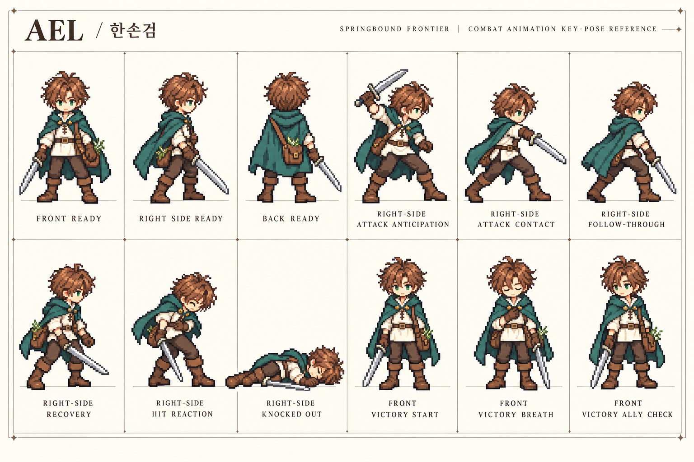
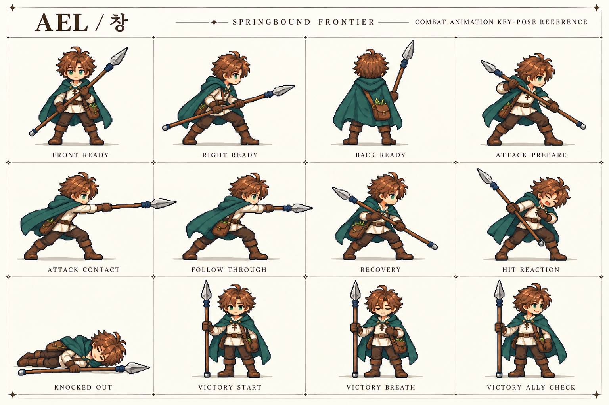
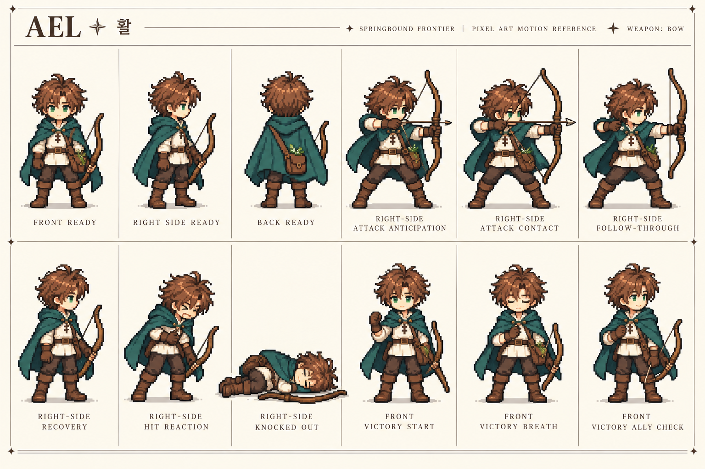
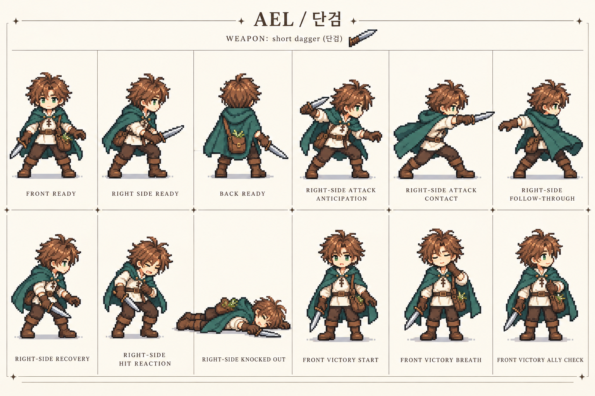
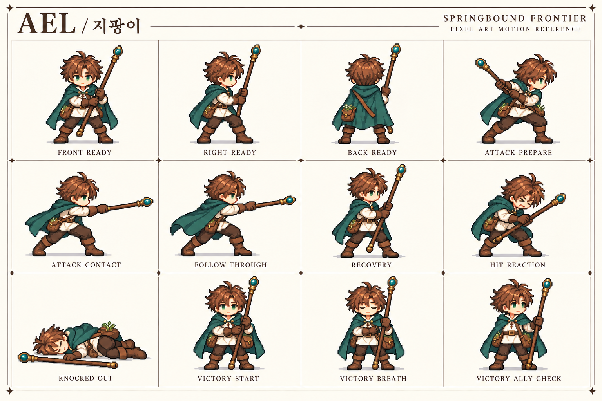
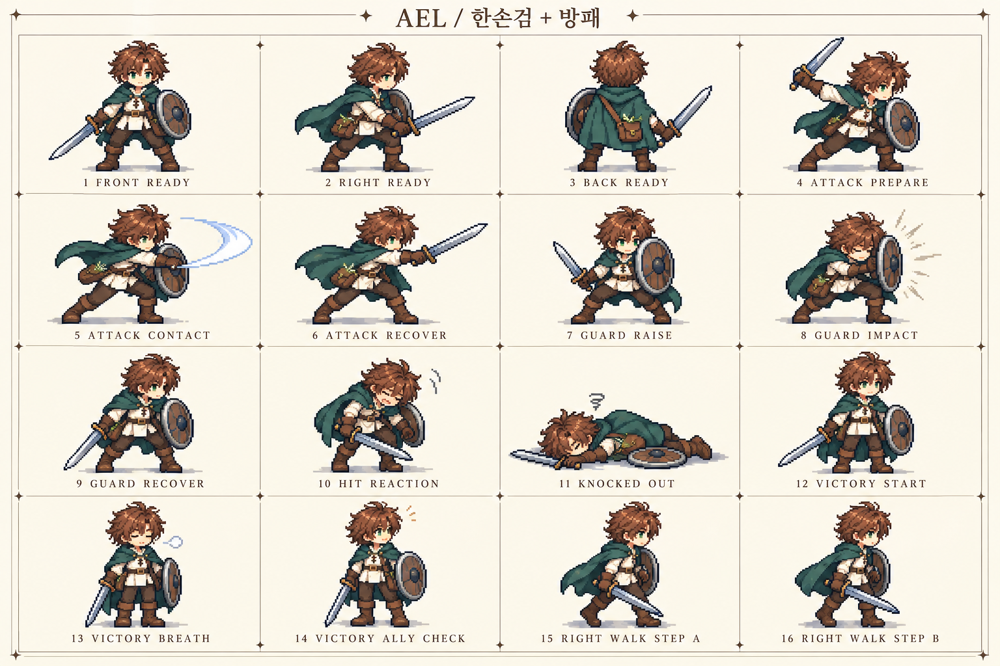
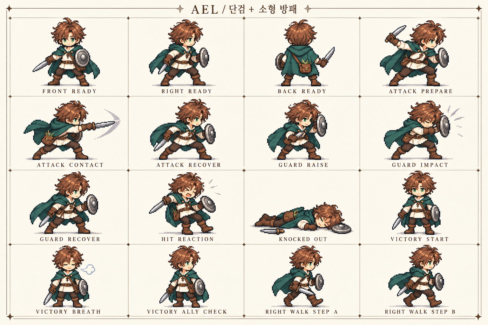

# 에일 무기별 전투·승리 키포즈

2026-10-29 · **시트 7장 / 기본 5장×12포즈 + 방패 조합 2장×16포즈 / 총 92개 포즈 배치**

[전투 장비·모션 제작 기획](combat-equipment-and-motion-spec.md) · [전체 에셋 가드레일](asset-planning-guardrails.md)

에일은 모든 무기를 사용할 수 있으므로 현재 5계열의 전투 자세·공격·피격·전투 불능·승리 포즈를 먼저 시각화했습니다. 기존 에일 보드를 정체성 참고로 사용했습니다.

이것은 **키포즈 참고 이미지**입니다. 개별 투명 스프라이트·같은 셀/발 원점으로 정렬된 아틀라스·모든 방향과 중간 프레임·타격 이벤트·재생 가능한 애니메이션은 후속 작업입니다. 시트 생성이 ‘전체 전투 모션 구현 완료’를 뜻하지 않습니다.

[HTML 목록](../assets/combat-motion-boards/ael/index.html) — 이미지와 함께 내려받아 브라우저에서 엽니다. [파일·프롬프트·검토 메모](../assets/combat-motion-boards/ael/manifest.json).

## 포즈 순서

읽는 순서: 앞 대기 → 오른쪽 대기 → 뒤 대기 → 공격 준비 → 타격 → 후속 자세 → 회수 → 피격 → 전투 불능 → 승리 시작 → 숨 고르기 → 동료 확인.

한손검·활·단검은 2행×6열, 창·지팡이는 긴 무기 여백을 위해 3행×4열로 배치했습니다. 각 시트는 균일 크기로 잘라 바로 재생할 수 있는 아틀라스가 아닙니다.

## 한손검

개별 투명 프레임·4방향 중간 프레임·발 원점·클립 타이밍 정리 필요

## 창

개별 투명 프레임·4방향 중간 프레임·발 원점·클립 타이밍 정리 필요 · 05 ATTACK CONTACT의 창끝이 옆 칸 영역과 겹쳐 있어 프레임 분리 전 여백 정리 필요

## 활

개별 투명 프레임·4방향 중간 프레임·발 원점·클립 타이밍 정리 필요

## 단검

개별 투명 프레임·4방향 중간 프레임·발 원점·클립 타이밍 정리 필요

## 지팡이

개별 투명 프레임·4방향 중간 프레임·발 원점·클립 타이밍 정리 필요 · 현재 시안은 전방 찌르기형 물리 타격. 가로 스윙 대안은 후속 검토

## 검토 결과와 남은 일

5장 모두 12개 포즈와 무기/승리 표현을 시각 확인했습니다. 창의 전방 타격 끝이 인접 칸과 겹치는 부분은 분리 프레임 제작 시 수정해야 합니다. 손 위치·셀 경계·발 원점·방향 일관성은 실제 애니메이션 전 정밀 검수가 필요합니다. 지팡이 현재 시안은 짧은 전방 물리 타격입니다.

프롤로그는 한손검만 실제 연결할 범위이며 창·활·단검·지팡이는 후속 제작을 위한 준비입니다. 다른 캐릭터의 키포즈·승리 모션은 이번에 만들지 않았습니다.

## 방패 조합 추가

[방패 장착·제작 규칙](shield-loadouts.md)에 따라 한손검+방패, 단검+소형 방패 각각 16포즈를 추가했습니다. 4행×4열이며 방어 3단계와 오른쪽 걷기 2포즈가 포함됩니다. 기존 12포즈 시트와 순서가 다르므로 manifest의 pose_order를 따릅니다.

