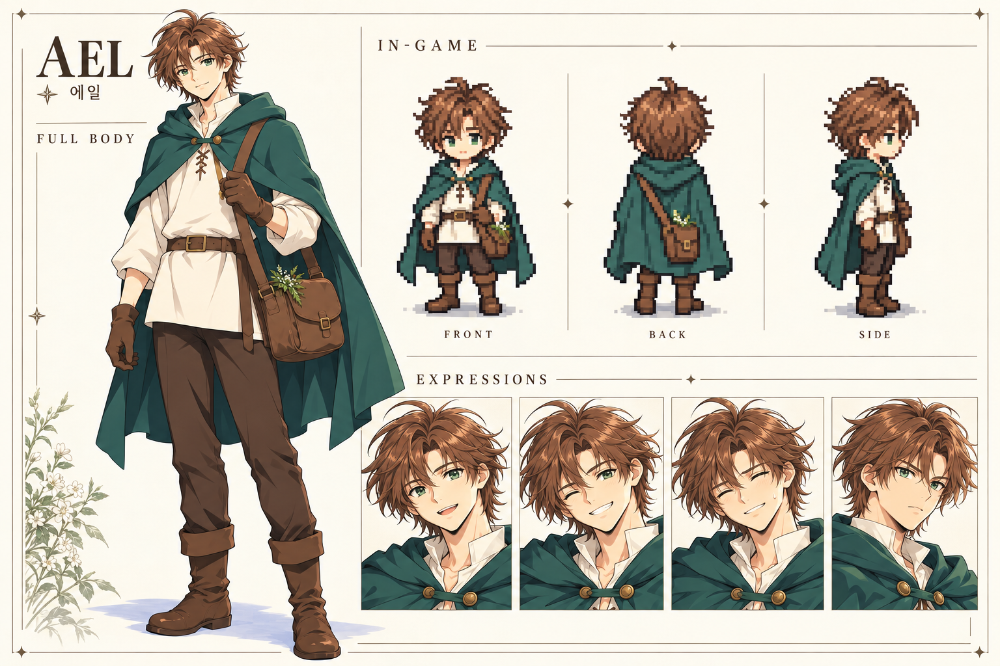
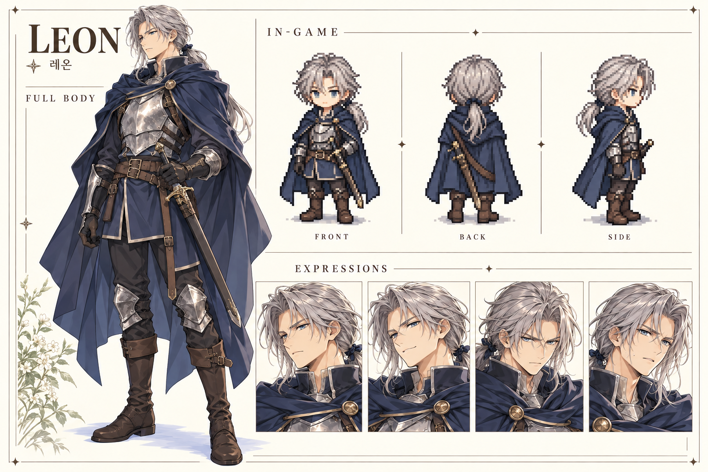
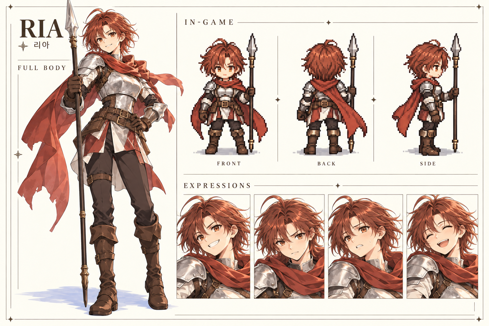
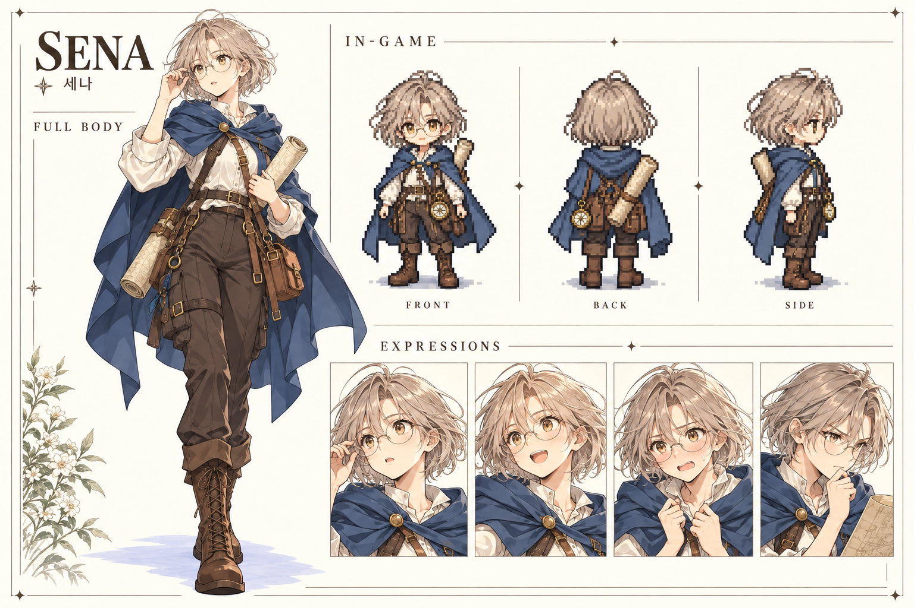
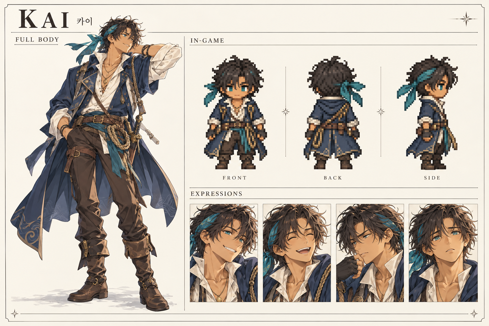
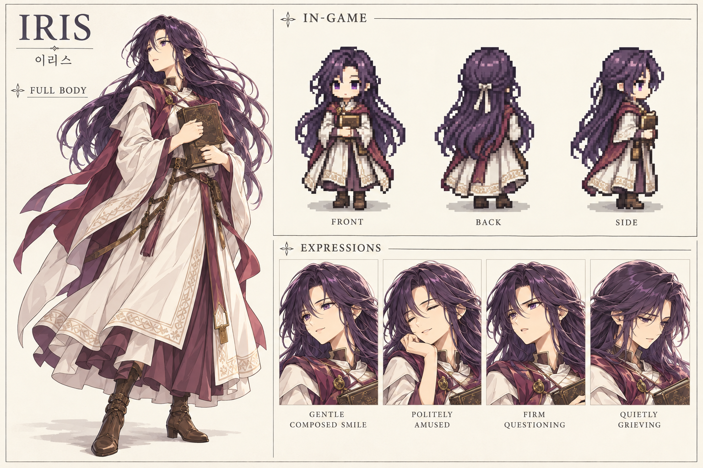
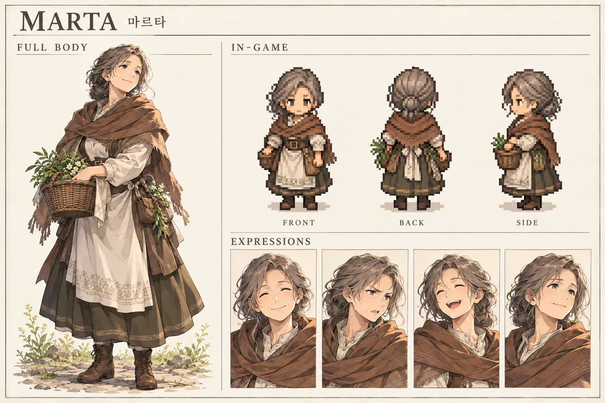

# 캐릭터 보드

[공통 NPC 14종 보드](generic-npc-boards.md) · [NPC 제작 목록](npc-registry.md)

[추가 조연 26명 보드](supporting-cast-boards.md)

내장 image_gen으로 생성한 시각 설정 보드입니다. 각 보드는 전신 컨셉 1개, 인게임 도트 앞·뒤·옆 3개, 표정 초상화 4개로 구성합니다. 도트는 제작 방향 시안이며 실제 48×64 스프라이트 파일이나 애니메이션 완성본은 아닙니다.

## 에일

## 레온

## 리아

## 세나

## 카이

## 이리스

## 마르타

