# 인간 적군 캐릭터 보드

2026-10-29 · 주요 적군 6명 + 일반 병종 8종 = **개별 보드 14장**. 몬스터는 이번 범위에서 제외합니다.

[HTML 갤러리](../assets/enemy-boards/index.html) · [파일·프롬프트·검토 메모](../assets/enemy-boards/manifest.json)

## 기획 및 제작 경계

사용자가 앞선 적군 제안의 보드 제작을 요청해 시각화한 초안입니다. 이름·소속·과거·등장 챕터와 수치는 최종 확정하지 않았으며 기존 설정과 연결 검토 후 확정합니다. 레온의 기존 역할은 유지합니다. 일반 병종 8종은 각각 한 가지 대표 외형이며 성별에 따른 장비 제한을 뜻하지 않습니다.

원정군은 버건디·강철, 왕국 감찰관은 크림·남색, 조사 책임자는 청록·차콜, 용병은 황토·갈색으로 구분하는 시각안입니다. 일반 병종을 다른 진영에 사용할 때는 문장·색 변형을 별도 검토합니다.

전신 1개, 앞/뒤/오른쪽 도트 시안 3개, 초상화 4칸으로 구성합니다. 보드는 불투명 참고 이미지이며 실제 48×64 프레임, 전체 4방향, 공격·방어·피격·승리 모션, 애니메이션·장비 데이터·AI 연결은 후속 작업입니다. 보드의 대기 그립이 양손 공격의 한손 사용 허용을 뜻하지 않습니다. 도끼·양손검 외형이 존재한다고 해당 무기 계열이나 전투 수치를 구현 완료로 간주하지 않습니다.

## 검토 메모

14장 모두 구성과 외형을 시각 확인했습니다. 궁병은 현재 전신/앞 도트의 활 손이 제작 기준과 달라 왼손 활·오른손 당김으로 정합화해야 합니다. 중장 기사의 초상화는 닫힌 투구와 고개 각도로 표현되어 얼굴 대사가 필요하면 별도 초상화를 제작해야 합니다. 표정 차이가 작은 칸, 손 위치, 장비 크기, 발 원점은 최종 프레임 제작 때 보정합니다.

## 목록

| 이름 | 분류/역할 | 무장 초안 | 시각 소속 초안 |
|---|---|---|---|
| 발테르 | 원정군 사령관 | 장검·방패 | 원정군 / 버건디·강철 |
| 카렌 | 추격 기사대장 | 창 | 원정군 / 버건디·강철 |
| 로에크 | 국경 요새장 | 한손검·대형 방패 | 원정군 / 버건디·강철 |
| 실베르 | 왕국 감찰관 | 세검 | 왕국 / 크림·남색 |
| 네리아 | 유적 조사 책임자 | 지팡이 | 유적 조사단 / 청록·차콜 |
| 에드란 | 독립 용병대장 | 양손검 | 독립 용병 / 황토·갈색 |
| 국경 검병 | 일반 병종 | 한손검·원형 방패 | 원정군 / 버건디·강철 |
| 국경 창병 | 일반 병종 | 양손 창 | 원정군 / 버건디·강철 |
| 군 궁병 | 일반 병종 | 활 | 원정군 / 버건디·갈색 |
| 중장 기사 | 일반 병종 | 한손검·큰 방패 | 원정군 / 버건디·강철 |
| 척후병 | 일반 병종 | 단검·버클러 | 원정군 / 버건디·갈색 |
| 군 마도병 | 일반 병종 | 지팡이 | 원정군 / 버건디·차콜 |
| 군 의무병 | 일반 병종 | 짧은 지팡이·회복 도구 | 원정군 / 버건디·크림 |
| 용병 도끼병 | 일반 병종 | 양손도끼 | 독립 용병 / 황토·갈색 |

## 발테르 — 원정군 사령관

침공을 지휘하며 민간인 보호도 중시하는 사령관.

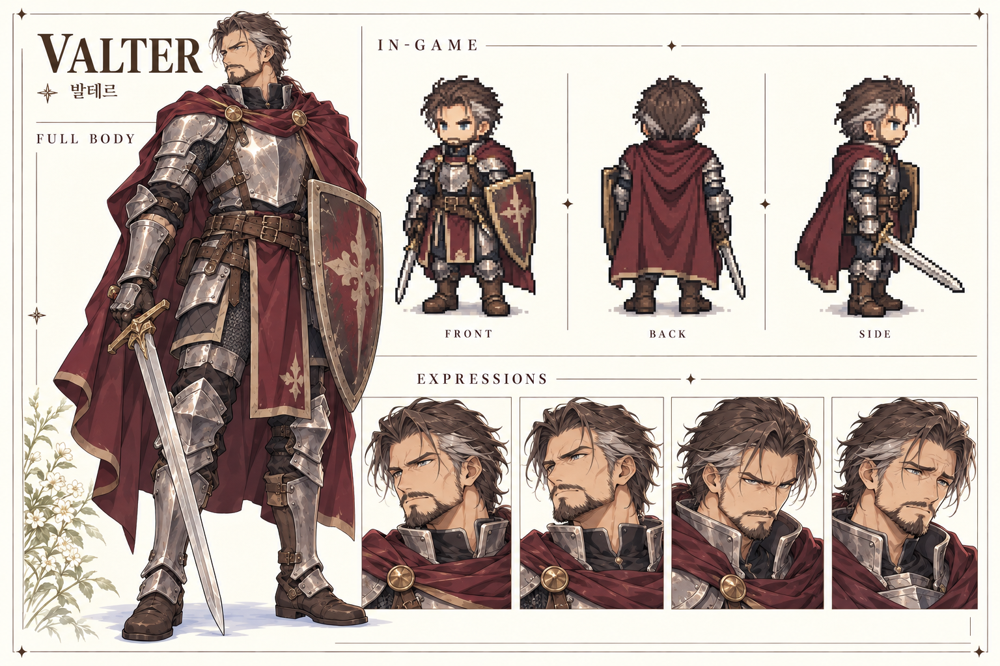

## 카렌 — 추격 기사대장

추격 임무 중 명령과 현장의 사실 사이에서 갈등.

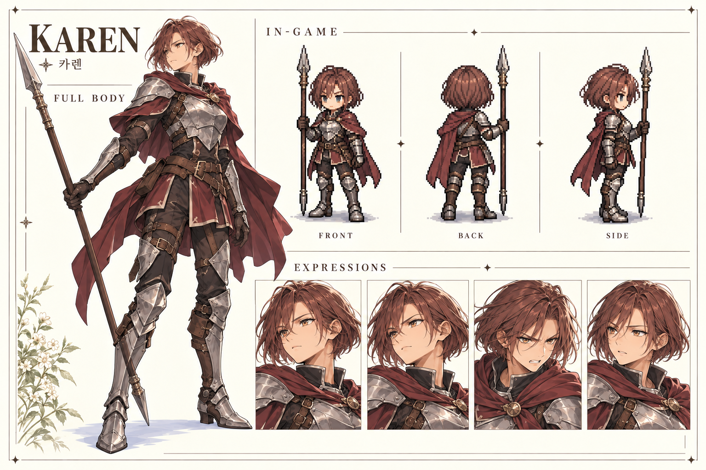

## 로에크 — 국경 요새장

보급로와 성문을 장악하며 협상·우회 가능성을 가진 상대.

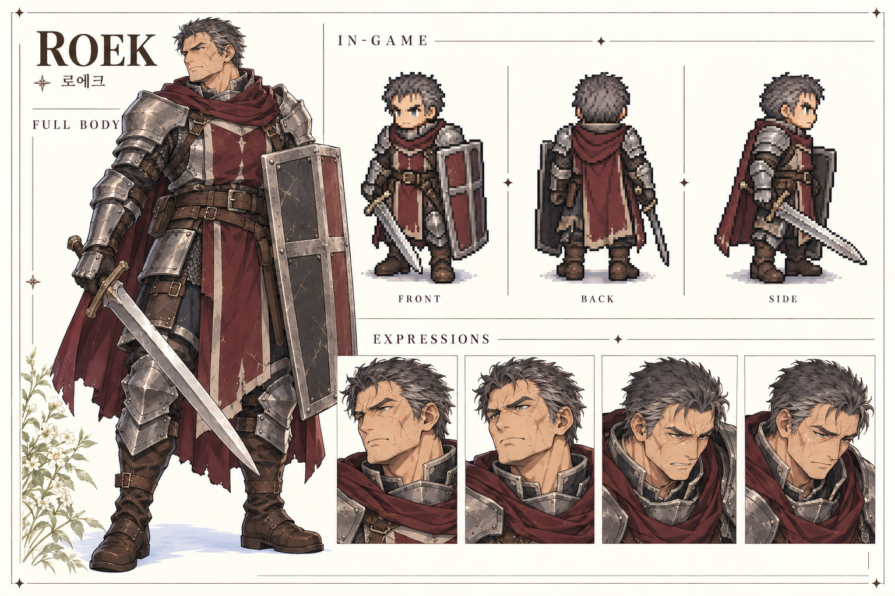

## 실베르 — 왕국 감찰관

왕국 내부에서 전쟁 기록을 은폐하는 감찰관.

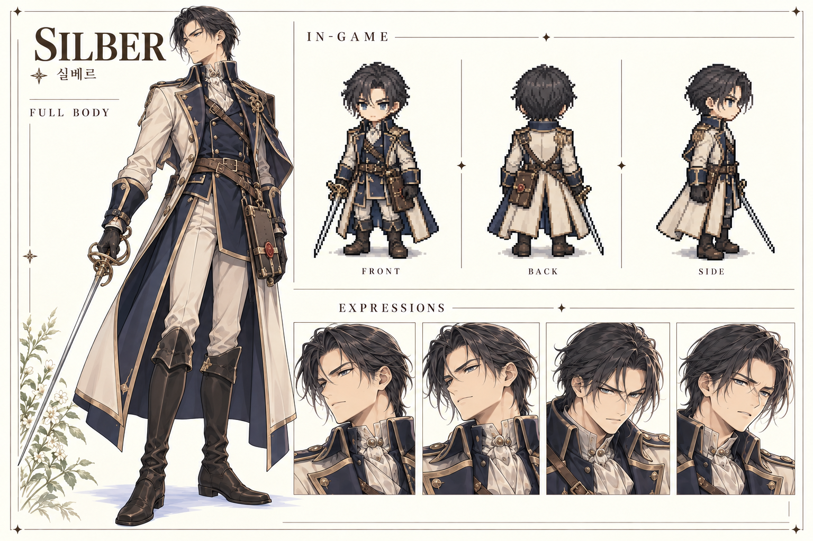

## 네리아 — 유적 조사 책임자

재난을 막으려 위험한 고대 시설 실험을 강행.

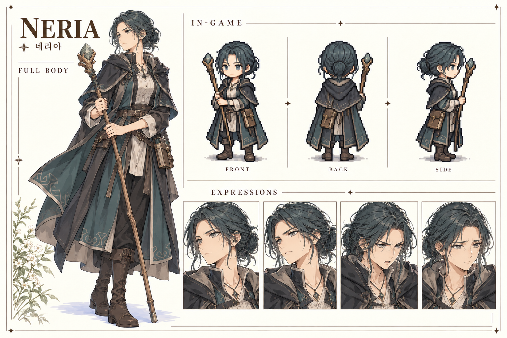

## 에드란 — 독립 용병대장

계약과 부하의 생존을 중시하는 재등장 용병대장.

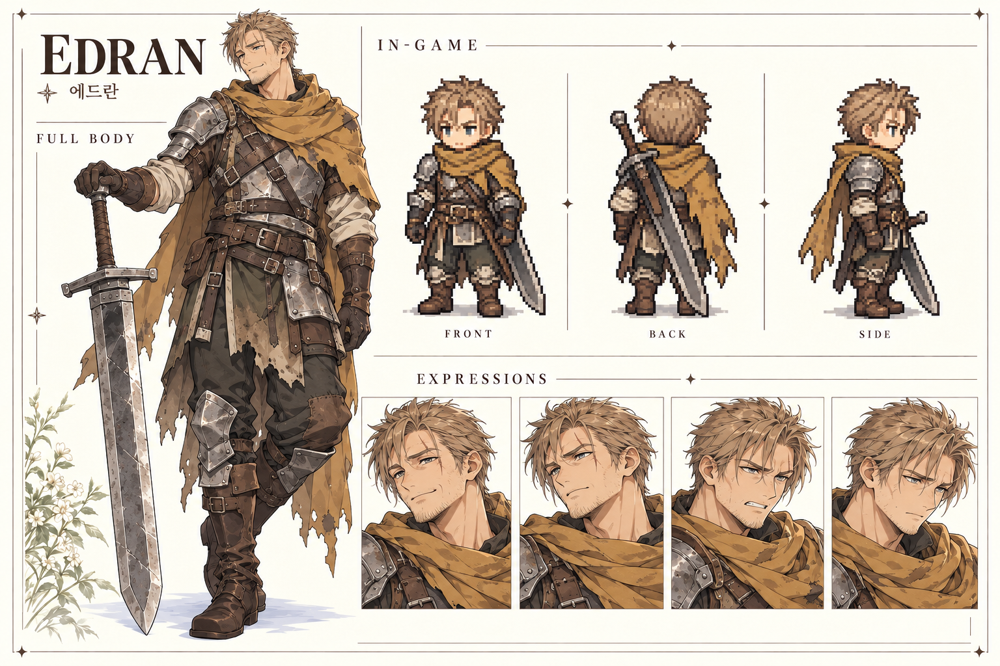

## 국경 검병 — 일반 병종

정면에서 접근로를 막는 기본 병종.

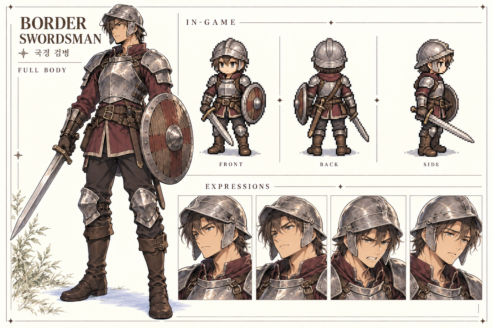

## 국경 창병 — 일반 병종

긴 사거리로 좁은 길을 지키는 병종.

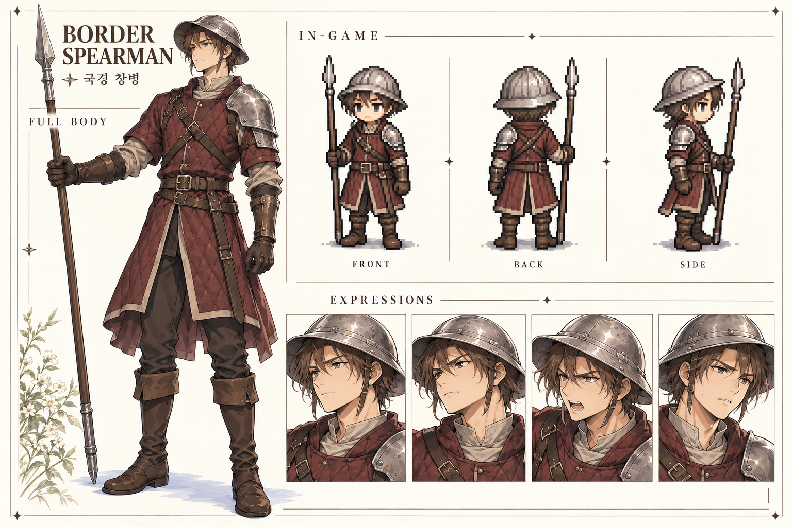

## 군 궁병 — 일반 병종

후방 원거리 공격으로 접근 경로 선택 유도.

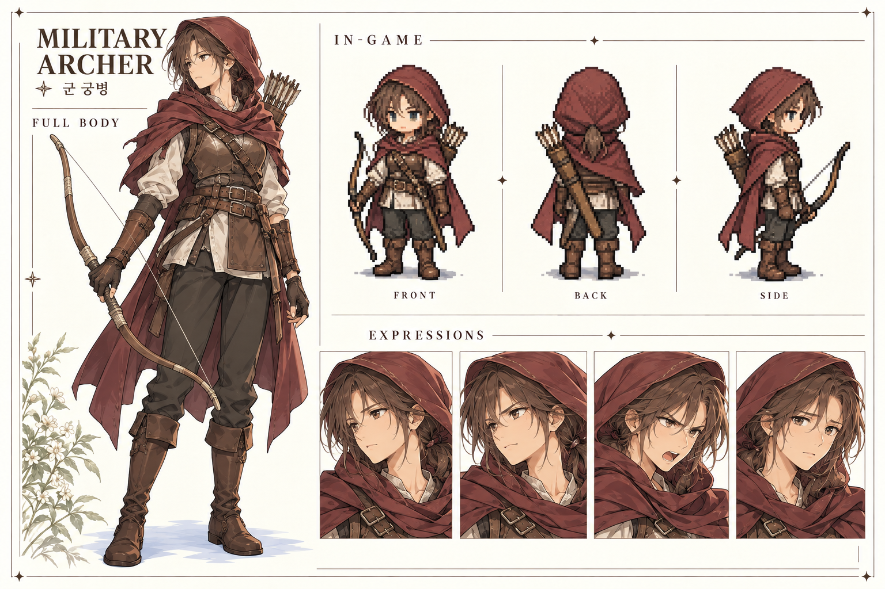

## 중장 기사 — 일반 병종

느리고 단단한 전열 압박 병종.

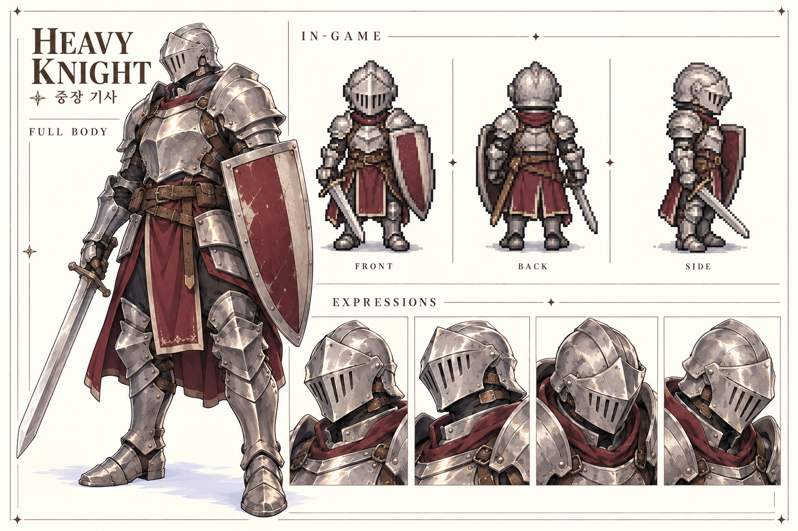

## 척후병 — 일반 병종

빠르게 이동하며 측면을 위협.

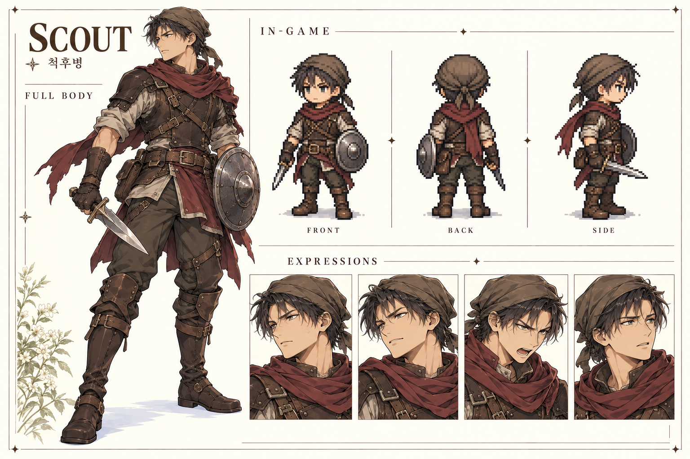

## 군 마도병 — 일반 병종

시전 중인 적의 우선 처리 판단 유도.

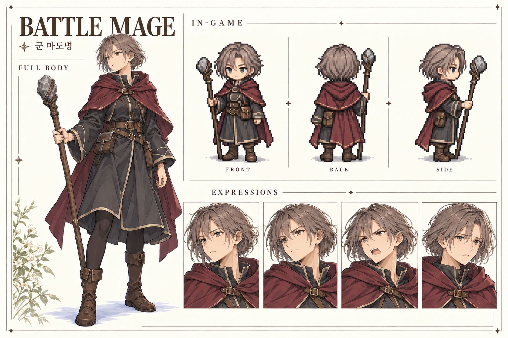

## 군 의무병 — 일반 병종

동료 회복으로 처치 우선순위를 바꾸는 병종.

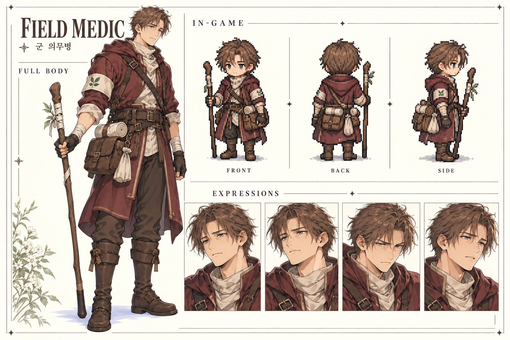

## 용병 도끼병 — 일반 병종

긴 준비 후 강한 일격을 가하는 병종.

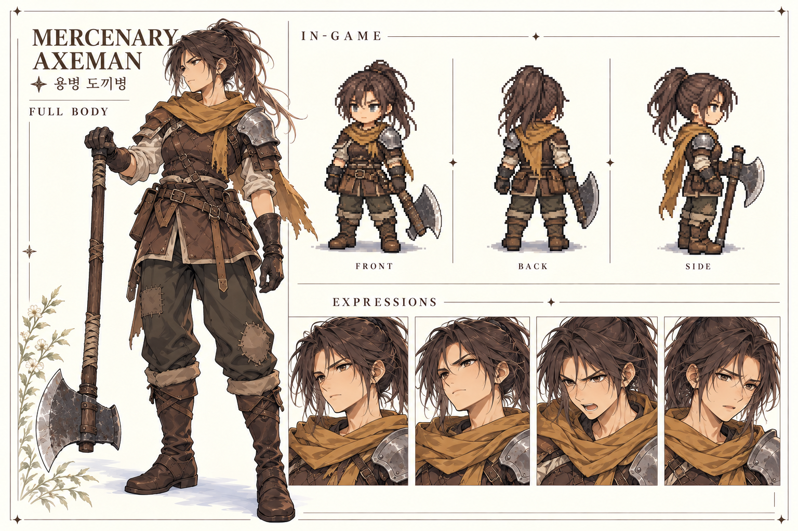
