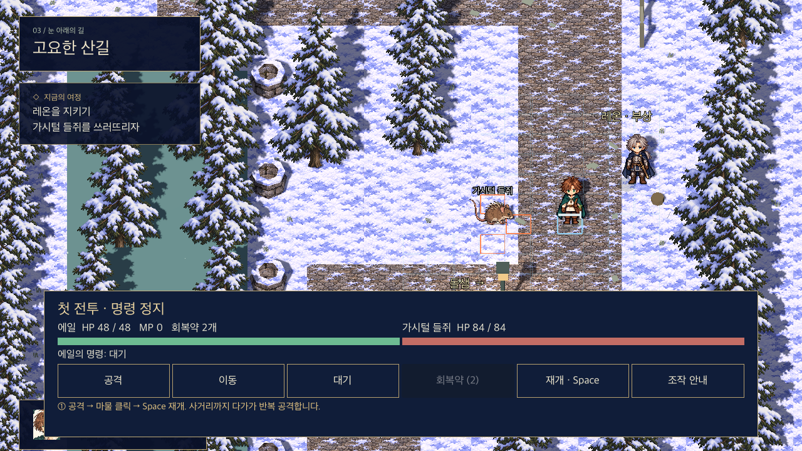
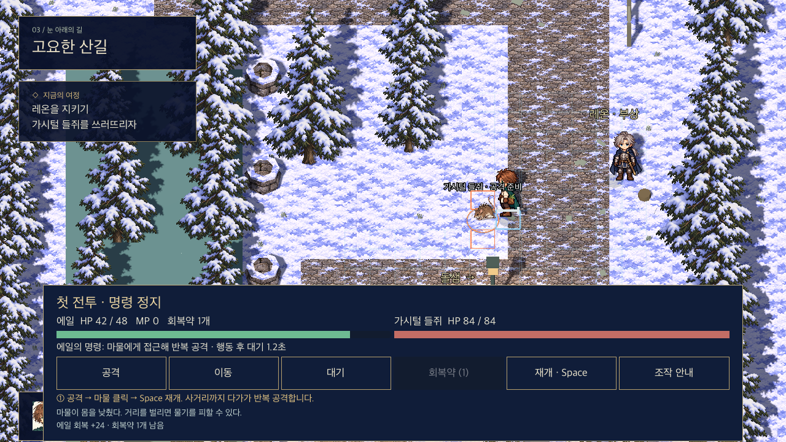
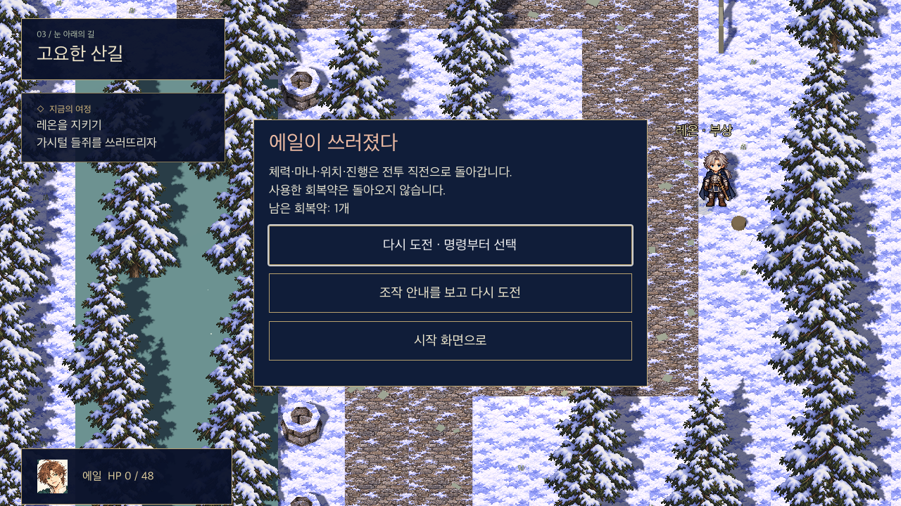
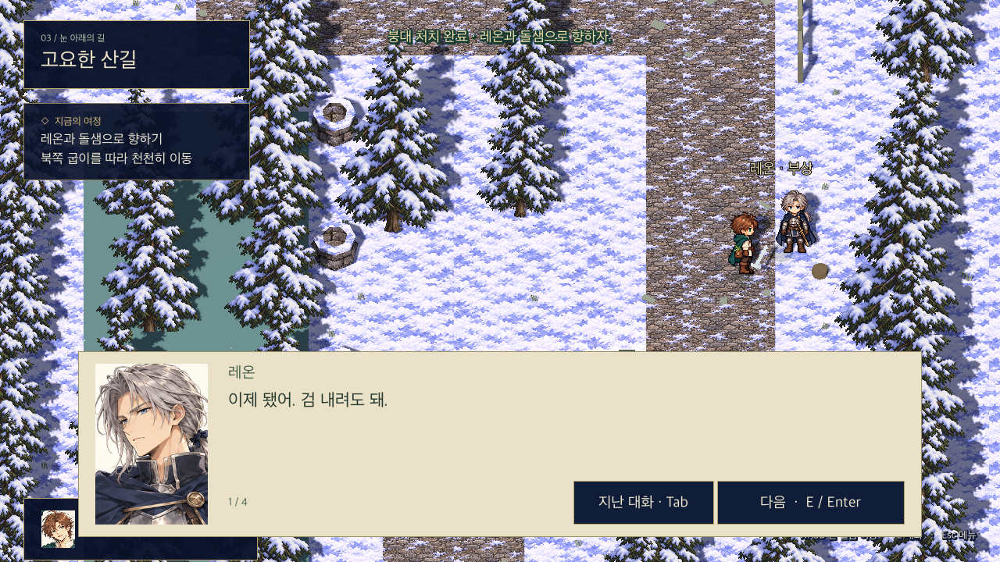

# 프롤로그 첫 전투

2026-10-30 · Godot 4.6.3 / Apple M2 macOS Compatibility 검증

## 플레이

전체 흐름은 `프롤로그 플레이.command`로 시작합니다. 아침 심부름·약 준비를 마치고 산길의 레온을 살핀 뒤 다시 말을 걸면 응급처치 도중 마물이 나타납니다. 레온이 검을 빌려주고, 같은 산길에서 에일 혼자 가시털 들쥐 한 마리와 싸웁니다. 부상당한 레온은 명령·공격·피격 대상에서 제외됩니다.

**바로 확인하려면 `첫 전투 테스트.command`를 실행하세요.** 일상 구간을 건너뛰고 검 대여 직전부터 시작합니다. 일반 진행 기록 `user://prologue_save.json`과 별개인 `user://first_battle_review_save.json`을 사용합니다. 이 바로가기는 실행할 때마다 새 테스트 전투를 준비합니다.

Godot에서 직접 실행:

```sh
godot --path game -- --battle-test
```

## 조작

| 조작 | 동작 |
|---|---|
| 공격 → 마물 클릭 | 시간을 멈추고 공격 명령 지정. 재개 후 접근→공격→행동 후 대기 반복 |
| 마물 직접 클릭 | 같은 공격 명령 지정 |
| 이동 → 길 위 클릭 / 우클릭 | 시간을 멈추고 목적지 지정. 재개 후 상하좌우 한 칸씩 이동하고 도착하면 대기 |
| 대기 | 공격을 중단하고 대기 명령 지정 |
| 회복약 | 에일 자신에게 사용할 약 선택. 재개 순간 즉시 회복·1개 소비·사용자 대기 |
| Space | 정지 / 재개. 미완료 대상 선택은 먼저 완료하거나 취소 |
| Esc | 대상 선택 중에는 취소, 그 외에는 정지 / 재개 |
| 1 | 에일 선택 |
| 조작 안내 | 멈춘 상태에서 짧은 안내 다시 보기 |
| F5 / F9 | 전투 중 자유 저장·불러오기는 차단. 전투 직전 기록을 유지 |

공격 명령을 골랐다는 것만으로 시간이 흐르지 않습니다. 이동 도중 정지해도 현재 칸의 진행률을 유지하며, 재개하면 그 한 걸음을 마칩니다. 공격 사거리와 장애물을 다시 확인한 뒤 피해를 1회만 적용합니다. 명령 변경으로 공격 후 대기 시간을 지울 수 없습니다.

마물은 물기 전에 몸을 낮추고 이름표에 **공격 준비**를 표시합니다. 준비 중에는 움직이지 않으며, 발동할 때 에일이 사거리 밖이거나 장애물로 가려졌다면 빗나갑니다. 이동 명령으로 거리를 벌려 피할 수 있습니다. 일반 공격이므로 바닥 위험 범위 표시는 넣지 않았습니다. 바닥 고리는 선택 대상 / 이동 목적지 표시입니다.

## 승리·패배와 진행

- 체력 0이면 에일이 전투 불능이 되어 패배합니다. 일반 회복약으로 쓰러진 자신을 부활시키지 않습니다.
- 패배 화면에서 **다시 도전** 또는 **조작 안내를 보고 다시 도전**을 선택합니다. 긴 발견·검 대여 대사를 반복하지 않습니다. 기본 재도전 버튼은 Enter로도 누를 수 있습니다.
- 재도전은 체력·마나·위치·퀘스트 상태와 적 체력을 전투 직전으로 되돌립니다. **사용한 회복약은 돌려주지 않습니다.** 회복약이 0개여도 이동으로 물기를 피하며 이길 수 있습니다.
- 승리하면 살아남은 에일의 체력·마나를 유지합니다. 자동 완전 회복은 없습니다. 검을 내린 뒤 조작을 돌려받습니다. 레온에게 돌아가 다시 말을 걸어 붕대를 마무리해야 동행 상태가 됩니다.
- 승리 확정과 체크포인트 제거를 먼저 기록하므로 전투 후 대화 도중 재실행해도 같은 마물이 다시 생성되지 않습니다. 레온에게 말을 걸어 처치를 마칠 수 있습니다.
- 약 전달 시 레온에게 빌린 검을 돌려주며, 그 뒤에도 돌샘의 마무리 대화까지 진행할 수 있습니다. 레온 재대화·맵 왕복으로 전투나 검 지급을 반복하지 않습니다.

## 저장

일반 저장은 v3입니다. 전투 시작 시 체력·마나·위치·진행 플래그를 체크포인트에 보관하고, 회복약이 실제 소비될 때 남은 수량을 함께 기록합니다. 임시 파일 쓰기·flush·close 후 기존 저장을 교체합니다. 아이템 기록 저장 실패 시 전투를 멈추고 안내합니다.

전투 중 종료하고 **여행 이어가기**를 하면 체크포인트의 재도전 화면으로 돌아갑니다. 실제 소비한 약은 줄어든 채 유지됩니다. 전투 밖에서는 F5/F9를 사용할 수 있습니다.

v1/v2 기록은 진행을 유지해 읽습니다. 이미 레온 동행이나 약 전달까지 진행한 이전 빌드 기록에는 첫 전투를 다시 강제하지 않습니다. 이전 기록의 미구현 전투를 플레이한 것으로 주장하는 것이 아니며, 새 첫 전투는 새 게임 또는 전투 테스트 바로가기로 확인합니다.

## 첫 테스트용 수치와 구현 선택

| 항목 | 현재 값 |
|---|---|
| 에일 최대 체력 / 마나 | 48 / 시작 0, 이번 전투에는 마법 없음 |
| 마물 체력 / 에일 피해 | 84 / 6 |
| 에일 공격 준비 / 공격 후 대기 | 0.45초 / 1.55초 |
| 마물 물기 준비 / 대기 | 0.85초 / 2초 |
| 마물 피해 | 스토리 4 / 전술 6 |
| 회복약 | 개인 소지 2개, 즉시 24 회복, 사용 뒤 1.2초 대기 |
| 이동 | 에일 1칸 0.2초, 마물 1칸 0.45초 |
| 일반 공격 사거리 | 1.3 월드 단위 + 장애물 시야 검사 |

난이도는 전투 밖 Esc 메뉴에서 바꿉니다. 이번 두 모드는 적 피해만 다르고 대사·승리·관계 보상은 같습니다. 행동 후 대기는 공격·아이템의 재사용을 제한하고 이동 명령은 허용하는 첫 제작안입니다. 회복약은 정지 중 선택하고 재개할 때 적용합니다. 이 수치·명령 취소·회복 타이밍을 한국어 PC CD판과 동일하다고 검증한 것은 아니며, 사용자 확정 규칙 위에서 플레이 검증할 임시값입니다. 원작 판본 검증 현황은 `growlanser-combat-reference.md`를 참고합니다.

단순 기본 공격만으로 진행한 코어 검사에서는 스토리 전투가 **27.34초**, 에일 **HP 12/48**로 끝났습니다. 정지 중 판단·튜토리얼 읽기 시간은 포함하지 않은 시뮬레이션 결과이며 플레이 제한 시간이 아닙니다.

## 표현과 남은 범위

첫 전투는 실제 지형·기존 이동 스프라이트 위에서 진행됩니다. 검은 간단한 3D 외형과 공격 궤적, 마물은 기존 보드의 정면·뒤·옆·준비·접촉 포즈를 분리해 사용합니다. 발 원점을 고정하며 HP 바·피격 색·행동 로그·짧은 타격/피격/회복/승리 효과음을 제공합니다. 효과음은 코드에서 생성하며 외부 음원을 쓰지 않습니다.

이는 첫 플레이용 연출이며 최종 4방향 공격·피격·다운 스프라이트 전체가 완성된 상태는 아닙니다. 레온 따라걷기·부상 포즈, 장면 BGM, 다인 파티·마법·부활·경제·경험치 시스템, 실제 Windows 빌드 검증은 이번 범위에 포함하지 않습니다. 출시 플랫폼은 기존대로 Windows Steam이며 Mac은 개발 테스트입니다.

## 검사

```sh
godot --headless --path game --script res://tests/first_battle_test.gd
godot --headless --path game -- --battle-qa
godot --path game -- --battle-input-qa
godot --headless --path game -- --qa
godot --headless --path game --script res://tests/prologue_story_test.gd
```

- 코어: 정지 중 시뮬레이션 정지, 반복 공격·승리 1회, 즉시 회복과 사용 후 대기, 명령 변경 악용 방지, 비환급 재도전, 패배, 4방향 목적지 이동, 벽 너머 타격 금지, 아이템 0개 전술 승리, 손상 저장 거부.
- 실제 산길 통합: 검 대여 전후·체크포인트 저장, 입자까지 포함한 시간 정지, 약 소비 뒤 재실행·재도전, 선택 안내, 승리 후 처치·HP 유지·재전투 차단, 검 반환·약 전달·마무리, 실제 지형에서 아이템 0개 전술 승리, 승리 후 레온에게 실제로 이동해 처치 상호작용.
- 입력: 실제 Godot GUI 좌표로 공격/이동/회복약 버튼·마물 클릭·우클릭 이동·Space 정지/재개·Esc 대상 취소·Enter 재도전. 효과음 생성·해제 확인.
- 자동 검사와 캡처는 모드별 전용 저장 파일을 사용하며 일반 진행 기록을 덮어쓰지 않습니다.

## 실제 화면










## 칸 단위 명령 표시 (2026-10-30)
명령 정지 중 통행 가능한 길에 격자를 표시합니다. 이동 선택 후 마우스를 올리면 초록색 경로, 금색 도착 칸이 보이며 불가능한 도착 칸은 빨간색입니다. 선택한 경로는 시간 진행 중에도 남습니다. 적 주변 주황색 네 칸은 검의 사거리입니다. 양쪽이 칸에 멈추고 상하좌우로 인접해야 공격이 맞습니다. 대각선이나 이동 중 공격은 맞지 않습니다.
