# 본편 애셋 제작 진행 기록

2026-11-02 · [전체 제작 대장](full-asset-registry.md) · [검색·시안 갤러리](assets-registry/index.html)

## 현재 상태

- 전체 관리 항목: 2,412개. 고유 그림 수가 아니며 방향별 클립·재사용·배치·음원 포함.
- 기존 참고 자료 연결: 205항목.
- 누적 신규 외형/배치 시안: **214장** = 공용 부품12 + 거점 배치11 + 건물·시설64 + 지역 환경55 + 지역 건축 부품72.
- 이번 제작: **8개 양식 × 벽 직선·벽 모서리·문·창·바닥·기둥·계단·난간·천장/지붕 = 72종**.
- 나머지 대기: **1,993항목**. 신규 런타임 연결은 0개.
- 다음 순서: 실내 배치22종. 나머지 목록과 순서는 전체 제작 대장 참조.

## 지역 건축 부품 72종

지역 양식별 9종의 외형 참고 보드입니다. 공용 구조 재사용 여부를 먼저 판단하고, 모델 제작 시 층고·벽 두께·피벗·접합면·개구부 규격을 통일합니다. 도면 치수나 조립 검증 완료를 뜻하지 않습니다.

### architecture-01-01 · 국경 산촌 벽 직선

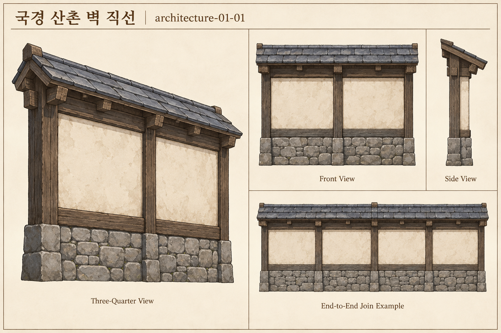

지역별 건축 모듈 외형 참고. 실제 모델·텍스처·충돌·게임 연결은 미제작. 동일 양식의 벽 두께·층고·개구부·바닥 두께·피벗·접합면 규격은 모델링에서 통일. 그림의 연결 예시는 스냅 검증 결과가 아님. 공용 부품 또는 지역 환경 시안과 겹치는 구조는 재사용·재질 변형 후보. 별도 고유 런타임 모델 제작을 강제하지 않음. 뷰별 치수·장식·단수 차이를 정합화하고 게임 카메라에서 세부 묘사를 단순화. 부속 처마·벽 조각·기둥이 함께 표현되면 분리. 문·창 개구부와 벽 모듈을 같은 기준으로 맞춤.

### architecture-01-02 · 국경 산촌 벽 모서리

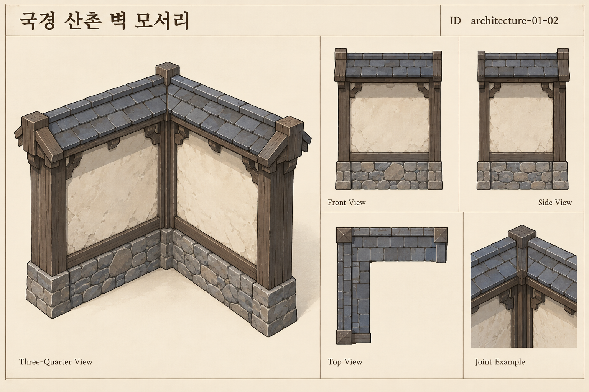

지역별 건축 모듈 외형 참고. 실제 모델·텍스처·충돌·게임 연결은 미제작. 동일 양식의 벽 두께·층고·개구부·바닥 두께·피벗·접합면 규격은 모델링에서 통일. 그림의 연결 예시는 스냅 검증 결과가 아님. 공용 부품 또는 지역 환경 시안과 겹치는 구조는 재사용·재질 변형 후보. 별도 고유 런타임 모델 제작을 강제하지 않음. 뷰별 치수·장식·단수 차이를 정합화하고 게임 카메라에서 세부 묘사를 단순화. 부속 처마·벽 조각·기둥이 함께 표현되면 분리. 문·창 개구부와 벽 모듈을 같은 기준으로 맞춤.

### architecture-01-03 · 국경 산촌 문

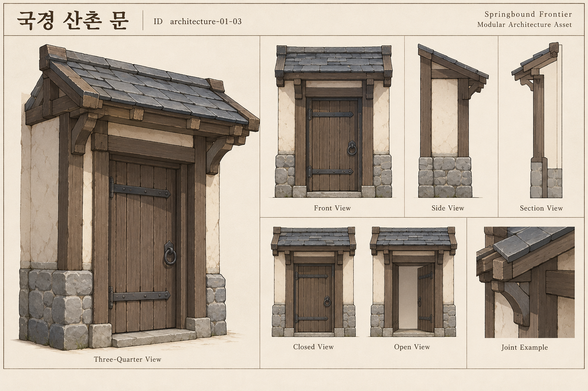

지역별 건축 모듈 외형 참고. 실제 모델·텍스처·충돌·게임 연결은 미제작. 동일 양식의 벽 두께·층고·개구부·바닥 두께·피벗·접합면 규격은 모델링에서 통일. 그림의 연결 예시는 스냅 검증 결과가 아님. 공용 부품 또는 지역 환경 시안과 겹치는 구조는 재사용·재질 변형 후보. 별도 고유 런타임 모델 제작을 강제하지 않음. 뷰별 치수·장식·단수 차이를 정합화하고 게임 카메라에서 세부 묘사를 단순화. 부속 처마·벽 조각·기둥이 함께 표현되면 분리. 문·창 개구부와 벽 모듈을 같은 기준으로 맞춤. 열림 그림은 외형 참고. 경첩 피벗·충돌 전환·상호작용·열림 동작은 별도 구현.

### architecture-01-04 · 국경 산촌 창

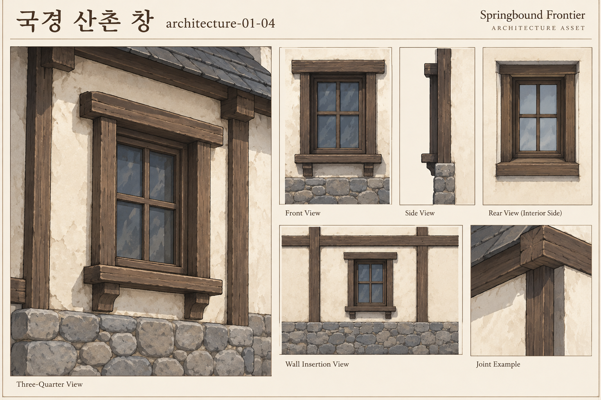

지역별 건축 모듈 외형 참고. 실제 모델·텍스처·충돌·게임 연결은 미제작. 동일 양식의 벽 두께·층고·개구부·바닥 두께·피벗·접합면 규격은 모델링에서 통일. 그림의 연결 예시는 스냅 검증 결과가 아님. 공용 부품 또는 지역 환경 시안과 겹치는 구조는 재사용·재질 변형 후보. 별도 고유 런타임 모델 제작을 강제하지 않음. 뷰별 치수·장식·단수 차이를 정합화하고 게임 카메라에서 세부 묘사를 단순화. 부속 처마·벽 조각·기둥이 함께 표현되면 분리. 문·창 개구부와 벽 모듈을 같은 기준으로 맞춤.

### architecture-01-05 · 국경 산촌 바닥

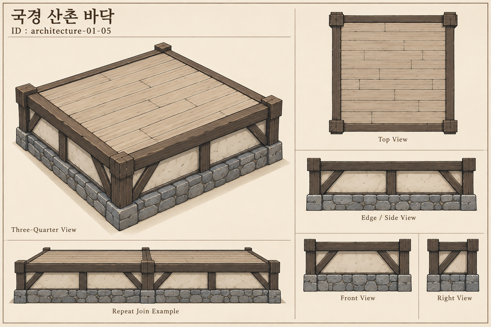

지역별 건축 모듈 외형 참고. 실제 모델·텍스처·충돌·게임 연결은 미제작. 동일 양식의 벽 두께·층고·개구부·바닥 두께·피벗·접합면 규격은 모델링에서 통일. 그림의 연결 예시는 스냅 검증 결과가 아님. 공용 부품 또는 지역 환경 시안과 겹치는 구조는 재사용·재질 변형 후보. 별도 고유 런타임 모델 제작을 강제하지 않음. 뷰별 치수·장식·단수 차이를 정합화하고 게임 카메라에서 세부 묘사를 단순화. 일부 보드는 두꺼운 기단을 포함. 실내 바닥·외부 광장과 구분하고 필요한 두께로 재설계. 무봉제 텍스처 아님.

### architecture-01-06 · 국경 산촌 기둥

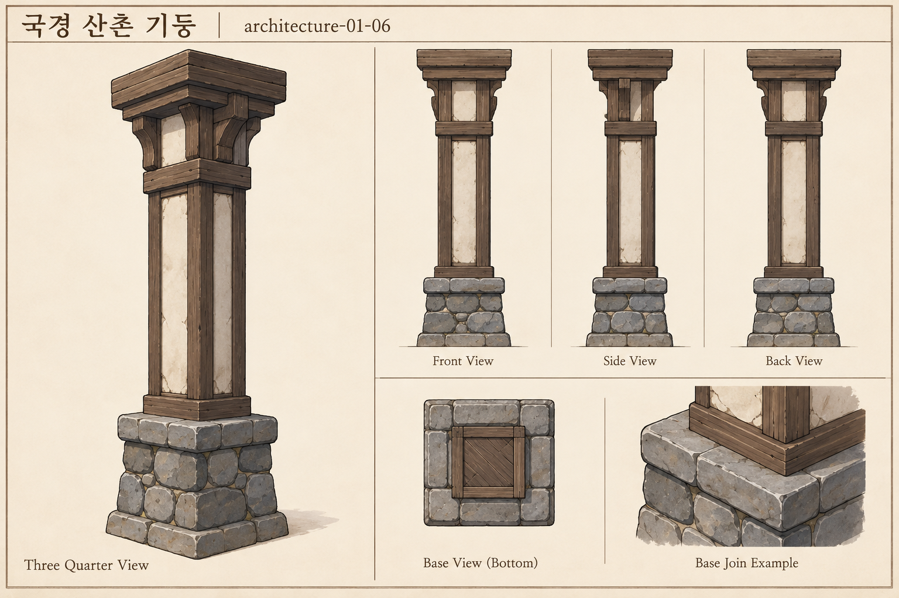

지역별 건축 모듈 외형 참고. 실제 모델·텍스처·충돌·게임 연결은 미제작. 동일 양식의 벽 두께·층고·개구부·바닥 두께·피벗·접합면 규격은 모델링에서 통일. 그림의 연결 예시는 스냅 검증 결과가 아님. 공용 부품 또는 지역 환경 시안과 겹치는 구조는 재사용·재질 변형 후보. 별도 고유 런타임 모델 제작을 강제하지 않음. 뷰별 치수·장식·단수 차이를 정합화하고 게임 카메라에서 세부 묘사를 단순화.

### architecture-01-07 · 국경 산촌 계단

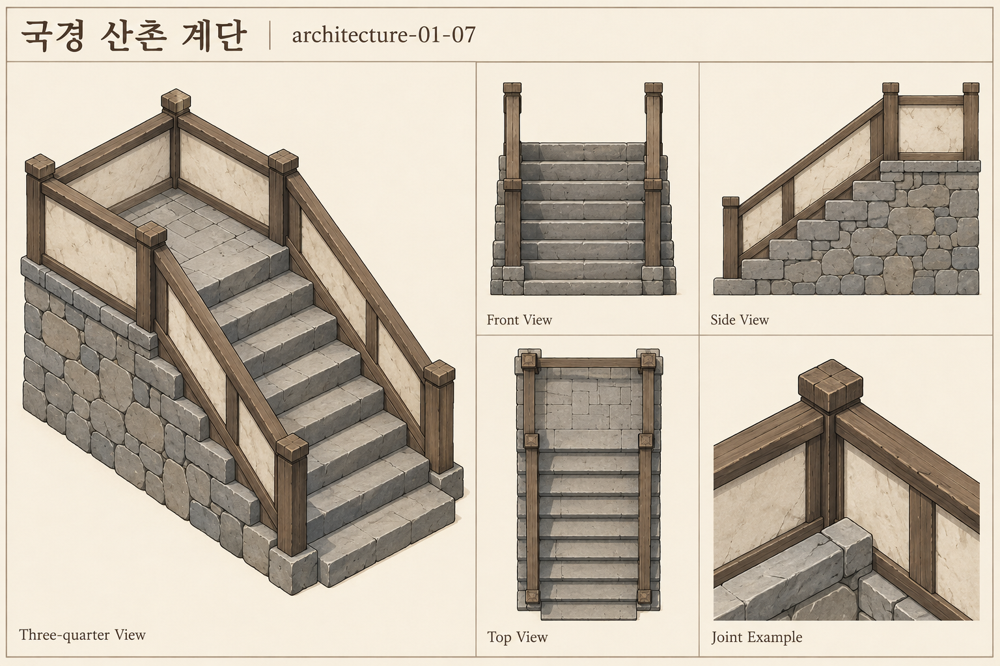

지역별 건축 모듈 외형 참고. 실제 모델·텍스처·충돌·게임 연결은 미제작. 동일 양식의 벽 두께·층고·개구부·바닥 두께·피벗·접합면 규격은 모델링에서 통일. 그림의 연결 예시는 스냅 검증 결과가 아님. 공용 부품 또는 지역 환경 시안과 겹치는 구조는 재사용·재질 변형 후보. 별도 고유 런타임 모델 제작을 강제하지 않음. 뷰별 치수·장식·단수 차이를 정합화하고 게임 카메라에서 세부 묘사를 단순화. 계단 단수·단높이·통행 폭·캐릭터 이동 충돌은 모델 제작 단계에서 검증.

### architecture-01-08 · 국경 산촌 난간

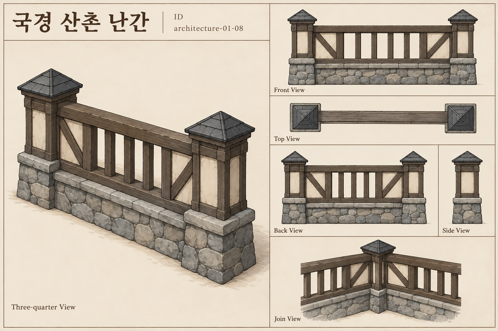

지역별 건축 모듈 외형 참고. 실제 모델·텍스처·충돌·게임 연결은 미제작. 동일 양식의 벽 두께·층고·개구부·바닥 두께·피벗·접합면 규격은 모델링에서 통일. 그림의 연결 예시는 스냅 검증 결과가 아님. 공용 부품 또는 지역 환경 시안과 겹치는 구조는 재사용·재질 변형 후보. 별도 고유 런타임 모델 제작을 강제하지 않음. 뷰별 치수·장식·단수 차이를 정합화하고 게임 카메라에서 세부 묘사를 단순화.

### architecture-01-09 · 국경 산촌 천장·지붕

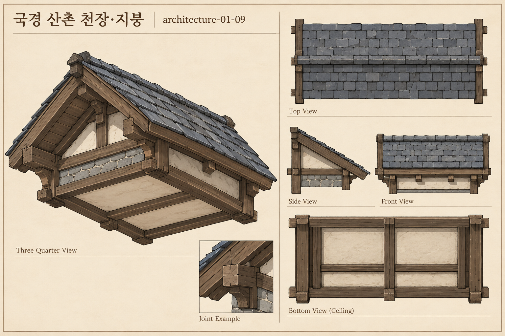

지역별 건축 모듈 외형 참고. 실제 모델·텍스처·충돌·게임 연결은 미제작. 동일 양식의 벽 두께·층고·개구부·바닥 두께·피벗·접합면 규격은 모델링에서 통일. 그림의 연결 예시는 스냅 검증 결과가 아님. 공용 부품 또는 지역 환경 시안과 겹치는 구조는 재사용·재질 변형 후보. 별도 고유 런타임 모델 제작을 강제하지 않음. 뷰별 치수·장식·단수 차이를 정합화하고 게임 카메라에서 세부 묘사를 단순화. 지붕 끝막음·용마루·처마·천장 분리 및 반복 구간 규격 확인. 시안의 단면 표시는 구조 데이터가 아님.

### architecture-02-01 · 왕도 벽 직선

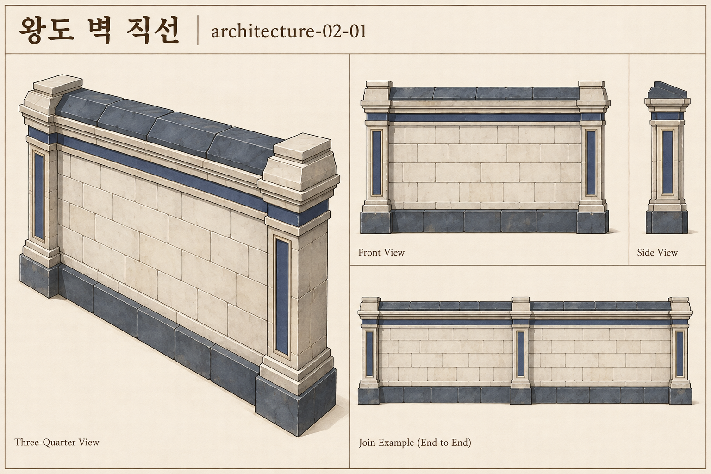

지역별 건축 모듈 외형 참고. 실제 모델·텍스처·충돌·게임 연결은 미제작. 동일 양식의 벽 두께·층고·개구부·바닥 두께·피벗·접합면 규격은 모델링에서 통일. 그림의 연결 예시는 스냅 검증 결과가 아님. 공용 부품 또는 지역 환경 시안과 겹치는 구조는 재사용·재질 변형 후보. 별도 고유 런타임 모델 제작을 강제하지 않음. 뷰별 치수·장식·단수 차이를 정합화하고 게임 카메라에서 세부 묘사를 단순화. 부속 처마·벽 조각·기둥이 함께 표현되면 분리. 문·창 개구부와 벽 모듈을 같은 기준으로 맞춤.

### architecture-02-02 · 왕도 벽 모서리

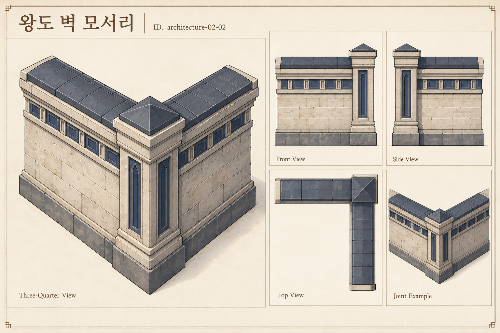

지역별 건축 모듈 외형 참고. 실제 모델·텍스처·충돌·게임 연결은 미제작. 동일 양식의 벽 두께·층고·개구부·바닥 두께·피벗·접합면 규격은 모델링에서 통일. 그림의 연결 예시는 스냅 검증 결과가 아님. 공용 부품 또는 지역 환경 시안과 겹치는 구조는 재사용·재질 변형 후보. 별도 고유 런타임 모델 제작을 강제하지 않음. 뷰별 치수·장식·단수 차이를 정합화하고 게임 카메라에서 세부 묘사를 단순화. 부속 처마·벽 조각·기둥이 함께 표현되면 분리. 문·창 개구부와 벽 모듈을 같은 기준으로 맞춤.

### architecture-02-03 · 왕도 문

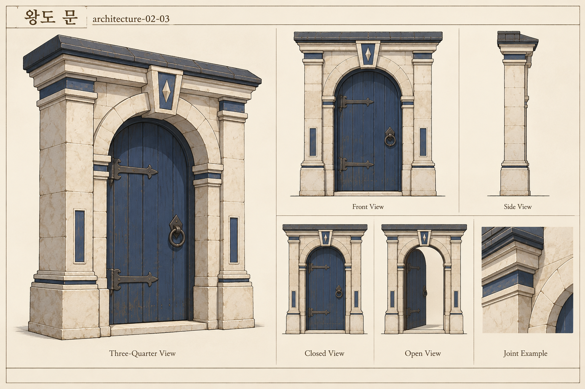

지역별 건축 모듈 외형 참고. 실제 모델·텍스처·충돌·게임 연결은 미제작. 동일 양식의 벽 두께·층고·개구부·바닥 두께·피벗·접합면 규격은 모델링에서 통일. 그림의 연결 예시는 스냅 검증 결과가 아님. 공용 부품 또는 지역 환경 시안과 겹치는 구조는 재사용·재질 변형 후보. 별도 고유 런타임 모델 제작을 강제하지 않음. 뷰별 치수·장식·단수 차이를 정합화하고 게임 카메라에서 세부 묘사를 단순화. 부속 처마·벽 조각·기둥이 함께 표현되면 분리. 문·창 개구부와 벽 모듈을 같은 기준으로 맞춤. 열림 그림은 외형 참고. 경첩 피벗·충돌 전환·상호작용·열림 동작은 별도 구현.

### architecture-02-04 · 왕도 창

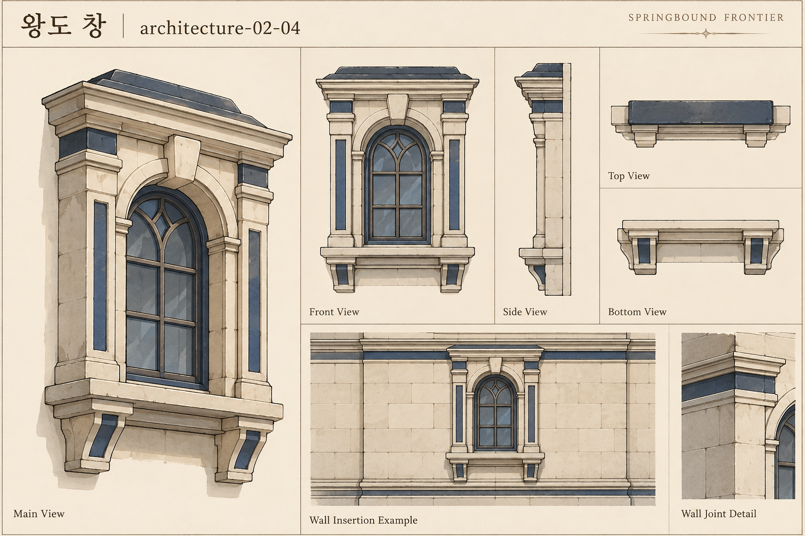

지역별 건축 모듈 외형 참고. 실제 모델·텍스처·충돌·게임 연결은 미제작. 동일 양식의 벽 두께·층고·개구부·바닥 두께·피벗·접합면 규격은 모델링에서 통일. 그림의 연결 예시는 스냅 검증 결과가 아님. 공용 부품 또는 지역 환경 시안과 겹치는 구조는 재사용·재질 변형 후보. 별도 고유 런타임 모델 제작을 강제하지 않음. 뷰별 치수·장식·단수 차이를 정합화하고 게임 카메라에서 세부 묘사를 단순화. 부속 처마·벽 조각·기둥이 함께 표현되면 분리. 문·창 개구부와 벽 모듈을 같은 기준으로 맞춤.

### architecture-02-05 · 왕도 바닥

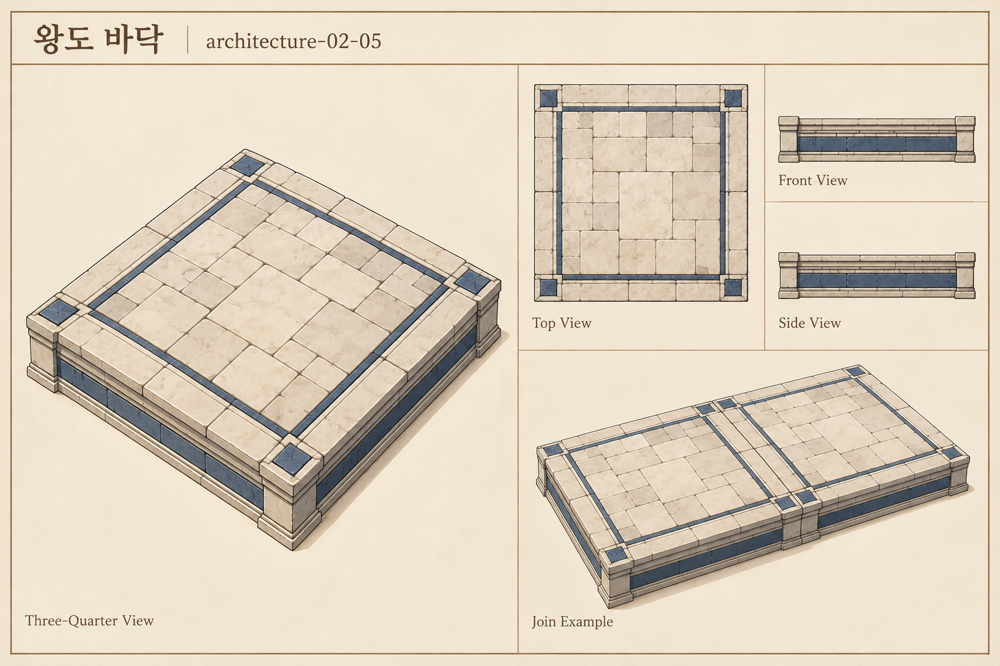

지역별 건축 모듈 외형 참고. 실제 모델·텍스처·충돌·게임 연결은 미제작. 동일 양식의 벽 두께·층고·개구부·바닥 두께·피벗·접합면 규격은 모델링에서 통일. 그림의 연결 예시는 스냅 검증 결과가 아님. 공용 부품 또는 지역 환경 시안과 겹치는 구조는 재사용·재질 변형 후보. 별도 고유 런타임 모델 제작을 강제하지 않음. 뷰별 치수·장식·단수 차이를 정합화하고 게임 카메라에서 세부 묘사를 단순화. 일부 보드는 두꺼운 기단을 포함. 실내 바닥·외부 광장과 구분하고 필요한 두께로 재설계. 무봉제 텍스처 아님.

### architecture-02-06 · 왕도 기둥

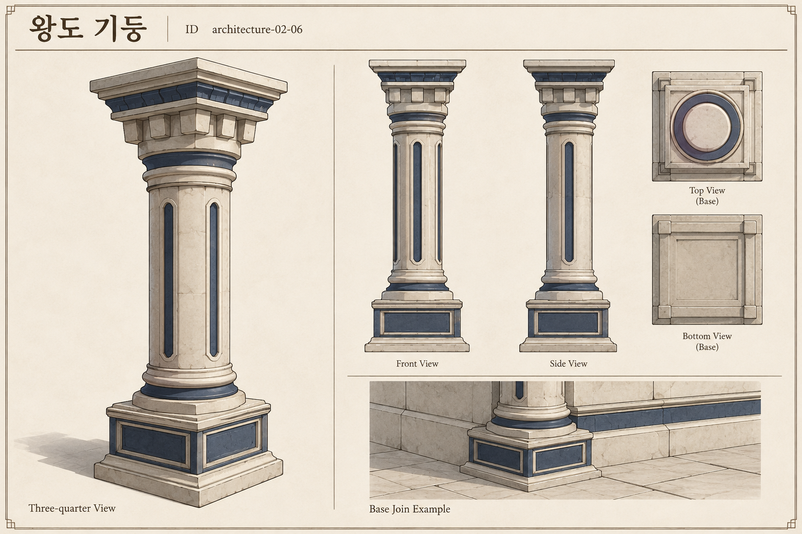

지역별 건축 모듈 외형 참고. 실제 모델·텍스처·충돌·게임 연결은 미제작. 동일 양식의 벽 두께·층고·개구부·바닥 두께·피벗·접합면 규격은 모델링에서 통일. 그림의 연결 예시는 스냅 검증 결과가 아님. 공용 부품 또는 지역 환경 시안과 겹치는 구조는 재사용·재질 변형 후보. 별도 고유 런타임 모델 제작을 강제하지 않음. 뷰별 치수·장식·단수 차이를 정합화하고 게임 카메라에서 세부 묘사를 단순화.

### architecture-02-07 · 왕도 계단

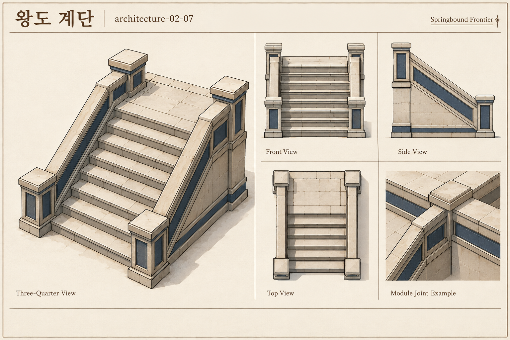

지역별 건축 모듈 외형 참고. 실제 모델·텍스처·충돌·게임 연결은 미제작. 동일 양식의 벽 두께·층고·개구부·바닥 두께·피벗·접합면 규격은 모델링에서 통일. 그림의 연결 예시는 스냅 검증 결과가 아님. 공용 부품 또는 지역 환경 시안과 겹치는 구조는 재사용·재질 변형 후보. 별도 고유 런타임 모델 제작을 강제하지 않음. 뷰별 치수·장식·단수 차이를 정합화하고 게임 카메라에서 세부 묘사를 단순화. 계단 단수·단높이·통행 폭·캐릭터 이동 충돌은 모델 제작 단계에서 검증.

### architecture-02-08 · 왕도 난간

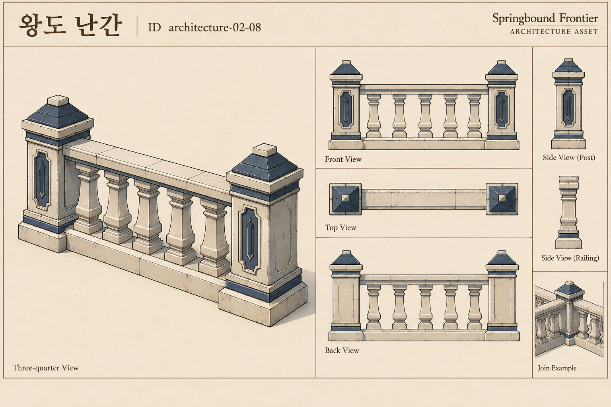

지역별 건축 모듈 외형 참고. 실제 모델·텍스처·충돌·게임 연결은 미제작. 동일 양식의 벽 두께·층고·개구부·바닥 두께·피벗·접합면 규격은 모델링에서 통일. 그림의 연결 예시는 스냅 검증 결과가 아님. 공용 부품 또는 지역 환경 시안과 겹치는 구조는 재사용·재질 변형 후보. 별도 고유 런타임 모델 제작을 강제하지 않음. 뷰별 치수·장식·단수 차이를 정합화하고 게임 카메라에서 세부 묘사를 단순화.

### architecture-02-09 · 왕도 천장·지붕

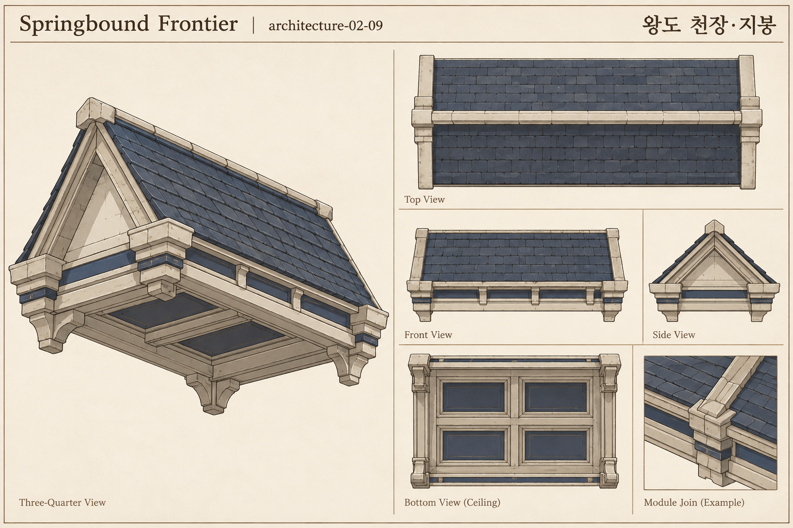

지역별 건축 모듈 외형 참고. 실제 모델·텍스처·충돌·게임 연결은 미제작. 동일 양식의 벽 두께·층고·개구부·바닥 두께·피벗·접합면 규격은 모델링에서 통일. 그림의 연결 예시는 스냅 검증 결과가 아님. 공용 부품 또는 지역 환경 시안과 겹치는 구조는 재사용·재질 변형 후보. 별도 고유 런타임 모델 제작을 강제하지 않음. 뷰별 치수·장식·단수 차이를 정합화하고 게임 카메라에서 세부 묘사를 단순화. 지붕 끝막음·용마루·처마·천장 분리 및 반복 구간 규격 확인. 시안의 단면 표시는 구조 데이터가 아님.

### architecture-03-01 · 학술도시 벽 직선

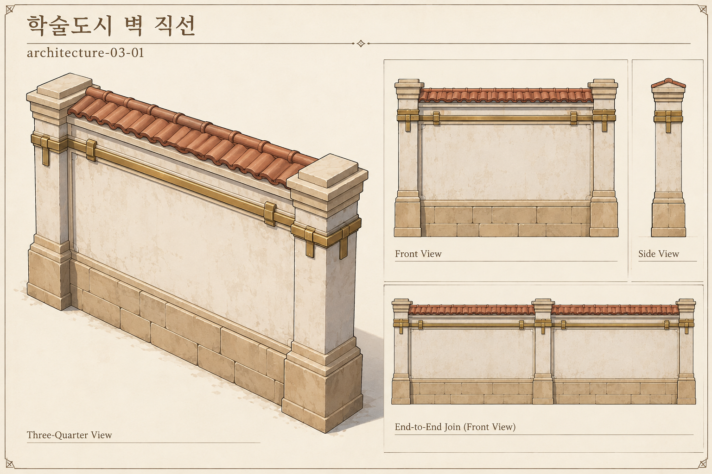

지역별 건축 모듈 외형 참고. 실제 모델·텍스처·충돌·게임 연결은 미제작. 동일 양식의 벽 두께·층고·개구부·바닥 두께·피벗·접합면 규격은 모델링에서 통일. 그림의 연결 예시는 스냅 검증 결과가 아님. 공용 부품 또는 지역 환경 시안과 겹치는 구조는 재사용·재질 변형 후보. 별도 고유 런타임 모델 제작을 강제하지 않음. 뷰별 치수·장식·단수 차이를 정합화하고 게임 카메라에서 세부 묘사를 단순화. 부속 처마·벽 조각·기둥이 함께 표현되면 분리. 문·창 개구부와 벽 모듈을 같은 기준으로 맞춤.

### architecture-03-02 · 학술도시 벽 모서리

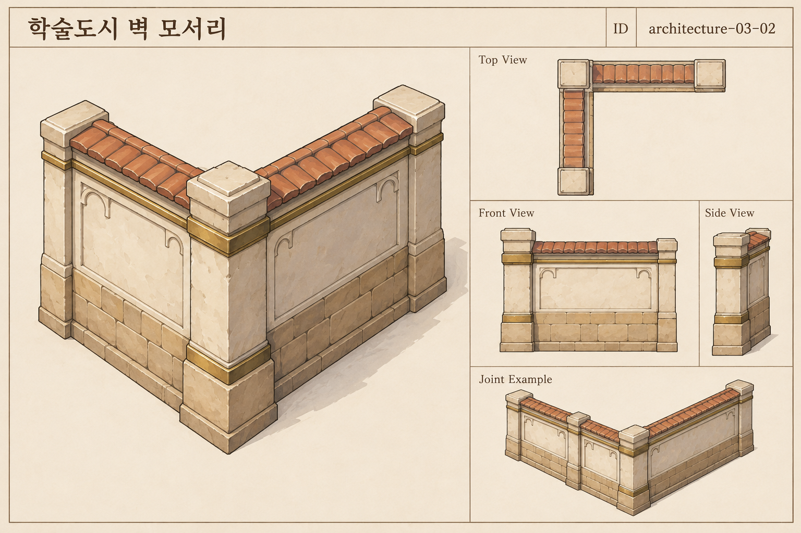

지역별 건축 모듈 외형 참고. 실제 모델·텍스처·충돌·게임 연결은 미제작. 동일 양식의 벽 두께·층고·개구부·바닥 두께·피벗·접합면 규격은 모델링에서 통일. 그림의 연결 예시는 스냅 검증 결과가 아님. 공용 부품 또는 지역 환경 시안과 겹치는 구조는 재사용·재질 변형 후보. 별도 고유 런타임 모델 제작을 강제하지 않음. 뷰별 치수·장식·단수 차이를 정합화하고 게임 카메라에서 세부 묘사를 단순화. 부속 처마·벽 조각·기둥이 함께 표현되면 분리. 문·창 개구부와 벽 모듈을 같은 기준으로 맞춤.

### architecture-03-03 · 학술도시 문

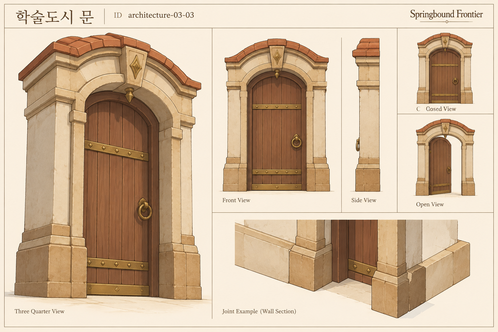

지역별 건축 모듈 외형 참고. 실제 모델·텍스처·충돌·게임 연결은 미제작. 동일 양식의 벽 두께·층고·개구부·바닥 두께·피벗·접합면 규격은 모델링에서 통일. 그림의 연결 예시는 스냅 검증 결과가 아님. 공용 부품 또는 지역 환경 시안과 겹치는 구조는 재사용·재질 변형 후보. 별도 고유 런타임 모델 제작을 강제하지 않음. 뷰별 치수·장식·단수 차이를 정합화하고 게임 카메라에서 세부 묘사를 단순화. 부속 처마·벽 조각·기둥이 함께 표현되면 분리. 문·창 개구부와 벽 모듈을 같은 기준으로 맞춤. 열림 그림은 외형 참고. 경첩 피벗·충돌 전환·상호작용·열림 동작은 별도 구현.

### architecture-03-04 · 학술도시 창

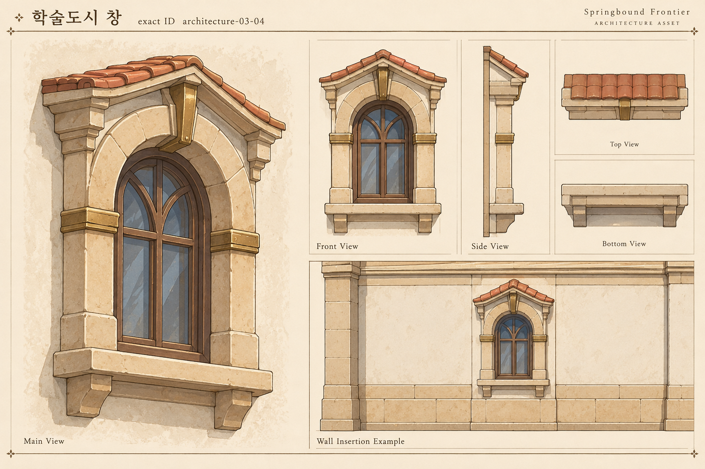

지역별 건축 모듈 외형 참고. 실제 모델·텍스처·충돌·게임 연결은 미제작. 동일 양식의 벽 두께·층고·개구부·바닥 두께·피벗·접합면 규격은 모델링에서 통일. 그림의 연결 예시는 스냅 검증 결과가 아님. 공용 부품 또는 지역 환경 시안과 겹치는 구조는 재사용·재질 변형 후보. 별도 고유 런타임 모델 제작을 강제하지 않음. 뷰별 치수·장식·단수 차이를 정합화하고 게임 카메라에서 세부 묘사를 단순화. 부속 처마·벽 조각·기둥이 함께 표현되면 분리. 문·창 개구부와 벽 모듈을 같은 기준으로 맞춤.

### architecture-03-05 · 학술도시 바닥

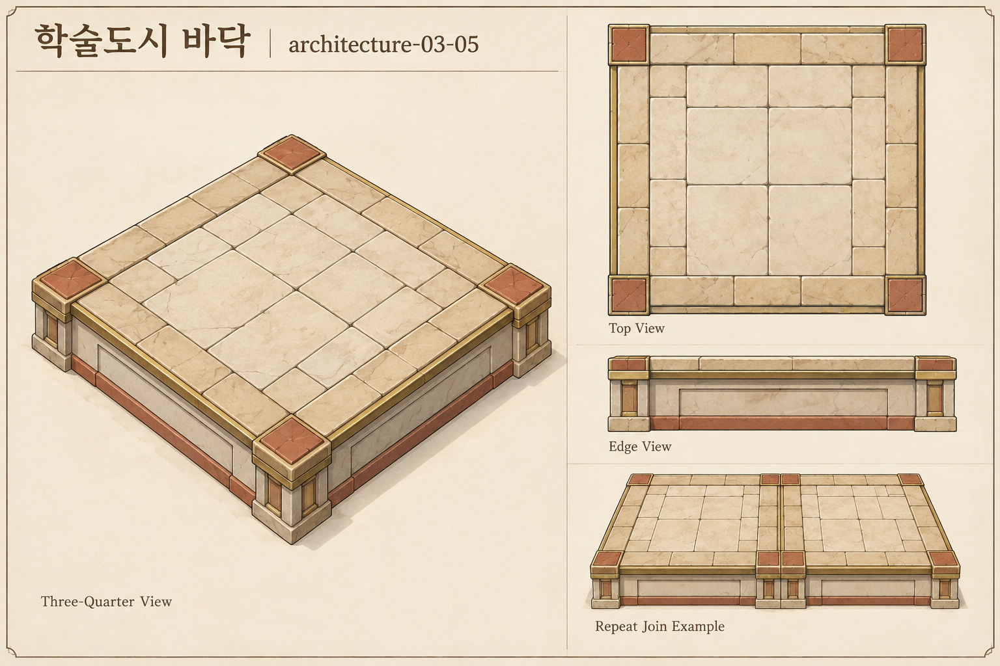

지역별 건축 모듈 외형 참고. 실제 모델·텍스처·충돌·게임 연결은 미제작. 동일 양식의 벽 두께·층고·개구부·바닥 두께·피벗·접합면 규격은 모델링에서 통일. 그림의 연결 예시는 스냅 검증 결과가 아님. 공용 부품 또는 지역 환경 시안과 겹치는 구조는 재사용·재질 변형 후보. 별도 고유 런타임 모델 제작을 강제하지 않음. 뷰별 치수·장식·단수 차이를 정합화하고 게임 카메라에서 세부 묘사를 단순화. 일부 보드는 두꺼운 기단을 포함. 실내 바닥·외부 광장과 구분하고 필요한 두께로 재설계. 무봉제 텍스처 아님.

### architecture-03-06 · 학술도시 기둥

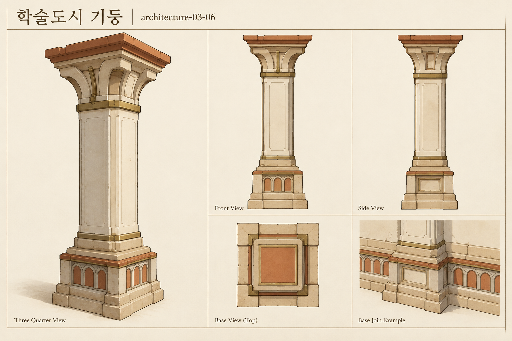

지역별 건축 모듈 외형 참고. 실제 모델·텍스처·충돌·게임 연결은 미제작. 동일 양식의 벽 두께·층고·개구부·바닥 두께·피벗·접합면 규격은 모델링에서 통일. 그림의 연결 예시는 스냅 검증 결과가 아님. 공용 부품 또는 지역 환경 시안과 겹치는 구조는 재사용·재질 변형 후보. 별도 고유 런타임 모델 제작을 강제하지 않음. 뷰별 치수·장식·단수 차이를 정합화하고 게임 카메라에서 세부 묘사를 단순화.

### architecture-03-07 · 학술도시 계단

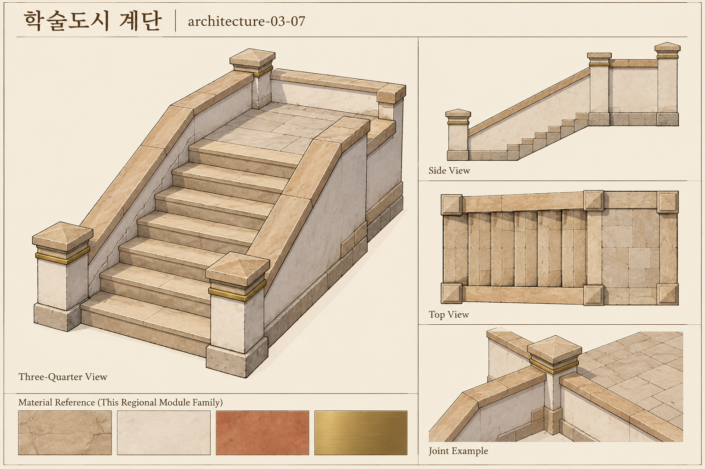

지역별 건축 모듈 외형 참고. 실제 모델·텍스처·충돌·게임 연결은 미제작. 동일 양식의 벽 두께·층고·개구부·바닥 두께·피벗·접합면 규격은 모델링에서 통일. 그림의 연결 예시는 스냅 검증 결과가 아님. 공용 부품 또는 지역 환경 시안과 겹치는 구조는 재사용·재질 변형 후보. 별도 고유 런타임 모델 제작을 강제하지 않음. 뷰별 치수·장식·단수 차이를 정합화하고 게임 카메라에서 세부 묘사를 단순화. 계단 단수·단높이·통행 폭·캐릭터 이동 충돌은 모델 제작 단계에서 검증.

### architecture-03-08 · 학술도시 난간

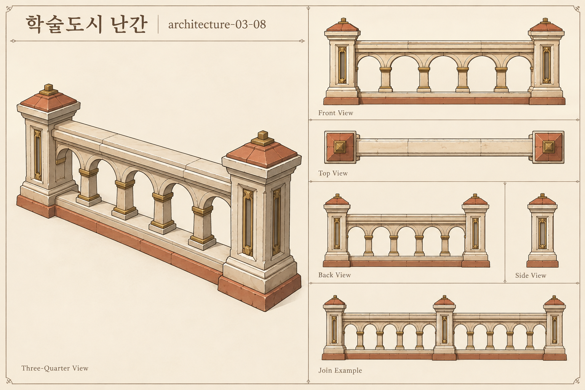

지역별 건축 모듈 외형 참고. 실제 모델·텍스처·충돌·게임 연결은 미제작. 동일 양식의 벽 두께·층고·개구부·바닥 두께·피벗·접합면 규격은 모델링에서 통일. 그림의 연결 예시는 스냅 검증 결과가 아님. 공용 부품 또는 지역 환경 시안과 겹치는 구조는 재사용·재질 변형 후보. 별도 고유 런타임 모델 제작을 강제하지 않음. 뷰별 치수·장식·단수 차이를 정합화하고 게임 카메라에서 세부 묘사를 단순화.

### architecture-03-09 · 학술도시 천장·지붕

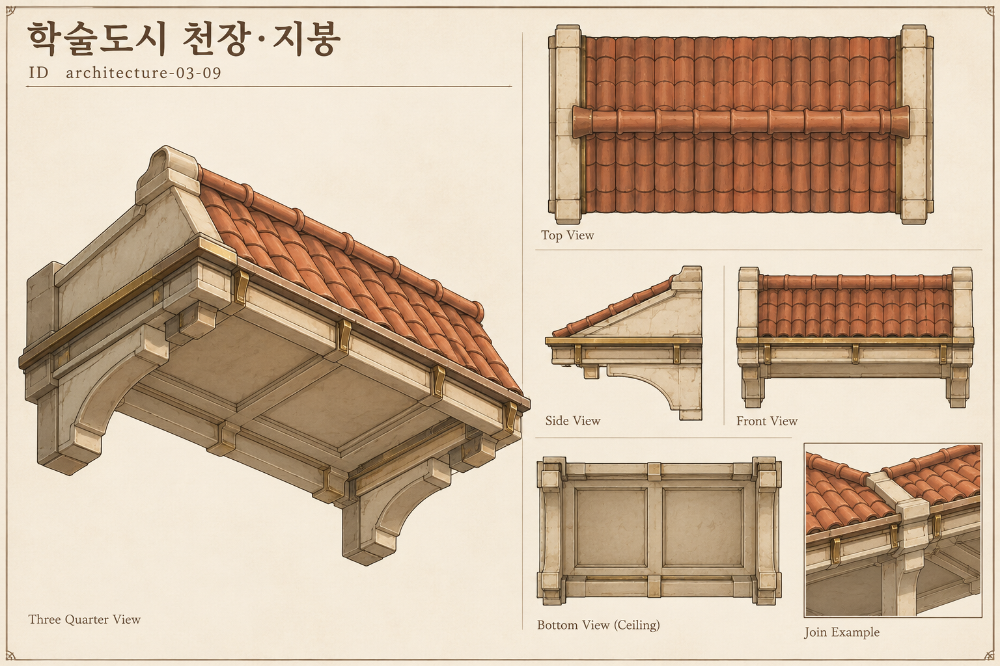

지역별 건축 모듈 외형 참고. 실제 모델·텍스처·충돌·게임 연결은 미제작. 동일 양식의 벽 두께·층고·개구부·바닥 두께·피벗·접합면 규격은 모델링에서 통일. 그림의 연결 예시는 스냅 검증 결과가 아님. 공용 부품 또는 지역 환경 시안과 겹치는 구조는 재사용·재질 변형 후보. 별도 고유 런타임 모델 제작을 강제하지 않음. 뷰별 치수·장식·단수 차이를 정합화하고 게임 카메라에서 세부 묘사를 단순화. 지붕 끝막음·용마루·처마·천장 분리 및 반복 구간 규격 확인. 시안의 단면 표시는 구조 데이터가 아님.

### architecture-04-01 · 남방 항만 벽 직선

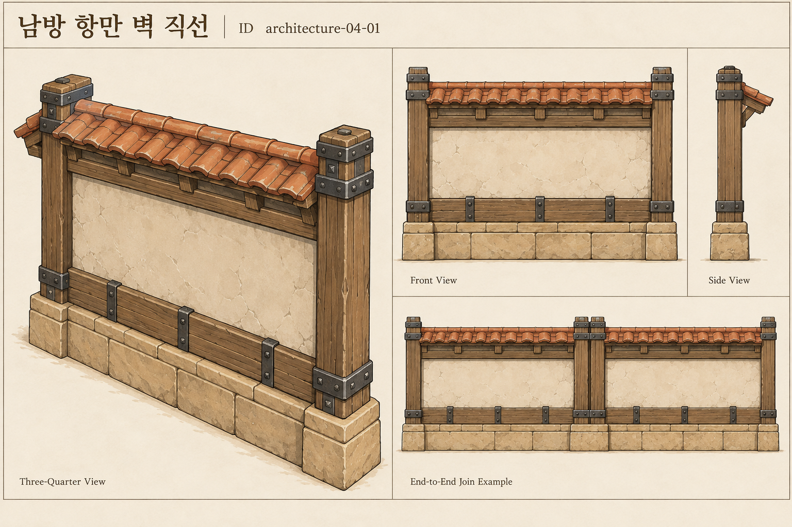

지역별 건축 모듈 외형 참고. 실제 모델·텍스처·충돌·게임 연결은 미제작. 동일 양식의 벽 두께·층고·개구부·바닥 두께·피벗·접합면 규격은 모델링에서 통일. 그림의 연결 예시는 스냅 검증 결과가 아님. 공용 부품 또는 지역 환경 시안과 겹치는 구조는 재사용·재질 변형 후보. 별도 고유 런타임 모델 제작을 강제하지 않음. 뷰별 치수·장식·단수 차이를 정합화하고 게임 카메라에서 세부 묘사를 단순화. 부속 처마·벽 조각·기둥이 함께 표현되면 분리. 문·창 개구부와 벽 모듈을 같은 기준으로 맞춤.

### architecture-04-02 · 남방 항만 벽 모서리

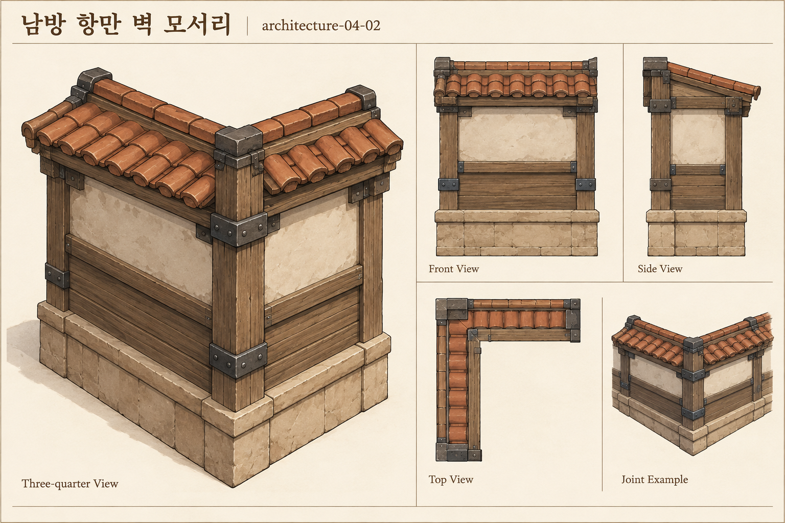

지역별 건축 모듈 외형 참고. 실제 모델·텍스처·충돌·게임 연결은 미제작. 동일 양식의 벽 두께·층고·개구부·바닥 두께·피벗·접합면 규격은 모델링에서 통일. 그림의 연결 예시는 스냅 검증 결과가 아님. 공용 부품 또는 지역 환경 시안과 겹치는 구조는 재사용·재질 변형 후보. 별도 고유 런타임 모델 제작을 강제하지 않음. 뷰별 치수·장식·단수 차이를 정합화하고 게임 카메라에서 세부 묘사를 단순화. 부속 처마·벽 조각·기둥이 함께 표현되면 분리. 문·창 개구부와 벽 모듈을 같은 기준으로 맞춤.

### architecture-04-03 · 남방 항만 문

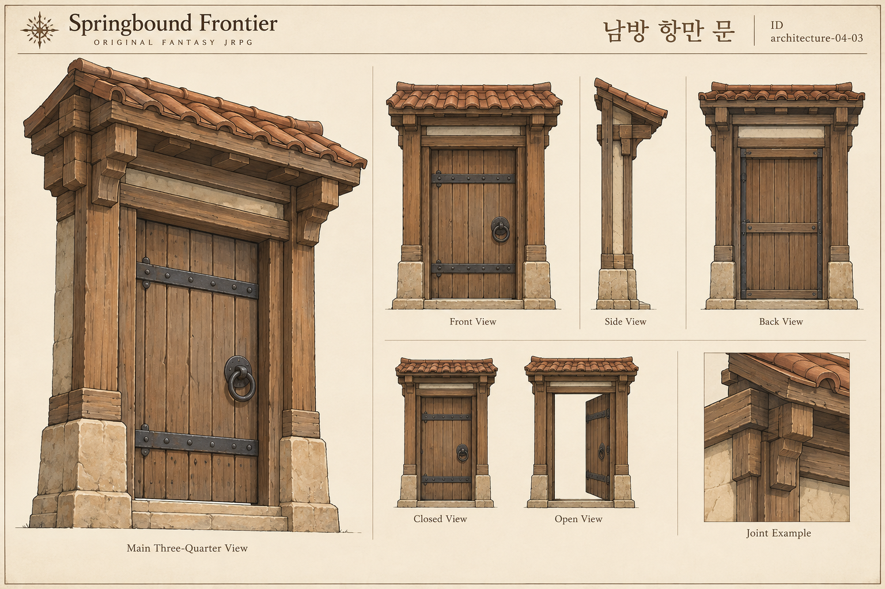

지역별 건축 모듈 외형 참고. 실제 모델·텍스처·충돌·게임 연결은 미제작. 동일 양식의 벽 두께·층고·개구부·바닥 두께·피벗·접합면 규격은 모델링에서 통일. 그림의 연결 예시는 스냅 검증 결과가 아님. 공용 부품 또는 지역 환경 시안과 겹치는 구조는 재사용·재질 변형 후보. 별도 고유 런타임 모델 제작을 강제하지 않음. 뷰별 치수·장식·단수 차이를 정합화하고 게임 카메라에서 세부 묘사를 단순화. 부속 처마·벽 조각·기둥이 함께 표현되면 분리. 문·창 개구부와 벽 모듈을 같은 기준으로 맞춤. 열림 그림은 외형 참고. 경첩 피벗·충돌 전환·상호작용·열림 동작은 별도 구현.

### architecture-04-04 · 남방 항만 창

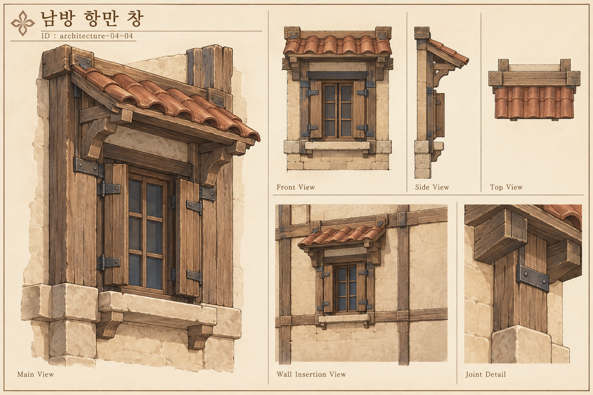

지역별 건축 모듈 외형 참고. 실제 모델·텍스처·충돌·게임 연결은 미제작. 동일 양식의 벽 두께·층고·개구부·바닥 두께·피벗·접합면 규격은 모델링에서 통일. 그림의 연결 예시는 스냅 검증 결과가 아님. 공용 부품 또는 지역 환경 시안과 겹치는 구조는 재사용·재질 변형 후보. 별도 고유 런타임 모델 제작을 강제하지 않음. 뷰별 치수·장식·단수 차이를 정합화하고 게임 카메라에서 세부 묘사를 단순화. 부속 처마·벽 조각·기둥이 함께 표현되면 분리. 문·창 개구부와 벽 모듈을 같은 기준으로 맞춤.

### architecture-04-05 · 남방 항만 바닥

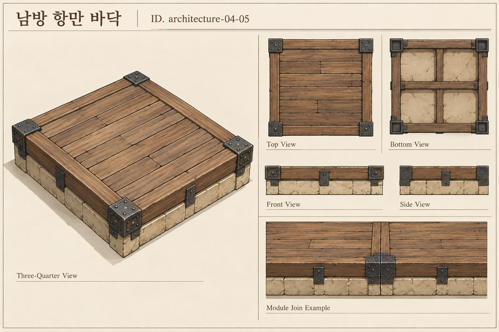

지역별 건축 모듈 외형 참고. 실제 모델·텍스처·충돌·게임 연결은 미제작. 동일 양식의 벽 두께·층고·개구부·바닥 두께·피벗·접합면 규격은 모델링에서 통일. 그림의 연결 예시는 스냅 검증 결과가 아님. 공용 부품 또는 지역 환경 시안과 겹치는 구조는 재사용·재질 변형 후보. 별도 고유 런타임 모델 제작을 강제하지 않음. 뷰별 치수·장식·단수 차이를 정합화하고 게임 카메라에서 세부 묘사를 단순화. 일부 보드는 두꺼운 기단을 포함. 실내 바닥·외부 광장과 구분하고 필요한 두께로 재설계. 무봉제 텍스처 아님.

### architecture-04-06 · 남방 항만 기둥

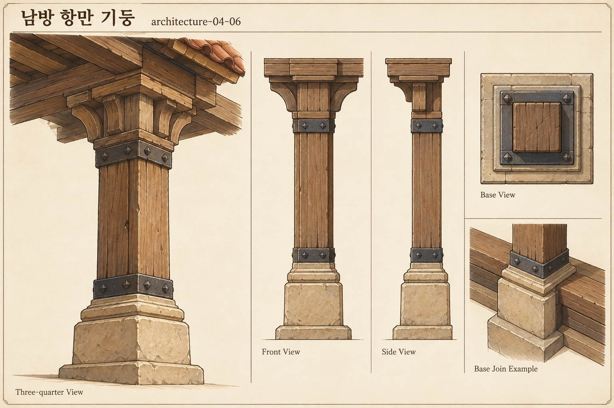

지역별 건축 모듈 외형 참고. 실제 모델·텍스처·충돌·게임 연결은 미제작. 동일 양식의 벽 두께·층고·개구부·바닥 두께·피벗·접합면 규격은 모델링에서 통일. 그림의 연결 예시는 스냅 검증 결과가 아님. 공용 부품 또는 지역 환경 시안과 겹치는 구조는 재사용·재질 변형 후보. 별도 고유 런타임 모델 제작을 강제하지 않음. 뷰별 치수·장식·단수 차이를 정합화하고 게임 카메라에서 세부 묘사를 단순화.

### architecture-04-07 · 남방 항만 계단

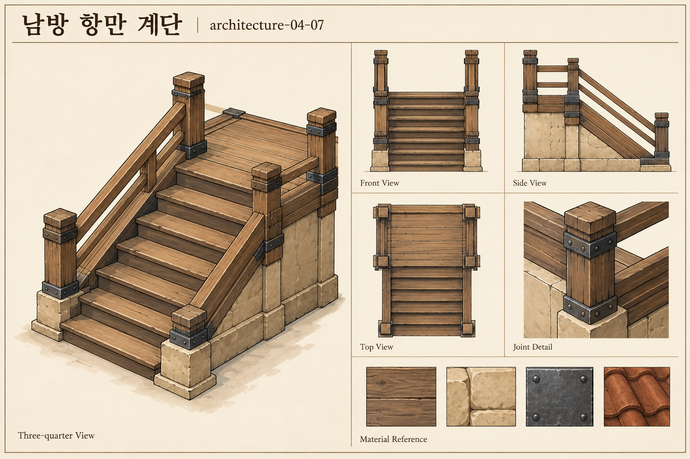

지역별 건축 모듈 외형 참고. 실제 모델·텍스처·충돌·게임 연결은 미제작. 동일 양식의 벽 두께·층고·개구부·바닥 두께·피벗·접합면 규격은 모델링에서 통일. 그림의 연결 예시는 스냅 검증 결과가 아님. 공용 부품 또는 지역 환경 시안과 겹치는 구조는 재사용·재질 변형 후보. 별도 고유 런타임 모델 제작을 강제하지 않음. 뷰별 치수·장식·단수 차이를 정합화하고 게임 카메라에서 세부 묘사를 단순화. 계단 단수·단높이·통행 폭·캐릭터 이동 충돌은 모델 제작 단계에서 검증.

### architecture-04-08 · 남방 항만 난간

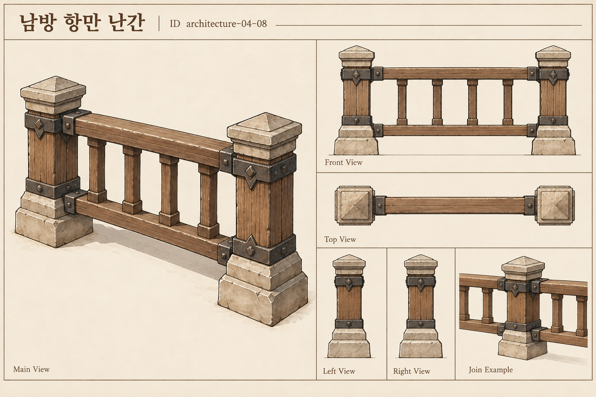

지역별 건축 모듈 외형 참고. 실제 모델·텍스처·충돌·게임 연결은 미제작. 동일 양식의 벽 두께·층고·개구부·바닥 두께·피벗·접합면 규격은 모델링에서 통일. 그림의 연결 예시는 스냅 검증 결과가 아님. 공용 부품 또는 지역 환경 시안과 겹치는 구조는 재사용·재질 변형 후보. 별도 고유 런타임 모델 제작을 강제하지 않음. 뷰별 치수·장식·단수 차이를 정합화하고 게임 카메라에서 세부 묘사를 단순화.

### architecture-04-09 · 남방 항만 천장·지붕

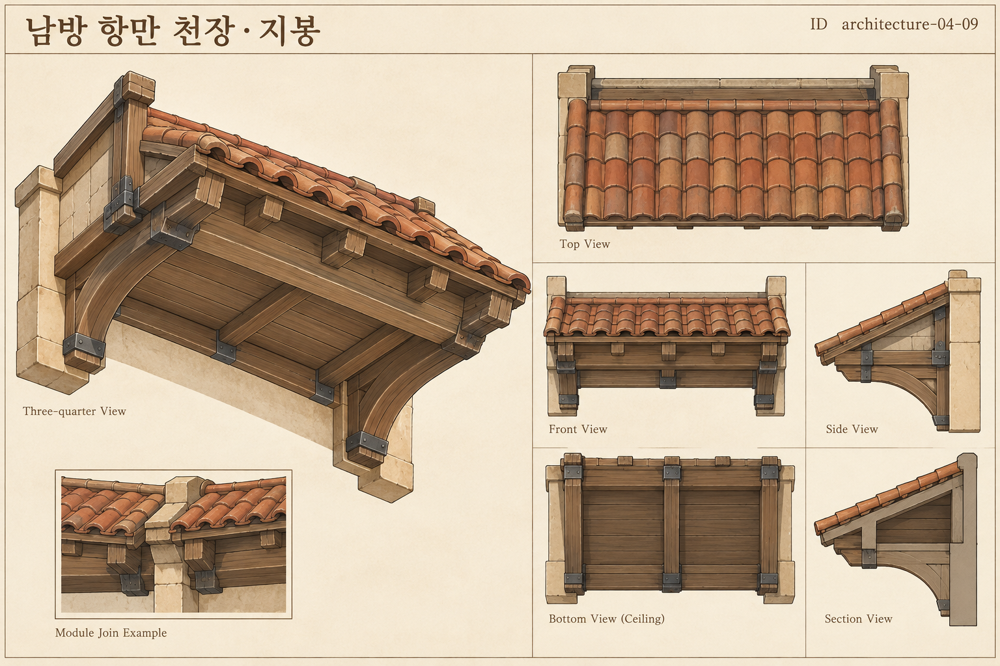

지역별 건축 모듈 외형 참고. 실제 모델·텍스처·충돌·게임 연결은 미제작. 동일 양식의 벽 두께·층고·개구부·바닥 두께·피벗·접합면 규격은 모델링에서 통일. 그림의 연결 예시는 스냅 검증 결과가 아님. 공용 부품 또는 지역 환경 시안과 겹치는 구조는 재사용·재질 변형 후보. 별도 고유 런타임 모델 제작을 강제하지 않음. 뷰별 치수·장식·단수 차이를 정합화하고 게임 카메라에서 세부 묘사를 단순화. 지붕 끝막음·용마루·처마·천장 분리 및 반복 구간 규격 확인. 시안의 단면 표시는 구조 데이터가 아님.

### architecture-05-01 · 해양국 벽 직선

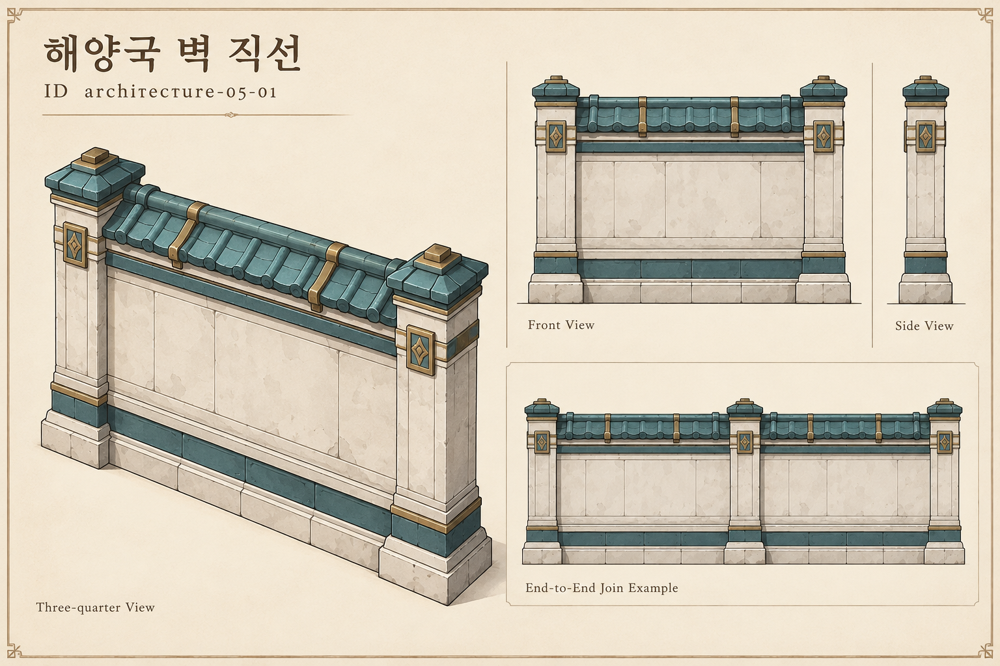

지역별 건축 모듈 외형 참고. 실제 모델·텍스처·충돌·게임 연결은 미제작. 동일 양식의 벽 두께·층고·개구부·바닥 두께·피벗·접합면 규격은 모델링에서 통일. 그림의 연결 예시는 스냅 검증 결과가 아님. 공용 부품 또는 지역 환경 시안과 겹치는 구조는 재사용·재질 변형 후보. 별도 고유 런타임 모델 제작을 강제하지 않음. 뷰별 치수·장식·단수 차이를 정합화하고 게임 카메라에서 세부 묘사를 단순화. 부속 처마·벽 조각·기둥이 함께 표현되면 분리. 문·창 개구부와 벽 모듈을 같은 기준으로 맞춤.

### architecture-05-02 · 해양국 벽 모서리

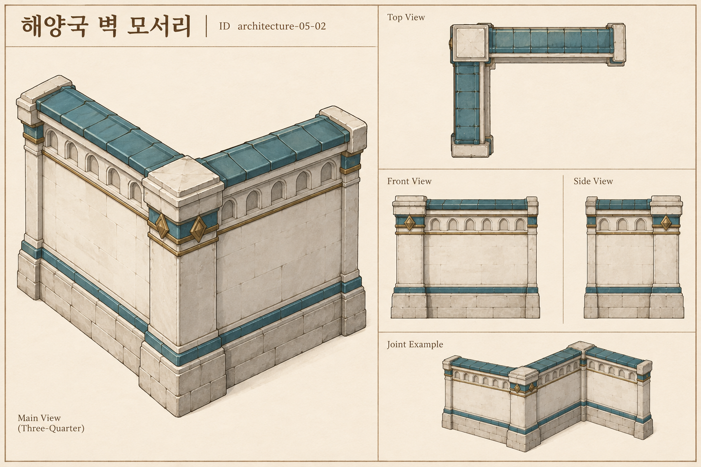

지역별 건축 모듈 외형 참고. 실제 모델·텍스처·충돌·게임 연결은 미제작. 동일 양식의 벽 두께·층고·개구부·바닥 두께·피벗·접합면 규격은 모델링에서 통일. 그림의 연결 예시는 스냅 검증 결과가 아님. 공용 부품 또는 지역 환경 시안과 겹치는 구조는 재사용·재질 변형 후보. 별도 고유 런타임 모델 제작을 강제하지 않음. 뷰별 치수·장식·단수 차이를 정합화하고 게임 카메라에서 세부 묘사를 단순화. 부속 처마·벽 조각·기둥이 함께 표현되면 분리. 문·창 개구부와 벽 모듈을 같은 기준으로 맞춤.

### architecture-05-03 · 해양국 문

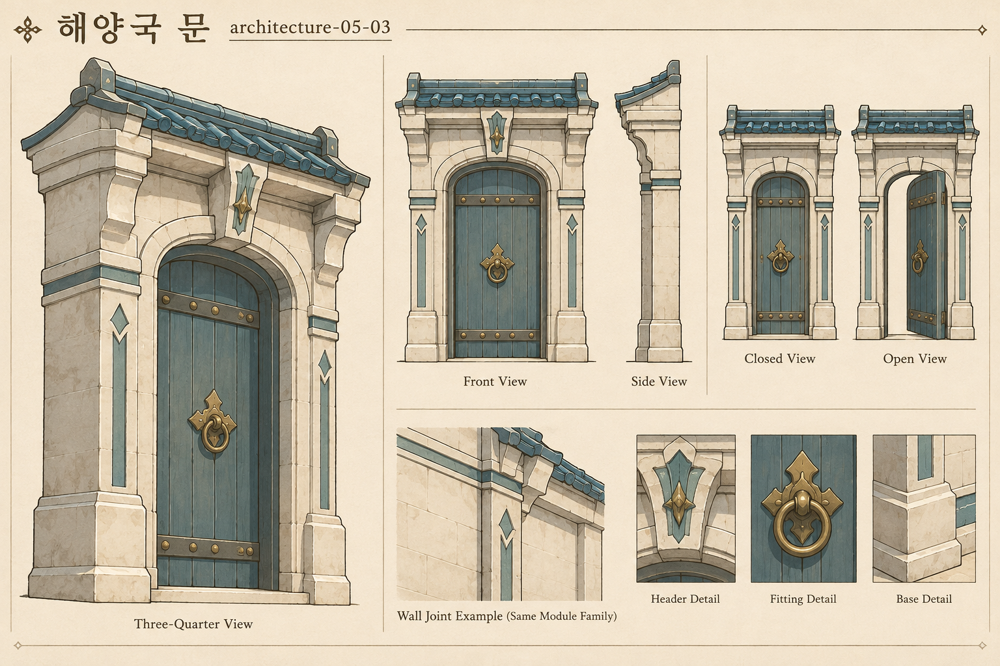

지역별 건축 모듈 외형 참고. 실제 모델·텍스처·충돌·게임 연결은 미제작. 동일 양식의 벽 두께·층고·개구부·바닥 두께·피벗·접합면 규격은 모델링에서 통일. 그림의 연결 예시는 스냅 검증 결과가 아님. 공용 부품 또는 지역 환경 시안과 겹치는 구조는 재사용·재질 변형 후보. 별도 고유 런타임 모델 제작을 강제하지 않음. 뷰별 치수·장식·단수 차이를 정합화하고 게임 카메라에서 세부 묘사를 단순화. 부속 처마·벽 조각·기둥이 함께 표현되면 분리. 문·창 개구부와 벽 모듈을 같은 기준으로 맞춤. 열림 그림은 외형 참고. 경첩 피벗·충돌 전환·상호작용·열림 동작은 별도 구현.

### architecture-05-04 · 해양국 창

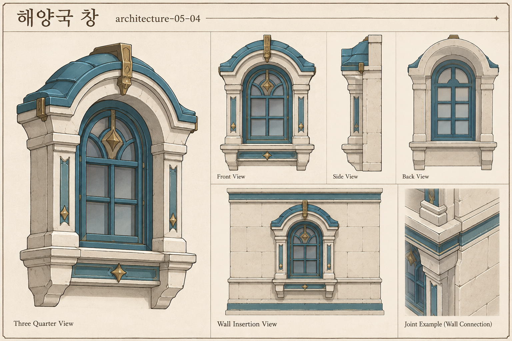

지역별 건축 모듈 외형 참고. 실제 모델·텍스처·충돌·게임 연결은 미제작. 동일 양식의 벽 두께·층고·개구부·바닥 두께·피벗·접합면 규격은 모델링에서 통일. 그림의 연결 예시는 스냅 검증 결과가 아님. 공용 부품 또는 지역 환경 시안과 겹치는 구조는 재사용·재질 변형 후보. 별도 고유 런타임 모델 제작을 강제하지 않음. 뷰별 치수·장식·단수 차이를 정합화하고 게임 카메라에서 세부 묘사를 단순화. 부속 처마·벽 조각·기둥이 함께 표현되면 분리. 문·창 개구부와 벽 모듈을 같은 기준으로 맞춤.

### architecture-05-05 · 해양국 바닥

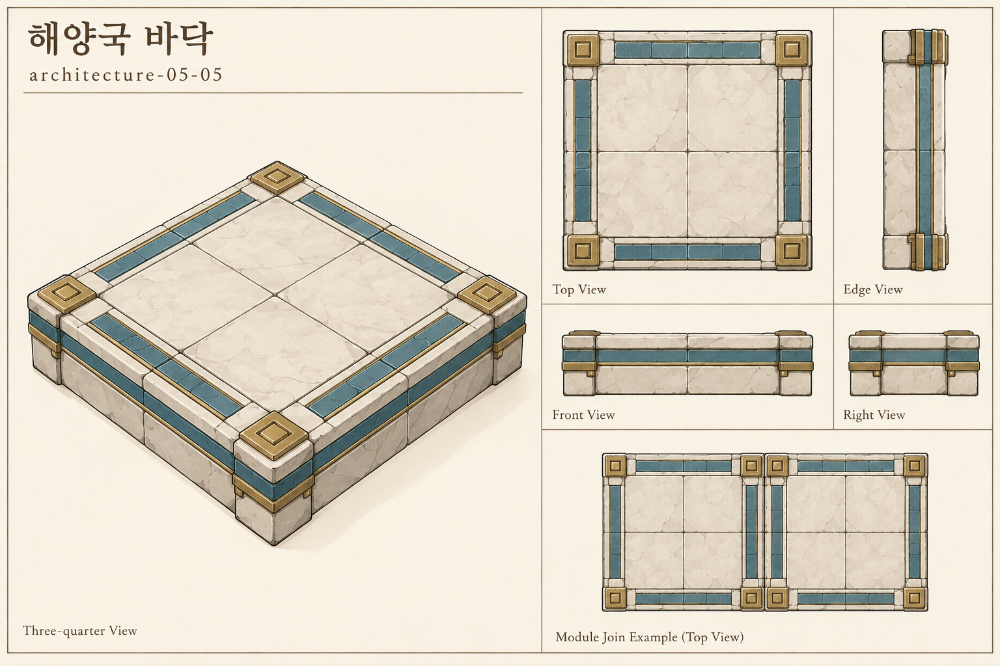

지역별 건축 모듈 외형 참고. 실제 모델·텍스처·충돌·게임 연결은 미제작. 동일 양식의 벽 두께·층고·개구부·바닥 두께·피벗·접합면 규격은 모델링에서 통일. 그림의 연결 예시는 스냅 검증 결과가 아님. 공용 부품 또는 지역 환경 시안과 겹치는 구조는 재사용·재질 변형 후보. 별도 고유 런타임 모델 제작을 강제하지 않음. 뷰별 치수·장식·단수 차이를 정합화하고 게임 카메라에서 세부 묘사를 단순화. 일부 보드는 두꺼운 기단을 포함. 실내 바닥·외부 광장과 구분하고 필요한 두께로 재설계. 무봉제 텍스처 아님.

### architecture-05-06 · 해양국 기둥

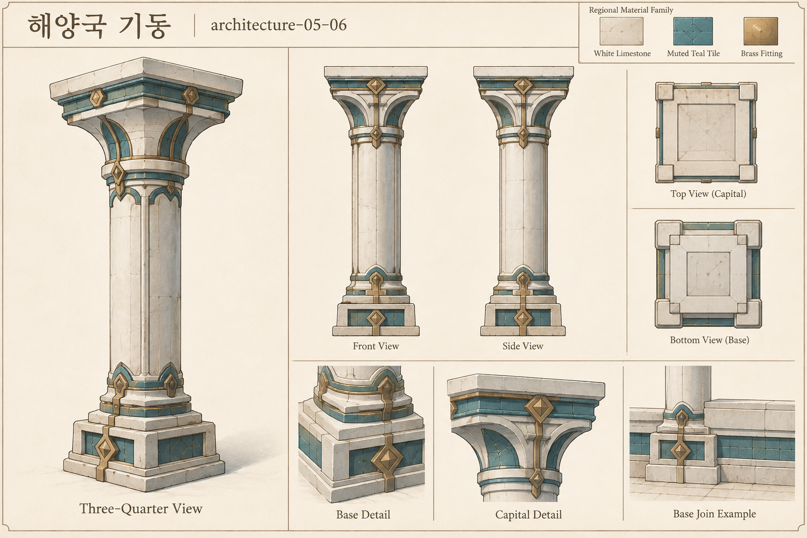

지역별 건축 모듈 외형 참고. 실제 모델·텍스처·충돌·게임 연결은 미제작. 동일 양식의 벽 두께·층고·개구부·바닥 두께·피벗·접합면 규격은 모델링에서 통일. 그림의 연결 예시는 스냅 검증 결과가 아님. 공용 부품 또는 지역 환경 시안과 겹치는 구조는 재사용·재질 변형 후보. 별도 고유 런타임 모델 제작을 강제하지 않음. 뷰별 치수·장식·단수 차이를 정합화하고 게임 카메라에서 세부 묘사를 단순화.

### architecture-05-07 · 해양국 계단

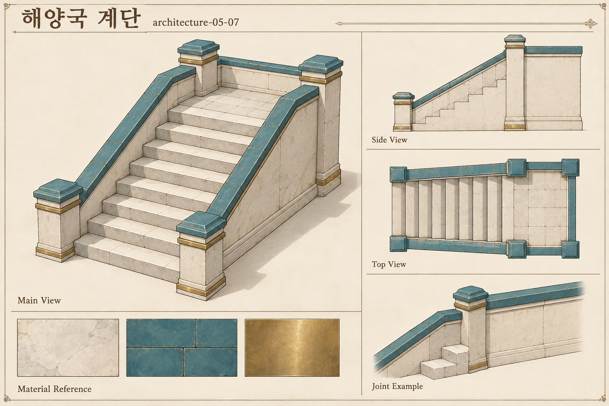

지역별 건축 모듈 외형 참고. 실제 모델·텍스처·충돌·게임 연결은 미제작. 동일 양식의 벽 두께·층고·개구부·바닥 두께·피벗·접합면 규격은 모델링에서 통일. 그림의 연결 예시는 스냅 검증 결과가 아님. 공용 부품 또는 지역 환경 시안과 겹치는 구조는 재사용·재질 변형 후보. 별도 고유 런타임 모델 제작을 강제하지 않음. 뷰별 치수·장식·단수 차이를 정합화하고 게임 카메라에서 세부 묘사를 단순화. 계단 단수·단높이·통행 폭·캐릭터 이동 충돌은 모델 제작 단계에서 검증.

### architecture-05-08 · 해양국 난간

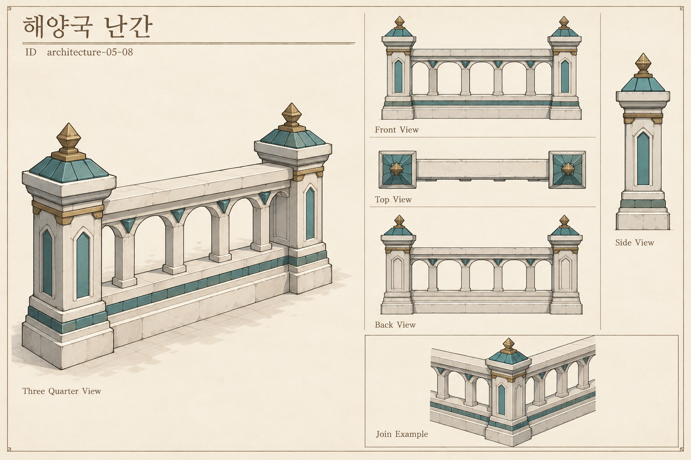

지역별 건축 모듈 외형 참고. 실제 모델·텍스처·충돌·게임 연결은 미제작. 동일 양식의 벽 두께·층고·개구부·바닥 두께·피벗·접합면 규격은 모델링에서 통일. 그림의 연결 예시는 스냅 검증 결과가 아님. 공용 부품 또는 지역 환경 시안과 겹치는 구조는 재사용·재질 변형 후보. 별도 고유 런타임 모델 제작을 강제하지 않음. 뷰별 치수·장식·단수 차이를 정합화하고 게임 카메라에서 세부 묘사를 단순화.

### architecture-05-09 · 해양국 천장·지붕

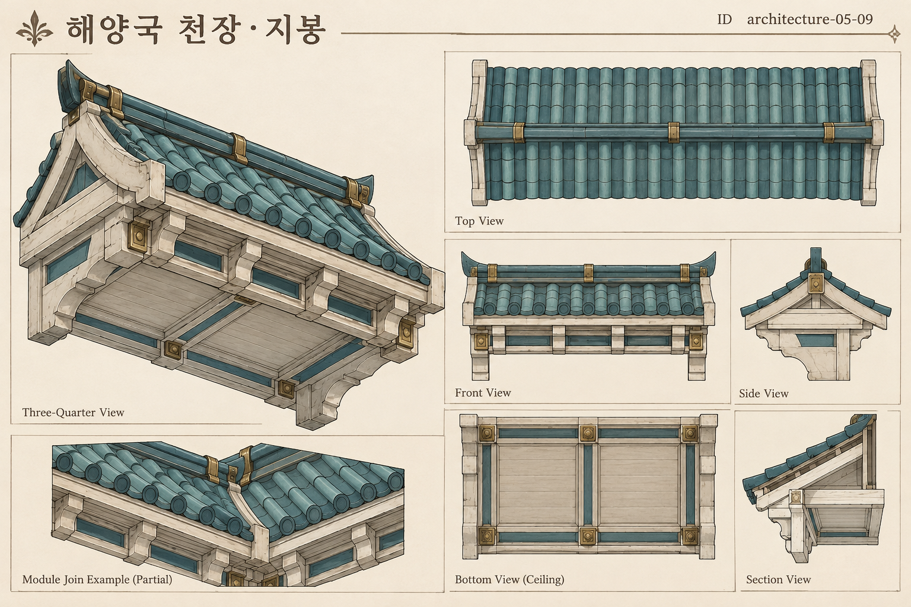

지역별 건축 모듈 외형 참고. 실제 모델·텍스처·충돌·게임 연결은 미제작. 동일 양식의 벽 두께·층고·개구부·바닥 두께·피벗·접합면 규격은 모델링에서 통일. 그림의 연결 예시는 스냅 검증 결과가 아님. 공용 부품 또는 지역 환경 시안과 겹치는 구조는 재사용·재질 변형 후보. 별도 고유 런타임 모델 제작을 강제하지 않음. 뷰별 치수·장식·단수 차이를 정합화하고 게임 카메라에서 세부 묘사를 단순화. 지붕 끝막음·용마루·처마·천장 분리 및 반복 구간 규격 확인. 시안의 단면 표시는 구조 데이터가 아님.

### architecture-06-01 · 성역 벽 직선

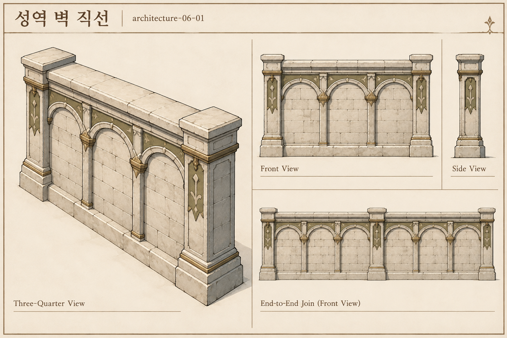

지역별 건축 모듈 외형 참고. 실제 모델·텍스처·충돌·게임 연결은 미제작. 동일 양식의 벽 두께·층고·개구부·바닥 두께·피벗·접합면 규격은 모델링에서 통일. 그림의 연결 예시는 스냅 검증 결과가 아님. 공용 부품 또는 지역 환경 시안과 겹치는 구조는 재사용·재질 변형 후보. 별도 고유 런타임 모델 제작을 강제하지 않음. 뷰별 치수·장식·단수 차이를 정합화하고 게임 카메라에서 세부 묘사를 단순화. 부속 처마·벽 조각·기둥이 함께 표현되면 분리. 문·창 개구부와 벽 모듈을 같은 기준으로 맞춤.

### architecture-06-02 · 성역 벽 모서리

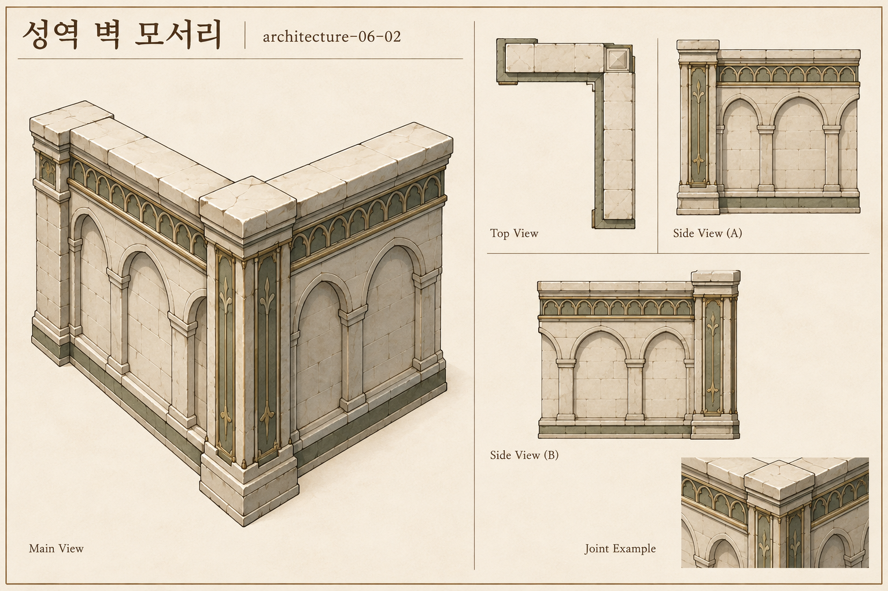

지역별 건축 모듈 외형 참고. 실제 모델·텍스처·충돌·게임 연결은 미제작. 동일 양식의 벽 두께·층고·개구부·바닥 두께·피벗·접합면 규격은 모델링에서 통일. 그림의 연결 예시는 스냅 검증 결과가 아님. 공용 부품 또는 지역 환경 시안과 겹치는 구조는 재사용·재질 변형 후보. 별도 고유 런타임 모델 제작을 강제하지 않음. 뷰별 치수·장식·단수 차이를 정합화하고 게임 카메라에서 세부 묘사를 단순화. 부속 처마·벽 조각·기둥이 함께 표현되면 분리. 문·창 개구부와 벽 모듈을 같은 기준으로 맞춤.

### architecture-06-03 · 성역 문

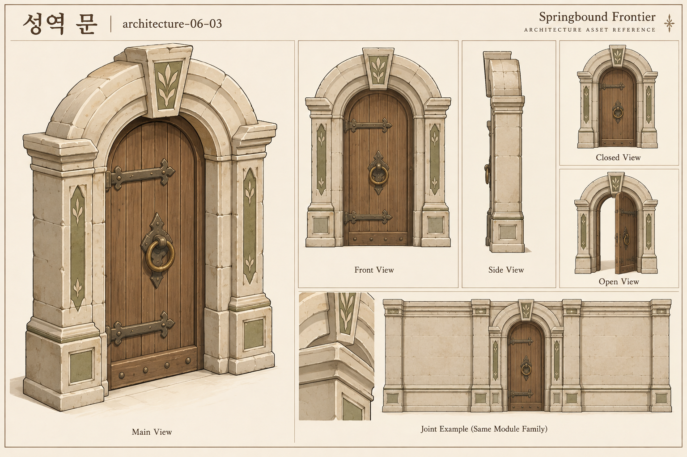

지역별 건축 모듈 외형 참고. 실제 모델·텍스처·충돌·게임 연결은 미제작. 동일 양식의 벽 두께·층고·개구부·바닥 두께·피벗·접합면 규격은 모델링에서 통일. 그림의 연결 예시는 스냅 검증 결과가 아님. 공용 부품 또는 지역 환경 시안과 겹치는 구조는 재사용·재질 변형 후보. 별도 고유 런타임 모델 제작을 강제하지 않음. 뷰별 치수·장식·단수 차이를 정합화하고 게임 카메라에서 세부 묘사를 단순화. 부속 처마·벽 조각·기둥이 함께 표현되면 분리. 문·창 개구부와 벽 모듈을 같은 기준으로 맞춤. 열림 그림은 외형 참고. 경첩 피벗·충돌 전환·상호작용·열림 동작은 별도 구현.

### architecture-06-04 · 성역 창

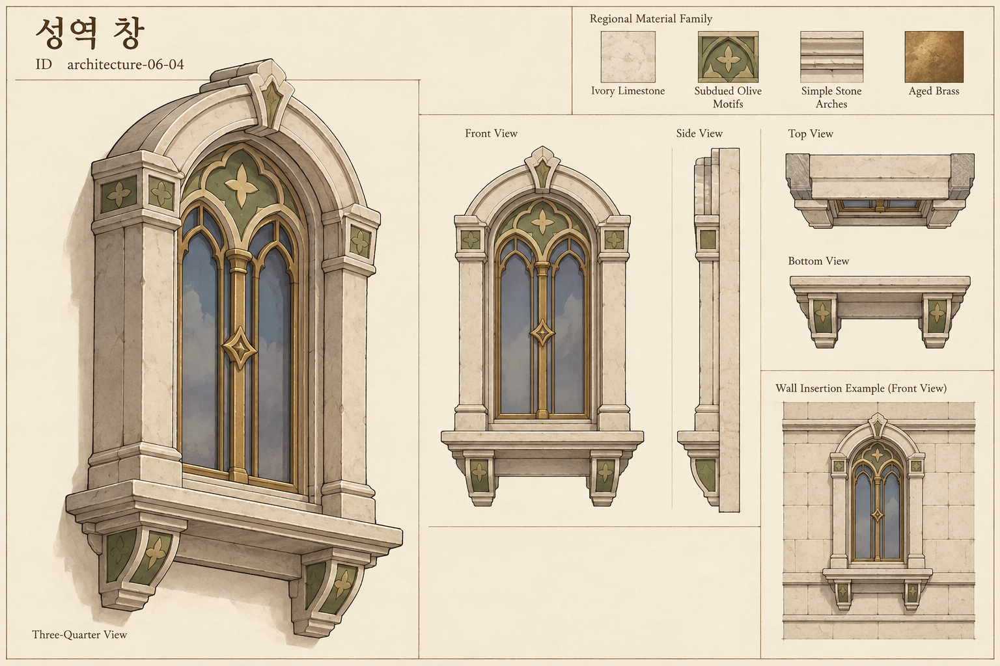

지역별 건축 모듈 외형 참고. 실제 모델·텍스처·충돌·게임 연결은 미제작. 동일 양식의 벽 두께·층고·개구부·바닥 두께·피벗·접합면 규격은 모델링에서 통일. 그림의 연결 예시는 스냅 검증 결과가 아님. 공용 부품 또는 지역 환경 시안과 겹치는 구조는 재사용·재질 변형 후보. 별도 고유 런타임 모델 제작을 강제하지 않음. 뷰별 치수·장식·단수 차이를 정합화하고 게임 카메라에서 세부 묘사를 단순화. 부속 처마·벽 조각·기둥이 함께 표현되면 분리. 문·창 개구부와 벽 모듈을 같은 기준으로 맞춤.

### architecture-06-05 · 성역 바닥

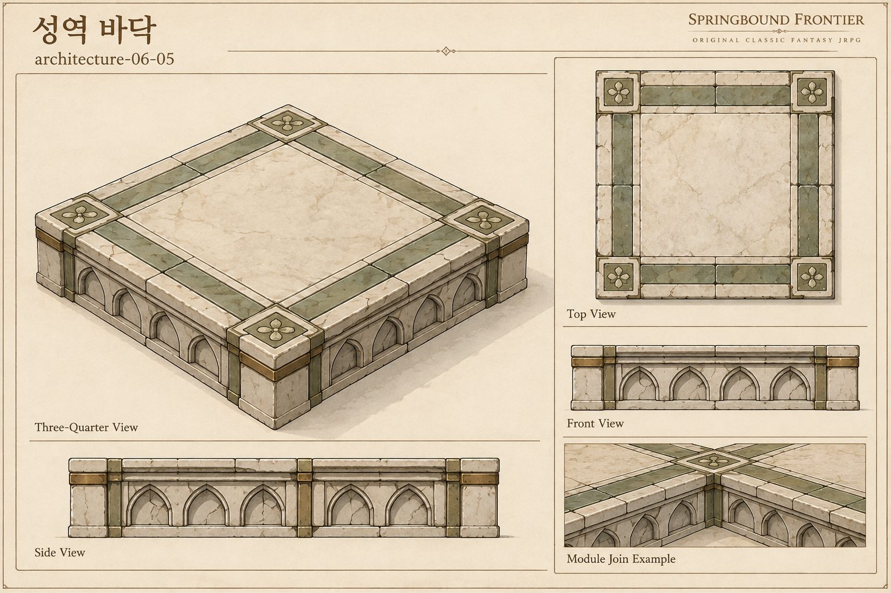

지역별 건축 모듈 외형 참고. 실제 모델·텍스처·충돌·게임 연결은 미제작. 동일 양식의 벽 두께·층고·개구부·바닥 두께·피벗·접합면 규격은 모델링에서 통일. 그림의 연결 예시는 스냅 검증 결과가 아님. 공용 부품 또는 지역 환경 시안과 겹치는 구조는 재사용·재질 변형 후보. 별도 고유 런타임 모델 제작을 강제하지 않음. 뷰별 치수·장식·단수 차이를 정합화하고 게임 카메라에서 세부 묘사를 단순화. 일부 보드는 두꺼운 기단을 포함. 실내 바닥·외부 광장과 구분하고 필요한 두께로 재설계. 무봉제 텍스처 아님.

### architecture-06-06 · 성역 기둥

지역별 건축 모듈 외형 참고. 실제 모델·텍스처·충돌·게임 연결은 미제작. 동일 양식의 벽 두께·층고·개구부·바닥 두께·피벗·접합면 규격은 모델링에서 통일. 그림의 연결 예시는 스냅 검증 결과가 아님. 공용 부품 또는 지역 환경 시안과 겹치는 구조는 재사용·재질 변형 후보. 별도 고유 런타임 모델 제작을 강제하지 않음. 뷰별 치수·장식·단수 차이를 정합화하고 게임 카메라에서 세부 묘사를 단순화.

### architecture-06-07 · 성역 계단

지역별 건축 모듈 외형 참고. 실제 모델·텍스처·충돌·게임 연결은 미제작. 동일 양식의 벽 두께·층고·개구부·바닥 두께·피벗·접합면 규격은 모델링에서 통일. 그림의 연결 예시는 스냅 검증 결과가 아님. 공용 부품 또는 지역 환경 시안과 겹치는 구조는 재사용·재질 변형 후보. 별도 고유 런타임 모델 제작을 강제하지 않음. 뷰별 치수·장식·단수 차이를 정합화하고 게임 카메라에서 세부 묘사를 단순화. 계단 단수·단높이·통행 폭·캐릭터 이동 충돌은 모델 제작 단계에서 검증.

### architecture-06-08 · 성역 난간

지역별 건축 모듈 외형 참고. 실제 모델·텍스처·충돌·게임 연결은 미제작. 동일 양식의 벽 두께·층고·개구부·바닥 두께·피벗·접합면 규격은 모델링에서 통일. 그림의 연결 예시는 스냅 검증 결과가 아님. 공용 부품 또는 지역 환경 시안과 겹치는 구조는 재사용·재질 변형 후보. 별도 고유 런타임 모델 제작을 강제하지 않음. 뷰별 치수·장식·단수 차이를 정합화하고 게임 카메라에서 세부 묘사를 단순화.

### architecture-06-09 · 성역 천장·지붕

지역별 건축 모듈 외형 참고. 실제 모델·텍스처·충돌·게임 연결은 미제작. 동일 양식의 벽 두께·층고·개구부·바닥 두께·피벗·접합면 규격은 모델링에서 통일. 그림의 연결 예시는 스냅 검증 결과가 아님. 공용 부품 또는 지역 환경 시안과 겹치는 구조는 재사용·재질 변형 후보. 별도 고유 런타임 모델 제작을 강제하지 않음. 뷰별 치수·장식·단수 차이를 정합화하고 게임 카메라에서 세부 묘사를 단순화. 지붕 끝막음·용마루·처마·천장 분리 및 반복 구간 규격 확인. 시안의 단면 표시는 구조 데이터가 아님.

### architecture-07-01 · 북방 시설 벽 직선

지역별 건축 모듈 외형 참고. 실제 모델·텍스처·충돌·게임 연결은 미제작. 동일 양식의 벽 두께·층고·개구부·바닥 두께·피벗·접합면 규격은 모델링에서 통일. 그림의 연결 예시는 스냅 검증 결과가 아님. 공용 부품 또는 지역 환경 시안과 겹치는 구조는 재사용·재질 변형 후보. 별도 고유 런타임 모델 제작을 강제하지 않음. 뷰별 치수·장식·단수 차이를 정합화하고 게임 카메라에서 세부 묘사를 단순화. 부속 처마·벽 조각·기둥이 함께 표현되면 분리. 문·창 개구부와 벽 모듈을 같은 기준으로 맞춤.

### architecture-07-02 · 북방 시설 벽 모서리

지역별 건축 모듈 외형 참고. 실제 모델·텍스처·충돌·게임 연결은 미제작. 동일 양식의 벽 두께·층고·개구부·바닥 두께·피벗·접합면 규격은 모델링에서 통일. 그림의 연결 예시는 스냅 검증 결과가 아님. 공용 부품 또는 지역 환경 시안과 겹치는 구조는 재사용·재질 변형 후보. 별도 고유 런타임 모델 제작을 강제하지 않음. 뷰별 치수·장식·단수 차이를 정합화하고 게임 카메라에서 세부 묘사를 단순화. 부속 처마·벽 조각·기둥이 함께 표현되면 분리. 문·창 개구부와 벽 모듈을 같은 기준으로 맞춤.

### architecture-07-03 · 북방 시설 문

지역별 건축 모듈 외형 참고. 실제 모델·텍스처·충돌·게임 연결은 미제작. 동일 양식의 벽 두께·층고·개구부·바닥 두께·피벗·접합면 규격은 모델링에서 통일. 그림의 연결 예시는 스냅 검증 결과가 아님. 공용 부품 또는 지역 환경 시안과 겹치는 구조는 재사용·재질 변형 후보. 별도 고유 런타임 모델 제작을 강제하지 않음. 뷰별 치수·장식·단수 차이를 정합화하고 게임 카메라에서 세부 묘사를 단순화. 부속 처마·벽 조각·기둥이 함께 표현되면 분리. 문·창 개구부와 벽 모듈을 같은 기준으로 맞춤. 열림 그림은 외형 참고. 경첩 피벗·충돌 전환·상호작용·열림 동작은 별도 구현.

### architecture-07-04 · 북방 시설 창

지역별 건축 모듈 외형 참고. 실제 모델·텍스처·충돌·게임 연결은 미제작. 동일 양식의 벽 두께·층고·개구부·바닥 두께·피벗·접합면 규격은 모델링에서 통일. 그림의 연결 예시는 스냅 검증 결과가 아님. 공용 부품 또는 지역 환경 시안과 겹치는 구조는 재사용·재질 변형 후보. 별도 고유 런타임 모델 제작을 강제하지 않음. 뷰별 치수·장식·단수 차이를 정합화하고 게임 카메라에서 세부 묘사를 단순화. 부속 처마·벽 조각·기둥이 함께 표현되면 분리. 문·창 개구부와 벽 모듈을 같은 기준으로 맞춤.

### architecture-07-05 · 북방 시설 바닥

지역별 건축 모듈 외형 참고. 실제 모델·텍스처·충돌·게임 연결은 미제작. 동일 양식의 벽 두께·층고·개구부·바닥 두께·피벗·접합면 규격은 모델링에서 통일. 그림의 연결 예시는 스냅 검증 결과가 아님. 공용 부품 또는 지역 환경 시안과 겹치는 구조는 재사용·재질 변형 후보. 별도 고유 런타임 모델 제작을 강제하지 않음. 뷰별 치수·장식·단수 차이를 정합화하고 게임 카메라에서 세부 묘사를 단순화. 일부 보드는 두꺼운 기단을 포함. 실내 바닥·외부 광장과 구분하고 필요한 두께로 재설계. 무봉제 텍스처 아님.

### architecture-07-06 · 북방 시설 기둥

지역별 건축 모듈 외형 참고. 실제 모델·텍스처·충돌·게임 연결은 미제작. 동일 양식의 벽 두께·층고·개구부·바닥 두께·피벗·접합면 규격은 모델링에서 통일. 그림의 연결 예시는 스냅 검증 결과가 아님. 공용 부품 또는 지역 환경 시안과 겹치는 구조는 재사용·재질 변형 후보. 별도 고유 런타임 모델 제작을 강제하지 않음. 뷰별 치수·장식·단수 차이를 정합화하고 게임 카메라에서 세부 묘사를 단순화.

### architecture-07-07 · 북방 시설 계단

지역별 건축 모듈 외형 참고. 실제 모델·텍스처·충돌·게임 연결은 미제작. 동일 양식의 벽 두께·층고·개구부·바닥 두께·피벗·접합면 규격은 모델링에서 통일. 그림의 연결 예시는 스냅 검증 결과가 아님. 공용 부품 또는 지역 환경 시안과 겹치는 구조는 재사용·재질 변형 후보. 별도 고유 런타임 모델 제작을 강제하지 않음. 뷰별 치수·장식·단수 차이를 정합화하고 게임 카메라에서 세부 묘사를 단순화. 계단 단수·단높이·통행 폭·캐릭터 이동 충돌은 모델 제작 단계에서 검증.

### architecture-07-08 · 북방 시설 난간

지역별 건축 모듈 외형 참고. 실제 모델·텍스처·충돌·게임 연결은 미제작. 동일 양식의 벽 두께·층고·개구부·바닥 두께·피벗·접합면 규격은 모델링에서 통일. 그림의 연결 예시는 스냅 검증 결과가 아님. 공용 부품 또는 지역 환경 시안과 겹치는 구조는 재사용·재질 변형 후보. 별도 고유 런타임 모델 제작을 강제하지 않음. 뷰별 치수·장식·단수 차이를 정합화하고 게임 카메라에서 세부 묘사를 단순화.

### architecture-07-09 · 북방 시설 천장·지붕

지역별 건축 모듈 외형 참고. 실제 모델·텍스처·충돌·게임 연결은 미제작. 동일 양식의 벽 두께·층고·개구부·바닥 두께·피벗·접합면 규격은 모델링에서 통일. 그림의 연결 예시는 스냅 검증 결과가 아님. 공용 부품 또는 지역 환경 시안과 겹치는 구조는 재사용·재질 변형 후보. 별도 고유 런타임 모델 제작을 강제하지 않음. 뷰별 치수·장식·단수 차이를 정합화하고 게임 카메라에서 세부 묘사를 단순화. 지붕 끝막음·용마루·처마·천장 분리 및 반복 구간 규격 확인. 시안의 단면 표시는 구조 데이터가 아님.

### architecture-08-01 · 고대 중추 벽 직선

지역별 건축 모듈 외형 참고. 실제 모델·텍스처·충돌·게임 연결은 미제작. 동일 양식의 벽 두께·층고·개구부·바닥 두께·피벗·접합면 규격은 모델링에서 통일. 그림의 연결 예시는 스냅 검증 결과가 아님. 공용 부품 또는 지역 환경 시안과 겹치는 구조는 재사용·재질 변형 후보. 별도 고유 런타임 모델 제작을 강제하지 않음. 뷰별 치수·장식·단수 차이를 정합화하고 게임 카메라에서 세부 묘사를 단순화. 부속 처마·벽 조각·기둥이 함께 표현되면 분리. 문·창 개구부와 벽 모듈을 같은 기준으로 맞춤.

### architecture-08-02 · 고대 중추 벽 모서리

지역별 건축 모듈 외형 참고. 실제 모델·텍스처·충돌·게임 연결은 미제작. 동일 양식의 벽 두께·층고·개구부·바닥 두께·피벗·접합면 규격은 모델링에서 통일. 그림의 연결 예시는 스냅 검증 결과가 아님. 공용 부품 또는 지역 환경 시안과 겹치는 구조는 재사용·재질 변형 후보. 별도 고유 런타임 모델 제작을 강제하지 않음. 뷰별 치수·장식·단수 차이를 정합화하고 게임 카메라에서 세부 묘사를 단순화. 부속 처마·벽 조각·기둥이 함께 표현되면 분리. 문·창 개구부와 벽 모듈을 같은 기준으로 맞춤.

### architecture-08-03 · 고대 중추 문

지역별 건축 모듈 외형 참고. 실제 모델·텍스처·충돌·게임 연결은 미제작. 동일 양식의 벽 두께·층고·개구부·바닥 두께·피벗·접합면 규격은 모델링에서 통일. 그림의 연결 예시는 스냅 검증 결과가 아님. 공용 부품 또는 지역 환경 시안과 겹치는 구조는 재사용·재질 변형 후보. 별도 고유 런타임 모델 제작을 강제하지 않음. 뷰별 치수·장식·단수 차이를 정합화하고 게임 카메라에서 세부 묘사를 단순화. 부속 처마·벽 조각·기둥이 함께 표현되면 분리. 문·창 개구부와 벽 모듈을 같은 기준으로 맞춤. 열림 그림은 외형 참고. 경첩 피벗·충돌 전환·상호작용·열림 동작은 별도 구현.

### architecture-08-04 · 고대 중추 창

지역별 건축 모듈 외형 참고. 실제 모델·텍스처·충돌·게임 연결은 미제작. 동일 양식의 벽 두께·층고·개구부·바닥 두께·피벗·접합면 규격은 모델링에서 통일. 그림의 연결 예시는 스냅 검증 결과가 아님. 공용 부품 또는 지역 환경 시안과 겹치는 구조는 재사용·재질 변형 후보. 별도 고유 런타임 모델 제작을 강제하지 않음. 뷰별 치수·장식·단수 차이를 정합화하고 게임 카메라에서 세부 묘사를 단순화. 부속 처마·벽 조각·기둥이 함께 표현되면 분리. 문·창 개구부와 벽 모듈을 같은 기준으로 맞춤.

### architecture-08-05 · 고대 중추 바닥

지역별 건축 모듈 외형 참고. 실제 모델·텍스처·충돌·게임 연결은 미제작. 동일 양식의 벽 두께·층고·개구부·바닥 두께·피벗·접합면 규격은 모델링에서 통일. 그림의 연결 예시는 스냅 검증 결과가 아님. 공용 부품 또는 지역 환경 시안과 겹치는 구조는 재사용·재질 변형 후보. 별도 고유 런타임 모델 제작을 강제하지 않음. 뷰별 치수·장식·단수 차이를 정합화하고 게임 카메라에서 세부 묘사를 단순화. 일부 보드는 두꺼운 기단을 포함. 실내 바닥·외부 광장과 구분하고 필요한 두께로 재설계. 무봉제 텍스처 아님.

### architecture-08-06 · 고대 중추 기둥

지역별 건축 모듈 외형 참고. 실제 모델·텍스처·충돌·게임 연결은 미제작. 동일 양식의 벽 두께·층고·개구부·바닥 두께·피벗·접합면 규격은 모델링에서 통일. 그림의 연결 예시는 스냅 검증 결과가 아님. 공용 부품 또는 지역 환경 시안과 겹치는 구조는 재사용·재질 변형 후보. 별도 고유 런타임 모델 제작을 강제하지 않음. 뷰별 치수·장식·단수 차이를 정합화하고 게임 카메라에서 세부 묘사를 단순화.

### architecture-08-07 · 고대 중추 계단

지역별 건축 모듈 외형 참고. 실제 모델·텍스처·충돌·게임 연결은 미제작. 동일 양식의 벽 두께·층고·개구부·바닥 두께·피벗·접합면 규격은 모델링에서 통일. 그림의 연결 예시는 스냅 검증 결과가 아님. 공용 부품 또는 지역 환경 시안과 겹치는 구조는 재사용·재질 변형 후보. 별도 고유 런타임 모델 제작을 강제하지 않음. 뷰별 치수·장식·단수 차이를 정합화하고 게임 카메라에서 세부 묘사를 단순화. 계단 단수·단높이·통행 폭·캐릭터 이동 충돌은 모델 제작 단계에서 검증.

### architecture-08-08 · 고대 중추 난간

지역별 건축 모듈 외형 참고. 실제 모델·텍스처·충돌·게임 연결은 미제작. 동일 양식의 벽 두께·층고·개구부·바닥 두께·피벗·접합면 규격은 모델링에서 통일. 그림의 연결 예시는 스냅 검증 결과가 아님. 공용 부품 또는 지역 환경 시안과 겹치는 구조는 재사용·재질 변형 후보. 별도 고유 런타임 모델 제작을 강제하지 않음. 뷰별 치수·장식·단수 차이를 정합화하고 게임 카메라에서 세부 묘사를 단순화.

### architecture-08-09 · 고대 중추 천장·지붕

지역별 건축 모듈 외형 참고. 실제 모델·텍스처·충돌·게임 연결은 미제작. 동일 양식의 벽 두께·층고·개구부·바닥 두께·피벗·접합면 규격은 모델링에서 통일. 그림의 연결 예시는 스냅 검증 결과가 아님. 공용 부품 또는 지역 환경 시안과 겹치는 구조는 재사용·재질 변형 후보. 별도 고유 런타임 모델 제작을 강제하지 않음. 뷰별 치수·장식·단수 차이를 정합화하고 게임 카메라에서 세부 묘사를 단순화. 지붕 끝막음·용마루·처마·천장 분리 및 반복 구간 규격 확인. 시안의 단면 표시는 구조 데이터가 아님.

## 지역 환경 55종

외형 참고 보드 단계입니다. 바닥에 포함된 소품은 분리 제작해야 하며, 반복 연결 그림은 검증된 타일 규격이 아닙니다. 중앙 문양의 반복·뷰 간 차이·부품 연결면을 실제 제작에서 정합화합니다. 조명 시안이 신규 시간대 시스템을 확정하지 않습니다.

### district-frost-1 · 서리골 광장 바닥

지역 환경 단독 외형과 배치 참고 보드. 실제 모델·타일·텍스처·충돌·내비게이션 데이터가 아님. 함께 그려진 조명·표지·울타리·식생은 모델 제작 시 분리. 주변 소품을 별도 제작 완료로 중복 집계하지 않음. 뷰 사이 치수·장식·연결면을 정합화해야 함. 문양은 임시 시각 제안이며 세력 설정 확정이 아님. 반복 배치는 개념 예시. 가장자리 무봉제 접합은 미검증이며 중앙 문양을 그대로 반복하지 않음. 길은 직선 구간으로 코너·교차로는 별도 제작.

### district-frost-2 · 서리골 주요 길

지역 환경 단독 외형과 배치 참고 보드. 실제 모델·타일·텍스처·충돌·내비게이션 데이터가 아님. 함께 그려진 조명·표지·울타리·식생은 모델 제작 시 분리. 주변 소품을 별도 제작 완료로 중복 집계하지 않음. 뷰 사이 치수·장식·연결면을 정합화해야 함. 문양은 임시 시각 제안이며 세력 설정 확정이 아님. 반복 배치는 개념 예시. 가장자리 무봉제 접합은 미검증이며 중앙 문양을 그대로 반복하지 않음. 길은 직선 구간으로 코너·교차로는 별도 제작.

### district-frost-3 · 서리골 지역 표지

지역 환경 단독 외형과 배치 참고 보드. 실제 모델·타일·텍스처·충돌·내비게이션 데이터가 아님. 함께 그려진 조명·표지·울타리·식생은 모델 제작 시 분리. 주변 소품을 별도 제작 완료로 중복 집계하지 않음. 뷰 사이 치수·장식·연결면을 정합화해야 함. 문양은 임시 시각 제안이며 세력 설정 확정이 아님.

### district-frost-4 · 서리골 가로 조명

지역 환경 단독 외형과 배치 참고 보드. 실제 모델·타일·텍스처·충돌·내비게이션 데이터가 아님. 함께 그려진 조명·표지·울타리·식생은 모델 제작 시 분리. 주변 소품을 별도 제작 완료로 중복 집계하지 않음. 뷰 사이 치수·장식·연결면을 정합화해야 함. 문양은 임시 시각 제안이며 세력 설정 확정이 아님.

### district-frost-5 · 서리골 경계 울타리

지역 환경 단독 외형과 배치 참고 보드. 실제 모델·타일·텍스처·충돌·내비게이션 데이터가 아님. 함께 그려진 조명·표지·울타리·식생은 모델 제작 시 분리. 주변 소품을 별도 제작 완료로 중복 집계하지 않음. 뷰 사이 치수·장식·연결면을 정합화해야 함. 문양은 임시 시각 제안이며 세력 설정 확정이 아님.

### district-border-1 · 돌샘·국경 연락소 광장 바닥

지역 환경 단독 외형과 배치 참고 보드. 실제 모델·타일·텍스처·충돌·내비게이션 데이터가 아님. 함께 그려진 조명·표지·울타리·식생은 모델 제작 시 분리. 주변 소품을 별도 제작 완료로 중복 집계하지 않음. 뷰 사이 치수·장식·연결면을 정합화해야 함. 문양은 임시 시각 제안이며 세력 설정 확정이 아님. 반복 배치는 개념 예시. 가장자리 무봉제 접합은 미검증이며 중앙 문양을 그대로 반복하지 않음. 길은 직선 구간으로 코너·교차로는 별도 제작.

### district-border-2 · 돌샘·국경 연락소 주요 길

지역 환경 단독 외형과 배치 참고 보드. 실제 모델·타일·텍스처·충돌·내비게이션 데이터가 아님. 함께 그려진 조명·표지·울타리·식생은 모델 제작 시 분리. 주변 소품을 별도 제작 완료로 중복 집계하지 않음. 뷰 사이 치수·장식·연결면을 정합화해야 함. 문양은 임시 시각 제안이며 세력 설정 확정이 아님. 반복 배치는 개념 예시. 가장자리 무봉제 접합은 미검증이며 중앙 문양을 그대로 반복하지 않음. 길은 직선 구간으로 코너·교차로는 별도 제작.

### district-border-3 · 돌샘·국경 연락소 지역 표지

지역 환경 단독 외형과 배치 참고 보드. 실제 모델·타일·텍스처·충돌·내비게이션 데이터가 아님. 함께 그려진 조명·표지·울타리·식생은 모델 제작 시 분리. 주변 소품을 별도 제작 완료로 중복 집계하지 않음. 뷰 사이 치수·장식·연결면을 정합화해야 함. 문양은 임시 시각 제안이며 세력 설정 확정이 아님.

### district-border-4 · 돌샘·국경 연락소 가로 조명

지역 환경 단독 외형과 배치 참고 보드. 실제 모델·타일·텍스처·충돌·내비게이션 데이터가 아님. 함께 그려진 조명·표지·울타리·식생은 모델 제작 시 분리. 주변 소품을 별도 제작 완료로 중복 집계하지 않음. 뷰 사이 치수·장식·연결면을 정합화해야 함. 문양은 임시 시각 제안이며 세력 설정 확정이 아님.

### district-border-5 · 돌샘·국경 연락소 경계 울타리

지역 환경 단독 외형과 배치 참고 보드. 실제 모델·타일·텍스처·충돌·내비게이션 데이터가 아님. 함께 그려진 조명·표지·울타리·식생은 모델 제작 시 분리. 주변 소품을 별도 제작 완료로 중복 집계하지 않음. 뷰 사이 치수·장식·연결면을 정합화해야 함. 문양은 임시 시각 제안이며 세력 설정 확정이 아님.

### district-refugee-1 · 피난 교량 광장 바닥

지역 환경 단독 외형과 배치 참고 보드. 실제 모델·타일·텍스처·충돌·내비게이션 데이터가 아님. 함께 그려진 조명·표지·울타리·식생은 모델 제작 시 분리. 주변 소품을 별도 제작 완료로 중복 집계하지 않음. 뷰 사이 치수·장식·연결면을 정합화해야 함. 문양은 임시 시각 제안이며 세력 설정 확정이 아님. 반복 배치는 개념 예시. 가장자리 무봉제 접합은 미검증이며 중앙 문양을 그대로 반복하지 않음. 길은 직선 구간으로 코너·교차로는 별도 제작.

### district-refugee-2 · 피난 교량 주요 길

지역 환경 단독 외형과 배치 참고 보드. 실제 모델·타일·텍스처·충돌·내비게이션 데이터가 아님. 함께 그려진 조명·표지·울타리·식생은 모델 제작 시 분리. 주변 소품을 별도 제작 완료로 중복 집계하지 않음. 뷰 사이 치수·장식·연결면을 정합화해야 함. 문양은 임시 시각 제안이며 세력 설정 확정이 아님. 반복 배치는 개념 예시. 가장자리 무봉제 접합은 미검증이며 중앙 문양을 그대로 반복하지 않음. 길은 직선 구간으로 코너·교차로는 별도 제작.

### district-refugee-3 · 피난 교량 지역 표지

지역 환경 단독 외형과 배치 참고 보드. 실제 모델·타일·텍스처·충돌·내비게이션 데이터가 아님. 함께 그려진 조명·표지·울타리·식생은 모델 제작 시 분리. 주변 소품을 별도 제작 완료로 중복 집계하지 않음. 뷰 사이 치수·장식·연결면을 정합화해야 함. 문양은 임시 시각 제안이며 세력 설정 확정이 아님.

### district-refugee-4 · 피난 교량 가로 조명

지역 환경 단독 외형과 배치 참고 보드. 실제 모델·타일·텍스처·충돌·내비게이션 데이터가 아님. 함께 그려진 조명·표지·울타리·식생은 모델 제작 시 분리. 주변 소품을 별도 제작 완료로 중복 집계하지 않음. 뷰 사이 치수·장식·연결면을 정합화해야 함. 문양은 임시 시각 제안이며 세력 설정 확정이 아님.

### district-refugee-5 · 피난 교량 경계 울타리

지역 환경 단독 외형과 배치 참고 보드. 실제 모델·타일·텍스처·충돌·내비게이션 데이터가 아님. 함께 그려진 조명·표지·울타리·식생은 모델 제작 시 분리. 주변 소품을 별도 제작 완료로 중복 집계하지 않음. 뷰 사이 치수·장식·연결면을 정합화해야 함. 문양은 임시 시각 제안이며 세력 설정 확정이 아님.

### district-capital-1 · 아르덴 왕도 광장 바닥

지역 환경 단독 외형과 배치 참고 보드. 실제 모델·타일·텍스처·충돌·내비게이션 데이터가 아님. 함께 그려진 조명·표지·울타리·식생은 모델 제작 시 분리. 주변 소품을 별도 제작 완료로 중복 집계하지 않음. 뷰 사이 치수·장식·연결면을 정합화해야 함. 문양은 임시 시각 제안이며 세력 설정 확정이 아님. 반복 배치는 개념 예시. 가장자리 무봉제 접합은 미검증이며 중앙 문양을 그대로 반복하지 않음. 길은 직선 구간으로 코너·교차로는 별도 제작.

### district-capital-2 · 아르덴 왕도 주요 길

지역 환경 단독 외형과 배치 참고 보드. 실제 모델·타일·텍스처·충돌·내비게이션 데이터가 아님. 함께 그려진 조명·표지·울타리·식생은 모델 제작 시 분리. 주변 소품을 별도 제작 완료로 중복 집계하지 않음. 뷰 사이 치수·장식·연결면을 정합화해야 함. 문양은 임시 시각 제안이며 세력 설정 확정이 아님. 반복 배치는 개념 예시. 가장자리 무봉제 접합은 미검증이며 중앙 문양을 그대로 반복하지 않음. 길은 직선 구간으로 코너·교차로는 별도 제작.

### district-capital-3 · 아르덴 왕도 지역 표지

지역 환경 단독 외형과 배치 참고 보드. 실제 모델·타일·텍스처·충돌·내비게이션 데이터가 아님. 함께 그려진 조명·표지·울타리·식생은 모델 제작 시 분리. 주변 소품을 별도 제작 완료로 중복 집계하지 않음. 뷰 사이 치수·장식·연결면을 정합화해야 함. 문양은 임시 시각 제안이며 세력 설정 확정이 아님.

### district-capital-4 · 아르덴 왕도 가로 조명

지역 환경 단독 외형과 배치 참고 보드. 실제 모델·타일·텍스처·충돌·내비게이션 데이터가 아님. 함께 그려진 조명·표지·울타리·식생은 모델 제작 시 분리. 주변 소품을 별도 제작 완료로 중복 집계하지 않음. 뷰 사이 치수·장식·연결면을 정합화해야 함. 문양은 임시 시각 제안이며 세력 설정 확정이 아님.

### district-capital-5 · 아르덴 왕도 경계 울타리

지역 환경 단독 외형과 배치 참고 보드. 실제 모델·타일·텍스처·충돌·내비게이션 데이터가 아님. 함께 그려진 조명·표지·울타리·식생은 모델 제작 시 분리. 주변 소품을 별도 제작 완료로 중복 집계하지 않음. 뷰 사이 치수·장식·연결면을 정합화해야 함. 문양은 임시 시각 제안이며 세력 설정 확정이 아님.

### district-academy-1 · 남방 학술도시 광장 바닥

지역 환경 단독 외형과 배치 참고 보드. 실제 모델·타일·텍스처·충돌·내비게이션 데이터가 아님. 함께 그려진 조명·표지·울타리·식생은 모델 제작 시 분리. 주변 소품을 별도 제작 완료로 중복 집계하지 않음. 뷰 사이 치수·장식·연결면을 정합화해야 함. 문양은 임시 시각 제안이며 세력 설정 확정이 아님. 반복 배치는 개념 예시. 가장자리 무봉제 접합은 미검증이며 중앙 문양을 그대로 반복하지 않음. 길은 직선 구간으로 코너·교차로는 별도 제작.

### district-academy-2 · 남방 학술도시 주요 길

지역 환경 단독 외형과 배치 참고 보드. 실제 모델·타일·텍스처·충돌·내비게이션 데이터가 아님. 함께 그려진 조명·표지·울타리·식생은 모델 제작 시 분리. 주변 소품을 별도 제작 완료로 중복 집계하지 않음. 뷰 사이 치수·장식·연결면을 정합화해야 함. 문양은 임시 시각 제안이며 세력 설정 확정이 아님. 반복 배치는 개념 예시. 가장자리 무봉제 접합은 미검증이며 중앙 문양을 그대로 반복하지 않음. 길은 직선 구간으로 코너·교차로는 별도 제작.

### district-academy-3 · 남방 학술도시 지역 표지

지역 환경 단독 외형과 배치 참고 보드. 실제 모델·타일·텍스처·충돌·내비게이션 데이터가 아님. 함께 그려진 조명·표지·울타리·식생은 모델 제작 시 분리. 주변 소품을 별도 제작 완료로 중복 집계하지 않음. 뷰 사이 치수·장식·연결면을 정합화해야 함. 문양은 임시 시각 제안이며 세력 설정 확정이 아님.

### district-academy-4 · 남방 학술도시 가로 조명

지역 환경 단독 외형과 배치 참고 보드. 실제 모델·타일·텍스처·충돌·내비게이션 데이터가 아님. 함께 그려진 조명·표지·울타리·식생은 모델 제작 시 분리. 주변 소품을 별도 제작 완료로 중복 집계하지 않음. 뷰 사이 치수·장식·연결면을 정합화해야 함. 문양은 임시 시각 제안이며 세력 설정 확정이 아님.

### district-academy-5 · 남방 학술도시 경계 울타리

지역 환경 단독 외형과 배치 참고 보드. 실제 모델·타일·텍스처·충돌·내비게이션 데이터가 아님. 함께 그려진 조명·표지·울타리·식생은 모델 제작 시 분리. 주변 소품을 별도 제작 완료로 중복 집계하지 않음. 뷰 사이 치수·장식·연결면을 정합화해야 함. 문양은 임시 시각 제안이며 세력 설정 확정이 아님.

### district-south-port-1 · 남방 항구 광장 바닥

지역 환경 단독 외형과 배치 참고 보드. 실제 모델·타일·텍스처·충돌·내비게이션 데이터가 아님. 함께 그려진 조명·표지·울타리·식생은 모델 제작 시 분리. 주변 소품을 별도 제작 완료로 중복 집계하지 않음. 뷰 사이 치수·장식·연결면을 정합화해야 함. 문양은 임시 시각 제안이며 세력 설정 확정이 아님. 반복 배치는 개념 예시. 가장자리 무봉제 접합은 미검증이며 중앙 문양을 그대로 반복하지 않음. 길은 직선 구간으로 코너·교차로는 별도 제작.

### district-south-port-2 · 남방 항구 주요 길

지역 환경 단독 외형과 배치 참고 보드. 실제 모델·타일·텍스처·충돌·내비게이션 데이터가 아님. 함께 그려진 조명·표지·울타리·식생은 모델 제작 시 분리. 주변 소품을 별도 제작 완료로 중복 집계하지 않음. 뷰 사이 치수·장식·연결면을 정합화해야 함. 문양은 임시 시각 제안이며 세력 설정 확정이 아님. 반복 배치는 개념 예시. 가장자리 무봉제 접합은 미검증이며 중앙 문양을 그대로 반복하지 않음. 길은 직선 구간으로 코너·교차로는 별도 제작.

### district-south-port-3 · 남방 항구 지역 표지

지역 환경 단독 외형과 배치 참고 보드. 실제 모델·타일·텍스처·충돌·내비게이션 데이터가 아님. 함께 그려진 조명·표지·울타리·식생은 모델 제작 시 분리. 주변 소품을 별도 제작 완료로 중복 집계하지 않음. 뷰 사이 치수·장식·연결면을 정합화해야 함. 문양은 임시 시각 제안이며 세력 설정 확정이 아님.

### district-south-port-4 · 남방 항구 가로 조명

지역 환경 단독 외형과 배치 참고 보드. 실제 모델·타일·텍스처·충돌·내비게이션 데이터가 아님. 함께 그려진 조명·표지·울타리·식생은 모델 제작 시 분리. 주변 소품을 별도 제작 완료로 중복 집계하지 않음. 뷰 사이 치수·장식·연결면을 정합화해야 함. 문양은 임시 시각 제안이며 세력 설정 확정이 아님.

### district-south-port-5 · 남방 항구 경계 울타리

지역 환경 단독 외형과 배치 참고 보드. 실제 모델·타일·텍스처·충돌·내비게이션 데이터가 아님. 함께 그려진 조명·표지·울타리·식생은 모델 제작 시 분리. 주변 소품을 별도 제작 완료로 중복 집계하지 않음. 뷰 사이 치수·장식·연결면을 정합화해야 함. 문양은 임시 시각 제안이며 세력 설정 확정이 아님.

### district-north-1 · 북방 시설 광장 바닥

지역 환경 단독 외형과 배치 참고 보드. 실제 모델·타일·텍스처·충돌·내비게이션 데이터가 아님. 함께 그려진 조명·표지·울타리·식생은 모델 제작 시 분리. 주변 소품을 별도 제작 완료로 중복 집계하지 않음. 뷰 사이 치수·장식·연결면을 정합화해야 함. 문양은 임시 시각 제안이며 세력 설정 확정이 아님. 반복 배치는 개념 예시. 가장자리 무봉제 접합은 미검증이며 중앙 문양을 그대로 반복하지 않음. 길은 직선 구간으로 코너·교차로는 별도 제작.

### district-north-2 · 북방 시설 주요 길

지역 환경 단독 외형과 배치 참고 보드. 실제 모델·타일·텍스처·충돌·내비게이션 데이터가 아님. 함께 그려진 조명·표지·울타리·식생은 모델 제작 시 분리. 주변 소품을 별도 제작 완료로 중복 집계하지 않음. 뷰 사이 치수·장식·연결면을 정합화해야 함. 문양은 임시 시각 제안이며 세력 설정 확정이 아님. 반복 배치는 개념 예시. 가장자리 무봉제 접합은 미검증이며 중앙 문양을 그대로 반복하지 않음. 길은 직선 구간으로 코너·교차로는 별도 제작.

### district-north-3 · 북방 시설 지역 표지

지역 환경 단독 외형과 배치 참고 보드. 실제 모델·타일·텍스처·충돌·내비게이션 데이터가 아님. 함께 그려진 조명·표지·울타리·식생은 모델 제작 시 분리. 주변 소품을 별도 제작 완료로 중복 집계하지 않음. 뷰 사이 치수·장식·연결면을 정합화해야 함. 문양은 임시 시각 제안이며 세력 설정 확정이 아님.

### district-north-4 · 북방 시설 가로 조명

지역 환경 단독 외형과 배치 참고 보드. 실제 모델·타일·텍스처·충돌·내비게이션 데이터가 아님. 함께 그려진 조명·표지·울타리·식생은 모델 제작 시 분리. 주변 소품을 별도 제작 완료로 중복 집계하지 않음. 뷰 사이 치수·장식·연결면을 정합화해야 함. 문양은 임시 시각 제안이며 세력 설정 확정이 아님.

### district-north-5 · 북방 시설 경계 울타리

지역 환경 단독 외형과 배치 참고 보드. 실제 모델·타일·텍스처·충돌·내비게이션 데이터가 아님. 함께 그려진 조명·표지·울타리·식생은 모델 제작 시 분리. 주변 소품을 별도 제작 완료로 중복 집계하지 않음. 뷰 사이 치수·장식·연결면을 정합화해야 함. 문양은 임시 시각 제안이며 세력 설정 확정이 아님.

### district-sea-1 · 해양국 항만 도시 광장 바닥

지역 환경 단독 외형과 배치 참고 보드. 실제 모델·타일·텍스처·충돌·내비게이션 데이터가 아님. 함께 그려진 조명·표지·울타리·식생은 모델 제작 시 분리. 주변 소품을 별도 제작 완료로 중복 집계하지 않음. 뷰 사이 치수·장식·연결면을 정합화해야 함. 문양은 임시 시각 제안이며 세력 설정 확정이 아님. 반복 배치는 개념 예시. 가장자리 무봉제 접합은 미검증이며 중앙 문양을 그대로 반복하지 않음. 길은 직선 구간으로 코너·교차로는 별도 제작.

### district-sea-2 · 해양국 항만 도시 주요 길

지역 환경 단독 외형과 배치 참고 보드. 실제 모델·타일·텍스처·충돌·내비게이션 데이터가 아님. 함께 그려진 조명·표지·울타리·식생은 모델 제작 시 분리. 주변 소품을 별도 제작 완료로 중복 집계하지 않음. 뷰 사이 치수·장식·연결면을 정합화해야 함. 문양은 임시 시각 제안이며 세력 설정 확정이 아님. 반복 배치는 개념 예시. 가장자리 무봉제 접합은 미검증이며 중앙 문양을 그대로 반복하지 않음. 길은 직선 구간으로 코너·교차로는 별도 제작.

### district-sea-3 · 해양국 항만 도시 지역 표지

지역 환경 단독 외형과 배치 참고 보드. 실제 모델·타일·텍스처·충돌·내비게이션 데이터가 아님. 함께 그려진 조명·표지·울타리·식생은 모델 제작 시 분리. 주변 소품을 별도 제작 완료로 중복 집계하지 않음. 뷰 사이 치수·장식·연결면을 정합화해야 함. 문양은 임시 시각 제안이며 세력 설정 확정이 아님.

### district-sea-4 · 해양국 항만 도시 가로 조명

지역 환경 단독 외형과 배치 참고 보드. 실제 모델·타일·텍스처·충돌·내비게이션 데이터가 아님. 함께 그려진 조명·표지·울타리·식생은 모델 제작 시 분리. 주변 소품을 별도 제작 완료로 중복 집계하지 않음. 뷰 사이 치수·장식·연결면을 정합화해야 함. 문양은 임시 시각 제안이며 세력 설정 확정이 아님.

### district-sea-5 · 해양국 항만 도시 경계 울타리

지역 환경 단독 외형과 배치 참고 보드. 실제 모델·타일·텍스처·충돌·내비게이션 데이터가 아님. 함께 그려진 조명·표지·울타리·식생은 모델 제작 시 분리. 주변 소품을 별도 제작 완료로 중복 집계하지 않음. 뷰 사이 치수·장식·연결면을 정합화해야 함. 문양은 임시 시각 제안이며 세력 설정 확정이 아님.

### district-sanctuary-1 · 교단 성역 광장 바닥

지역 환경 단독 외형과 배치 참고 보드. 실제 모델·타일·텍스처·충돌·내비게이션 데이터가 아님. 함께 그려진 조명·표지·울타리·식생은 모델 제작 시 분리. 주변 소품을 별도 제작 완료로 중복 집계하지 않음. 뷰 사이 치수·장식·연결면을 정합화해야 함. 문양은 임시 시각 제안이며 세력 설정 확정이 아님. 반복 배치는 개념 예시. 가장자리 무봉제 접합은 미검증이며 중앙 문양을 그대로 반복하지 않음. 길은 직선 구간으로 코너·교차로는 별도 제작.

### district-sanctuary-2 · 교단 성역 주요 길

지역 환경 단독 외형과 배치 참고 보드. 실제 모델·타일·텍스처·충돌·내비게이션 데이터가 아님. 함께 그려진 조명·표지·울타리·식생은 모델 제작 시 분리. 주변 소품을 별도 제작 완료로 중복 집계하지 않음. 뷰 사이 치수·장식·연결면을 정합화해야 함. 문양은 임시 시각 제안이며 세력 설정 확정이 아님. 반복 배치는 개념 예시. 가장자리 무봉제 접합은 미검증이며 중앙 문양을 그대로 반복하지 않음. 길은 직선 구간으로 코너·교차로는 별도 제작.

### district-sanctuary-3 · 교단 성역 지역 표지

지역 환경 단독 외형과 배치 참고 보드. 실제 모델·타일·텍스처·충돌·내비게이션 데이터가 아님. 함께 그려진 조명·표지·울타리·식생은 모델 제작 시 분리. 주변 소품을 별도 제작 완료로 중복 집계하지 않음. 뷰 사이 치수·장식·연결면을 정합화해야 함. 문양은 임시 시각 제안이며 세력 설정 확정이 아님.

### district-sanctuary-4 · 교단 성역 가로 조명

지역 환경 단독 외형과 배치 참고 보드. 실제 모델·타일·텍스처·충돌·내비게이션 데이터가 아님. 함께 그려진 조명·표지·울타리·식생은 모델 제작 시 분리. 주변 소품을 별도 제작 완료로 중복 집계하지 않음. 뷰 사이 치수·장식·연결면을 정합화해야 함. 문양은 임시 시각 제안이며 세력 설정 확정이 아님.

### district-sanctuary-5 · 교단 성역 경계 울타리

지역 환경 단독 외형과 배치 참고 보드. 실제 모델·타일·텍스처·충돌·내비게이션 데이터가 아님. 함께 그려진 조명·표지·울타리·식생은 모델 제작 시 분리. 주변 소품을 별도 제작 완료로 중복 집계하지 않음. 뷰 사이 치수·장식·연결면을 정합화해야 함. 문양은 임시 시각 제안이며 세력 설정 확정이 아님.

### district-core-1 · 고대 중추 광장 바닥

지역 환경 단독 외형과 배치 참고 보드. 실제 모델·타일·텍스처·충돌·내비게이션 데이터가 아님. 함께 그려진 조명·표지·울타리·식생은 모델 제작 시 분리. 주변 소품을 별도 제작 완료로 중복 집계하지 않음. 뷰 사이 치수·장식·연결면을 정합화해야 함. 문양은 임시 시각 제안이며 세력 설정 확정이 아님. 반복 배치는 개념 예시. 가장자리 무봉제 접합은 미검증이며 중앙 문양을 그대로 반복하지 않음. 길은 직선 구간으로 코너·교차로는 별도 제작.

### district-core-2 · 고대 중추 주요 길

지역 환경 단독 외형과 배치 참고 보드. 실제 모델·타일·텍스처·충돌·내비게이션 데이터가 아님. 함께 그려진 조명·표지·울타리·식생은 모델 제작 시 분리. 주변 소품을 별도 제작 완료로 중복 집계하지 않음. 뷰 사이 치수·장식·연결면을 정합화해야 함. 문양은 임시 시각 제안이며 세력 설정 확정이 아님. 반복 배치는 개념 예시. 가장자리 무봉제 접합은 미검증이며 중앙 문양을 그대로 반복하지 않음. 길은 직선 구간으로 코너·교차로는 별도 제작.

### district-core-3 · 고대 중추 지역 표지

지역 환경 단독 외형과 배치 참고 보드. 실제 모델·타일·텍스처·충돌·내비게이션 데이터가 아님. 함께 그려진 조명·표지·울타리·식생은 모델 제작 시 분리. 주변 소품을 별도 제작 완료로 중복 집계하지 않음. 뷰 사이 치수·장식·연결면을 정합화해야 함. 문양은 임시 시각 제안이며 세력 설정 확정이 아님.

### district-core-4 · 고대 중추 가로 조명

지역 환경 단독 외형과 배치 참고 보드. 실제 모델·타일·텍스처·충돌·내비게이션 데이터가 아님. 함께 그려진 조명·표지·울타리·식생은 모델 제작 시 분리. 주변 소품을 별도 제작 완료로 중복 집계하지 않음. 뷰 사이 치수·장식·연결면을 정합화해야 함. 문양은 임시 시각 제안이며 세력 설정 확정이 아님.

### district-core-5 · 고대 중추 경계 울타리

지역 환경 단독 외형과 배치 참고 보드. 실제 모델·타일·텍스처·충돌·내비게이션 데이터가 아님. 함께 그려진 조명·표지·울타리·식생은 모델 제작 시 분리. 주변 소품을 별도 제작 완료로 중복 집계하지 않음. 뷰 사이 치수·장식·연결면을 정합화해야 함. 문양은 임시 시각 제안이며 세력 설정 확정이 아님.

### district-leon-home-1 · 레온의 고향 광장 바닥

지역 환경 단독 외형과 배치 참고 보드. 실제 모델·타일·텍스처·충돌·내비게이션 데이터가 아님. 함께 그려진 조명·표지·울타리·식생은 모델 제작 시 분리. 주변 소품을 별도 제작 완료로 중복 집계하지 않음. 뷰 사이 치수·장식·연결면을 정합화해야 함. 문양은 임시 시각 제안이며 세력 설정 확정이 아님. 반복 배치는 개념 예시. 가장자리 무봉제 접합은 미검증이며 중앙 문양을 그대로 반복하지 않음. 길은 직선 구간으로 코너·교차로는 별도 제작.

### district-leon-home-2 · 레온의 고향 주요 길

지역 환경 단독 외형과 배치 참고 보드. 실제 모델·타일·텍스처·충돌·내비게이션 데이터가 아님. 함께 그려진 조명·표지·울타리·식생은 모델 제작 시 분리. 주변 소품을 별도 제작 완료로 중복 집계하지 않음. 뷰 사이 치수·장식·연결면을 정합화해야 함. 문양은 임시 시각 제안이며 세력 설정 확정이 아님. 반복 배치는 개념 예시. 가장자리 무봉제 접합은 미검증이며 중앙 문양을 그대로 반복하지 않음. 길은 직선 구간으로 코너·교차로는 별도 제작.

### district-leon-home-3 · 레온의 고향 지역 표지

지역 환경 단독 외형과 배치 참고 보드. 실제 모델·타일·텍스처·충돌·내비게이션 데이터가 아님. 함께 그려진 조명·표지·울타리·식생은 모델 제작 시 분리. 주변 소품을 별도 제작 완료로 중복 집계하지 않음. 뷰 사이 치수·장식·연결면을 정합화해야 함. 문양은 임시 시각 제안이며 세력 설정 확정이 아님.

### district-leon-home-4 · 레온의 고향 가로 조명

지역 환경 단독 외형과 배치 참고 보드. 실제 모델·타일·텍스처·충돌·내비게이션 데이터가 아님. 함께 그려진 조명·표지·울타리·식생은 모델 제작 시 분리. 주변 소품을 별도 제작 완료로 중복 집계하지 않음. 뷰 사이 치수·장식·연결면을 정합화해야 함. 문양은 임시 시각 제안이며 세력 설정 확정이 아님.

### district-leon-home-5 · 레온의 고향 경계 울타리

지역 환경 단독 외형과 배치 참고 보드. 실제 모델·타일·텍스처·충돌·내비게이션 데이터가 아님. 함께 그려진 조명·표지·울타리·식생은 모델 제작 시 분리. 주변 소품을 별도 제작 완료로 중복 집계하지 않음. 뷰 사이 치수·장식·연결면을 정합화해야 함. 문양은 임시 시각 제안이며 세력 설정 확정이 아님.

## 이번 건물·시설 지역별 수량

| 지역 | 개별 보드 |
|---|---:|
| 서리골 | 5 |
| 돌샘·국경 연락소 | 6 |
| 피난 교량 | 5 |
| 아르덴 왕도 | 9 |
| 남방 학술도시 | 7 |
| 남방 항구 | 7 |
| 북방 시설 | 5 |
| 해양국 항만 도시 | 6 |
| 교단 성역 | 6 |
| 고대 중추 | 5 |
| 레온의 고향 | 3 |

각 PNG는 단독 외형·정면·측면·윗모습으로 구성합니다. 뷰 사이 치수·문창 위치·단수·문장·장식은 모델 제작 전 정합화해야 합니다. 윗모습과 화살표는 충돌·출입구 데이터가 아닙니다. 시안에서 주변에 보이는 소품을 개별 소품 제작 완료로 집계하지 않습니다. 서리골은 기존 환경 모델 보완 참고이며 기존 게임 맵을 자동 교체하지 않았습니다.

## 이번 건물 보드 목록

### building-frost-01 · 서리골 약초사 집

건물/시설 단독 외형·정면·측면·윗모습 구성 시각 확인. 외형 참고이며 실제 모델·타일·실내맵 데이터 아님. 창·문·계단·장식·평면의 위치와 수가 뷰마다 다를 수 있음. 정확한 치수·동선·충돌은 모델 제작 때 단일 규격으로 정합화. 지역 지도는 건축 양식 참고. 그림 속 문장·주변 소품이 신규 규칙이나 개별 제작 완료를 뜻하지 않음. 기존 서리골 환경 장면 보완용 시안. 기존 마을 배치와 집 구조를 자동 교체하지 않음.

### building-frost-02 · 서리골 일반 주택

건물/시설 단독 외형·정면·측면·윗모습 구성 시각 확인. 외형 참고이며 실제 모델·타일·실내맵 데이터 아님. 창·문·계단·장식·평면의 위치와 수가 뷰마다 다를 수 있음. 정확한 치수·동선·충돌은 모델 제작 때 단일 규격으로 정합화. 지역 지도는 건축 양식 참고. 그림 속 문장·주변 소품이 신규 규칙이나 개별 제작 완료를 뜻하지 않음. 기존 서리골 환경 장면 보완용 시안. 기존 마을 배치와 집 구조를 자동 교체하지 않음.

### building-frost-03 · 서리골 마을 상점

건물/시설 단독 외형·정면·측면·윗모습 구성 시각 확인. 외형 참고이며 실제 모델·타일·실내맵 데이터 아님. 창·문·계단·장식·평면의 위치와 수가 뷰마다 다를 수 있음. 정확한 치수·동선·충돌은 모델 제작 때 단일 규격으로 정합화. 지역 지도는 건축 양식 참고. 그림 속 문장·주변 소품이 신규 규칙이나 개별 제작 완료를 뜻하지 않음. 기존 서리골 환경 장면 보완용 시안. 기존 마을 배치와 집 구조를 자동 교체하지 않음.

### building-frost-04 · 서리골 공용 창고

건물/시설 단독 외형·정면·측면·윗모습 구성 시각 확인. 외형 참고이며 실제 모델·타일·실내맵 데이터 아님. 창·문·계단·장식·평면의 위치와 수가 뷰마다 다를 수 있음. 정확한 치수·동선·충돌은 모델 제작 때 단일 규격으로 정합화. 지역 지도는 건축 양식 참고. 그림 속 문장·주변 소품이 신규 규칙이나 개별 제작 완료를 뜻하지 않음. 기존 서리골 환경 장면 보완용 시안. 기존 마을 배치와 집 구조를 자동 교체하지 않음.

### building-frost-05 · 서리골 마을 입구

건물/시설 단독 외형·정면·측면·윗모습 구성 시각 확인. 외형 참고이며 실제 모델·타일·실내맵 데이터 아님. 창·문·계단·장식·평면의 위치와 수가 뷰마다 다를 수 있음. 정확한 치수·동선·충돌은 모델 제작 때 단일 규격으로 정합화. 지역 지도는 건축 양식 참고. 그림 속 문장·주변 소품이 신규 규칙이나 개별 제작 완료를 뜻하지 않음. 기존 서리골 환경 장면 보완용 시안. 기존 마을 배치와 집 구조를 자동 교체하지 않음.

### building-border-01 · 돌샘·국경 연락소 여관

건물/시설 단독 외형·정면·측면·윗모습 구성 시각 확인. 외형 참고이며 실제 모델·타일·실내맵 데이터 아님. 창·문·계단·장식·평면의 위치와 수가 뷰마다 다를 수 있음. 정확한 치수·동선·충돌은 모델 제작 때 단일 규격으로 정합화. 지역 지도는 건축 양식 참고. 그림 속 문장·주변 소품이 신규 규칙이나 개별 제작 완료를 뜻하지 않음.

### building-border-02 · 돌샘·국경 연락소 보급 상점

건물/시설 단독 외형·정면·측면·윗모습 구성 시각 확인. 외형 참고이며 실제 모델·타일·실내맵 데이터 아님. 창·문·계단·장식·평면의 위치와 수가 뷰마다 다를 수 있음. 정확한 치수·동선·충돌은 모델 제작 때 단일 규격으로 정합화. 지역 지도는 건축 양식 참고. 그림 속 문장·주변 소품이 신규 규칙이나 개별 제작 완료를 뜻하지 않음.

### building-border-03 · 돌샘·국경 연락소 진료소

건물/시설 단독 외형·정면·측면·윗모습 구성 시각 확인. 외형 참고이며 실제 모델·타일·실내맵 데이터 아님. 창·문·계단·장식·평면의 위치와 수가 뷰마다 다를 수 있음. 정확한 치수·동선·충돌은 모델 제작 때 단일 규격으로 정합화. 지역 지도는 건축 양식 참고. 그림 속 문장·주변 소품이 신규 규칙이나 개별 제작 완료를 뜻하지 않음. 접근성 기준은 모델에서 별도 확인. 시안의 정문 계단이 무장애 이동 경로를 보장하지 않음.

### building-border-04 · 돌샘·국경 연락소 연락소

건물/시설 단독 외형·정면·측면·윗모습 구성 시각 확인. 외형 참고이며 실제 모델·타일·실내맵 데이터 아님. 창·문·계단·장식·평면의 위치와 수가 뷰마다 다를 수 있음. 정확한 치수·동선·충돌은 모델 제작 때 단일 규격으로 정합화. 지역 지도는 건축 양식 참고. 그림 속 문장·주변 소품이 신규 규칙이나 개별 제작 완료를 뜻하지 않음.

### building-border-05 · 돌샘·국경 연락소 초소

건물/시설 단독 외형·정면·측면·윗모습 구성 시각 확인. 외형 참고이며 실제 모델·타일·실내맵 데이터 아님. 창·문·계단·장식·평면의 위치와 수가 뷰마다 다를 수 있음. 정확한 치수·동선·충돌은 모델 제작 때 단일 규격으로 정합화. 지역 지도는 건축 양식 참고. 그림 속 문장·주변 소품이 신규 규칙이나 개별 제작 완료를 뜻하지 않음.

### building-border-06 · 돌샘·국경 연락소 훈련장

건물/시설 단독 외형·정면·측면·윗모습 구성 시각 확인. 외형 참고이며 실제 모델·타일·실내맵 데이터 아님. 창·문·계단·장식·평면의 위치와 수가 뷰마다 다를 수 있음. 정확한 치수·동선·충돌은 모델 제작 때 단일 규격으로 정합화. 지역 지도는 건축 양식 참고. 그림 속 문장·주변 소품이 신규 규칙이나 개별 제작 완료를 뜻하지 않음.

### building-refugee-01 · 피난 교량 교량

건물/시설 단독 외형·정면·측면·윗모습 구성 시각 확인. 외형 참고이며 실제 모델·타일·실내맵 데이터 아님. 창·문·계단·장식·평면의 위치와 수가 뷰마다 다를 수 있음. 정확한 치수·동선·충돌은 모델 제작 때 단일 규격으로 정합화. 지역 지도는 건축 양식 참고. 그림 속 문장·주변 소품이 신규 규칙이나 개별 제작 완료를 뜻하지 않음.

### building-refugee-02 · 피난 교량 검문소

건물/시설 단독 외형·정면·측면·윗모습 구성 시각 확인. 외형 참고이며 실제 모델·타일·실내맵 데이터 아님. 창·문·계단·장식·평면의 위치와 수가 뷰마다 다를 수 있음. 정확한 치수·동선·충돌은 모델 제작 때 단일 규격으로 정합화. 지역 지도는 건축 양식 참고. 그림 속 문장·주변 소품이 신규 규칙이나 개별 제작 완료를 뜻하지 않음.

### building-refugee-03 · 피난 교량 구호소

건물/시설 단독 외형·정면·측면·윗모습 구성 시각 확인. 외형 참고이며 실제 모델·타일·실내맵 데이터 아님. 창·문·계단·장식·평면의 위치와 수가 뷰마다 다를 수 있음. 정확한 치수·동선·충돌은 모델 제작 때 단일 규격으로 정합화. 지역 지도는 건축 양식 참고. 그림 속 문장·주변 소품이 신규 규칙이나 개별 제작 완료를 뜻하지 않음.

### building-refugee-04 · 피난 교량 천막

건물/시설 단독 외형·정면·측면·윗모습 구성 시각 확인. 외형 참고이며 실제 모델·타일·실내맵 데이터 아님. 창·문·계단·장식·평면의 위치와 수가 뷰마다 다를 수 있음. 정확한 치수·동선·충돌은 모델 제작 때 단일 규격으로 정합화. 지역 지도는 건축 양식 참고. 그림 속 문장·주변 소품이 신규 규칙이나 개별 제작 완료를 뜻하지 않음.

### building-refugee-05 · 피난 교량 보급소

건물/시설 단독 외형·정면·측면·윗모습 구성 시각 확인. 외형 참고이며 실제 모델·타일·실내맵 데이터 아님. 창·문·계단·장식·평면의 위치와 수가 뷰마다 다를 수 있음. 정확한 치수·동선·충돌은 모델 제작 때 단일 규격으로 정합화. 지역 지도는 건축 양식 참고. 그림 속 문장·주변 소품이 신규 규칙이나 개별 제작 완료를 뜻하지 않음.

### building-capital-01 · 아르덴 왕도 성문

건물/시설 단독 외형·정면·측면·윗모습 구성 시각 확인. 외형 참고이며 실제 모델·타일·실내맵 데이터 아님. 창·문·계단·장식·평면의 위치와 수가 뷰마다 다를 수 있음. 정확한 치수·동선·충돌은 모델 제작 때 단일 규격으로 정합화. 지역 지도는 건축 양식 참고. 그림 속 문장·주변 소품이 신규 규칙이나 개별 제작 완료를 뜻하지 않음.

### building-capital-02 · 아르덴 왕도 성벽

건물/시설 단독 외형·정면·측면·윗모습 구성 시각 확인. 외형 참고이며 실제 모델·타일·실내맵 데이터 아님. 창·문·계단·장식·평면의 위치와 수가 뷰마다 다를 수 있음. 정확한 치수·동선·충돌은 모델 제작 때 단일 규격으로 정합화. 지역 지도는 건축 양식 참고. 그림 속 문장·주변 소품이 신규 규칙이나 개별 제작 완료를 뜻하지 않음. 시안에는 양끝 탑이 포함됨. 반복 성벽과 탑을 모델 제작 시 분리.

### building-capital-03 · 아르덴 왕도 주택

건물/시설 단독 외형·정면·측면·윗모습 구성 시각 확인. 외형 참고이며 실제 모델·타일·실내맵 데이터 아님. 창·문·계단·장식·평면의 위치와 수가 뷰마다 다를 수 있음. 정확한 치수·동선·충돌은 모델 제작 때 단일 규격으로 정합화. 지역 지도는 건축 양식 참고. 그림 속 문장·주변 소품이 신규 규칙이나 개별 제작 완료를 뜻하지 않음.

### building-capital-04 · 아르덴 왕도 무기 상점

건물/시설 단독 외형·정면·측면·윗모습 구성 시각 확인. 외형 참고이며 실제 모델·타일·실내맵 데이터 아님. 창·문·계단·장식·평면의 위치와 수가 뷰마다 다를 수 있음. 정확한 치수·동선·충돌은 모델 제작 때 단일 규격으로 정합화. 지역 지도는 건축 양식 참고. 그림 속 문장·주변 소품이 신규 규칙이나 개별 제작 완료를 뜻하지 않음.

### building-capital-05 · 아르덴 왕도 방어구 상점

건물/시설 단독 외형·정면·측면·윗모습 구성 시각 확인. 외형 참고이며 실제 모델·타일·실내맵 데이터 아님. 창·문·계단·장식·평면의 위치와 수가 뷰마다 다를 수 있음. 정확한 치수·동선·충돌은 모델 제작 때 단일 규격으로 정합화. 지역 지도는 건축 양식 참고. 그림 속 문장·주변 소품이 신규 규칙이나 개별 제작 완료를 뜻하지 않음.

### building-capital-06 · 아르덴 왕도 여관

건물/시설 단독 외형·정면·측면·윗모습 구성 시각 확인. 외형 참고이며 실제 모델·타일·실내맵 데이터 아님. 창·문·계단·장식·평면의 위치와 수가 뷰마다 다를 수 있음. 정확한 치수·동선·충돌은 모델 제작 때 단일 규격으로 정합화. 지역 지도는 건축 양식 참고. 그림 속 문장·주변 소품이 신규 규칙이나 개별 제작 완료를 뜻하지 않음.

### building-capital-07 · 아르덴 왕도 병영

건물/시설 단독 외형·정면·측면·윗모습 구성 시각 확인. 외형 참고이며 실제 모델·타일·실내맵 데이터 아님. 창·문·계단·장식·평면의 위치와 수가 뷰마다 다를 수 있음. 정확한 치수·동선·충돌은 모델 제작 때 단일 규격으로 정합화. 지역 지도는 건축 양식 참고. 그림 속 문장·주변 소품이 신규 규칙이나 개별 제작 완료를 뜻하지 않음. 장식·탑·창문 수를 실제 게임 배율에서 단순화 검토. 규모를 그림에서 확정하지 않음.

### building-capital-08 · 아르덴 왕도 행정청

건물/시설 단독 외형·정면·측면·윗모습 구성 시각 확인. 외형 참고이며 실제 모델·타일·실내맵 데이터 아님. 창·문·계단·장식·평면의 위치와 수가 뷰마다 다를 수 있음. 정확한 치수·동선·충돌은 모델 제작 때 단일 규격으로 정합화. 지역 지도는 건축 양식 참고. 그림 속 문장·주변 소품이 신규 규칙이나 개별 제작 완료를 뜻하지 않음. 장식·탑·창문 수를 실제 게임 배율에서 단순화 검토. 규모를 그림에서 확정하지 않음.

### building-capital-09 · 아르덴 왕도 왕성 접견동

건물/시설 단독 외형·정면·측면·윗모습 구성 시각 확인. 외형 참고이며 실제 모델·타일·실내맵 데이터 아님. 창·문·계단·장식·평면의 위치와 수가 뷰마다 다를 수 있음. 정확한 치수·동선·충돌은 모델 제작 때 단일 규격으로 정합화. 지역 지도는 건축 양식 참고. 그림 속 문장·주변 소품이 신규 규칙이나 개별 제작 완료를 뜻하지 않음. 장식·탑·창문 수를 실제 게임 배율에서 단순화 검토. 규모를 그림에서 확정하지 않음.

### building-academy-01 · 남방 학술도시 학술원

건물/시설 단독 외형·정면·측면·윗모습 구성 시각 확인. 외형 참고이며 실제 모델·타일·실내맵 데이터 아님. 창·문·계단·장식·평면의 위치와 수가 뷰마다 다를 수 있음. 정확한 치수·동선·충돌은 모델 제작 때 단일 규격으로 정합화. 지역 지도는 건축 양식 참고. 그림 속 문장·주변 소품이 신규 규칙이나 개별 제작 완료를 뜻하지 않음.

### building-academy-02 · 남방 학술도시 도서관

건물/시설 단독 외형·정면·측면·윗모습 구성 시각 확인. 외형 참고이며 실제 모델·타일·실내맵 데이터 아님. 창·문·계단·장식·평면의 위치와 수가 뷰마다 다를 수 있음. 정확한 치수·동선·충돌은 모델 제작 때 단일 규격으로 정합화. 지역 지도는 건축 양식 참고. 그림 속 문장·주변 소품이 신규 규칙이나 개별 제작 완료를 뜻하지 않음.

### building-academy-03 · 남방 학술도시 연구실 동

건물/시설 단독 외형·정면·측면·윗모습 구성 시각 확인. 외형 참고이며 실제 모델·타일·실내맵 데이터 아님. 창·문·계단·장식·평면의 위치와 수가 뷰마다 다를 수 있음. 정확한 치수·동선·충돌은 모델 제작 때 단일 규격으로 정합화. 지역 지도는 건축 양식 참고. 그림 속 문장·주변 소품이 신규 규칙이나 개별 제작 완료를 뜻하지 않음.

### building-academy-04 · 남방 학술도시 기숙사

건물/시설 단독 외형·정면·측면·윗모습 구성 시각 확인. 외형 참고이며 실제 모델·타일·실내맵 데이터 아님. 창·문·계단·장식·평면의 위치와 수가 뷰마다 다를 수 있음. 정확한 치수·동선·충돌은 모델 제작 때 단일 규격으로 정합화. 지역 지도는 건축 양식 참고. 그림 속 문장·주변 소품이 신규 규칙이나 개별 제작 완료를 뜻하지 않음.

### building-academy-05 · 남방 학술도시 유물 보관소

건물/시설 단독 외형·정면·측면·윗모습 구성 시각 확인. 외형 참고이며 실제 모델·타일·실내맵 데이터 아님. 창·문·계단·장식·평면의 위치와 수가 뷰마다 다를 수 있음. 정확한 치수·동선·충돌은 모델 제작 때 단일 규격으로 정합화. 지역 지도는 건축 양식 참고. 그림 속 문장·주변 소품이 신규 규칙이나 개별 제작 완료를 뜻하지 않음.

### building-academy-06 · 남방 학술도시 주택

건물/시설 단독 외형·정면·측면·윗모습 구성 시각 확인. 외형 참고이며 실제 모델·타일·실내맵 데이터 아님. 창·문·계단·장식·평면의 위치와 수가 뷰마다 다를 수 있음. 정확한 치수·동선·충돌은 모델 제작 때 단일 규격으로 정합화. 지역 지도는 건축 양식 참고. 그림 속 문장·주변 소품이 신규 규칙이나 개별 제작 완료를 뜻하지 않음. 일반 주택에 학술 문장이 표현됨. 일반 주거용 모델은 문장 생략 검토.

### building-academy-07 · 남방 학술도시 여관

건물/시설 단독 외형·정면·측면·윗모습 구성 시각 확인. 외형 참고이며 실제 모델·타일·실내맵 데이터 아님. 창·문·계단·장식·평면의 위치와 수가 뷰마다 다를 수 있음. 정확한 치수·동선·충돌은 모델 제작 때 단일 규격으로 정합화. 지역 지도는 건축 양식 참고. 그림 속 문장·주변 소품이 신규 규칙이나 개별 제작 완료를 뜻하지 않음.

### building-south-port-01 · 남방 항구 부두

건물/시설 단독 외형·정면·측면·윗모습 구성 시각 확인. 외형 참고이며 실제 모델·타일·실내맵 데이터 아님. 창·문·계단·장식·평면의 위치와 수가 뷰마다 다를 수 있음. 정확한 치수·동선·충돌은 모델 제작 때 단일 규격으로 정합화. 지역 지도는 건축 양식 참고. 그림 속 문장·주변 소품이 신규 규칙이나 개별 제작 완료를 뜻하지 않음.

### building-south-port-02 · 남방 항구 시장 점포

건물/시설 단독 외형·정면·측면·윗모습 구성 시각 확인. 외형 참고이며 실제 모델·타일·실내맵 데이터 아님. 창·문·계단·장식·평면의 위치와 수가 뷰마다 다를 수 있음. 정확한 치수·동선·충돌은 모델 제작 때 단일 규격으로 정합화. 지역 지도는 건축 양식 참고. 그림 속 문장·주변 소품이 신규 규칙이나 개별 제작 완료를 뜻하지 않음.

### building-south-port-03 · 남방 항구 선술집

건물/시설 단독 외형·정면·측면·윗모습 구성 시각 확인. 외형 참고이며 실제 모델·타일·실내맵 데이터 아님. 창·문·계단·장식·평면의 위치와 수가 뷰마다 다를 수 있음. 정확한 치수·동선·충돌은 모델 제작 때 단일 규격으로 정합화. 지역 지도는 건축 양식 참고. 그림 속 문장·주변 소품이 신규 규칙이나 개별 제작 완료를 뜻하지 않음.

### building-south-port-04 · 남방 항구 여관

건물/시설 단독 외형·정면·측면·윗모습 구성 시각 확인. 외형 참고이며 실제 모델·타일·실내맵 데이터 아님. 창·문·계단·장식·평면의 위치와 수가 뷰마다 다를 수 있음. 정확한 치수·동선·충돌은 모델 제작 때 단일 규격으로 정합화. 지역 지도는 건축 양식 참고. 그림 속 문장·주변 소품이 신규 규칙이나 개별 제작 완료를 뜻하지 않음.

### building-south-port-05 · 남방 항구 화물 창고

건물/시설 단독 외형·정면·측면·윗모습 구성 시각 확인. 외형 참고이며 실제 모델·타일·실내맵 데이터 아님. 창·문·계단·장식·평면의 위치와 수가 뷰마다 다를 수 있음. 정확한 치수·동선·충돌은 모델 제작 때 단일 규격으로 정합화. 지역 지도는 건축 양식 참고. 그림 속 문장·주변 소품이 신규 규칙이나 개별 제작 완료를 뜻하지 않음.

### building-south-port-06 · 남방 항구 조선 작업장

건물/시설 단독 외형·정면·측면·윗모습 구성 시각 확인. 외형 참고이며 실제 모델·타일·실내맵 데이터 아님. 창·문·계단·장식·평면의 위치와 수가 뷰마다 다를 수 있음. 정확한 치수·동선·충돌은 모델 제작 때 단일 규격으로 정합화. 지역 지도는 건축 양식 참고. 그림 속 문장·주변 소품이 신규 규칙이나 개별 제작 완료를 뜻하지 않음.

### building-south-port-07 · 남방 항구 주택

건물/시설 단독 외형·정면·측면·윗모습 구성 시각 확인. 외형 참고이며 실제 모델·타일·실내맵 데이터 아님. 창·문·계단·장식·평면의 위치와 수가 뷰마다 다를 수 있음. 정확한 치수·동선·충돌은 모델 제작 때 단일 규격으로 정합화. 지역 지도는 건축 양식 참고. 그림 속 문장·주변 소품이 신규 규칙이나 개별 제작 완료를 뜻하지 않음.

### building-north-01 · 북방 시설 외곽 기지

건물/시설 단독 외형·정면·측면·윗모습 구성 시각 확인. 외형 참고이며 실제 모델·타일·실내맵 데이터 아님. 창·문·계단·장식·평면의 위치와 수가 뷰마다 다를 수 있음. 정확한 치수·동선·충돌은 모델 제작 때 단일 규격으로 정합화. 지역 지도는 건축 양식 참고. 그림 속 문장·주변 소품이 신규 규칙이나 개별 제작 완료를 뜻하지 않음.

### building-north-02 · 북방 시설 관측동

건물/시설 단독 외형·정면·측면·윗모습 구성 시각 확인. 외형 참고이며 실제 모델·타일·실내맵 데이터 아님. 창·문·계단·장식·평면의 위치와 수가 뷰마다 다를 수 있음. 정확한 치수·동선·충돌은 모델 제작 때 단일 규격으로 정합화. 지역 지도는 건축 양식 참고. 그림 속 문장·주변 소품이 신규 규칙이나 개별 제작 완료를 뜻하지 않음.

### building-north-03 · 북방 시설 동력실

건물/시설 단독 외형·정면·측면·윗모습 구성 시각 확인. 외형 참고이며 실제 모델·타일·실내맵 데이터 아님. 창·문·계단·장식·평면의 위치와 수가 뷰마다 다를 수 있음. 정확한 치수·동선·충돌은 모델 제작 때 단일 규격으로 정합화. 지역 지도는 건축 양식 참고. 그림 속 문장·주변 소품이 신규 규칙이나 개별 제작 완료를 뜻하지 않음. 유사한 공명 핵 구조가 반복됨. 동력·분기·제어 기능은 장치 배치와 실루엣으로 후속 구분 검토.

### building-north-04 · 북방 시설 통제동

건물/시설 단독 외형·정면·측면·윗모습 구성 시각 확인. 외형 참고이며 실제 모델·타일·실내맵 데이터 아님. 창·문·계단·장식·평면의 위치와 수가 뷰마다 다를 수 있음. 정확한 치수·동선·충돌은 모델 제작 때 단일 규격으로 정합화. 지역 지도는 건축 양식 참고. 그림 속 문장·주변 소품이 신규 규칙이나 개별 제작 완료를 뜻하지 않음. 유사한 공명 핵 구조가 반복됨. 동력·분기·제어 기능은 장치 배치와 실루엣으로 후속 구분 검토.

### building-north-05 · 북방 시설 시설 입구

건물/시설 단독 외형·정면·측면·윗모습 구성 시각 확인. 외형 참고이며 실제 모델·타일·실내맵 데이터 아님. 창·문·계단·장식·평면의 위치와 수가 뷰마다 다를 수 있음. 정확한 치수·동선·충돌은 모델 제작 때 단일 규격으로 정합화. 지역 지도는 건축 양식 참고. 그림 속 문장·주변 소품이 신규 규칙이나 개별 제작 완료를 뜻하지 않음. 핵과 조명은 최종 화면에서 더 절제할 수 있음. 문 열림/닫힘 상태는 별도 모델·동작 필요.

### building-sea-01 · 해양국 항만 도시 부두

건물/시설 단독 외형·정면·측면·윗모습 구성 시각 확인. 외형 참고이며 실제 모델·타일·실내맵 데이터 아님. 창·문·계단·장식·평면의 위치와 수가 뷰마다 다를 수 있음. 정확한 치수·동선·충돌은 모델 제작 때 단일 규격으로 정합화. 지역 지도는 건축 양식 참고. 그림 속 문장·주변 소품이 신규 규칙이나 개별 제작 완료를 뜻하지 않음.

### building-sea-02 · 해양국 항만 도시 주택

건물/시설 단독 외형·정면·측면·윗모습 구성 시각 확인. 외형 참고이며 실제 모델·타일·실내맵 데이터 아님. 창·문·계단·장식·평면의 위치와 수가 뷰마다 다를 수 있음. 정확한 치수·동선·충돌은 모델 제작 때 단일 규격으로 정합화. 지역 지도는 건축 양식 참고. 그림 속 문장·주변 소품이 신규 규칙이나 개별 제작 완료를 뜻하지 않음.

### building-sea-03 · 해양국 항만 도시 교역소

건물/시설 단독 외형·정면·측면·윗모습 구성 시각 확인. 외형 참고이며 실제 모델·타일·실내맵 데이터 아님. 창·문·계단·장식·평면의 위치와 수가 뷰마다 다를 수 있음. 정확한 치수·동선·충돌은 모델 제작 때 단일 규격으로 정합화. 지역 지도는 건축 양식 참고. 그림 속 문장·주변 소품이 신규 규칙이나 개별 제작 완료를 뜻하지 않음.

### building-sea-04 · 해양국 항만 도시 선원 회관

건물/시설 단독 외형·정면·측면·윗모습 구성 시각 확인. 외형 참고이며 실제 모델·타일·실내맵 데이터 아님. 창·문·계단·장식·평면의 위치와 수가 뷰마다 다를 수 있음. 정확한 치수·동선·충돌은 모델 제작 때 단일 규격으로 정합화. 지역 지도는 건축 양식 참고. 그림 속 문장·주변 소품이 신규 규칙이나 개별 제작 완료를 뜻하지 않음.

### building-sea-05 · 해양국 항만 도시 관측소

건물/시설 단독 외형·정면·측면·윗모습 구성 시각 확인. 외형 참고이며 실제 모델·타일·실내맵 데이터 아님. 창·문·계단·장식·평면의 위치와 수가 뷰마다 다를 수 있음. 정확한 치수·동선·충돌은 모델 제작 때 단일 규격으로 정합화. 지역 지도는 건축 양식 참고. 그림 속 문장·주변 소품이 신규 규칙이나 개별 제작 완료를 뜻하지 않음.

### building-sea-06 · 해양국 항만 도시 여관

건물/시설 단독 외형·정면·측면·윗모습 구성 시각 확인. 외형 참고이며 실제 모델·타일·실내맵 데이터 아님. 창·문·계단·장식·평면의 위치와 수가 뷰마다 다를 수 있음. 정확한 치수·동선·충돌은 모델 제작 때 단일 규격으로 정합화. 지역 지도는 건축 양식 참고. 그림 속 문장·주변 소품이 신규 규칙이나 개별 제작 완료를 뜻하지 않음.

### building-sanctuary-01 · 교단 성역 성역 문

건물/시설 단독 외형·정면·측면·윗모습 구성 시각 확인. 외형 참고이며 실제 모델·타일·실내맵 데이터 아님. 창·문·계단·장식·평면의 위치와 수가 뷰마다 다를 수 있음. 정확한 치수·동선·충돌은 모델 제작 때 단일 규격으로 정합화. 지역 지도는 건축 양식 참고. 그림 속 문장·주변 소품이 신규 규칙이나 개별 제작 완료를 뜻하지 않음.

### building-sanctuary-02 · 교단 성역 숙소

건물/시설 단독 외형·정면·측면·윗모습 구성 시각 확인. 외형 참고이며 실제 모델·타일·실내맵 데이터 아님. 창·문·계단·장식·평면의 위치와 수가 뷰마다 다를 수 있음. 정확한 치수·동선·충돌은 모델 제작 때 단일 규격으로 정합화. 지역 지도는 건축 양식 참고. 그림 속 문장·주변 소품이 신규 규칙이나 개별 제작 완료를 뜻하지 않음.

### building-sanctuary-03 · 교단 성역 진료소

건물/시설 단독 외형·정면·측면·윗모습 구성 시각 확인. 외형 참고이며 실제 모델·타일·실내맵 데이터 아님. 창·문·계단·장식·평면의 위치와 수가 뷰마다 다를 수 있음. 정확한 치수·동선·충돌은 모델 제작 때 단일 규격으로 정합화. 지역 지도는 건축 양식 참고. 그림 속 문장·주변 소품이 신규 규칙이나 개별 제작 완료를 뜻하지 않음.

### building-sanctuary-04 · 교단 성역 예배당

건물/시설 단독 외형·정면·측면·윗모습 구성 시각 확인. 외형 참고이며 실제 모델·타일·실내맵 데이터 아님. 창·문·계단·장식·평면의 위치와 수가 뷰마다 다를 수 있음. 정확한 치수·동선·충돌은 모델 제작 때 단일 규격으로 정합화. 지역 지도는 건축 양식 참고. 그림 속 문장·주변 소품이 신규 규칙이나 개별 제작 완료를 뜻하지 않음.

### building-sanctuary-05 · 교단 성역 회랑

건물/시설 단독 외형·정면·측면·윗모습 구성 시각 확인. 외형 참고이며 실제 모델·타일·실내맵 데이터 아님. 창·문·계단·장식·평면의 위치와 수가 뷰마다 다를 수 있음. 정확한 치수·동선·충돌은 모델 제작 때 단일 규격으로 정합화. 지역 지도는 건축 양식 참고. 그림 속 문장·주변 소품이 신규 규칙이나 개별 제작 완료를 뜻하지 않음.

### building-sanctuary-06 · 교단 성역 기록실

건물/시설 단독 외형·정면·측면·윗모습 구성 시각 확인. 외형 참고이며 실제 모델·타일·실내맵 데이터 아님. 창·문·계단·장식·평면의 위치와 수가 뷰마다 다를 수 있음. 정확한 치수·동선·충돌은 모델 제작 때 단일 규격으로 정합화. 지역 지도는 건축 양식 참고. 그림 속 문장·주변 소품이 신규 규칙이나 개별 제작 완료를 뜻하지 않음.

### building-core-01 · 고대 중추 진입문

건물/시설 단독 외형·정면·측면·윗모습 구성 시각 확인. 외형 참고이며 실제 모델·타일·실내맵 데이터 아님. 창·문·계단·장식·평면의 위치와 수가 뷰마다 다를 수 있음. 정확한 치수·동선·충돌은 모델 제작 때 단일 규격으로 정합화. 지역 지도는 건축 양식 참고. 그림 속 문장·주변 소품이 신규 규칙이나 개별 제작 완료를 뜻하지 않음.

### building-core-02 · 고대 중추 연결 회랑

건물/시설 단독 외형·정면·측면·윗모습 구성 시각 확인. 외형 참고이며 실제 모델·타일·실내맵 데이터 아님. 창·문·계단·장식·평면의 위치와 수가 뷰마다 다를 수 있음. 정확한 치수·동선·충돌은 모델 제작 때 단일 규격으로 정합화. 지역 지도는 건축 양식 참고. 그림 속 문장·주변 소품이 신규 규칙이나 개별 제작 완료를 뜻하지 않음.

### building-core-03 · 고대 중추 분기실

건물/시설 단독 외형·정면·측면·윗모습 구성 시각 확인. 외형 참고이며 실제 모델·타일·실내맵 데이터 아님. 창·문·계단·장식·평면의 위치와 수가 뷰마다 다를 수 있음. 정확한 치수·동선·충돌은 모델 제작 때 단일 규격으로 정합화. 지역 지도는 건축 양식 참고. 그림 속 문장·주변 소품이 신규 규칙이나 개별 제작 완료를 뜻하지 않음. 유사한 공명 핵 구조가 반복됨. 동력·분기·제어 기능은 장치 배치와 실루엣으로 후속 구분 검토.

### building-core-04 · 고대 중추 제어실

건물/시설 단독 외형·정면·측면·윗모습 구성 시각 확인. 외형 참고이며 실제 모델·타일·실내맵 데이터 아님. 창·문·계단·장식·평면의 위치와 수가 뷰마다 다를 수 있음. 정확한 치수·동선·충돌은 모델 제작 때 단일 규격으로 정합화. 지역 지도는 건축 양식 참고. 그림 속 문장·주변 소품이 신규 규칙이나 개별 제작 완료를 뜻하지 않음. 유사한 공명 핵 구조가 반복됨. 동력·분기·제어 기능은 장치 배치와 실루엣으로 후속 구분 검토.

### building-core-05 · 고대 중추 중심 구조물

건물/시설 단독 외형·정면·측면·윗모습 구성 시각 확인. 외형 참고이며 실제 모델·타일·실내맵 데이터 아님. 창·문·계단·장식·평면의 위치와 수가 뷰마다 다를 수 있음. 정확한 치수·동선·충돌은 모델 제작 때 단일 규격으로 정합화. 지역 지도는 건축 양식 참고. 그림 속 문장·주변 소품이 신규 규칙이나 개별 제작 완료를 뜻하지 않음. 핵과 조명은 최종 화면에서 더 절제할 수 있음. 문 열림/닫힘 상태는 별도 모델·동작 필요.

### building-leon-home-01 · 레온의 고향 마을 입구

건물/시설 단독 외형·정면·측면·윗모습 구성 시각 확인. 외형 참고이며 실제 모델·타일·실내맵 데이터 아님. 창·문·계단·장식·평면의 위치와 수가 뷰마다 다를 수 있음. 정확한 치수·동선·충돌은 모델 제작 때 단일 규격으로 정합화. 지역 지도는 건축 양식 참고. 그림 속 문장·주변 소품이 신규 규칙이나 개별 제작 완료를 뜻하지 않음.

### building-leon-home-02 · 레온의 고향 레온의 옛집

건물/시설 단독 외형·정면·측면·윗모습 구성 시각 확인. 외형 참고이며 실제 모델·타일·실내맵 데이터 아님. 창·문·계단·장식·평면의 위치와 수가 뷰마다 다를 수 있음. 정확한 치수·동선·충돌은 모델 제작 때 단일 규격으로 정합화. 지역 지도는 건축 양식 참고. 그림 속 문장·주변 소품이 신규 규칙이나 개별 제작 완료를 뜻하지 않음.

### building-leon-home-03 · 레온의 고향 기억의 장소

건물/시설 단독 외형·정면·측면·윗모습 구성 시각 확인. 외형 참고이며 실제 모델·타일·실내맵 데이터 아님. 창·문·계단·장식·평면의 위치와 수가 뷰마다 다를 수 있음. 정확한 치수·동선·충돌은 모델 제작 때 단일 규격으로 정합화. 지역 지도는 건축 양식 참고. 그림 속 문장·주변 소품이 신규 규칙이나 개별 제작 완료를 뜻하지 않음.

## 앞선 공용 부품·배치 시안

### kit-wall-straight · 목조 석벽 직선

개별 외형·주요 뷰·연결/배치 예시 시각 확인. 실제 모델·타일·맵 데이터 아님. 부품별 크기·두께·맞댐 면·지붕 경사·재질 반복 간격은 모델링 때 통일. 배치 예시의 주변 부품을 별도 완성 애셋으로 집계하지 않음.

### kit-wall-corner · 목조 석벽 모서리

개별 외형·주요 뷰·연결/배치 예시 시각 확인. 실제 모델·타일·맵 데이터 아님. 부품별 크기·두께·맞댐 면·지붕 경사·재질 반복 간격은 모델링 때 통일. 배치 예시의 주변 부품을 별도 완성 애셋으로 집계하지 않음. 모서리 시안에 처마가 함께 표현됨. 모델링 시 벽과 지붕을 분리해 공용 부품 경계를 유지.

### kit-door-frame · 목재 출입문 틀

개별 외형·주요 뷰·연결/배치 예시 시각 확인. 실제 모델·타일·맵 데이터 아님. 부품별 크기·두께·맞댐 면·지붕 경사·재질 반복 간격은 모델링 때 통일. 배치 예시의 주변 부품을 별도 완성 애셋으로 집계하지 않음.

### kit-door-leaf · 목재 문짝

개별 외형·주요 뷰·연결/배치 예시 시각 확인. 실제 모델·타일·맵 데이터 아님. 부품별 크기·두께·맞댐 면·지붕 경사·재질 반복 간격은 모델링 때 통일. 배치 예시의 주변 부품을 별도 완성 애셋으로 집계하지 않음.

### kit-window-frame · 목재 창틀

개별 외형·주요 뷰·연결/배치 예시 시각 확인. 실제 모델·타일·맵 데이터 아님. 부품별 크기·두께·맞댐 면·지붕 경사·재질 반복 간격은 모델링 때 통일. 배치 예시의 주변 부품을 별도 완성 애셋으로 집계하지 않음.

### kit-window-shutters · 목재 덧문

개별 외형·주요 뷰·연결/배치 예시 시각 확인. 실제 모델·타일·맵 데이터 아님. 부품별 크기·두께·맞댐 면·지붕 경사·재질 반복 간격은 모델링 때 통일. 배치 예시의 주변 부품을 별도 완성 애셋으로 집계하지 않음.

### kit-roof-slope · 짙은 청색 지붕 경사면

개별 외형·주요 뷰·연결/배치 예시 시각 확인. 실제 모델·타일·맵 데이터 아님. 부품별 크기·두께·맞댐 면·지붕 경사·재질 반복 간격은 모델링 때 통일. 배치 예시의 주변 부품을 별도 완성 애셋으로 집계하지 않음.

### kit-roof-corner · 짙은 청색 지붕 모서리

개별 외형·주요 뷰·연결/배치 예시 시각 확인. 실제 모델·타일·맵 데이터 아님. 부품별 크기·두께·맞댐 면·지붕 경사·재질 반복 간격은 모델링 때 통일. 배치 예시의 주변 부품을 별도 완성 애셋으로 집계하지 않음. v2에서 탑 벽체와 꼭대기 장식을 제거. 이음새 방향은 모델링 때 지붕 경사면과 맞춤.

### kit-roof-ridge · 짙은 청색 지붕 용마루

개별 외형·주요 뷰·연결/배치 예시 시각 확인. 실제 모델·타일·맵 데이터 아님. 부품별 크기·두께·맞댐 면·지붕 경사·재질 반복 간격은 모델링 때 통일. 배치 예시의 주변 부품을 별도 완성 애셋으로 집계하지 않음.

### kit-timber-pillar · 목재 지지 기둥

개별 외형·주요 뷰·연결/배치 예시 시각 확인. 실제 모델·타일·맵 데이터 아님. 부품별 크기·두께·맞댐 면·지붕 경사·재질 반복 간격은 모델링 때 통일. 배치 예시의 주변 부품을 별도 완성 애셋으로 집계하지 않음.

### kit-stone-foundation · 석조 기단

개별 외형·주요 뷰·연결/배치 예시 시각 확인. 실제 모델·타일·맵 데이터 아님. 부품별 크기·두께·맞댐 면·지붕 경사·재질 반복 간격은 모델링 때 통일. 배치 예시의 주변 부품을 별도 완성 애셋으로 집계하지 않음.

### kit-stone-stairs · 석조 계단

개별 외형·주요 뷰·연결/배치 예시 시각 확인. 실제 모델·타일·맵 데이터 아님. 부품별 크기·두께·맞댐 면·지붕 경사·재질 반복 간격은 모델링 때 통일. 배치 예시의 주변 부품을 별도 완성 애셋으로 집계하지 않음. 단독/연결 예시의 단수와 높이 차이는 모델링 규격으로 통일 필요.

### map-frost · 서리골 전체 배치도

개별 외형·주요 뷰·연결/배치 예시 시각 확인. 실제 모델·타일·맵 데이터 아님. 그림 속 번호·출입구·상호·스케일·화살표는 생성 시안이며 자동으로 내비게이션·퀘스트·지리 확정 데이터로 가져오지 않음. 일부 곡선/대각선 길은 화면 상하좌우 이동 기준으로 정합화 필요. 북쪽 출구 마커가 6 대신 1로 중복 표기됨. 범례·번호 수정 후 구현.

### map-border · 돌샘·국경 연락소 전체 배치도

개별 외형·주요 뷰·연결/배치 예시 시각 확인. 실제 모델·타일·맵 데이터 아님. 그림 속 번호·출입구·상호·스케일·화살표는 생성 시안이며 자동으로 내비게이션·퀘스트·지리 확정 데이터로 가져오지 않음. 일부 곡선/대각선 길은 화면 상하좌우 이동 기준으로 정합화 필요.

### map-refugee · 피난 교량 전체 배치도

개별 외형·주요 뷰·연결/배치 예시 시각 확인. 실제 모델·타일·맵 데이터 아님. 그림 속 번호·출입구·상호·스케일·화살표는 생성 시안이며 자동으로 내비게이션·퀘스트·지리 확정 데이터로 가져오지 않음. 일부 곡선/대각선 길은 화면 상하좌우 이동 기준으로 정합화 필요. 구호 천막 문양은 임시 시각 요소. 기존 의무병 보드의 잎사귀 표식으로 통일 검토.

### map-capital · 아르덴 왕도 전체 배치도

개별 외형·주요 뷰·연결/배치 예시 시각 확인. 실제 모델·타일·맵 데이터 아님. 그림 속 번호·출입구·상호·스케일·화살표는 생성 시안이며 자동으로 내비게이션·퀘스트·지리 확정 데이터로 가져오지 않음. 일부 곡선/대각선 길은 화면 상하좌우 이동 기준으로 정합화 필요.

### map-academy · 남방 학술도시 전체 배치도

개별 외형·주요 뷰·연결/배치 예시 시각 확인. 실제 모델·타일·맵 데이터 아님. 그림 속 번호·출입구·상호·스케일·화살표는 생성 시안이며 자동으로 내비게이션·퀘스트·지리 확정 데이터로 가져오지 않음. 일부 곡선/대각선 길은 화면 상하좌우 이동 기준으로 정합화 필요.

### map-south-port · 남방 항구 전체 배치도

개별 외형·주요 뷰·연결/배치 예시 시각 확인. 실제 모델·타일·맵 데이터 아님. 그림 속 번호·출입구·상호·스케일·화살표는 생성 시안이며 자동으로 내비게이션·퀘스트·지리 확정 데이터로 가져오지 않음. 일부 곡선/대각선 길은 화면 상하좌우 이동 기준으로 정합화 필요.

### map-north · 북방 시설 전체 배치도

개별 외형·주요 뷰·연결/배치 예시 시각 확인. 실제 모델·타일·맵 데이터 아님. 그림 속 번호·출입구·상호·스케일·화살표는 생성 시안이며 자동으로 내비게이션·퀘스트·지리 확정 데이터로 가져오지 않음. 일부 곡선/대각선 길은 화면 상하좌우 이동 기준으로 정합화 필요.

### map-sea · 해양국 항만 도시 전체 배치도

개별 외형·주요 뷰·연결/배치 예시 시각 확인. 실제 모델·타일·맵 데이터 아님. 그림 속 번호·출입구·상호·스케일·화살표는 생성 시안이며 자동으로 내비게이션·퀘스트·지리 확정 데이터로 가져오지 않음. 일부 곡선/대각선 길은 화면 상하좌우 이동 기준으로 정합화 필요.

### map-sanctuary · 교단 성역 전체 배치도

개별 외형·주요 뷰·연결/배치 예시 시각 확인. 실제 모델·타일·맵 데이터 아님. 그림 속 번호·출입구·상호·스케일·화살표는 생성 시안이며 자동으로 내비게이션·퀘스트·지리 확정 데이터로 가져오지 않음. 일부 곡선/대각선 길은 화면 상하좌우 이동 기준으로 정합화 필요. 남쪽 입구와 서쪽 숙소가 모두 1로 보이는 번호 오류. 도면 확정 때 정정.

### map-core · 고대 중추 전체 배치도

개별 외형·주요 뷰·연결/배치 예시 시각 확인. 실제 모델·타일·맵 데이터 아님. 그림 속 번호·출입구·상호·스케일·화살표는 생성 시안이며 자동으로 내비게이션·퀘스트·지리 확정 데이터로 가져오지 않음. 일부 곡선/대각선 길은 화면 상하좌우 이동 기준으로 정합화 필요. 중앙 회랑 화살표 방향 일부가 역방향. 장면 전환·통행·퀘스트 순서를 그림에서 추출하지 않음.

### map-leon-home · 레온의 고향 전체 배치도

개별 외형·주요 뷰·연결/배치 예시 시각 확인. 실제 모델·타일·맵 데이터 아님. 그림 속 번호·출입구·상호·스케일·화살표는 생성 시안이며 자동으로 내비게이션·퀘스트·지리 확정 데이터로 가져오지 않음. 일부 곡선/대각선 길은 화면 상하좌우 이동 기준으로 정합화 필요.

