# 본편 애셋 제작 진행 기록

2026-11-02 · [전체 제작 대장](full-asset-registry.md) · [검색·시안 갤러리](assets-registry/index.html)

## 현재 상태

- 전체 관리 항목: 2,412개. 고유 그림 장수가 아니며 방향별 클립·재사용 참조·배치·음원 포함.
- 기존 참고 자료 연결: 205항목.
- 누적 신규 외형/배치 시안: **87장** = 공용 부품12 + 거점 배치11 + 개별 건물/시설64.
- 이번 추가 제작: **건물·시설64종 전부의 개별 보드**.
- 나머지 대기: **2,120항목**. 전체 제작 완료가 아님.
- 이번 신규 런타임 모델·맵·동작·음원 연결: 0개.

## 이번 건물·시설 지역별 수량

| 지역 | 개별 보드 |
|---|---:|
| 서리골 | 5 |
| 돌샘·국경 연락소 | 6 |
| 피난 교량 | 5 |
| 아르덴 왕도 | 9 |
| 남방 학술도시 | 7 |
| 남방 항구 | 7 |
| 북방 시설 | 5 |
| 해양국 항만 도시 | 6 |
| 교단 성역 | 6 |
| 고대 중추 | 5 |
| 레온의 고향 | 3 |

각 PNG는 단독 외형·정면·측면·윗모습으로 구성합니다. 뷰 사이 치수·문창 위치·단수·문장·장식은 모델 제작 전 정합화해야 합니다. 윗모습과 화살표는 충돌·출입구 데이터가 아닙니다. 시안에서 주변에 보이는 소품을 개별 소품 제작 완료로 집계하지 않습니다. 서리골은 기존 환경 모델 보완 참고이며 기존 게임 맵을 자동 교체하지 않았습니다.

## 이후 제작 대기

- district-frost-1: 서리골 광장 바닥
- district-frost-2: 서리골 주요 길
- district-frost-3: 서리골 지역 표지
- district-frost-4: 서리골 가로 조명
- district-frost-5: 서리골 경계 울타리
- district-border-1: 돌샘·국경 연락소 광장 바닥
- district-border-2: 돌샘·국경 연락소 주요 길
- district-border-3: 돌샘·국경 연락소 지역 표지
- district-border-4: 돌샘·국경 연락소 가로 조명
- district-border-5: 돌샘·국경 연락소 경계 울타리
- district-refugee-1: 피난 교량 광장 바닥
- district-refugee-2: 피난 교량 주요 길
- district-refugee-3: 피난 교량 지역 표지
- district-refugee-4: 피난 교량 가로 조명
- district-refugee-5: 피난 교량 경계 울타리

지역 환경 변형·건축 부품·실내·가구·소품·자연·필드·인물/적군/몬스터 동작·아이콘·UI/VFX·음향은 해당 대기 항목에 남아 있습니다. 소리와 완성 애니메이션을 건물 보드로 대체하지 않습니다.

## 이번 건물 보드 목록

### building-frost-01 · 서리골 약초사 집

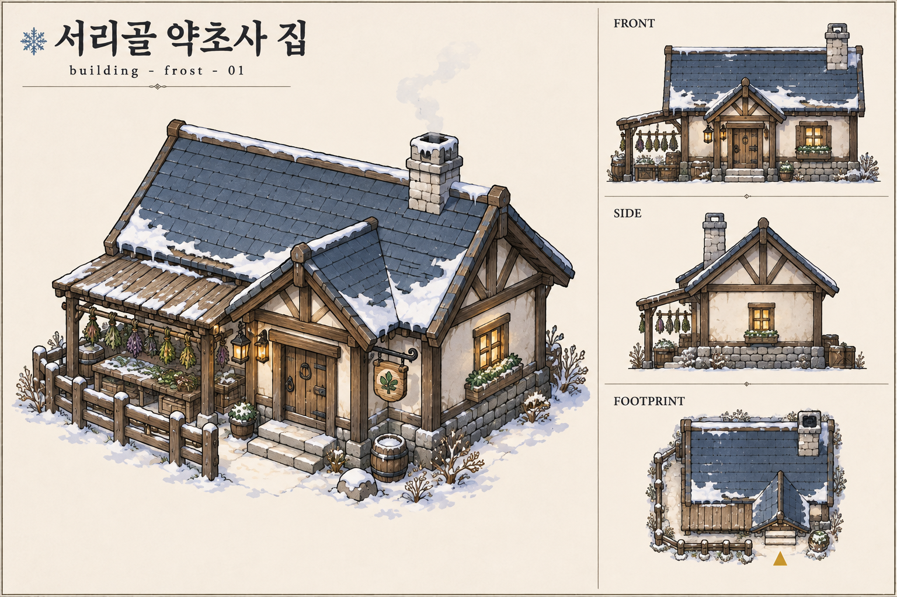

건물/시설 단독 외형·정면·측면·윗모습 구성 시각 확인. 외형 참고이며 실제 모델·타일·실내맵 데이터 아님. 창·문·계단·장식·평면의 위치와 수가 뷰마다 다를 수 있음. 정확한 치수·동선·충돌은 모델 제작 때 단일 규격으로 정합화. 지역 지도는 건축 양식 참고. 그림 속 문장·주변 소품이 신규 규칙이나 개별 제작 완료를 뜻하지 않음. 기존 서리골 환경 장면 보완용 시안. 기존 마을 배치와 집 구조를 자동 교체하지 않음.

### building-frost-02 · 서리골 일반 주택

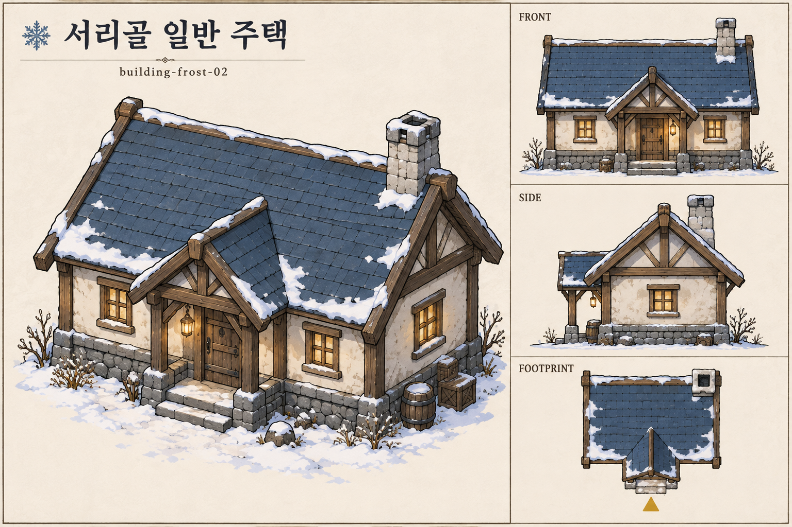

건물/시설 단독 외형·정면·측면·윗모습 구성 시각 확인. 외형 참고이며 실제 모델·타일·실내맵 데이터 아님. 창·문·계단·장식·평면의 위치와 수가 뷰마다 다를 수 있음. 정확한 치수·동선·충돌은 모델 제작 때 단일 규격으로 정합화. 지역 지도는 건축 양식 참고. 그림 속 문장·주변 소품이 신규 규칙이나 개별 제작 완료를 뜻하지 않음. 기존 서리골 환경 장면 보완용 시안. 기존 마을 배치와 집 구조를 자동 교체하지 않음.

### building-frost-03 · 서리골 마을 상점

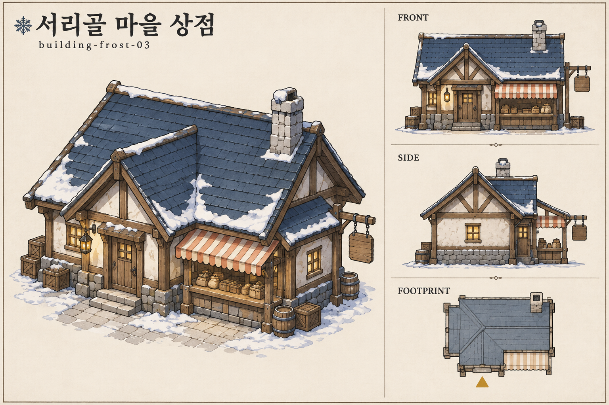

건물/시설 단독 외형·정면·측면·윗모습 구성 시각 확인. 외형 참고이며 실제 모델·타일·실내맵 데이터 아님. 창·문·계단·장식·평면의 위치와 수가 뷰마다 다를 수 있음. 정확한 치수·동선·충돌은 모델 제작 때 단일 규격으로 정합화. 지역 지도는 건축 양식 참고. 그림 속 문장·주변 소품이 신규 규칙이나 개별 제작 완료를 뜻하지 않음. 기존 서리골 환경 장면 보완용 시안. 기존 마을 배치와 집 구조를 자동 교체하지 않음.

### building-frost-04 · 서리골 공용 창고

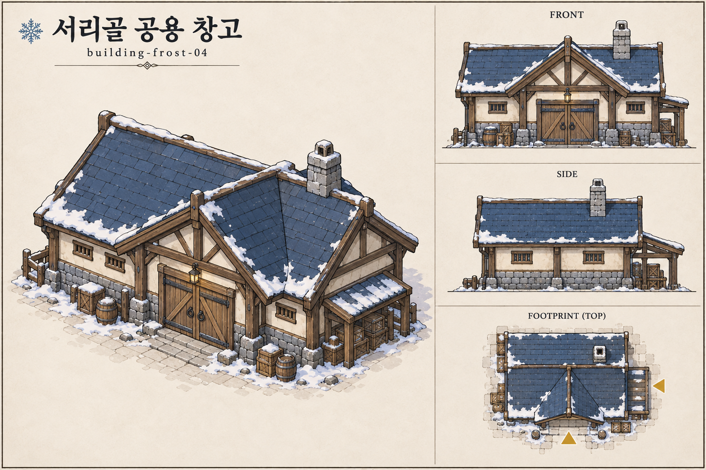

건물/시설 단독 외형·정면·측면·윗모습 구성 시각 확인. 외형 참고이며 실제 모델·타일·실내맵 데이터 아님. 창·문·계단·장식·평면의 위치와 수가 뷰마다 다를 수 있음. 정확한 치수·동선·충돌은 모델 제작 때 단일 규격으로 정합화. 지역 지도는 건축 양식 참고. 그림 속 문장·주변 소품이 신규 규칙이나 개별 제작 완료를 뜻하지 않음. 기존 서리골 환경 장면 보완용 시안. 기존 마을 배치와 집 구조를 자동 교체하지 않음.

### building-frost-05 · 서리골 마을 입구

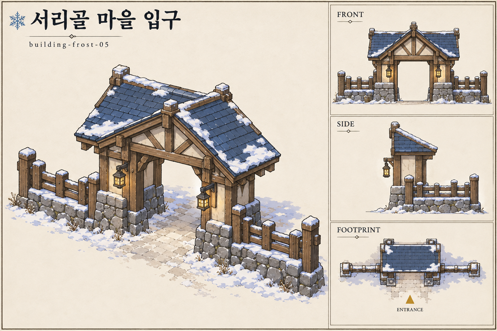

건물/시설 단독 외형·정면·측면·윗모습 구성 시각 확인. 외형 참고이며 실제 모델·타일·실내맵 데이터 아님. 창·문·계단·장식·평면의 위치와 수가 뷰마다 다를 수 있음. 정확한 치수·동선·충돌은 모델 제작 때 단일 규격으로 정합화. 지역 지도는 건축 양식 참고. 그림 속 문장·주변 소품이 신규 규칙이나 개별 제작 완료를 뜻하지 않음. 기존 서리골 환경 장면 보완용 시안. 기존 마을 배치와 집 구조를 자동 교체하지 않음.

### building-border-01 · 돌샘·국경 연락소 여관

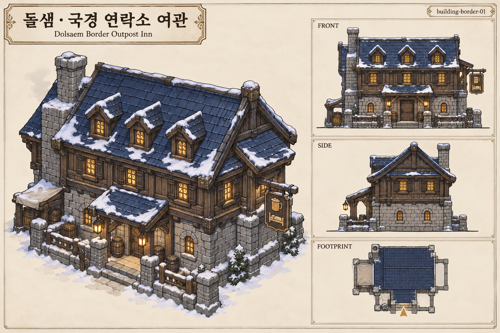

건물/시설 단독 외형·정면·측면·윗모습 구성 시각 확인. 외형 참고이며 실제 모델·타일·실내맵 데이터 아님. 창·문·계단·장식·평면의 위치와 수가 뷰마다 다를 수 있음. 정확한 치수·동선·충돌은 모델 제작 때 단일 규격으로 정합화. 지역 지도는 건축 양식 참고. 그림 속 문장·주변 소품이 신규 규칙이나 개별 제작 완료를 뜻하지 않음.

### building-border-02 · 돌샘·국경 연락소 보급 상점

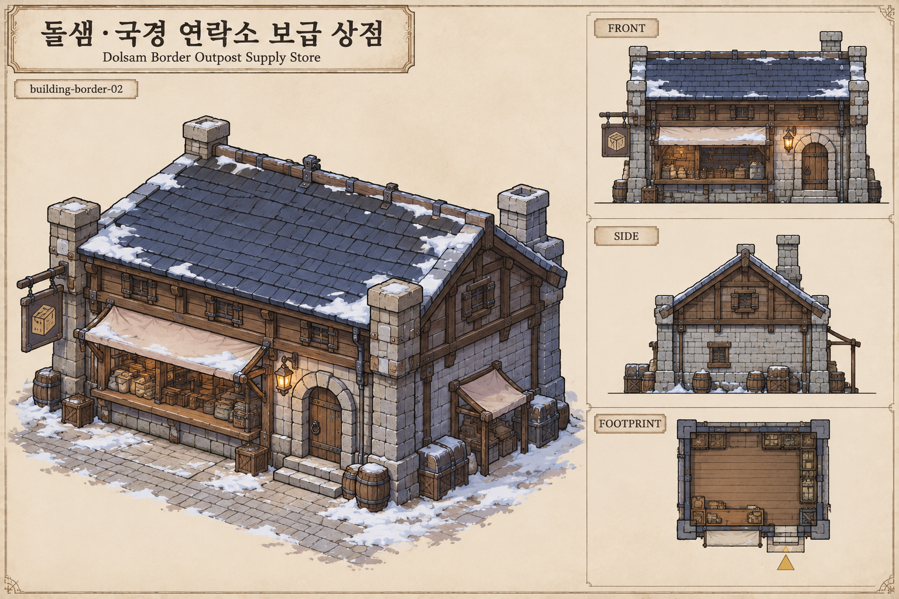

건물/시설 단독 외형·정면·측면·윗모습 구성 시각 확인. 외형 참고이며 실제 모델·타일·실내맵 데이터 아님. 창·문·계단·장식·평면의 위치와 수가 뷰마다 다를 수 있음. 정확한 치수·동선·충돌은 모델 제작 때 단일 규격으로 정합화. 지역 지도는 건축 양식 참고. 그림 속 문장·주변 소품이 신규 규칙이나 개별 제작 완료를 뜻하지 않음.

### building-border-03 · 돌샘·국경 연락소 진료소

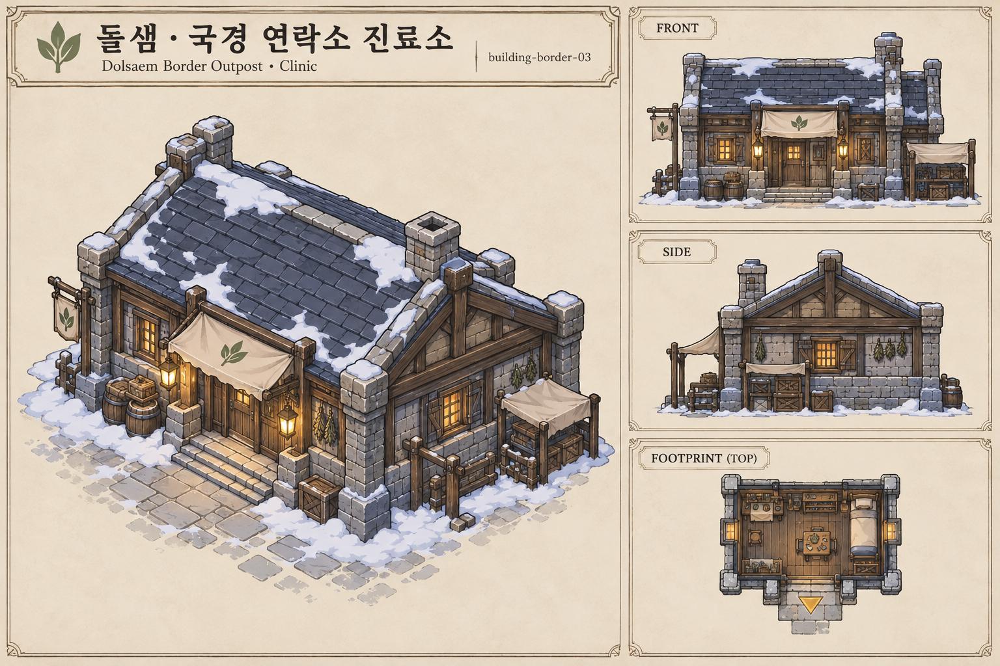

건물/시설 단독 외형·정면·측면·윗모습 구성 시각 확인. 외형 참고이며 실제 모델·타일·실내맵 데이터 아님. 창·문·계단·장식·평면의 위치와 수가 뷰마다 다를 수 있음. 정확한 치수·동선·충돌은 모델 제작 때 단일 규격으로 정합화. 지역 지도는 건축 양식 참고. 그림 속 문장·주변 소품이 신규 규칙이나 개별 제작 완료를 뜻하지 않음. 접근성 기준은 모델에서 별도 확인. 시안의 정문 계단이 무장애 이동 경로를 보장하지 않음.

### building-border-04 · 돌샘·국경 연락소 연락소

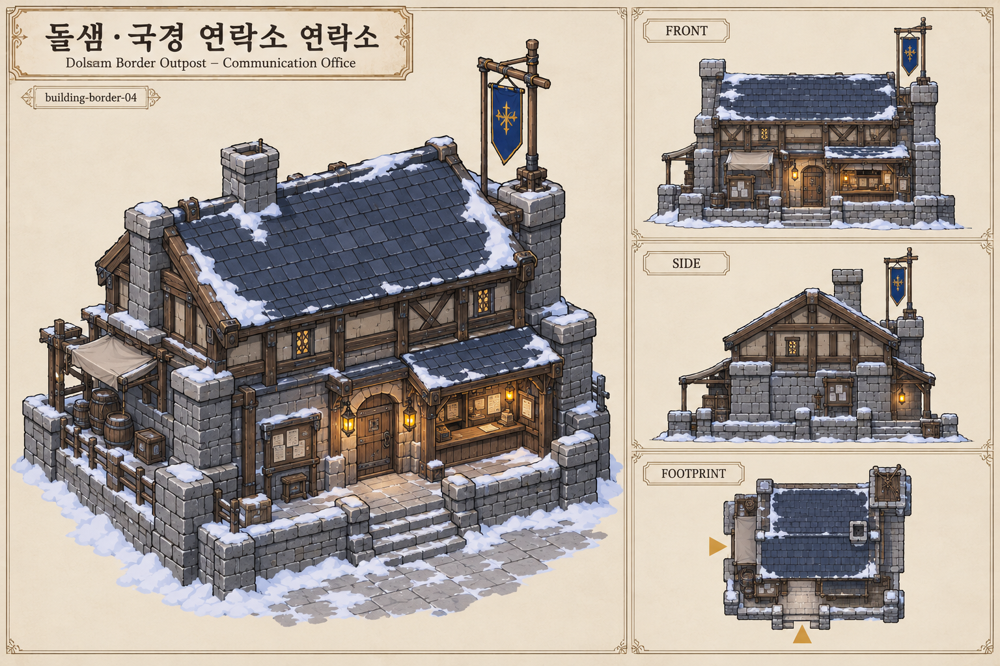

건물/시설 단독 외형·정면·측면·윗모습 구성 시각 확인. 외형 참고이며 실제 모델·타일·실내맵 데이터 아님. 창·문·계단·장식·평면의 위치와 수가 뷰마다 다를 수 있음. 정확한 치수·동선·충돌은 모델 제작 때 단일 규격으로 정합화. 지역 지도는 건축 양식 참고. 그림 속 문장·주변 소품이 신규 규칙이나 개별 제작 완료를 뜻하지 않음.

### building-border-05 · 돌샘·국경 연락소 초소

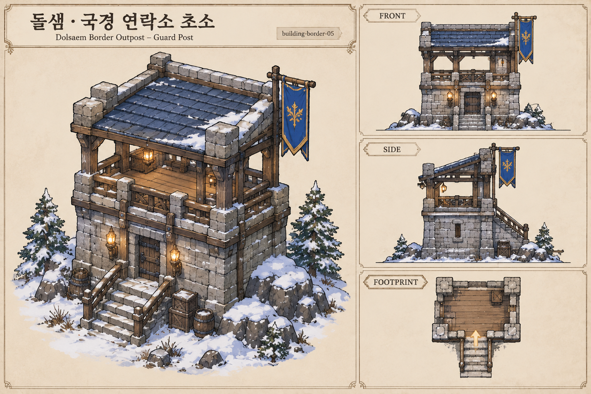

건물/시설 단독 외형·정면·측면·윗모습 구성 시각 확인. 외형 참고이며 실제 모델·타일·실내맵 데이터 아님. 창·문·계단·장식·평면의 위치와 수가 뷰마다 다를 수 있음. 정확한 치수·동선·충돌은 모델 제작 때 단일 규격으로 정합화. 지역 지도는 건축 양식 참고. 그림 속 문장·주변 소품이 신규 규칙이나 개별 제작 완료를 뜻하지 않음.

### building-border-06 · 돌샘·국경 연락소 훈련장

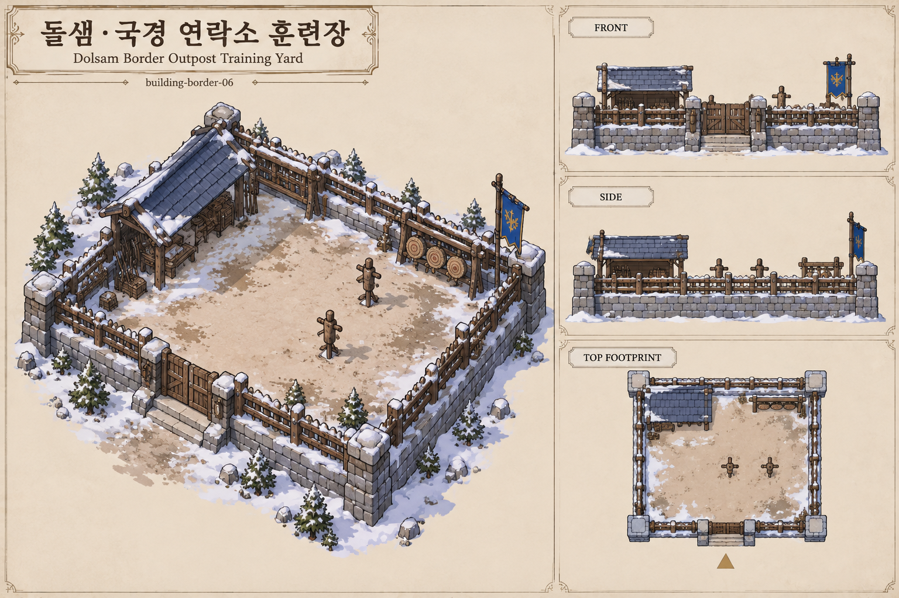

건물/시설 단독 외형·정면·측면·윗모습 구성 시각 확인. 외형 참고이며 실제 모델·타일·실내맵 데이터 아님. 창·문·계단·장식·평면의 위치와 수가 뷰마다 다를 수 있음. 정확한 치수·동선·충돌은 모델 제작 때 단일 규격으로 정합화. 지역 지도는 건축 양식 참고. 그림 속 문장·주변 소품이 신규 규칙이나 개별 제작 완료를 뜻하지 않음.

### building-refugee-01 · 피난 교량 교량

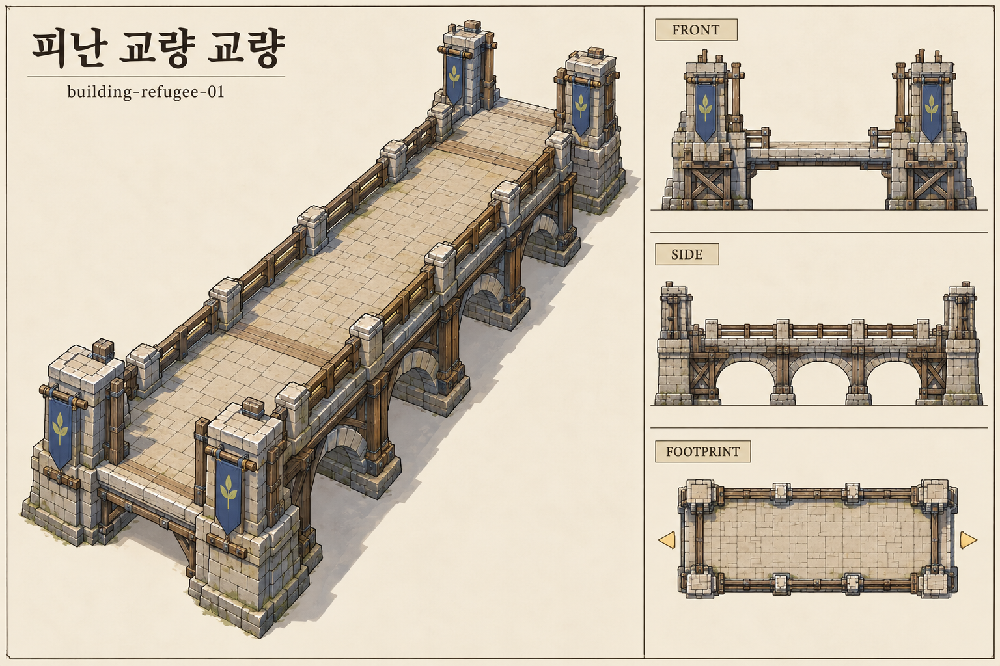

건물/시설 단독 외형·정면·측면·윗모습 구성 시각 확인. 외형 참고이며 실제 모델·타일·실내맵 데이터 아님. 창·문·계단·장식·평면의 위치와 수가 뷰마다 다를 수 있음. 정확한 치수·동선·충돌은 모델 제작 때 단일 규격으로 정합화. 지역 지도는 건축 양식 참고. 그림 속 문장·주변 소품이 신규 규칙이나 개별 제작 완료를 뜻하지 않음.

### building-refugee-02 · 피난 교량 검문소

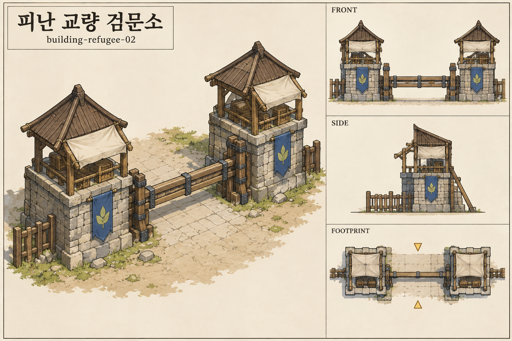

건물/시설 단독 외형·정면·측면·윗모습 구성 시각 확인. 외형 참고이며 실제 모델·타일·실내맵 데이터 아님. 창·문·계단·장식·평면의 위치와 수가 뷰마다 다를 수 있음. 정확한 치수·동선·충돌은 모델 제작 때 단일 규격으로 정합화. 지역 지도는 건축 양식 참고. 그림 속 문장·주변 소품이 신규 규칙이나 개별 제작 완료를 뜻하지 않음.

### building-refugee-03 · 피난 교량 구호소

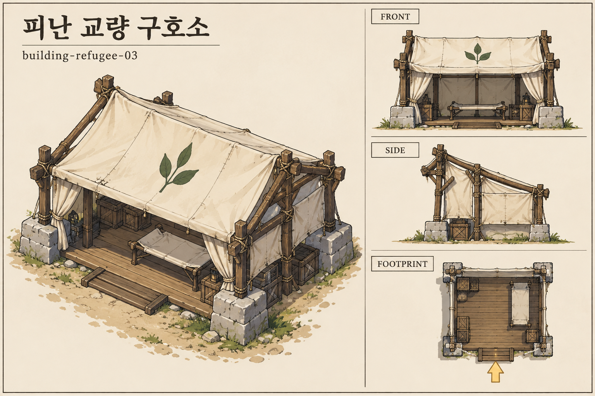

건물/시설 단독 외형·정면·측면·윗모습 구성 시각 확인. 외형 참고이며 실제 모델·타일·실내맵 데이터 아님. 창·문·계단·장식·평면의 위치와 수가 뷰마다 다를 수 있음. 정확한 치수·동선·충돌은 모델 제작 때 단일 규격으로 정합화. 지역 지도는 건축 양식 참고. 그림 속 문장·주변 소품이 신규 규칙이나 개별 제작 완료를 뜻하지 않음.

### building-refugee-04 · 피난 교량 천막

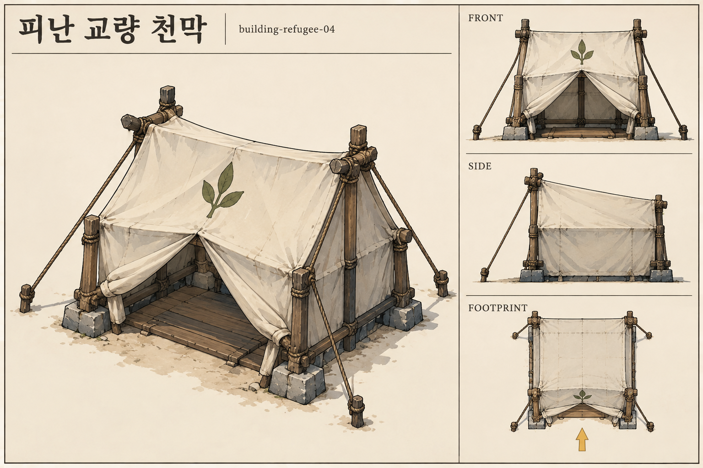

건물/시설 단독 외형·정면·측면·윗모습 구성 시각 확인. 외형 참고이며 실제 모델·타일·실내맵 데이터 아님. 창·문·계단·장식·평면의 위치와 수가 뷰마다 다를 수 있음. 정확한 치수·동선·충돌은 모델 제작 때 단일 규격으로 정합화. 지역 지도는 건축 양식 참고. 그림 속 문장·주변 소품이 신규 규칙이나 개별 제작 완료를 뜻하지 않음.

### building-refugee-05 · 피난 교량 보급소

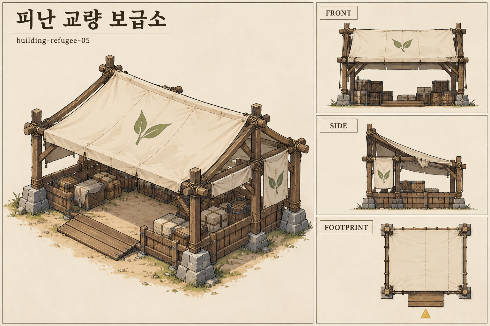

건물/시설 단독 외형·정면·측면·윗모습 구성 시각 확인. 외형 참고이며 실제 모델·타일·실내맵 데이터 아님. 창·문·계단·장식·평면의 위치와 수가 뷰마다 다를 수 있음. 정확한 치수·동선·충돌은 모델 제작 때 단일 규격으로 정합화. 지역 지도는 건축 양식 참고. 그림 속 문장·주변 소품이 신규 규칙이나 개별 제작 완료를 뜻하지 않음.

### building-capital-01 · 아르덴 왕도 성문

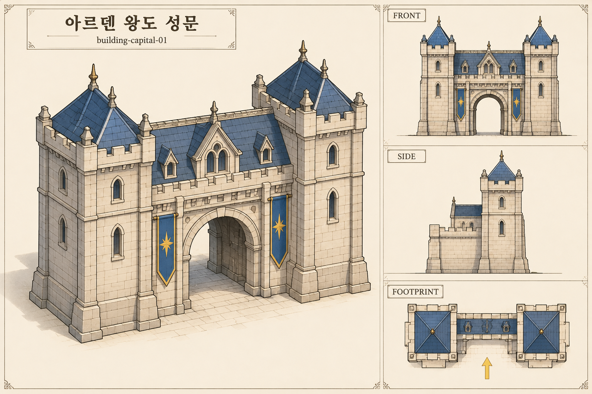

건물/시설 단독 외형·정면·측면·윗모습 구성 시각 확인. 외형 참고이며 실제 모델·타일·실내맵 데이터 아님. 창·문·계단·장식·평면의 위치와 수가 뷰마다 다를 수 있음. 정확한 치수·동선·충돌은 모델 제작 때 단일 규격으로 정합화. 지역 지도는 건축 양식 참고. 그림 속 문장·주변 소품이 신규 규칙이나 개별 제작 완료를 뜻하지 않음.

### building-capital-02 · 아르덴 왕도 성벽

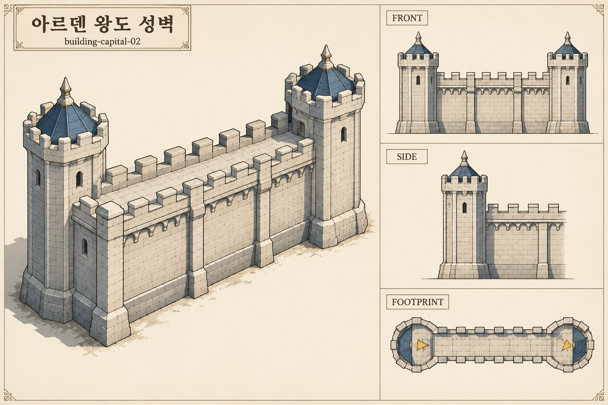

건물/시설 단독 외형·정면·측면·윗모습 구성 시각 확인. 외형 참고이며 실제 모델·타일·실내맵 데이터 아님. 창·문·계단·장식·평면의 위치와 수가 뷰마다 다를 수 있음. 정확한 치수·동선·충돌은 모델 제작 때 단일 규격으로 정합화. 지역 지도는 건축 양식 참고. 그림 속 문장·주변 소품이 신규 규칙이나 개별 제작 완료를 뜻하지 않음. 시안에는 양끝 탑이 포함됨. 반복 성벽과 탑을 모델 제작 시 분리.

### building-capital-03 · 아르덴 왕도 주택

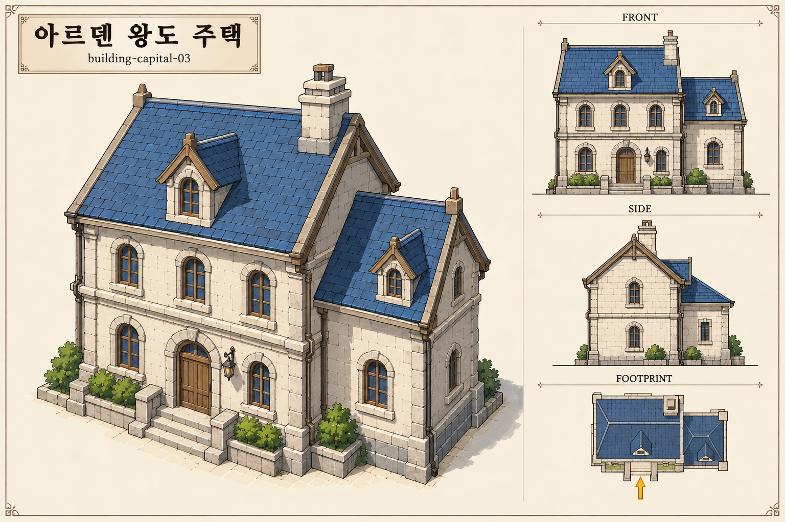

건물/시설 단독 외형·정면·측면·윗모습 구성 시각 확인. 외형 참고이며 실제 모델·타일·실내맵 데이터 아님. 창·문·계단·장식·평면의 위치와 수가 뷰마다 다를 수 있음. 정확한 치수·동선·충돌은 모델 제작 때 단일 규격으로 정합화. 지역 지도는 건축 양식 참고. 그림 속 문장·주변 소품이 신규 규칙이나 개별 제작 완료를 뜻하지 않음.

### building-capital-04 · 아르덴 왕도 무기 상점

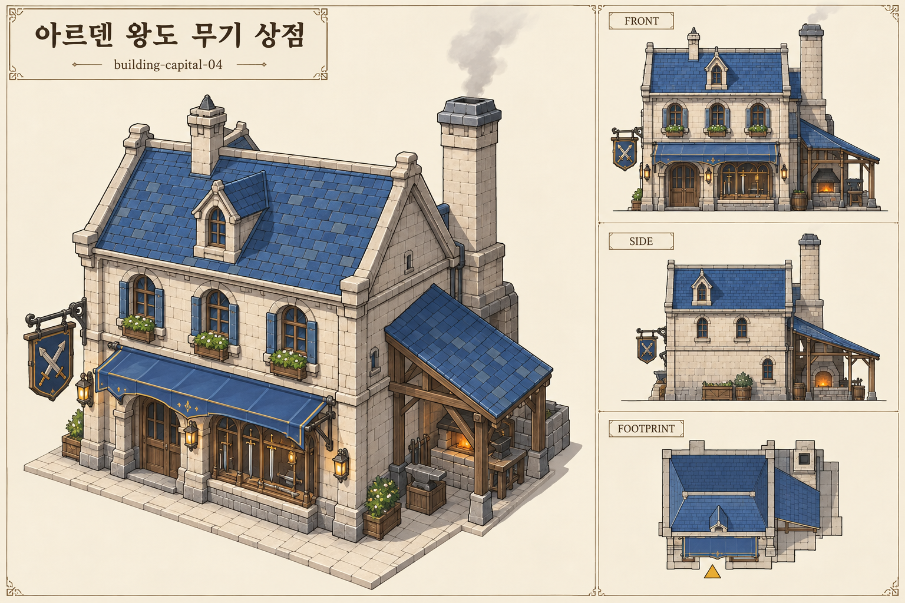

건물/시설 단독 외형·정면·측면·윗모습 구성 시각 확인. 외형 참고이며 실제 모델·타일·실내맵 데이터 아님. 창·문·계단·장식·평면의 위치와 수가 뷰마다 다를 수 있음. 정확한 치수·동선·충돌은 모델 제작 때 단일 규격으로 정합화. 지역 지도는 건축 양식 참고. 그림 속 문장·주변 소품이 신규 규칙이나 개별 제작 완료를 뜻하지 않음.

### building-capital-05 · 아르덴 왕도 방어구 상점

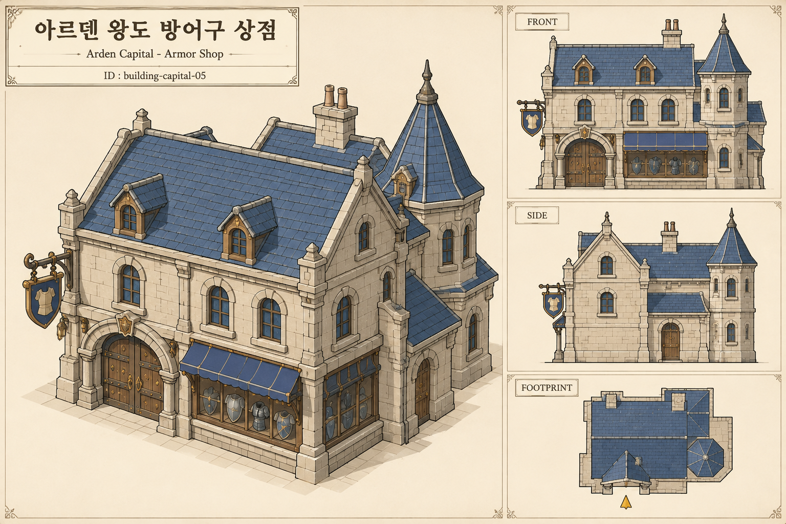

건물/시설 단독 외형·정면·측면·윗모습 구성 시각 확인. 외형 참고이며 실제 모델·타일·실내맵 데이터 아님. 창·문·계단·장식·평면의 위치와 수가 뷰마다 다를 수 있음. 정확한 치수·동선·충돌은 모델 제작 때 단일 규격으로 정합화. 지역 지도는 건축 양식 참고. 그림 속 문장·주변 소품이 신규 규칙이나 개별 제작 완료를 뜻하지 않음.

### building-capital-06 · 아르덴 왕도 여관

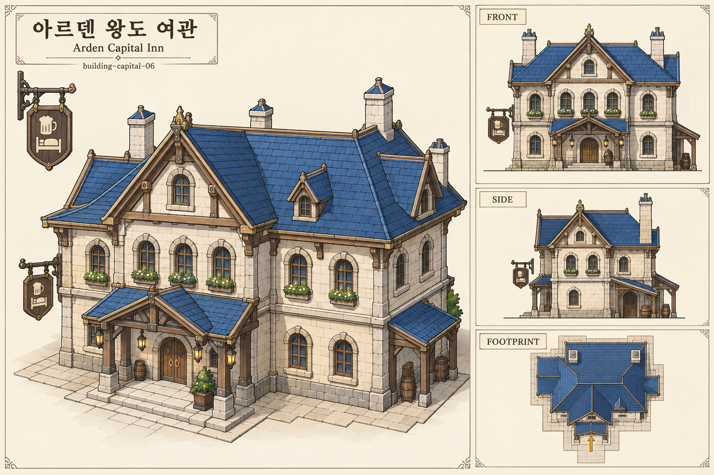

건물/시설 단독 외형·정면·측면·윗모습 구성 시각 확인. 외형 참고이며 실제 모델·타일·실내맵 데이터 아님. 창·문·계단·장식·평면의 위치와 수가 뷰마다 다를 수 있음. 정확한 치수·동선·충돌은 모델 제작 때 단일 규격으로 정합화. 지역 지도는 건축 양식 참고. 그림 속 문장·주변 소품이 신규 규칙이나 개별 제작 완료를 뜻하지 않음.

### building-capital-07 · 아르덴 왕도 병영

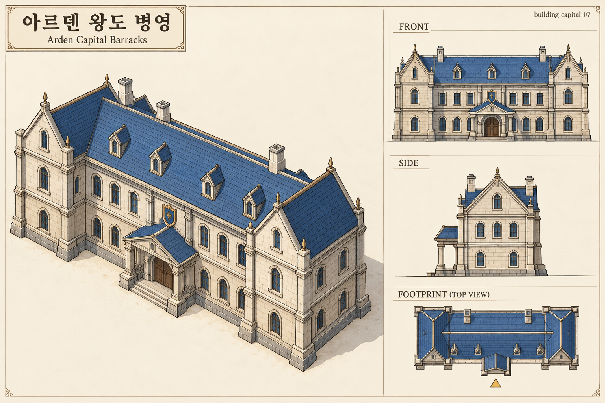

건물/시설 단독 외형·정면·측면·윗모습 구성 시각 확인. 외형 참고이며 실제 모델·타일·실내맵 데이터 아님. 창·문·계단·장식·평면의 위치와 수가 뷰마다 다를 수 있음. 정확한 치수·동선·충돌은 모델 제작 때 단일 규격으로 정합화. 지역 지도는 건축 양식 참고. 그림 속 문장·주변 소품이 신규 규칙이나 개별 제작 완료를 뜻하지 않음. 장식·탑·창문 수를 실제 게임 배율에서 단순화 검토. 규모를 그림에서 확정하지 않음.

### building-capital-08 · 아르덴 왕도 행정청

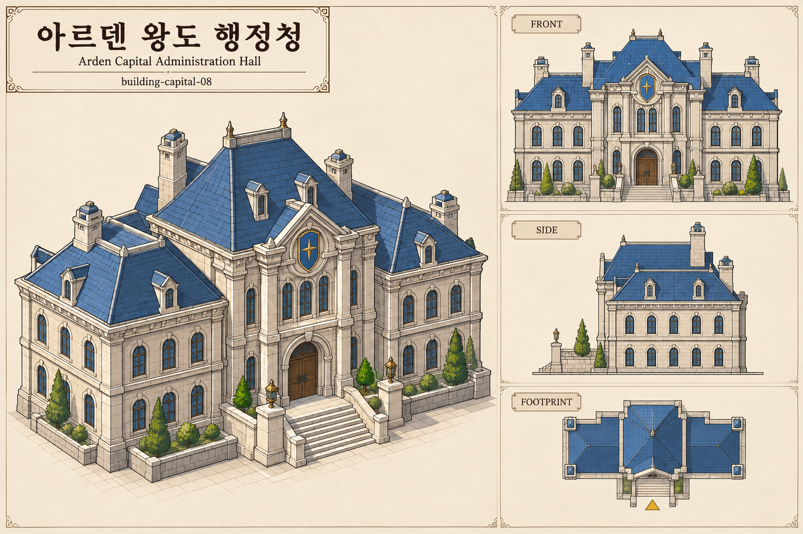

건물/시설 단독 외형·정면·측면·윗모습 구성 시각 확인. 외형 참고이며 실제 모델·타일·실내맵 데이터 아님. 창·문·계단·장식·평면의 위치와 수가 뷰마다 다를 수 있음. 정확한 치수·동선·충돌은 모델 제작 때 단일 규격으로 정합화. 지역 지도는 건축 양식 참고. 그림 속 문장·주변 소품이 신규 규칙이나 개별 제작 완료를 뜻하지 않음. 장식·탑·창문 수를 실제 게임 배율에서 단순화 검토. 규모를 그림에서 확정하지 않음.

### building-capital-09 · 아르덴 왕도 왕성 접견동

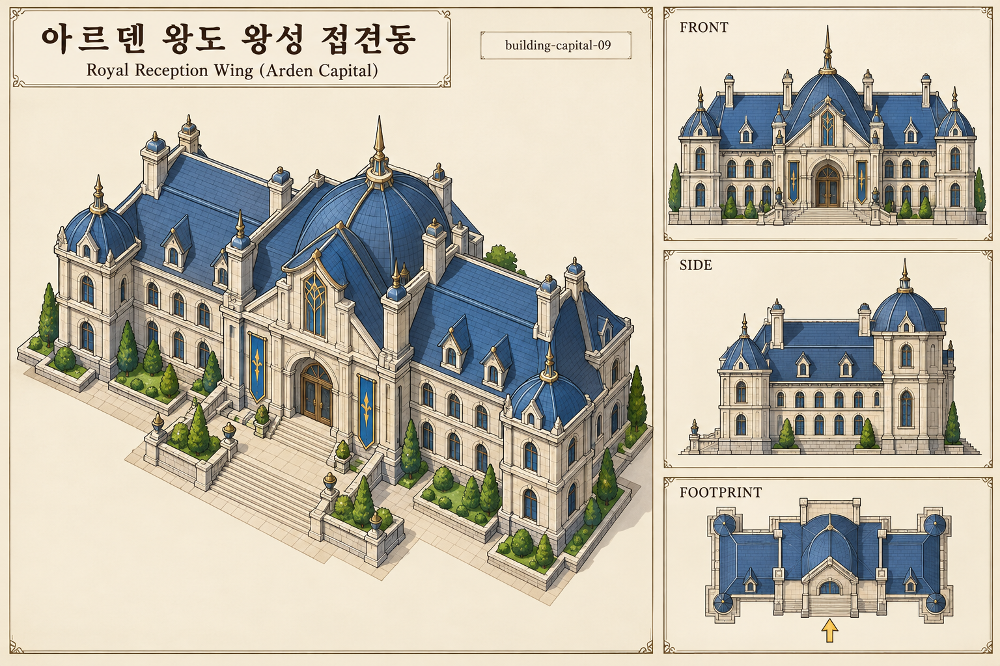

건물/시설 단독 외형·정면·측면·윗모습 구성 시각 확인. 외형 참고이며 실제 모델·타일·실내맵 데이터 아님. 창·문·계단·장식·평면의 위치와 수가 뷰마다 다를 수 있음. 정확한 치수·동선·충돌은 모델 제작 때 단일 규격으로 정합화. 지역 지도는 건축 양식 참고. 그림 속 문장·주변 소품이 신규 규칙이나 개별 제작 완료를 뜻하지 않음. 장식·탑·창문 수를 실제 게임 배율에서 단순화 검토. 규모를 그림에서 확정하지 않음.

### building-academy-01 · 남방 학술도시 학술원

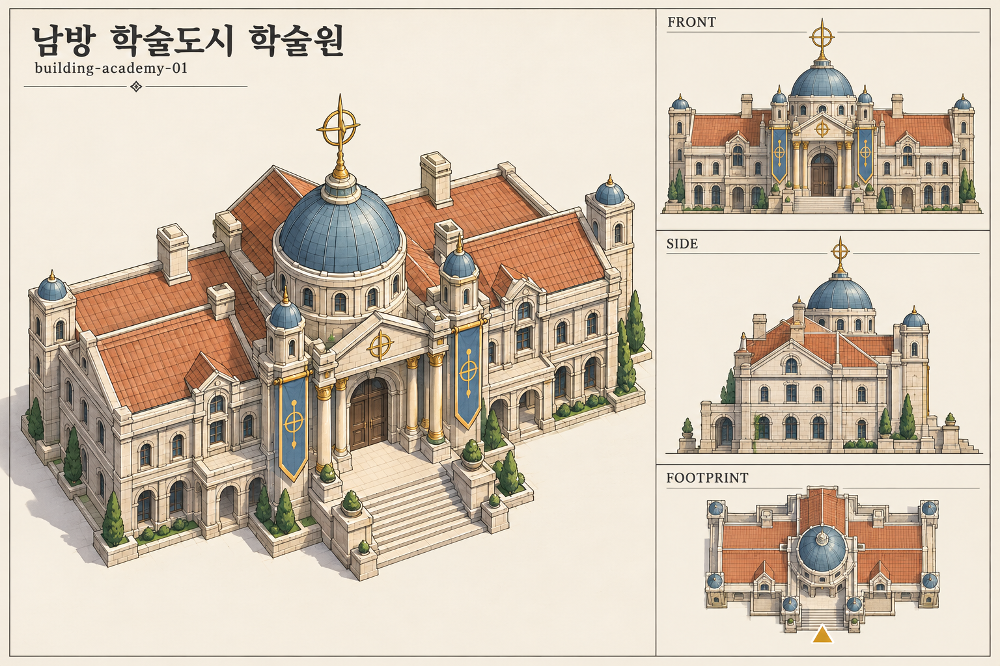

건물/시설 단독 외형·정면·측면·윗모습 구성 시각 확인. 외형 참고이며 실제 모델·타일·실내맵 데이터 아님. 창·문·계단·장식·평면의 위치와 수가 뷰마다 다를 수 있음. 정확한 치수·동선·충돌은 모델 제작 때 단일 규격으로 정합화. 지역 지도는 건축 양식 참고. 그림 속 문장·주변 소품이 신규 규칙이나 개별 제작 완료를 뜻하지 않음.

### building-academy-02 · 남방 학술도시 도서관

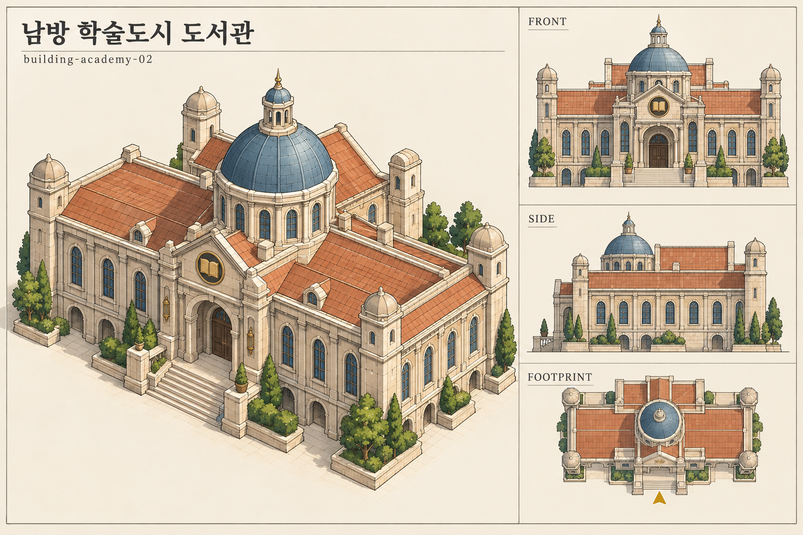

건물/시설 단독 외형·정면·측면·윗모습 구성 시각 확인. 외형 참고이며 실제 모델·타일·실내맵 데이터 아님. 창·문·계단·장식·평면의 위치와 수가 뷰마다 다를 수 있음. 정확한 치수·동선·충돌은 모델 제작 때 단일 규격으로 정합화. 지역 지도는 건축 양식 참고. 그림 속 문장·주변 소품이 신규 규칙이나 개별 제작 완료를 뜻하지 않음.

### building-academy-03 · 남방 학술도시 연구실 동

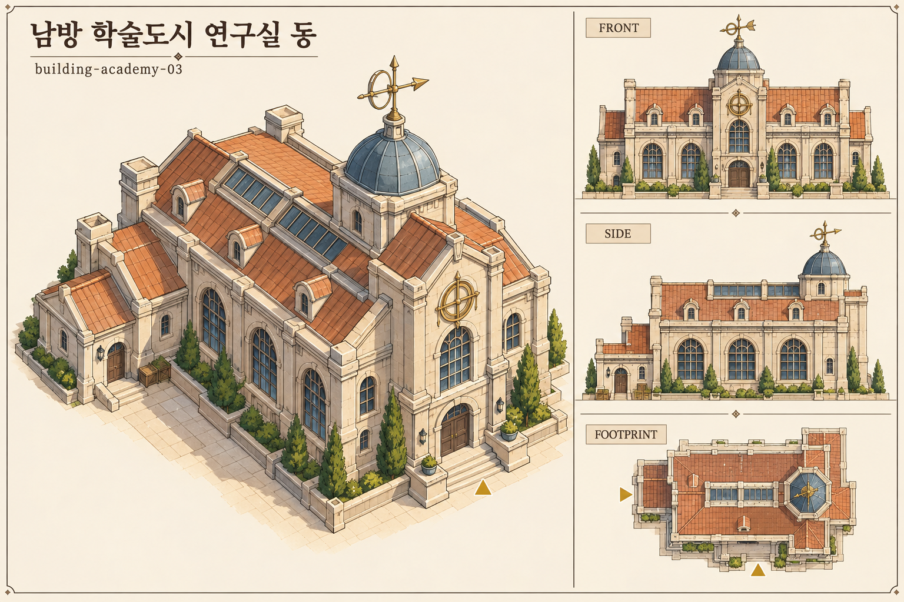

건물/시설 단독 외형·정면·측면·윗모습 구성 시각 확인. 외형 참고이며 실제 모델·타일·실내맵 데이터 아님. 창·문·계단·장식·평면의 위치와 수가 뷰마다 다를 수 있음. 정확한 치수·동선·충돌은 모델 제작 때 단일 규격으로 정합화. 지역 지도는 건축 양식 참고. 그림 속 문장·주변 소품이 신규 규칙이나 개별 제작 완료를 뜻하지 않음.

### building-academy-04 · 남방 학술도시 기숙사

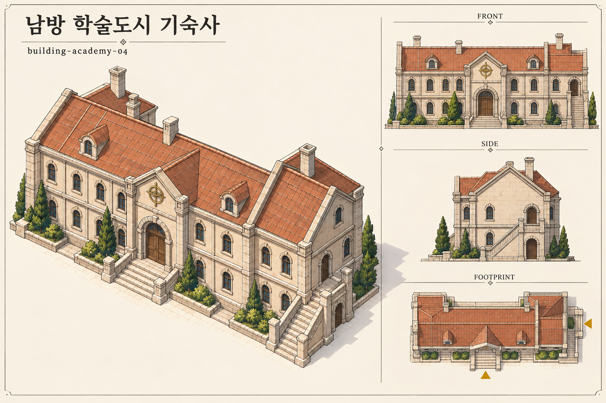

건물/시설 단독 외형·정면·측면·윗모습 구성 시각 확인. 외형 참고이며 실제 모델·타일·실내맵 데이터 아님. 창·문·계단·장식·평면의 위치와 수가 뷰마다 다를 수 있음. 정확한 치수·동선·충돌은 모델 제작 때 단일 규격으로 정합화. 지역 지도는 건축 양식 참고. 그림 속 문장·주변 소품이 신규 규칙이나 개별 제작 완료를 뜻하지 않음.

### building-academy-05 · 남방 학술도시 유물 보관소

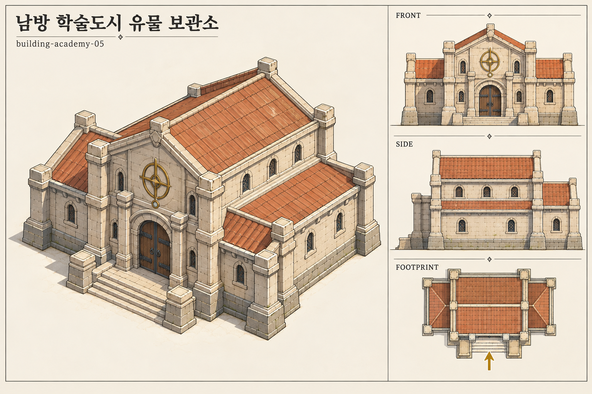

건물/시설 단독 외형·정면·측면·윗모습 구성 시각 확인. 외형 참고이며 실제 모델·타일·실내맵 데이터 아님. 창·문·계단·장식·평면의 위치와 수가 뷰마다 다를 수 있음. 정확한 치수·동선·충돌은 모델 제작 때 단일 규격으로 정합화. 지역 지도는 건축 양식 참고. 그림 속 문장·주변 소품이 신규 규칙이나 개별 제작 완료를 뜻하지 않음.

### building-academy-06 · 남방 학술도시 주택

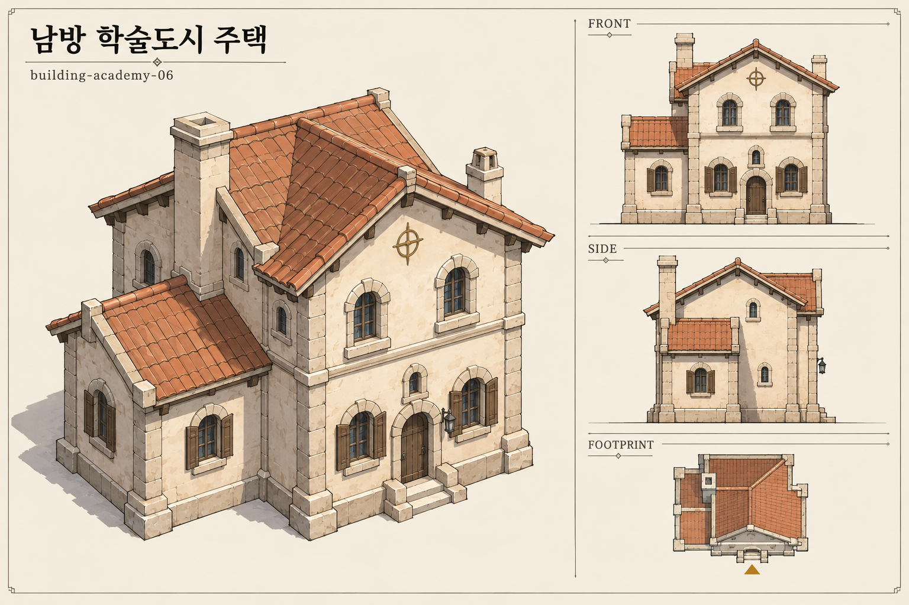

건물/시설 단독 외형·정면·측면·윗모습 구성 시각 확인. 외형 참고이며 실제 모델·타일·실내맵 데이터 아님. 창·문·계단·장식·평면의 위치와 수가 뷰마다 다를 수 있음. 정확한 치수·동선·충돌은 모델 제작 때 단일 규격으로 정합화. 지역 지도는 건축 양식 참고. 그림 속 문장·주변 소품이 신규 규칙이나 개별 제작 완료를 뜻하지 않음. 일반 주택에 학술 문장이 표현됨. 일반 주거용 모델은 문장 생략 검토.

### building-academy-07 · 남방 학술도시 여관

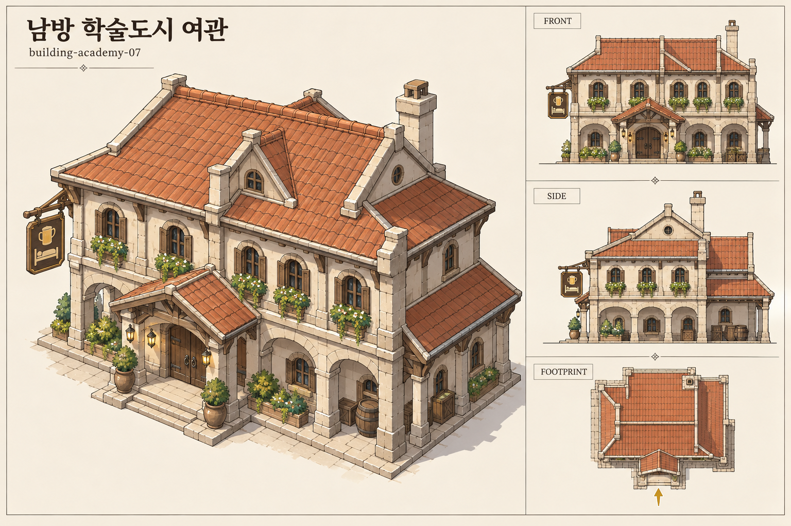

건물/시설 단독 외형·정면·측면·윗모습 구성 시각 확인. 외형 참고이며 실제 모델·타일·실내맵 데이터 아님. 창·문·계단·장식·평면의 위치와 수가 뷰마다 다를 수 있음. 정확한 치수·동선·충돌은 모델 제작 때 단일 규격으로 정합화. 지역 지도는 건축 양식 참고. 그림 속 문장·주변 소품이 신규 규칙이나 개별 제작 완료를 뜻하지 않음.

### building-south-port-01 · 남방 항구 부두

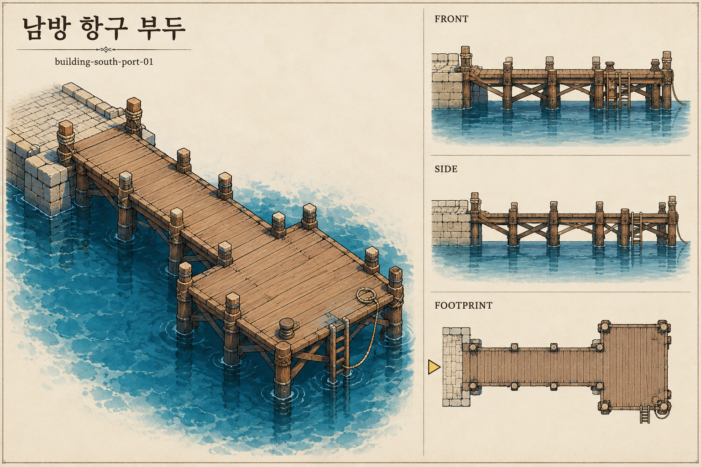

건물/시설 단독 외형·정면·측면·윗모습 구성 시각 확인. 외형 참고이며 실제 모델·타일·실내맵 데이터 아님. 창·문·계단·장식·평면의 위치와 수가 뷰마다 다를 수 있음. 정확한 치수·동선·충돌은 모델 제작 때 단일 규격으로 정합화. 지역 지도는 건축 양식 참고. 그림 속 문장·주변 소품이 신규 규칙이나 개별 제작 완료를 뜻하지 않음.

### building-south-port-02 · 남방 항구 시장 점포

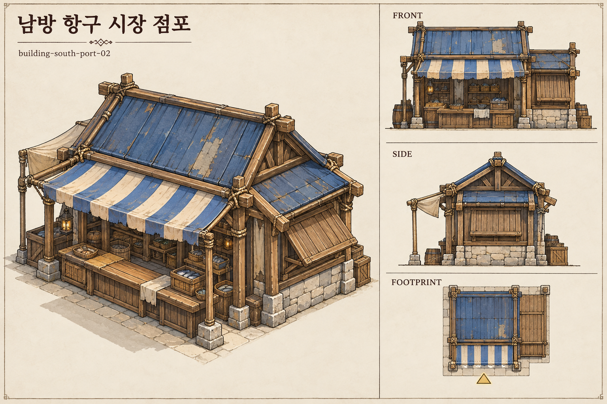

건물/시설 단독 외형·정면·측면·윗모습 구성 시각 확인. 외형 참고이며 실제 모델·타일·실내맵 데이터 아님. 창·문·계단·장식·평면의 위치와 수가 뷰마다 다를 수 있음. 정확한 치수·동선·충돌은 모델 제작 때 단일 규격으로 정합화. 지역 지도는 건축 양식 참고. 그림 속 문장·주변 소품이 신규 규칙이나 개별 제작 완료를 뜻하지 않음.

### building-south-port-03 · 남방 항구 선술집

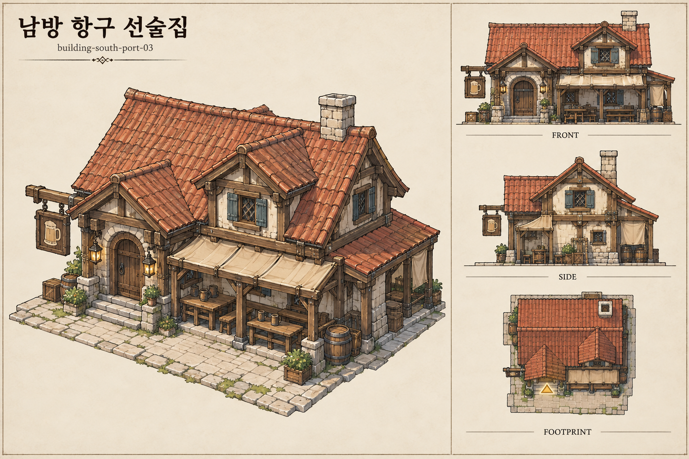

건물/시설 단독 외형·정면·측면·윗모습 구성 시각 확인. 외형 참고이며 실제 모델·타일·실내맵 데이터 아님. 창·문·계단·장식·평면의 위치와 수가 뷰마다 다를 수 있음. 정확한 치수·동선·충돌은 모델 제작 때 단일 규격으로 정합화. 지역 지도는 건축 양식 참고. 그림 속 문장·주변 소품이 신규 규칙이나 개별 제작 완료를 뜻하지 않음.

### building-south-port-04 · 남방 항구 여관

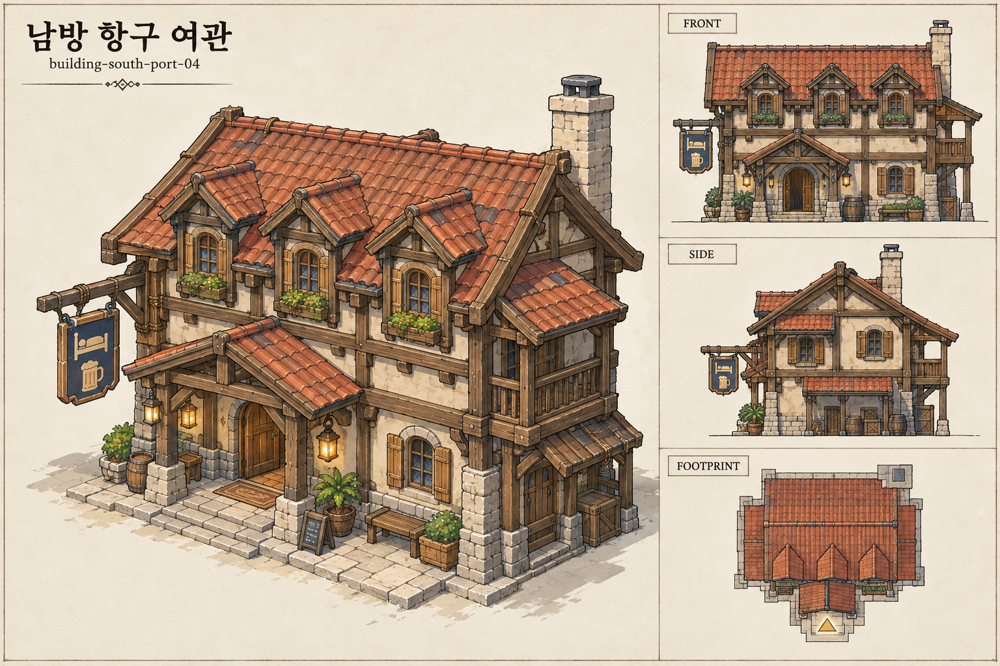

건물/시설 단독 외형·정면·측면·윗모습 구성 시각 확인. 외형 참고이며 실제 모델·타일·실내맵 데이터 아님. 창·문·계단·장식·평면의 위치와 수가 뷰마다 다를 수 있음. 정확한 치수·동선·충돌은 모델 제작 때 단일 규격으로 정합화. 지역 지도는 건축 양식 참고. 그림 속 문장·주변 소품이 신규 규칙이나 개별 제작 완료를 뜻하지 않음.

### building-south-port-05 · 남방 항구 화물 창고

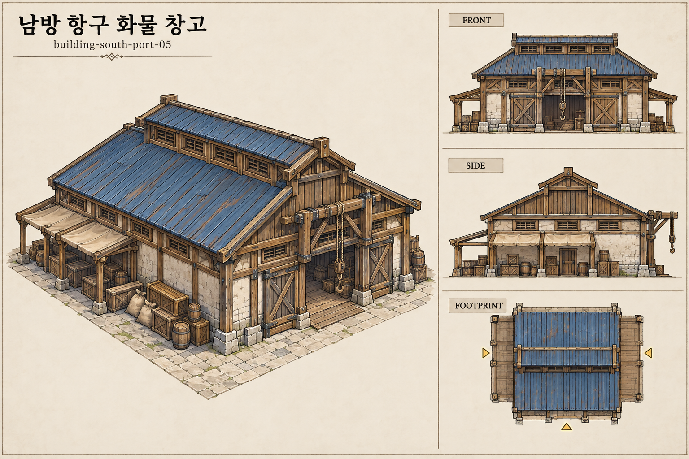

건물/시설 단독 외형·정면·측면·윗모습 구성 시각 확인. 외형 참고이며 실제 모델·타일·실내맵 데이터 아님. 창·문·계단·장식·평면의 위치와 수가 뷰마다 다를 수 있음. 정확한 치수·동선·충돌은 모델 제작 때 단일 규격으로 정합화. 지역 지도는 건축 양식 참고. 그림 속 문장·주변 소품이 신규 규칙이나 개별 제작 완료를 뜻하지 않음.

### building-south-port-06 · 남방 항구 조선 작업장

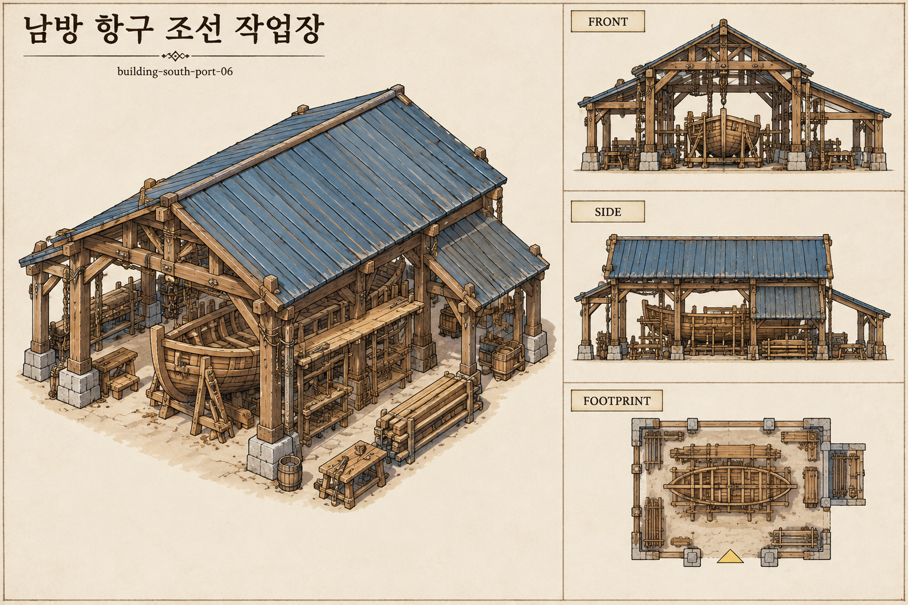

건물/시설 단독 외형·정면·측면·윗모습 구성 시각 확인. 외형 참고이며 실제 모델·타일·실내맵 데이터 아님. 창·문·계단·장식·평면의 위치와 수가 뷰마다 다를 수 있음. 정확한 치수·동선·충돌은 모델 제작 때 단일 규격으로 정합화. 지역 지도는 건축 양식 참고. 그림 속 문장·주변 소품이 신규 규칙이나 개별 제작 완료를 뜻하지 않음.

### building-south-port-07 · 남방 항구 주택

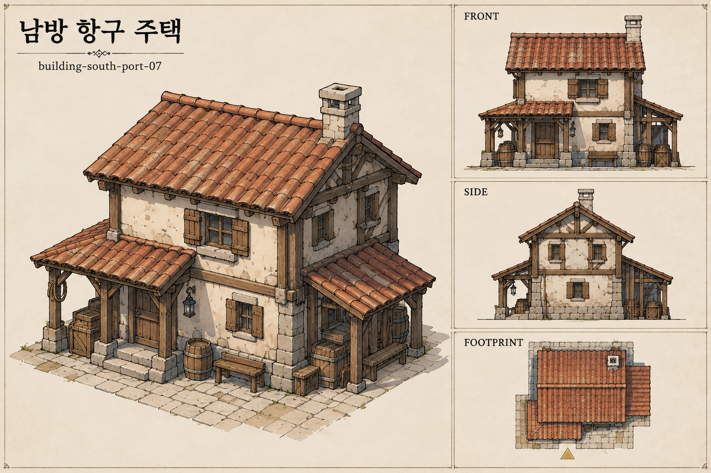

건물/시설 단독 외형·정면·측면·윗모습 구성 시각 확인. 외형 참고이며 실제 모델·타일·실내맵 데이터 아님. 창·문·계단·장식·평면의 위치와 수가 뷰마다 다를 수 있음. 정확한 치수·동선·충돌은 모델 제작 때 단일 규격으로 정합화. 지역 지도는 건축 양식 참고. 그림 속 문장·주변 소품이 신규 규칙이나 개별 제작 완료를 뜻하지 않음.

### building-north-01 · 북방 시설 외곽 기지

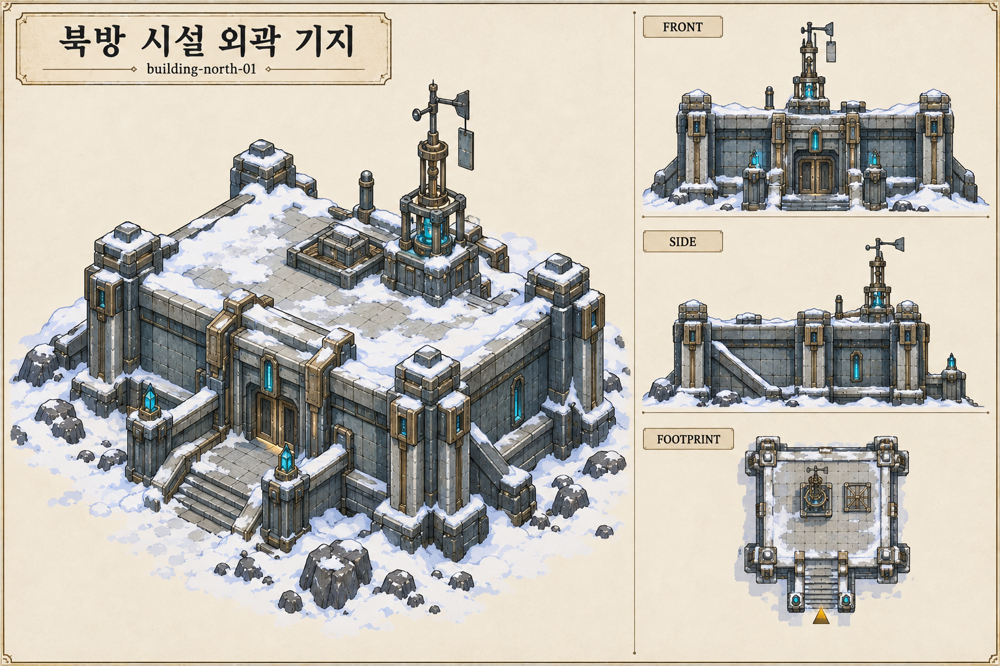

건물/시설 단독 외형·정면·측면·윗모습 구성 시각 확인. 외형 참고이며 실제 모델·타일·실내맵 데이터 아님. 창·문·계단·장식·평면의 위치와 수가 뷰마다 다를 수 있음. 정확한 치수·동선·충돌은 모델 제작 때 단일 규격으로 정합화. 지역 지도는 건축 양식 참고. 그림 속 문장·주변 소품이 신규 규칙이나 개별 제작 완료를 뜻하지 않음.

### building-north-02 · 북방 시설 관측동

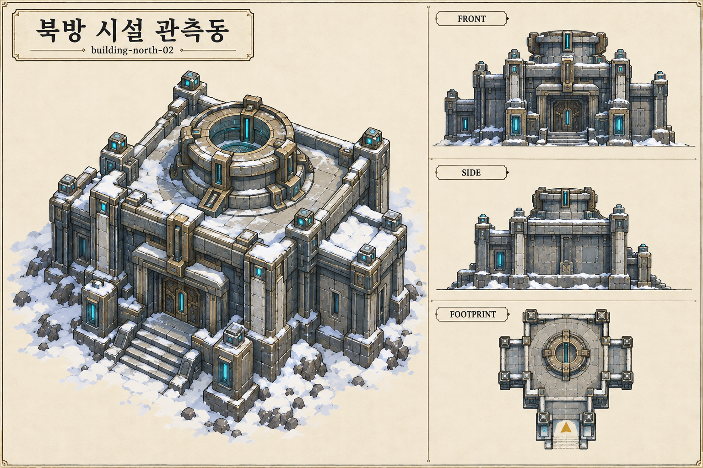

건물/시설 단독 외형·정면·측면·윗모습 구성 시각 확인. 외형 참고이며 실제 모델·타일·실내맵 데이터 아님. 창·문·계단·장식·평면의 위치와 수가 뷰마다 다를 수 있음. 정확한 치수·동선·충돌은 모델 제작 때 단일 규격으로 정합화. 지역 지도는 건축 양식 참고. 그림 속 문장·주변 소품이 신규 규칙이나 개별 제작 완료를 뜻하지 않음.

### building-north-03 · 북방 시설 동력실

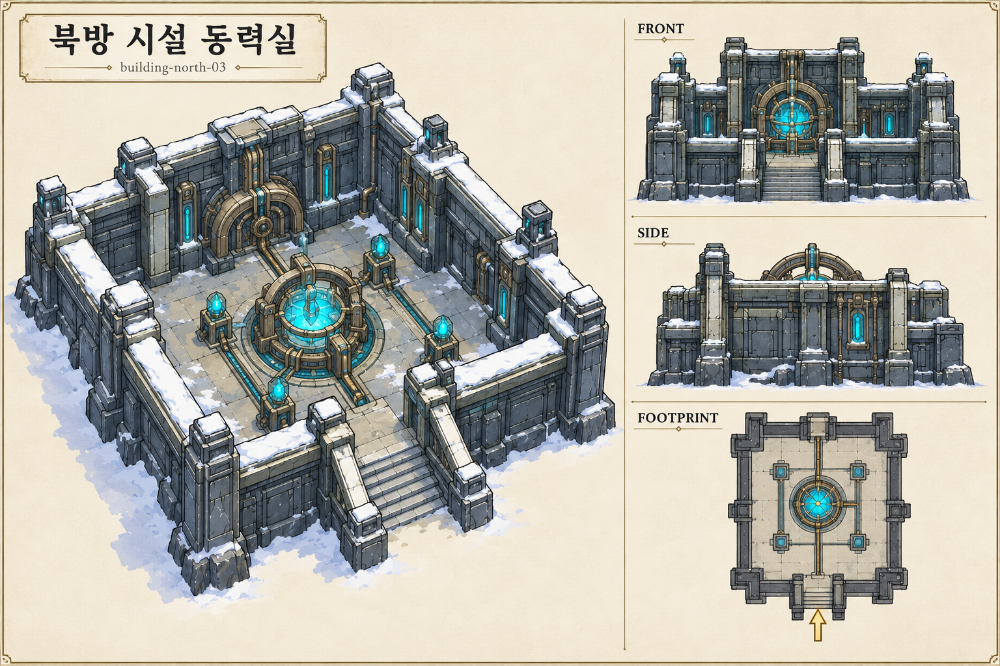

건물/시설 단독 외형·정면·측면·윗모습 구성 시각 확인. 외형 참고이며 실제 모델·타일·실내맵 데이터 아님. 창·문·계단·장식·평면의 위치와 수가 뷰마다 다를 수 있음. 정확한 치수·동선·충돌은 모델 제작 때 단일 규격으로 정합화. 지역 지도는 건축 양식 참고. 그림 속 문장·주변 소품이 신규 규칙이나 개별 제작 완료를 뜻하지 않음. 유사한 공명 핵 구조가 반복됨. 동력·분기·제어 기능은 장치 배치와 실루엣으로 후속 구분 검토.

### building-north-04 · 북방 시설 통제동

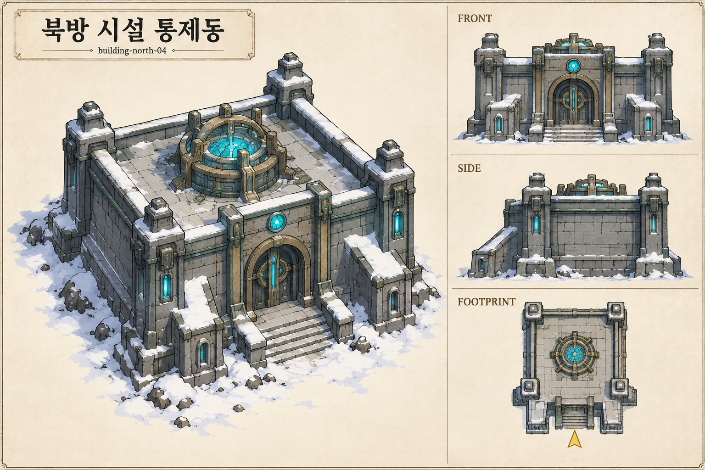

건물/시설 단독 외형·정면·측면·윗모습 구성 시각 확인. 외형 참고이며 실제 모델·타일·실내맵 데이터 아님. 창·문·계단·장식·평면의 위치와 수가 뷰마다 다를 수 있음. 정확한 치수·동선·충돌은 모델 제작 때 단일 규격으로 정합화. 지역 지도는 건축 양식 참고. 그림 속 문장·주변 소품이 신규 규칙이나 개별 제작 완료를 뜻하지 않음. 유사한 공명 핵 구조가 반복됨. 동력·분기·제어 기능은 장치 배치와 실루엣으로 후속 구분 검토.

### building-north-05 · 북방 시설 시설 입구

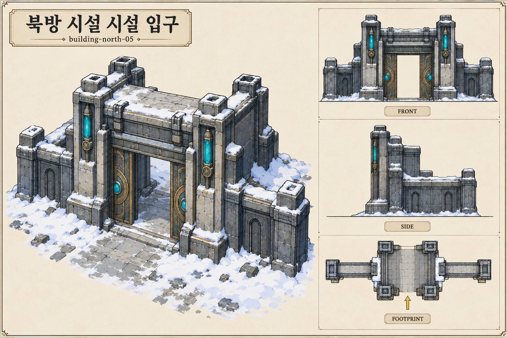

건물/시설 단독 외형·정면·측면·윗모습 구성 시각 확인. 외형 참고이며 실제 모델·타일·실내맵 데이터 아님. 창·문·계단·장식·평면의 위치와 수가 뷰마다 다를 수 있음. 정확한 치수·동선·충돌은 모델 제작 때 단일 규격으로 정합화. 지역 지도는 건축 양식 참고. 그림 속 문장·주변 소품이 신규 규칙이나 개별 제작 완료를 뜻하지 않음. 핵과 조명은 최종 화면에서 더 절제할 수 있음. 문 열림/닫힘 상태는 별도 모델·동작 필요.

### building-sea-01 · 해양국 항만 도시 부두

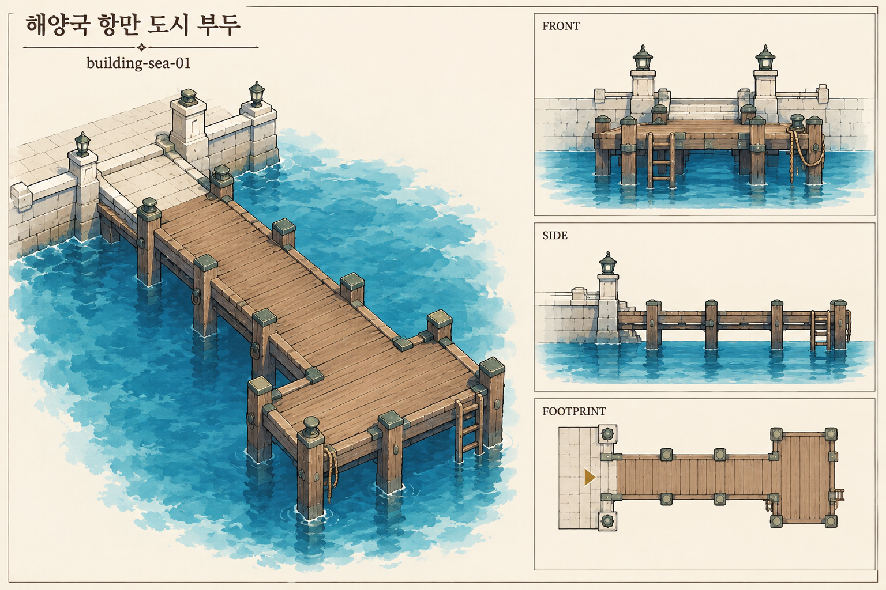

건물/시설 단독 외형·정면·측면·윗모습 구성 시각 확인. 외형 참고이며 실제 모델·타일·실내맵 데이터 아님. 창·문·계단·장식·평면의 위치와 수가 뷰마다 다를 수 있음. 정확한 치수·동선·충돌은 모델 제작 때 단일 규격으로 정합화. 지역 지도는 건축 양식 참고. 그림 속 문장·주변 소품이 신규 규칙이나 개별 제작 완료를 뜻하지 않음.

### building-sea-02 · 해양국 항만 도시 주택

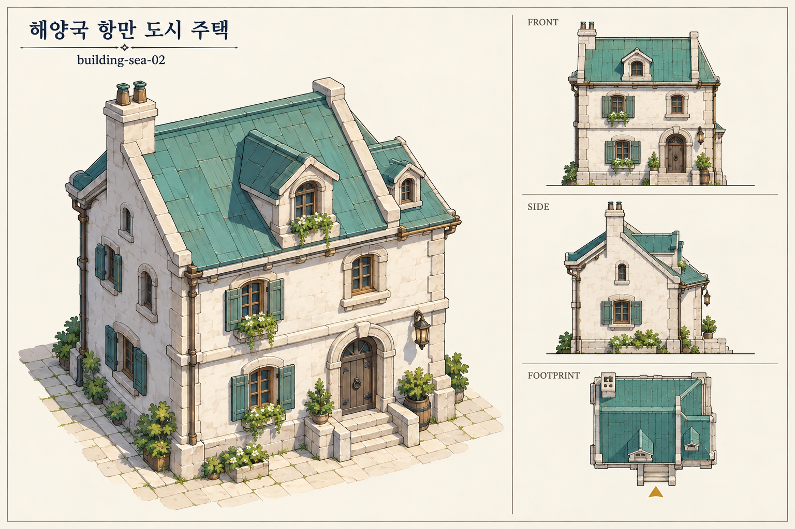

건물/시설 단독 외형·정면·측면·윗모습 구성 시각 확인. 외형 참고이며 실제 모델·타일·실내맵 데이터 아님. 창·문·계단·장식·평면의 위치와 수가 뷰마다 다를 수 있음. 정확한 치수·동선·충돌은 모델 제작 때 단일 규격으로 정합화. 지역 지도는 건축 양식 참고. 그림 속 문장·주변 소품이 신규 규칙이나 개별 제작 완료를 뜻하지 않음.

### building-sea-03 · 해양국 항만 도시 교역소

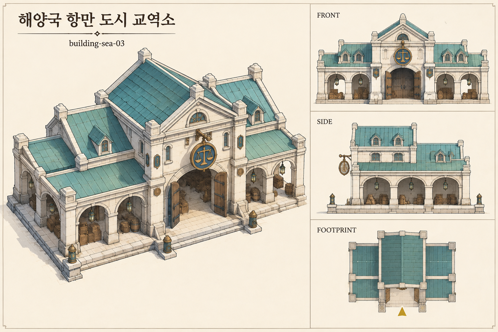

건물/시설 단독 외형·정면·측면·윗모습 구성 시각 확인. 외형 참고이며 실제 모델·타일·실내맵 데이터 아님. 창·문·계단·장식·평면의 위치와 수가 뷰마다 다를 수 있음. 정확한 치수·동선·충돌은 모델 제작 때 단일 규격으로 정합화. 지역 지도는 건축 양식 참고. 그림 속 문장·주변 소품이 신규 규칙이나 개별 제작 완료를 뜻하지 않음.

### building-sea-04 · 해양국 항만 도시 선원 회관

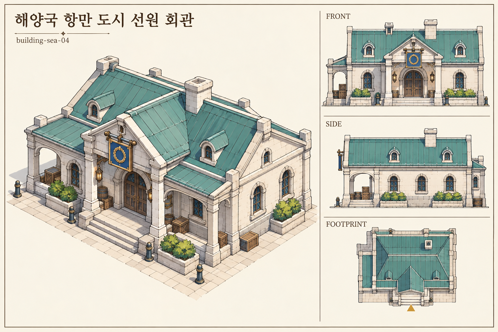

건물/시설 단독 외형·정면·측면·윗모습 구성 시각 확인. 외형 참고이며 실제 모델·타일·실내맵 데이터 아님. 창·문·계단·장식·평면의 위치와 수가 뷰마다 다를 수 있음. 정확한 치수·동선·충돌은 모델 제작 때 단일 규격으로 정합화. 지역 지도는 건축 양식 참고. 그림 속 문장·주변 소품이 신규 규칙이나 개별 제작 완료를 뜻하지 않음.

### building-sea-05 · 해양국 항만 도시 관측소

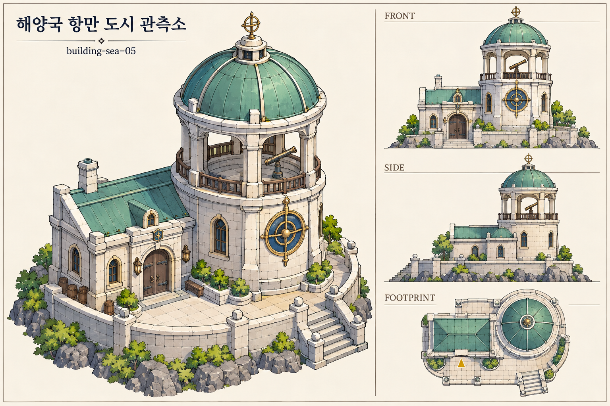

건물/시설 단독 외형·정면·측면·윗모습 구성 시각 확인. 외형 참고이며 실제 모델·타일·실내맵 데이터 아님. 창·문·계단·장식·평면의 위치와 수가 뷰마다 다를 수 있음. 정확한 치수·동선·충돌은 모델 제작 때 단일 규격으로 정합화. 지역 지도는 건축 양식 참고. 그림 속 문장·주변 소품이 신규 규칙이나 개별 제작 완료를 뜻하지 않음.

### building-sea-06 · 해양국 항만 도시 여관

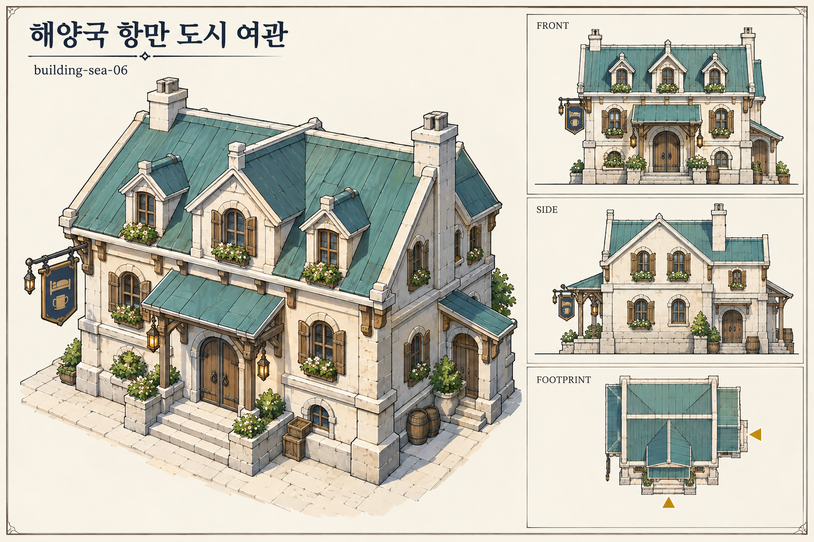

건물/시설 단독 외형·정면·측면·윗모습 구성 시각 확인. 외형 참고이며 실제 모델·타일·실내맵 데이터 아님. 창·문·계단·장식·평면의 위치와 수가 뷰마다 다를 수 있음. 정확한 치수·동선·충돌은 모델 제작 때 단일 규격으로 정합화. 지역 지도는 건축 양식 참고. 그림 속 문장·주변 소품이 신규 규칙이나 개별 제작 완료를 뜻하지 않음.

### building-sanctuary-01 · 교단 성역 성역 문

건물/시설 단독 외형·정면·측면·윗모습 구성 시각 확인. 외형 참고이며 실제 모델·타일·실내맵 데이터 아님. 창·문·계단·장식·평면의 위치와 수가 뷰마다 다를 수 있음. 정확한 치수·동선·충돌은 모델 제작 때 단일 규격으로 정합화. 지역 지도는 건축 양식 참고. 그림 속 문장·주변 소품이 신규 규칙이나 개별 제작 완료를 뜻하지 않음.

### building-sanctuary-02 · 교단 성역 숙소

건물/시설 단독 외형·정면·측면·윗모습 구성 시각 확인. 외형 참고이며 실제 모델·타일·실내맵 데이터 아님. 창·문·계단·장식·평면의 위치와 수가 뷰마다 다를 수 있음. 정확한 치수·동선·충돌은 모델 제작 때 단일 규격으로 정합화. 지역 지도는 건축 양식 참고. 그림 속 문장·주변 소품이 신규 규칙이나 개별 제작 완료를 뜻하지 않음.

### building-sanctuary-03 · 교단 성역 진료소

건물/시설 단독 외형·정면·측면·윗모습 구성 시각 확인. 외형 참고이며 실제 모델·타일·실내맵 데이터 아님. 창·문·계단·장식·평면의 위치와 수가 뷰마다 다를 수 있음. 정확한 치수·동선·충돌은 모델 제작 때 단일 규격으로 정합화. 지역 지도는 건축 양식 참고. 그림 속 문장·주변 소품이 신규 규칙이나 개별 제작 완료를 뜻하지 않음.

### building-sanctuary-04 · 교단 성역 예배당

건물/시설 단독 외형·정면·측면·윗모습 구성 시각 확인. 외형 참고이며 실제 모델·타일·실내맵 데이터 아님. 창·문·계단·장식·평면의 위치와 수가 뷰마다 다를 수 있음. 정확한 치수·동선·충돌은 모델 제작 때 단일 규격으로 정합화. 지역 지도는 건축 양식 참고. 그림 속 문장·주변 소품이 신규 규칙이나 개별 제작 완료를 뜻하지 않음.

### building-sanctuary-05 · 교단 성역 회랑

건물/시설 단독 외형·정면·측면·윗모습 구성 시각 확인. 외형 참고이며 실제 모델·타일·실내맵 데이터 아님. 창·문·계단·장식·평면의 위치와 수가 뷰마다 다를 수 있음. 정확한 치수·동선·충돌은 모델 제작 때 단일 규격으로 정합화. 지역 지도는 건축 양식 참고. 그림 속 문장·주변 소품이 신규 규칙이나 개별 제작 완료를 뜻하지 않음.

### building-sanctuary-06 · 교단 성역 기록실

건물/시설 단독 외형·정면·측면·윗모습 구성 시각 확인. 외형 참고이며 실제 모델·타일·실내맵 데이터 아님. 창·문·계단·장식·평면의 위치와 수가 뷰마다 다를 수 있음. 정확한 치수·동선·충돌은 모델 제작 때 단일 규격으로 정합화. 지역 지도는 건축 양식 참고. 그림 속 문장·주변 소품이 신규 규칙이나 개별 제작 완료를 뜻하지 않음.

### building-core-01 · 고대 중추 진입문

건물/시설 단독 외형·정면·측면·윗모습 구성 시각 확인. 외형 참고이며 실제 모델·타일·실내맵 데이터 아님. 창·문·계단·장식·평면의 위치와 수가 뷰마다 다를 수 있음. 정확한 치수·동선·충돌은 모델 제작 때 단일 규격으로 정합화. 지역 지도는 건축 양식 참고. 그림 속 문장·주변 소품이 신규 규칙이나 개별 제작 완료를 뜻하지 않음.

### building-core-02 · 고대 중추 연결 회랑

건물/시설 단독 외형·정면·측면·윗모습 구성 시각 확인. 외형 참고이며 실제 모델·타일·실내맵 데이터 아님. 창·문·계단·장식·평면의 위치와 수가 뷰마다 다를 수 있음. 정확한 치수·동선·충돌은 모델 제작 때 단일 규격으로 정합화. 지역 지도는 건축 양식 참고. 그림 속 문장·주변 소품이 신규 규칙이나 개별 제작 완료를 뜻하지 않음.

### building-core-03 · 고대 중추 분기실

건물/시설 단독 외형·정면·측면·윗모습 구성 시각 확인. 외형 참고이며 실제 모델·타일·실내맵 데이터 아님. 창·문·계단·장식·평면의 위치와 수가 뷰마다 다를 수 있음. 정확한 치수·동선·충돌은 모델 제작 때 단일 규격으로 정합화. 지역 지도는 건축 양식 참고. 그림 속 문장·주변 소품이 신규 규칙이나 개별 제작 완료를 뜻하지 않음. 유사한 공명 핵 구조가 반복됨. 동력·분기·제어 기능은 장치 배치와 실루엣으로 후속 구분 검토.

### building-core-04 · 고대 중추 제어실

건물/시설 단독 외형·정면·측면·윗모습 구성 시각 확인. 외형 참고이며 실제 모델·타일·실내맵 데이터 아님. 창·문·계단·장식·평면의 위치와 수가 뷰마다 다를 수 있음. 정확한 치수·동선·충돌은 모델 제작 때 단일 규격으로 정합화. 지역 지도는 건축 양식 참고. 그림 속 문장·주변 소품이 신규 규칙이나 개별 제작 완료를 뜻하지 않음. 유사한 공명 핵 구조가 반복됨. 동력·분기·제어 기능은 장치 배치와 실루엣으로 후속 구분 검토.

### building-core-05 · 고대 중추 중심 구조물

건물/시설 단독 외형·정면·측면·윗모습 구성 시각 확인. 외형 참고이며 실제 모델·타일·실내맵 데이터 아님. 창·문·계단·장식·평면의 위치와 수가 뷰마다 다를 수 있음. 정확한 치수·동선·충돌은 모델 제작 때 단일 규격으로 정합화. 지역 지도는 건축 양식 참고. 그림 속 문장·주변 소품이 신규 규칙이나 개별 제작 완료를 뜻하지 않음. 핵과 조명은 최종 화면에서 더 절제할 수 있음. 문 열림/닫힘 상태는 별도 모델·동작 필요.

### building-leon-home-01 · 레온의 고향 마을 입구

건물/시설 단독 외형·정면·측면·윗모습 구성 시각 확인. 외형 참고이며 실제 모델·타일·실내맵 데이터 아님. 창·문·계단·장식·평면의 위치와 수가 뷰마다 다를 수 있음. 정확한 치수·동선·충돌은 모델 제작 때 단일 규격으로 정합화. 지역 지도는 건축 양식 참고. 그림 속 문장·주변 소품이 신규 규칙이나 개별 제작 완료를 뜻하지 않음.

### building-leon-home-02 · 레온의 고향 레온의 옛집

건물/시설 단독 외형·정면·측면·윗모습 구성 시각 확인. 외형 참고이며 실제 모델·타일·실내맵 데이터 아님. 창·문·계단·장식·평면의 위치와 수가 뷰마다 다를 수 있음. 정확한 치수·동선·충돌은 모델 제작 때 단일 규격으로 정합화. 지역 지도는 건축 양식 참고. 그림 속 문장·주변 소품이 신규 규칙이나 개별 제작 완료를 뜻하지 않음.

### building-leon-home-03 · 레온의 고향 기억의 장소

건물/시설 단독 외형·정면·측면·윗모습 구성 시각 확인. 외형 참고이며 실제 모델·타일·실내맵 데이터 아님. 창·문·계단·장식·평면의 위치와 수가 뷰마다 다를 수 있음. 정확한 치수·동선·충돌은 모델 제작 때 단일 규격으로 정합화. 지역 지도는 건축 양식 참고. 그림 속 문장·주변 소품이 신규 규칙이나 개별 제작 완료를 뜻하지 않음.

## 앞선 공용 부품·배치 시안

### kit-wall-straight · 목조 석벽 직선

개별 외형·주요 뷰·연결/배치 예시 시각 확인. 실제 모델·타일·맵 데이터 아님. 부품별 크기·두께·맞댐 면·지붕 경사·재질 반복 간격은 모델링 때 통일. 배치 예시의 주변 부품을 별도 완성 애셋으로 집계하지 않음.

### kit-wall-corner · 목조 석벽 모서리

개별 외형·주요 뷰·연결/배치 예시 시각 확인. 실제 모델·타일·맵 데이터 아님. 부품별 크기·두께·맞댐 면·지붕 경사·재질 반복 간격은 모델링 때 통일. 배치 예시의 주변 부품을 별도 완성 애셋으로 집계하지 않음. 모서리 시안에 처마가 함께 표현됨. 모델링 시 벽과 지붕을 분리해 공용 부품 경계를 유지.

### kit-door-frame · 목재 출입문 틀

개별 외형·주요 뷰·연결/배치 예시 시각 확인. 실제 모델·타일·맵 데이터 아님. 부품별 크기·두께·맞댐 면·지붕 경사·재질 반복 간격은 모델링 때 통일. 배치 예시의 주변 부품을 별도 완성 애셋으로 집계하지 않음.

### kit-door-leaf · 목재 문짝

개별 외형·주요 뷰·연결/배치 예시 시각 확인. 실제 모델·타일·맵 데이터 아님. 부품별 크기·두께·맞댐 면·지붕 경사·재질 반복 간격은 모델링 때 통일. 배치 예시의 주변 부품을 별도 완성 애셋으로 집계하지 않음.

### kit-window-frame · 목재 창틀

개별 외형·주요 뷰·연결/배치 예시 시각 확인. 실제 모델·타일·맵 데이터 아님. 부품별 크기·두께·맞댐 면·지붕 경사·재질 반복 간격은 모델링 때 통일. 배치 예시의 주변 부품을 별도 완성 애셋으로 집계하지 않음.

### kit-window-shutters · 목재 덧문

개별 외형·주요 뷰·연결/배치 예시 시각 확인. 실제 모델·타일·맵 데이터 아님. 부품별 크기·두께·맞댐 면·지붕 경사·재질 반복 간격은 모델링 때 통일. 배치 예시의 주변 부품을 별도 완성 애셋으로 집계하지 않음.

### kit-roof-slope · 짙은 청색 지붕 경사면

개별 외형·주요 뷰·연결/배치 예시 시각 확인. 실제 모델·타일·맵 데이터 아님. 부품별 크기·두께·맞댐 면·지붕 경사·재질 반복 간격은 모델링 때 통일. 배치 예시의 주변 부품을 별도 완성 애셋으로 집계하지 않음.

### kit-roof-corner · 짙은 청색 지붕 모서리

개별 외형·주요 뷰·연결/배치 예시 시각 확인. 실제 모델·타일·맵 데이터 아님. 부품별 크기·두께·맞댐 면·지붕 경사·재질 반복 간격은 모델링 때 통일. 배치 예시의 주변 부품을 별도 완성 애셋으로 집계하지 않음. v2에서 탑 벽체와 꼭대기 장식을 제거. 이음새 방향은 모델링 때 지붕 경사면과 맞춤.

### kit-roof-ridge · 짙은 청색 지붕 용마루

개별 외형·주요 뷰·연결/배치 예시 시각 확인. 실제 모델·타일·맵 데이터 아님. 부품별 크기·두께·맞댐 면·지붕 경사·재질 반복 간격은 모델링 때 통일. 배치 예시의 주변 부품을 별도 완성 애셋으로 집계하지 않음.

### kit-timber-pillar · 목재 지지 기둥

개별 외형·주요 뷰·연결/배치 예시 시각 확인. 실제 모델·타일·맵 데이터 아님. 부품별 크기·두께·맞댐 면·지붕 경사·재질 반복 간격은 모델링 때 통일. 배치 예시의 주변 부품을 별도 완성 애셋으로 집계하지 않음.

### kit-stone-foundation · 석조 기단

개별 외형·주요 뷰·연결/배치 예시 시각 확인. 실제 모델·타일·맵 데이터 아님. 부품별 크기·두께·맞댐 면·지붕 경사·재질 반복 간격은 모델링 때 통일. 배치 예시의 주변 부품을 별도 완성 애셋으로 집계하지 않음.

### kit-stone-stairs · 석조 계단

개별 외형·주요 뷰·연결/배치 예시 시각 확인. 실제 모델·타일·맵 데이터 아님. 부품별 크기·두께·맞댐 면·지붕 경사·재질 반복 간격은 모델링 때 통일. 배치 예시의 주변 부품을 별도 완성 애셋으로 집계하지 않음. 단독/연결 예시의 단수와 높이 차이는 모델링 규격으로 통일 필요.

### map-frost · 서리골 전체 배치도

개별 외형·주요 뷰·연결/배치 예시 시각 확인. 실제 모델·타일·맵 데이터 아님. 그림 속 번호·출입구·상호·스케일·화살표는 생성 시안이며 자동으로 내비게이션·퀘스트·지리 확정 데이터로 가져오지 않음. 일부 곡선/대각선 길은 화면 상하좌우 이동 기준으로 정합화 필요. 북쪽 출구 마커가 6 대신 1로 중복 표기됨. 범례·번호 수정 후 구현.

### map-border · 돌샘·국경 연락소 전체 배치도

개별 외형·주요 뷰·연결/배치 예시 시각 확인. 실제 모델·타일·맵 데이터 아님. 그림 속 번호·출입구·상호·스케일·화살표는 생성 시안이며 자동으로 내비게이션·퀘스트·지리 확정 데이터로 가져오지 않음. 일부 곡선/대각선 길은 화면 상하좌우 이동 기준으로 정합화 필요.

### map-refugee · 피난 교량 전체 배치도

개별 외형·주요 뷰·연결/배치 예시 시각 확인. 실제 모델·타일·맵 데이터 아님. 그림 속 번호·출입구·상호·스케일·화살표는 생성 시안이며 자동으로 내비게이션·퀘스트·지리 확정 데이터로 가져오지 않음. 일부 곡선/대각선 길은 화면 상하좌우 이동 기준으로 정합화 필요. 구호 천막 문양은 임시 시각 요소. 기존 의무병 보드의 잎사귀 표식으로 통일 검토.

### map-capital · 아르덴 왕도 전체 배치도

개별 외형·주요 뷰·연결/배치 예시 시각 확인. 실제 모델·타일·맵 데이터 아님. 그림 속 번호·출입구·상호·스케일·화살표는 생성 시안이며 자동으로 내비게이션·퀘스트·지리 확정 데이터로 가져오지 않음. 일부 곡선/대각선 길은 화면 상하좌우 이동 기준으로 정합화 필요.

### map-academy · 남방 학술도시 전체 배치도

개별 외형·주요 뷰·연결/배치 예시 시각 확인. 실제 모델·타일·맵 데이터 아님. 그림 속 번호·출입구·상호·스케일·화살표는 생성 시안이며 자동으로 내비게이션·퀘스트·지리 확정 데이터로 가져오지 않음. 일부 곡선/대각선 길은 화면 상하좌우 이동 기준으로 정합화 필요.

### map-south-port · 남방 항구 전체 배치도

개별 외형·주요 뷰·연결/배치 예시 시각 확인. 실제 모델·타일·맵 데이터 아님. 그림 속 번호·출입구·상호·스케일·화살표는 생성 시안이며 자동으로 내비게이션·퀘스트·지리 확정 데이터로 가져오지 않음. 일부 곡선/대각선 길은 화면 상하좌우 이동 기준으로 정합화 필요.

### map-north · 북방 시설 전체 배치도

개별 외형·주요 뷰·연결/배치 예시 시각 확인. 실제 모델·타일·맵 데이터 아님. 그림 속 번호·출입구·상호·스케일·화살표는 생성 시안이며 자동으로 내비게이션·퀘스트·지리 확정 데이터로 가져오지 않음. 일부 곡선/대각선 길은 화면 상하좌우 이동 기준으로 정합화 필요.

### map-sea · 해양국 항만 도시 전체 배치도

개별 외형·주요 뷰·연결/배치 예시 시각 확인. 실제 모델·타일·맵 데이터 아님. 그림 속 번호·출입구·상호·스케일·화살표는 생성 시안이며 자동으로 내비게이션·퀘스트·지리 확정 데이터로 가져오지 않음. 일부 곡선/대각선 길은 화면 상하좌우 이동 기준으로 정합화 필요.

### map-sanctuary · 교단 성역 전체 배치도

개별 외형·주요 뷰·연결/배치 예시 시각 확인. 실제 모델·타일·맵 데이터 아님. 그림 속 번호·출입구·상호·스케일·화살표는 생성 시안이며 자동으로 내비게이션·퀘스트·지리 확정 데이터로 가져오지 않음. 일부 곡선/대각선 길은 화면 상하좌우 이동 기준으로 정합화 필요. 남쪽 입구와 서쪽 숙소가 모두 1로 보이는 번호 오류. 도면 확정 때 정정.

### map-core · 고대 중추 전체 배치도

개별 외형·주요 뷰·연결/배치 예시 시각 확인. 실제 모델·타일·맵 데이터 아님. 그림 속 번호·출입구·상호·스케일·화살표는 생성 시안이며 자동으로 내비게이션·퀘스트·지리 확정 데이터로 가져오지 않음. 일부 곡선/대각선 길은 화면 상하좌우 이동 기준으로 정합화 필요. 중앙 회랑 화살표 방향 일부가 역방향. 장면 전환·통행·퀘스트 순서를 그림에서 추출하지 않음.

### map-leon-home · 레온의 고향 전체 배치도

개별 외형·주요 뷰·연결/배치 예시 시각 확인. 실제 모델·타일·맵 데이터 아님. 그림 속 번호·출입구·상호·스케일·화살표는 생성 시안이며 자동으로 내비게이션·퀘스트·지리 확정 데이터로 가져오지 않음. 일부 곡선/대각선 길은 화면 상하좌우 이동 기준으로 정합화 필요.

