# 이름 없는 공통 NPC 보드 14종

기존과 동일하게 전신 1개 + 앞·뒤·옆 도트 시안 3개 + 표정 초상화 4개로 제작했습니다. 타입별 대표 외형이며, 색·장비 변형이나 게임용 애니메이션 완성본은 아닙니다.

[전체 NPC 제작 목록](npc-registry.md) · [HTML 갤러리](../assets/character-boards/generic-npcs/index.html)

## 마을 주민 남성

분류: 주민 · 등장 후보: 서리골·돌샘

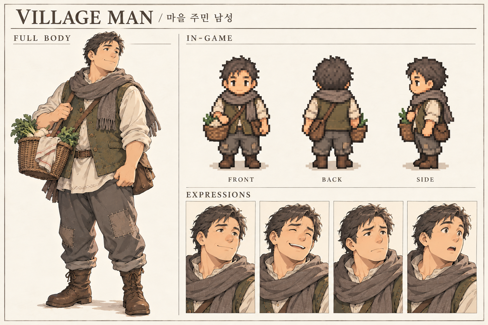

## 마을 주민 여성

분류: 주민 · 등장 후보: 서리골·돌샘

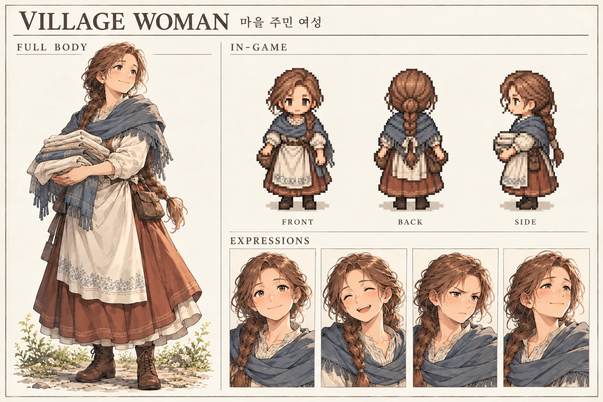

## 마을 아이 공통형

분류: 주민 · 등장 후보: 서리골·돌샘

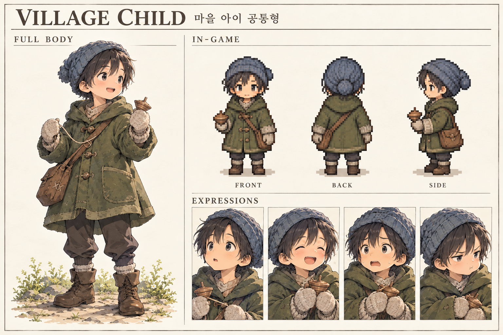

## 노년 주민 공통형

분류: 주민 · 등장 후보: 서리골·돌샘

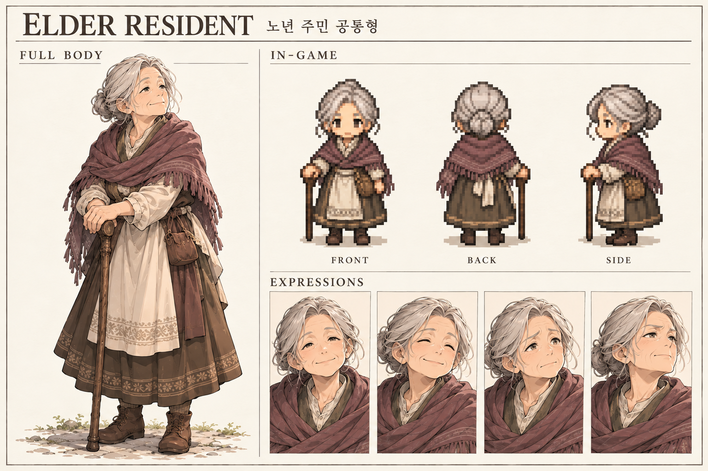

## 벌목꾼 공통형

분류: 노동자 · 등장 후보: 서리골·산길

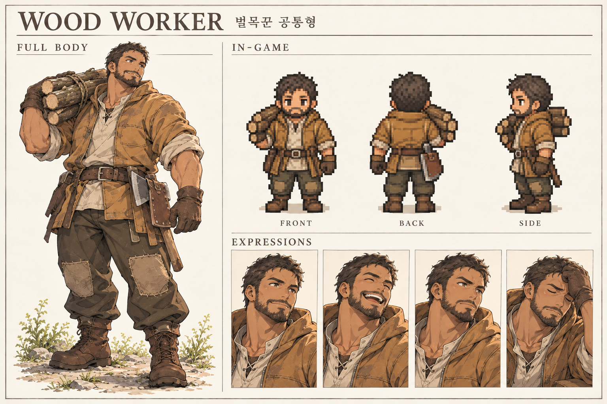

## 광부 공통형

분류: 노동자 · 등장 후보: 돌샘

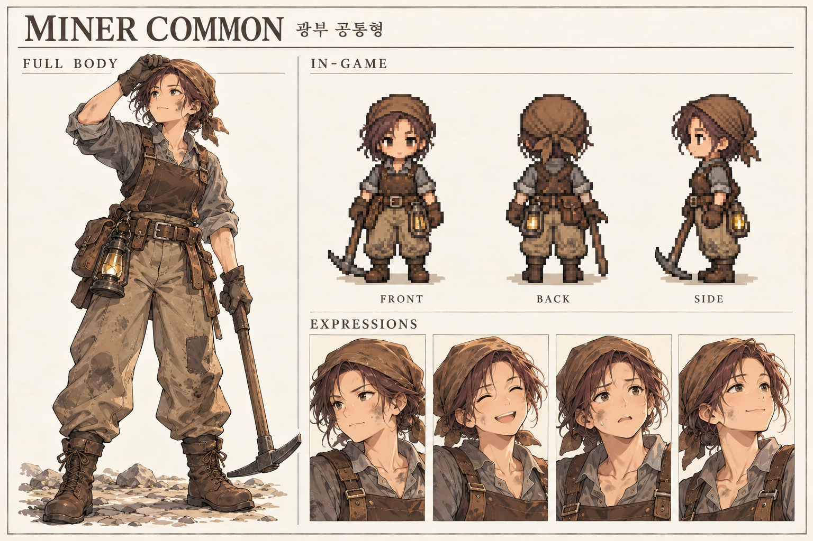

## 행상인 공통형

분류: 상인·여행자 · 등장 후보: 서리골·돌샘·남방 도시연맹

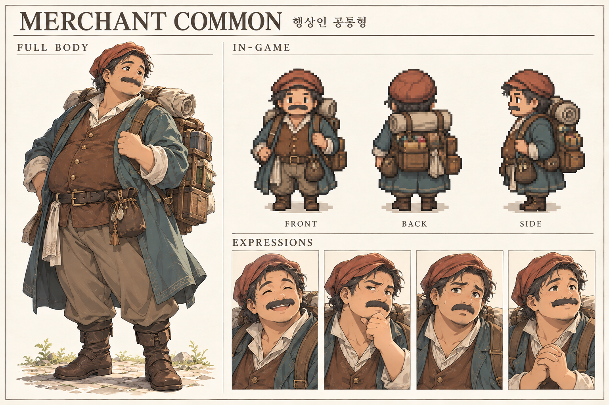

## 여행자 공통형

분류: 상인·여행자 · 등장 후보: 산길·남방 도시연맹

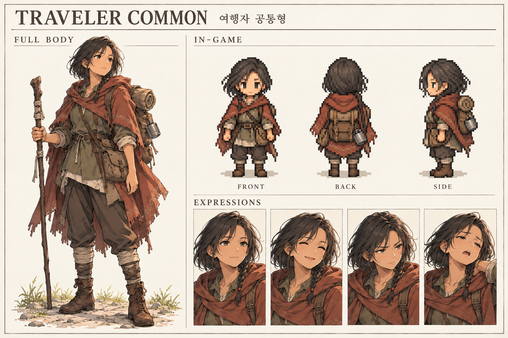

## 아르덴 일반병

분류: 병사 · 등장 후보: 아르덴·서리골·피난 교량

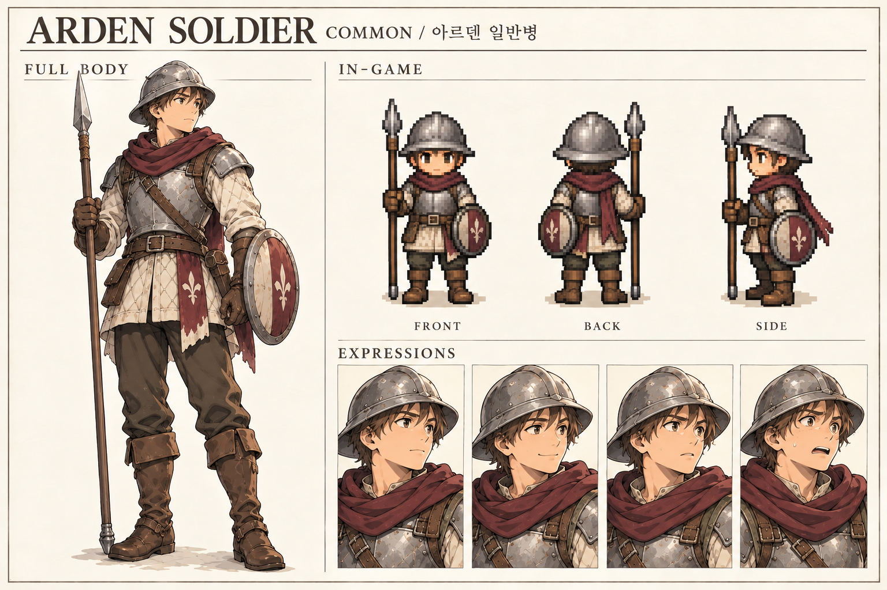

## 벨크 일반병

분류: 병사 · 등장 후보: 벨크·국경·북방 시설

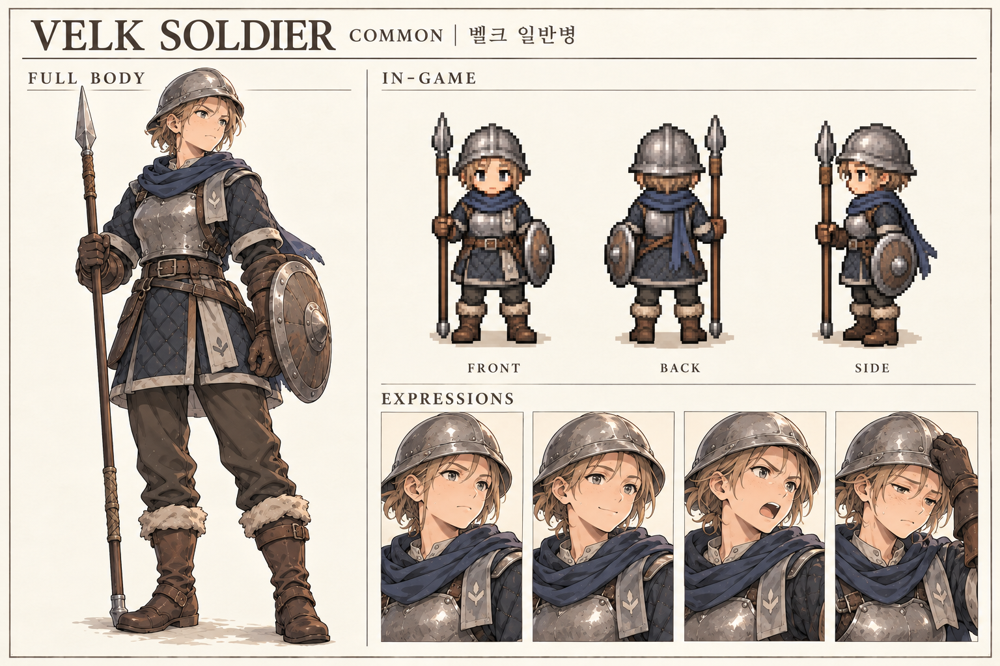

## 항만 인부

분류: 노동자 · 등장 후보: 남방 항구·해양국

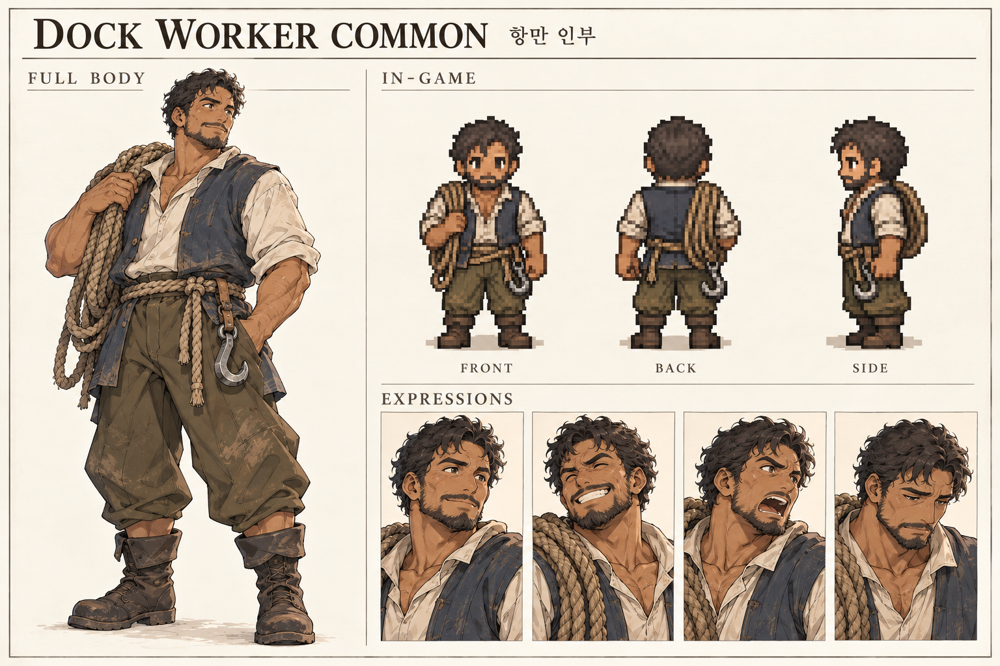

## 구호 사제 공통형

분류: 교단·연구 · 등장 후보: 성역·피난 거점

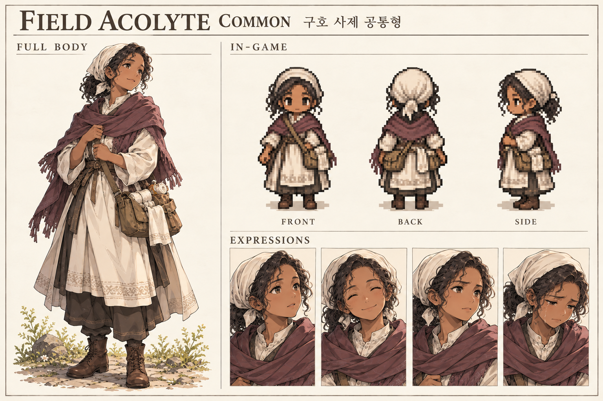

## 연구 보조원

분류: 교단·연구 · 등장 후보: 남방 학술도시·성역·고대 시설

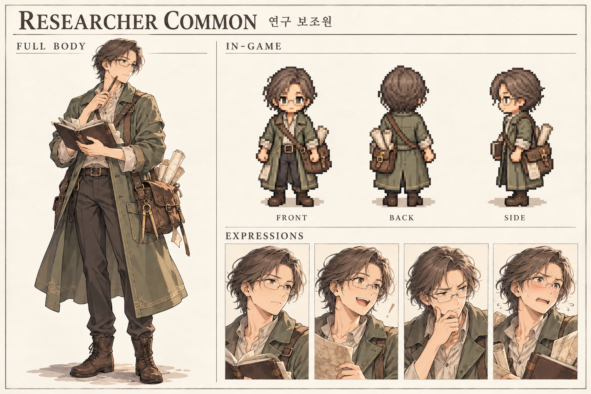

## 피난민 공통형

분류: 피난민 · 등장 후보: 서리골·피난 교량·해양국

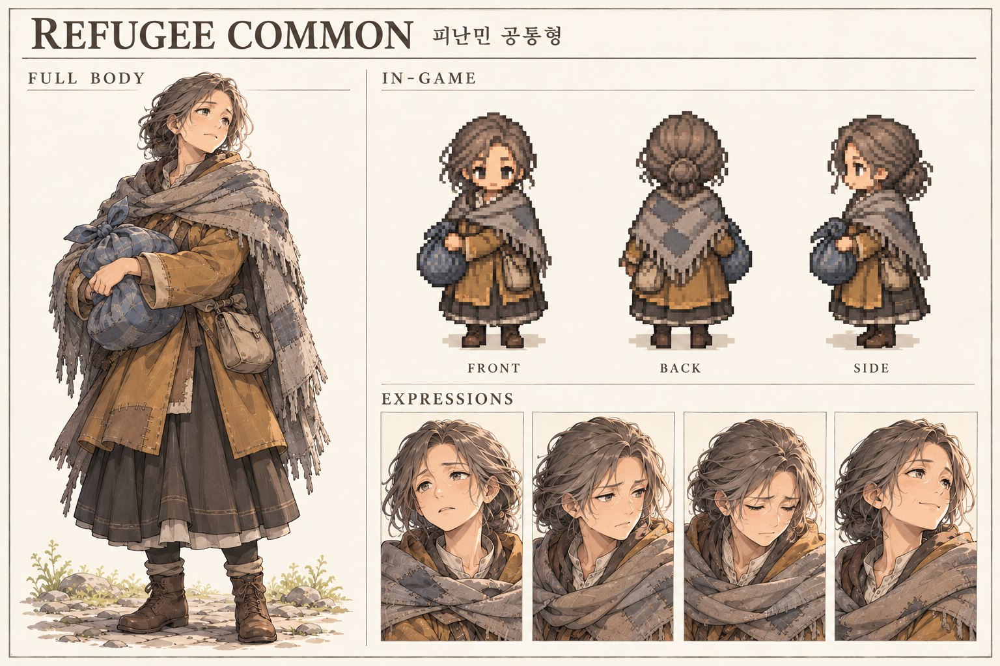
