# 아이템 외형 시안 80종

2026-10-29 · 무기·방어구/장신구 50종 + 기본 물품 30종 · 보드 15장

사용자가 승인한 8개 카테고리를 기준으로 기본 외형을 만들었습니다. 무기 5계열과 방어구·장신구 5계열은 각각 5종의 변형을 제작했고, 나머지는 기본형을 제작했습니다. 각 시안에는 확대 외형과 작은 도트 아이콘을 함께 넣었습니다.

**80개의 독립 게임용 PNG가 아니라 15장의 외형 비교 보드**입니다. 이름과 숫자는 외형을 구별하기 위한 가안이며 성능 등급·강함 순서가 아닙니다. 경갑·중갑·장갑·부적·반지는 에셋 분류이지 장비 슬롯을 확정하는 결정이 아닙니다. 약초·재료를 만들었다고 제작/조합 시스템을 도입한 것은 아닙니다.

- [HTML 전체 보기](../assets/item-boards/index.html) — 이미지와 함께 내려받아 브라우저로 열기.
- [아이템 목록 CSV](../assets/item-boards/items.csv)
- [보드·아이템·프롬프트·해시 JSON](../assets/item-boards/manifest.json)

## 분류와 제작량

| 분류 | 구성 | 외형 수 |
|---|---|---|
| 무기 | 한손검·창·활·단검·지팡이 각 5종 | 25 |
| 방어구·장신구 | 경갑·중갑·장갑·부적·반지 각 5종 | 25 |
| 회복·부활 | 회복약·마나약·부활약·붕대·식량 | 6 |
| 상태이상 해제 | 해독·마비·침묵·만능 치료 | 4 |
| 약초·재료 | 약초·해열제 재료·광석·천 | 6 |
| 탐험 도구 | 밧줄·부싯돌·등불·곡괭이·야영 도구 | 5 |
| 퀘스트 물품·기록 | 배달 약·쪽지·수첩·지도·통행증 | 5 |
| 중요품·관계 물품 | 공명석·파손형·니아 선물·기념품 후보 | 4 |

## 먼저 검토할 물건

레온의 대여 검은 한손검 03, 소형 회복약과 붕대는 회복·치료 01/05, 돌샘에 전할 약은 퀘스트·기록 01, 깨진 공명석은 중요품 02입니다. 프롤로그에서 직접 보이는 물건부터 손에 든 크기와 장면 소품 크기를 맞춰야 합니다.

붕대와 식량은 시각 분류상 회복 쪽에 묶었으며 전투 사용 가능 여부·효과·소모 방식은 별도 설계합니다. 해열제 재료는 의뢰·배달 배경용 외형 제안이며 조합법이나 상태이상을 확정하지 않습니다. 여행의 기념품은 소유자·이벤트가 지정되지 않은 예시입니다. 상태이상 종류도 전투 설계 검토가 필요합니다.

## 한손검

01 낡은 철검 · 02 국경 수비검 · 03 레온의 대여 검 · 04 왕국 제식검 · 05 고대 각인검

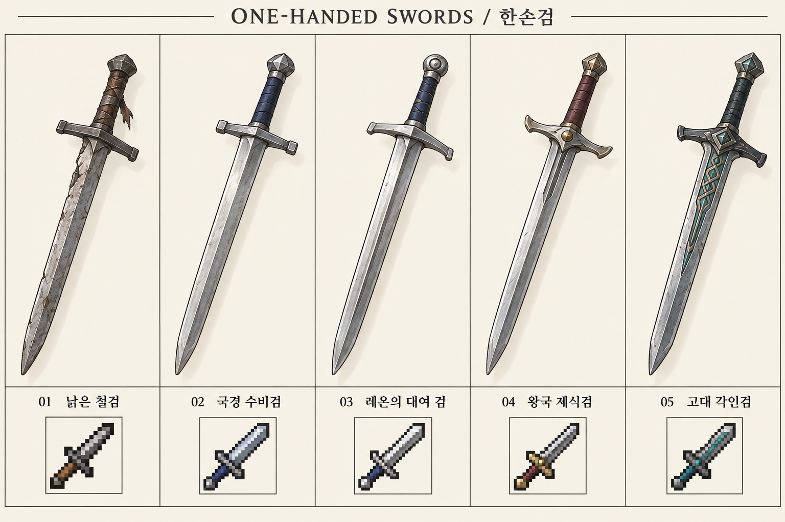

## 창

01 사냥창 · 02 민병대 장창 · 03 국경 수비창 · 04 왕국 제식창 · 05 유적 수호창

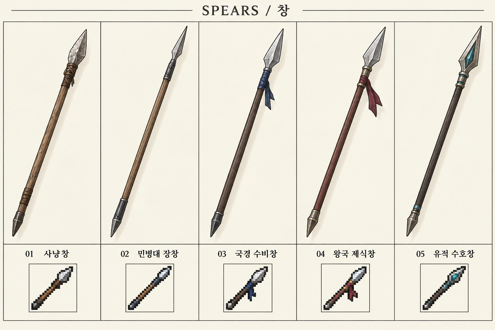

## 활

01 사냥용 단궁 · 02 목제 장궁 · 03 국경 복합궁 · 04 정찰병 단궁 · 05 고대 각인궁

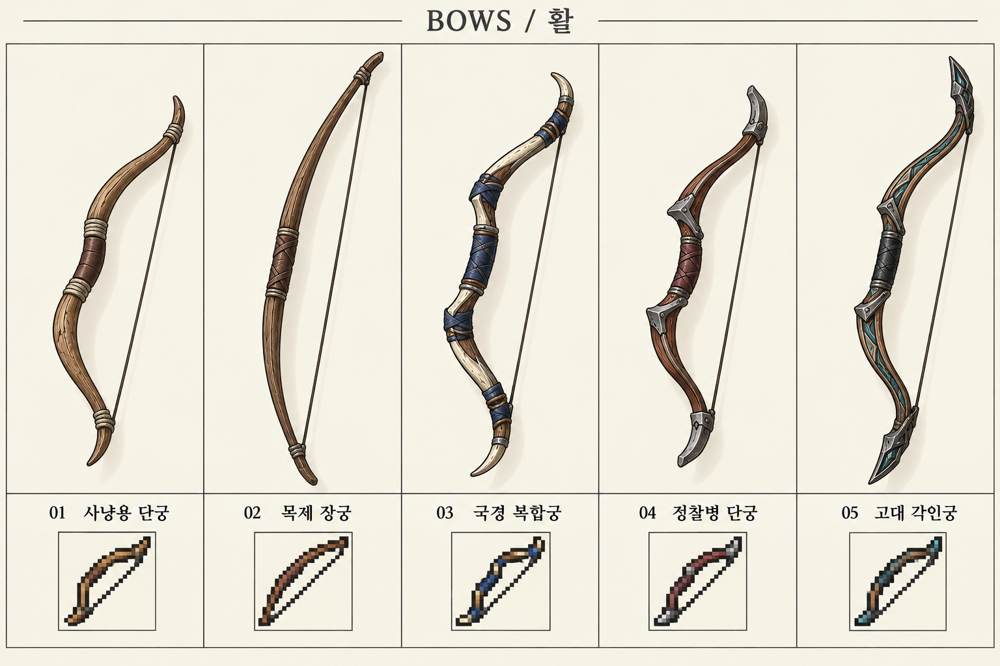

## 단검

01 작업용 단검 · 02 여행자 단검 · 03 선원용 단검 · 04 정찰병 단검 · 05 유적 각인단검

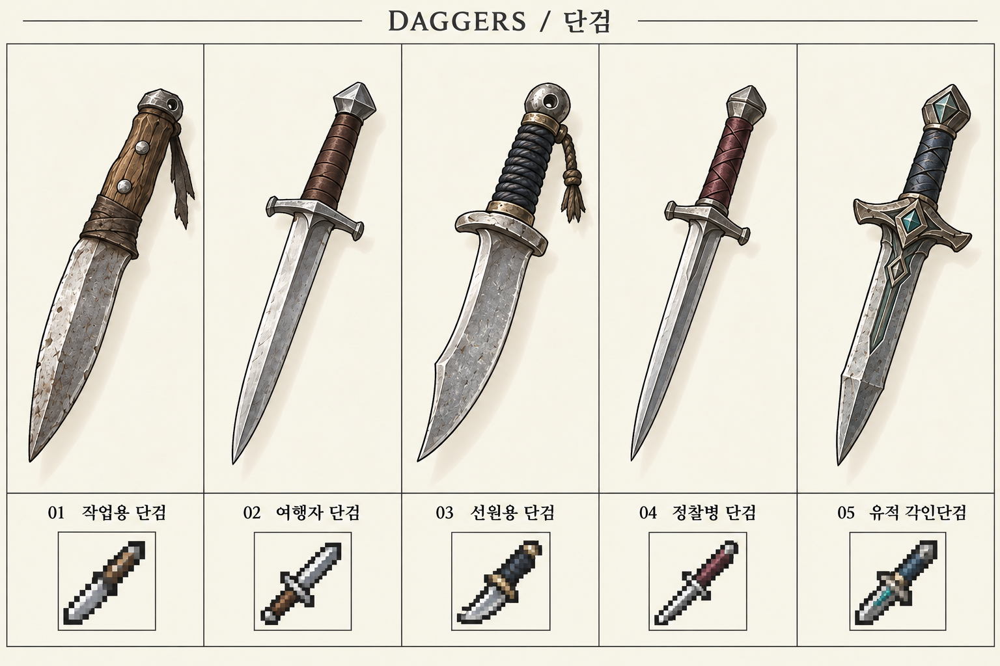

## 지팡이

01 수련용 목봉 · 02 약초사 지팡이 · 03 학술 측정봉 · 04 성역 사제봉 · 05 고대 공명봉

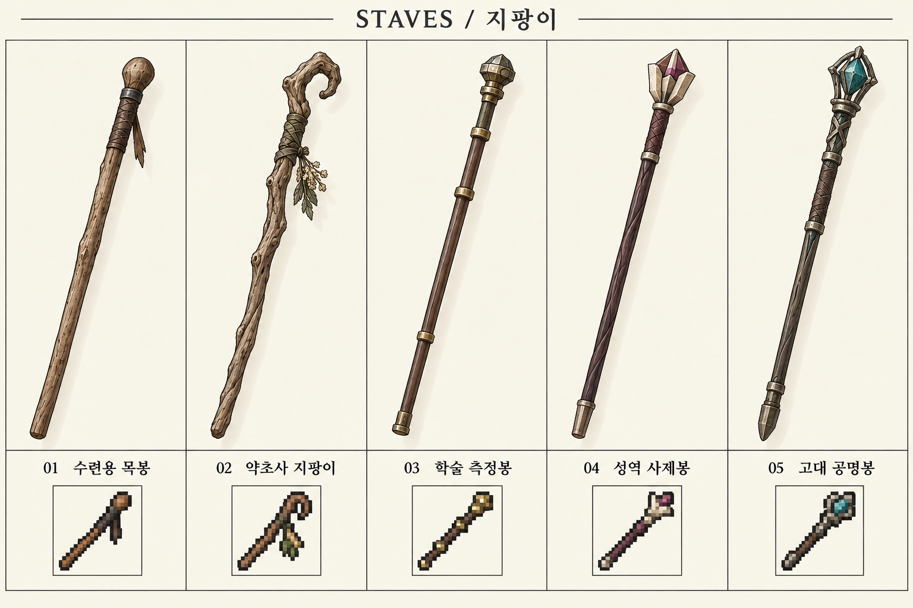

## 경갑

01 덧댄 여행 조끼 · 02 가죽 경갑 · 03 국경 정찰 경갑 · 04 왕국 보급 경갑 · 05 유적 탐사 경갑

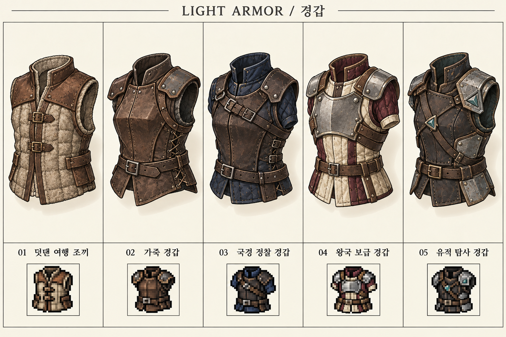

## 중갑

01 보강 가죽 흉갑 · 02 철제 흉갑 · 03 국경 수비 흉갑 · 04 왕국 제식 흉갑 · 05 고대 판금 흉갑

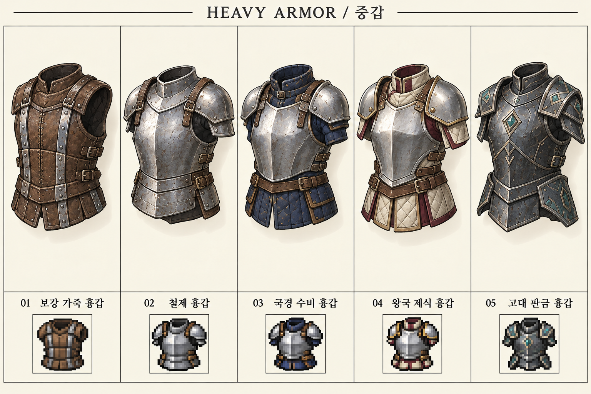

## 장갑

01 천 작업 장갑 · 02 가죽 여행 장갑 · 03 국경 방한 장갑 · 04 병사용 철장갑 · 05 유적 탐사 장갑

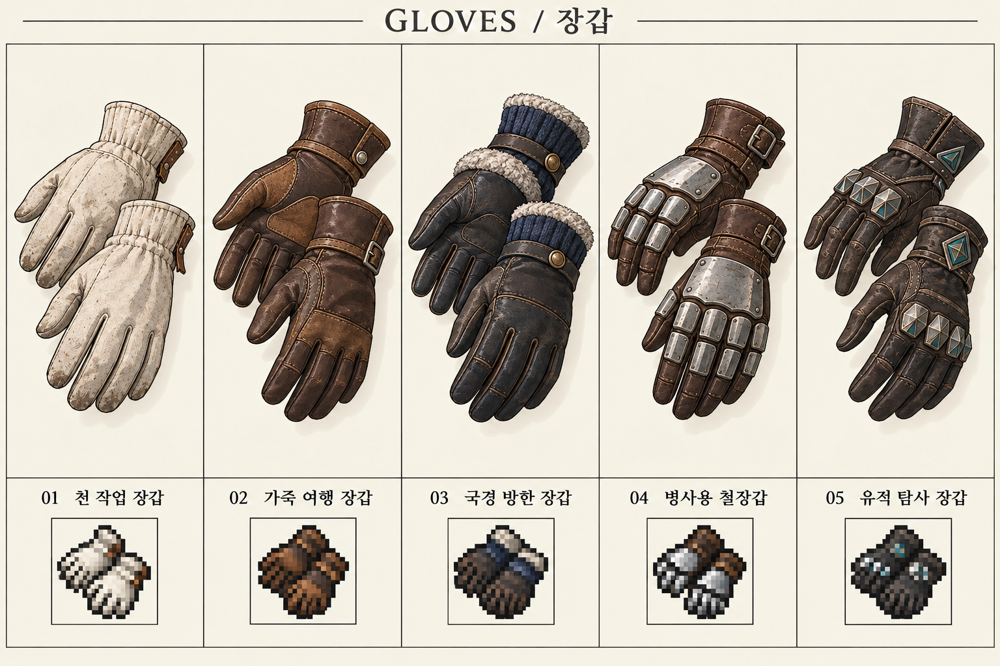

## 부적

01 매듭 부적 · 02 약초 주머니 부적 · 03 길잡이 목패 · 04 성역 수호 부적 · 05 고대 각인 부적

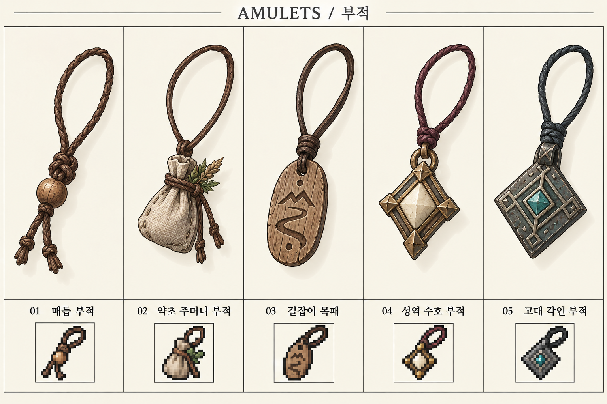

## 반지

01 구리 반지 · 02 철제 인장반지 · 03 은빛 수호반지 · 04 청록석 반지 · 05 고대 각인반지

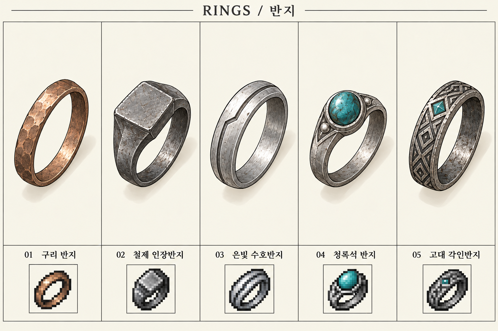

## 회복·치료

01 소형 회복약 · 02 고급 회복약 · 03 마나 회복약 · 04 부활약 · 05 붕대 · 06 식량 꾸러미 · 07 해독제 · 08 마비 해제약 · 09 침묵 해제약 · 10 만능 치료약

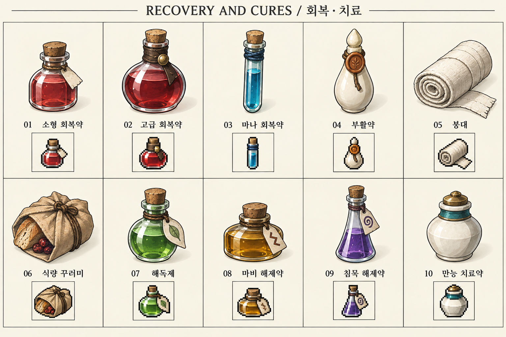

## 약초·재료

01 지혈초 · 02 해독초 · 03 말린 약초 · 04 해열제 재료 · 05 철광석 · 06 천 조각

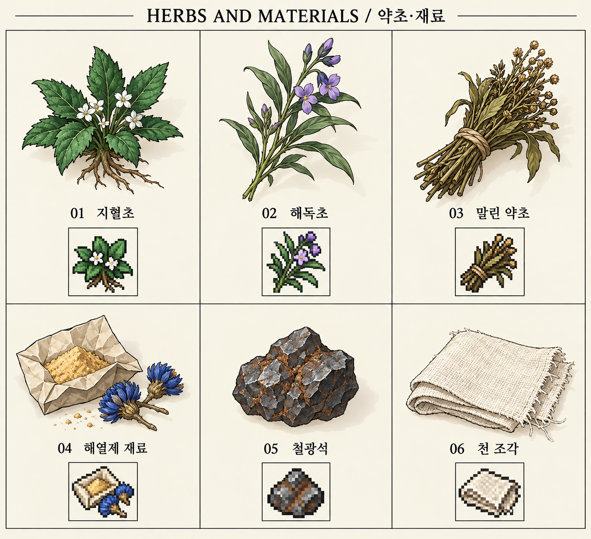

## 탐험 도구

01 밧줄 · 02 부싯돌 · 03 휴대 등불 · 04 곡괭이 · 05 야영 도구

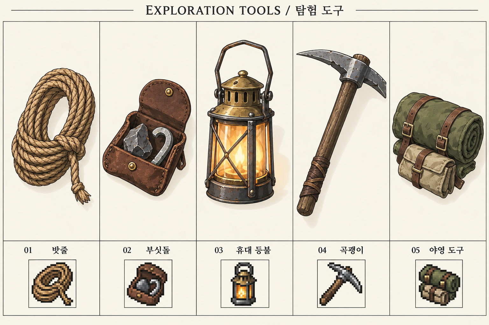

## 퀘스트 물품·기록

01 돌샘에 전할 약 · 02 배달 쪽지 · 03 조사 수첩 · 04 여행 지도 · 05 통행증

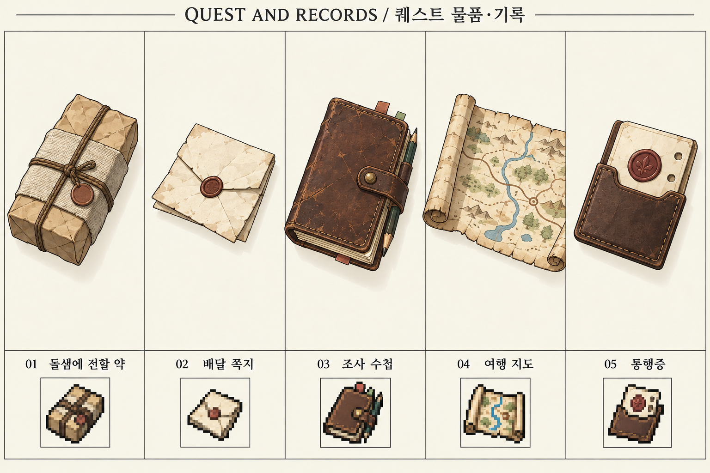

## 중요품·관계 물품

01 공명석 · 02 깨진 공명석 · 03 니아의 선물 돌 · 04 여행의 기념품

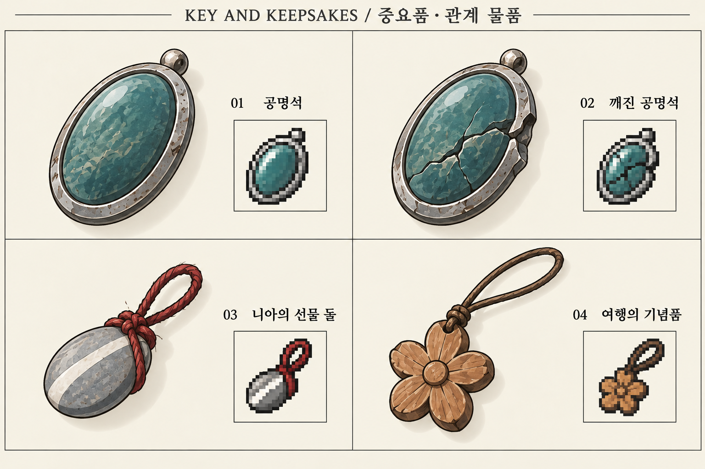

## 실제 게임 에셋으로 옮기는 다음 단계

외형 검토 → 필요한 아이템의 개별 투명 아이콘 제작 → 실제 UI 크기에서 식별성 검수 → 필드 배치/손에 든 소품 제작 → 캐릭터 공격·착용 동작과 연결 순입니다. 보드의 작은 도트는 32×32 제작 방향의 참고이며 정확한 32×32 투명 파일이 아닙니다. 물건의 설정 크기는 서로 다르므로 보드 안에서 비슷한 크기로 보인다고 실물 크기가 같은 것은 아닙니다.

원본의 글자가 생성 과정에서 조금 달라 보이면 manifest와 items.csv의 이름·번호를 제작 기준으로 사용합니다. 무기와 의상의 디테일은 기존 캐릭터 도트에 맞춰 추가 단순화할 수 있습니다. 이번 PR은 런타임, 장비 수치, 아이템 지급·소비와 상점을 변경하지 않습니다.
