# 몬스터 보드 16종

2026-10-30 · 일반 몬스터 12종 + 보스 4종. [HTML 갤러리](../assets/monster-boards/index.html) · [메타데이터와 제작 메모](../assets/monster-boards/manifest.json)

## 기획과 가드레일

앞서 제안한 몬스터를 각각 시각화한 제작 초안입니다. 등장 챕터·위치·크기·공격 수치·보상은 미확정이며 기존 메인 퀘스트를 변경하지 않습니다. 들쥐는 첫 전투의 후보이며 기존 몬스터를 교체하거나 게임에 연결한 것은 아닙니다. 보스 4종은 일반종과 연결된 별도 외형안입니다.

보드마다 전신 1개, 앞·뒤·옆 도트 시안 3개, 공격 준비/타격 참고 2개, 170cm 사람 실루엣과의 비교를 넣었습니다. 비교 크기는 대략적인 시각안이며 특히 수호체·공명체는 프롬프트 목표 비율과 차이가 있어 게임 카메라에서 다시 맞춰야 합니다. 부유체는 고도와 지면 원점을 따로 정합니다.

현재는 불투명 참고 이미지이며 실제 48×64 규격 스프라이트·4방향 전체 프레임·이동/피격/사망 모션·공격 판정·AI·투사체·상태 이상·보스 페이즈는 구현하지 않았습니다. 인간형의 48×64 기준을 모든 크기의 몬스터에 동일 적용하지 않고 실루엣과 화면 크기를 먼저 검증합니다. 두 공격 그림은 애니메이션 클립이 아닙니다. 나방 가루·공명 펄스·균사 연출만으로 상태 이상, 사거리, 무적, 지형 파괴 규칙을 확정하지 않습니다.

다리·날개 수, 좌우 비대칭, 원점과 픽셀 밀도를 정합화한 뒤 개별 투명 프레임을 제작합니다. 나방의 큰 날개는 구획선을 넘고 감시구의 펄스는 칸 끝에서 잘리므로 자동 셀 분리하지 않습니다. 공명 융합체는 장식과 크기를 줄인 v2만 배포합니다.

## 목록

| 이름 | 분류 | 등장 지역 초안 | 공격 방향 초안 |
|---|---|---|---|
| 가시털 들쥐 | 일반 | 마을 외곽·숲길 | 짧게 접근해 물기. 레온 발견 직후 첫 전투 후보 |
| 회색 들늑대 | 일반 | 숲·국경길 | 무리로 접근해 물기 |
| 돌등 멧돼지 | 일반 | 농경지·구릉 | 머리를 낮춘 뒤 직선 돌진 |
| 큰집게 동굴거미 | 일반 | 동굴·폐광 | 작은 거미줄과 집게 물기 |
| 먹안개 나방 | 일반 | 습지·오염된 숲 | 날갯짓으로 작은 가루 구름 방출 |
| 갈대턱 도마뱀 | 일반 | 강가·늪 | 낮게 접근한 뒤 짧게 도약 |
| 암각 소라게 | 일반 | 협곡·바위지대 | 정면 집게 방어 후 뻗어 공격 |
| 공명에 물든 늑대 | 일반 | 유적 인근 숲 | 몸을 굳힌 뒤 불규칙하게 접근해 물기 |
| 균사 포식체 | 일반 | 버려진 취락·지하 | 뿌리를 고정한 뒤 균사 뻗기 |
| 유적 감시구 | 일반 | 고대 시설 입구 | 렌즈 조준 후 직선 공명 펄스 |
| 석갑 수호체 | 일반 | 유적 내부 | 느린 주먹 준비 후 내려치기 |
| 공명 융합체 | 일반 | 이상 현상 중심 | 낮은 사족 자세에서 앞다리 뻗기 |
| 흉터 난 무리 우두머리 | 보스 | 숲·초반 보스 후보 | 무리 호출 자세 후 크게 물기 |
| 협곡의 돌등왕 | 보스 | 협곡·중반 보스 후보 | 발을 긁고 머리를 낮춘 뒤 강한 돌진 |
| 문지기 수호체 | 보스 | 유적 진입부·보스 후보 | 방패 팔로 막은 뒤 반대 주먹 내려치기 |
| 뿌리 깊은 공명체 | 보스 | 재난 중심·후반 보스 후보 | 석판을 열고 큰 뿌리를 뻗기 |

## 가시털 들쥐

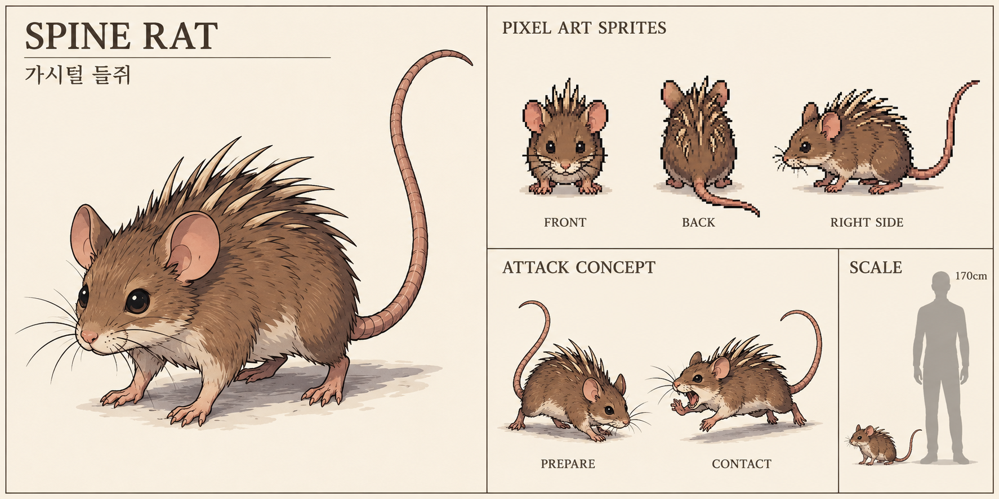

## 회색 들늑대

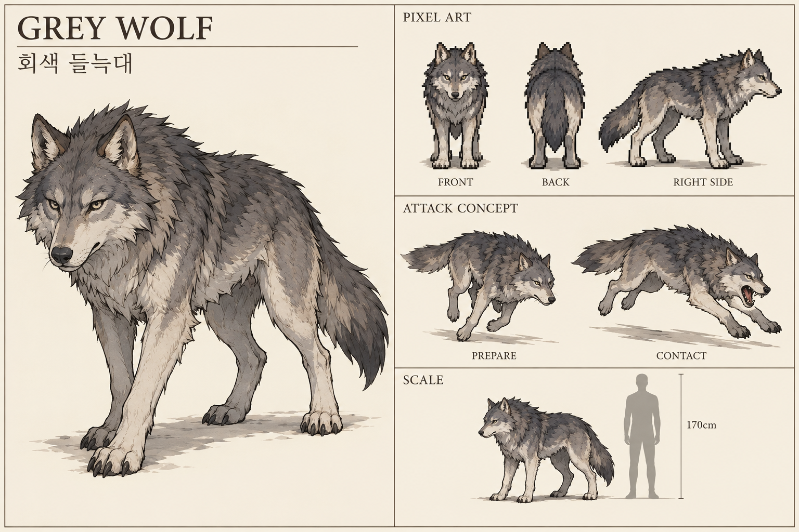

## 돌등 멧돼지

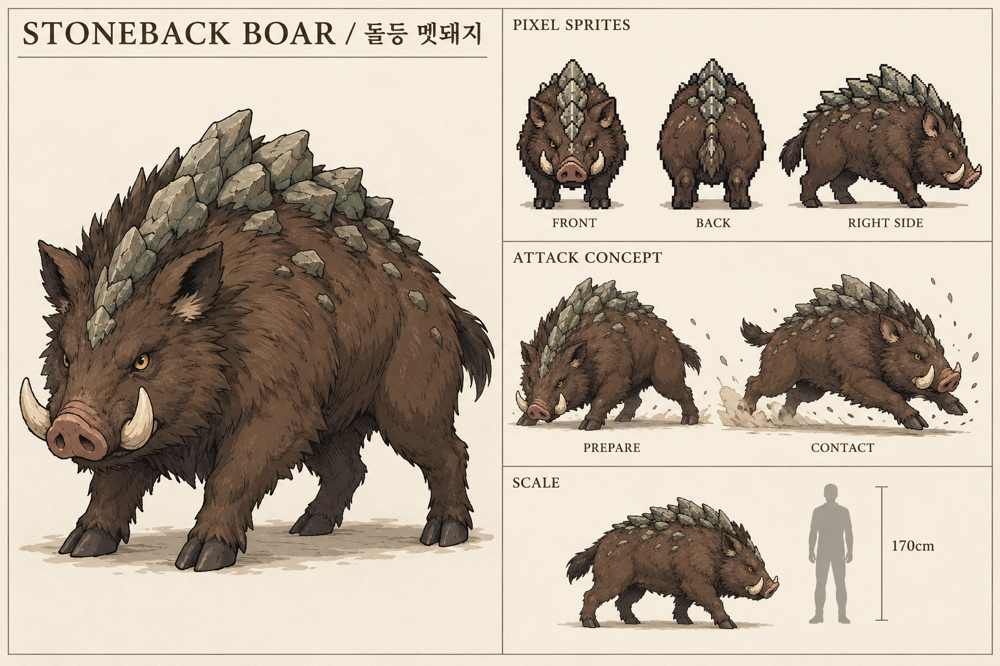

## 큰집게 동굴거미

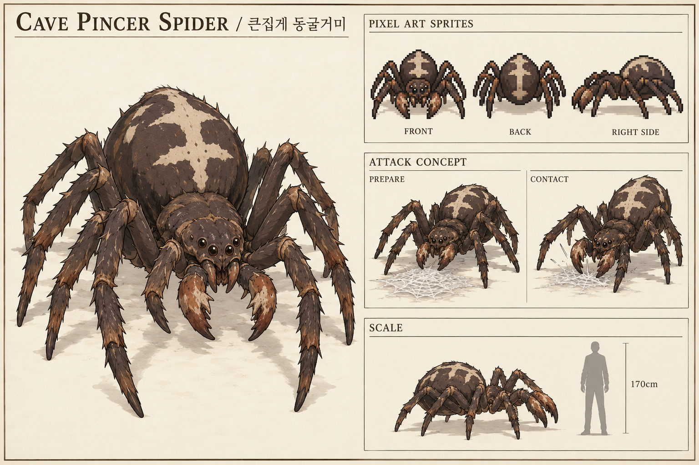

## 먹안개 나방

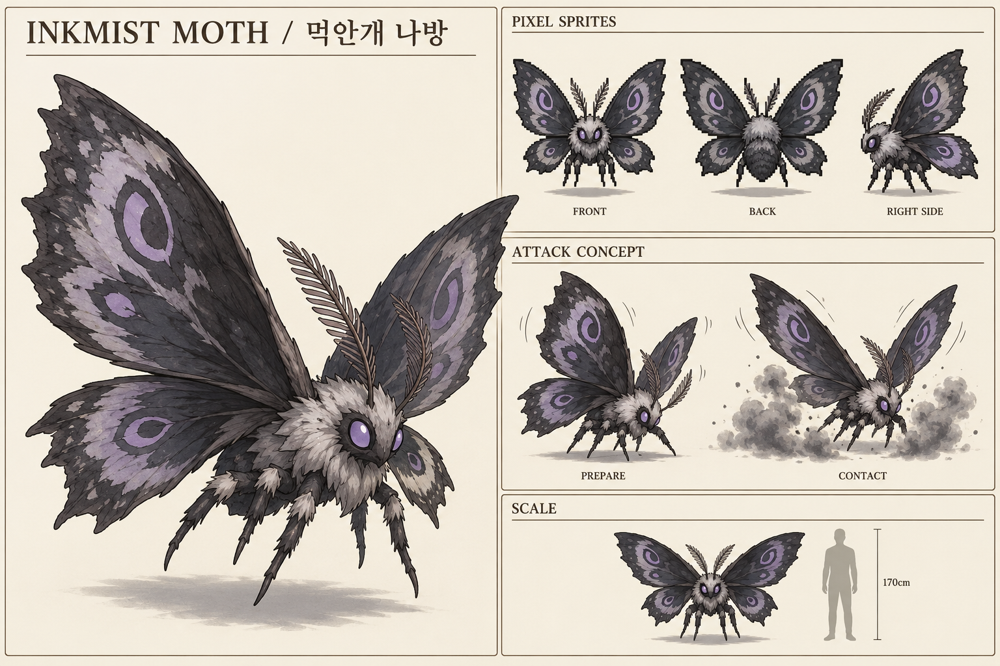

## 갈대턱 도마뱀

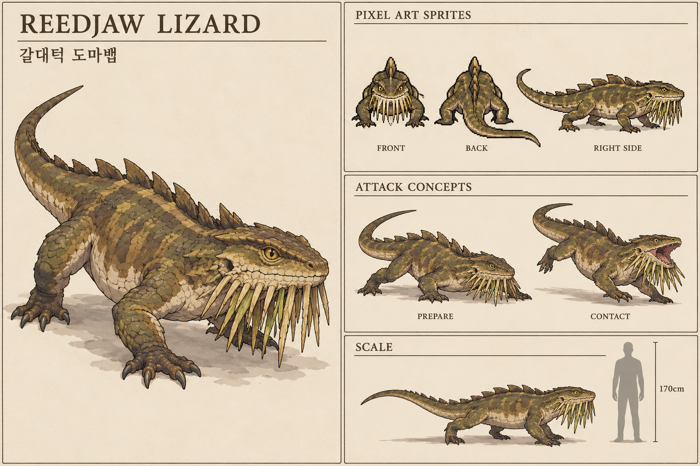

## 암각 소라게

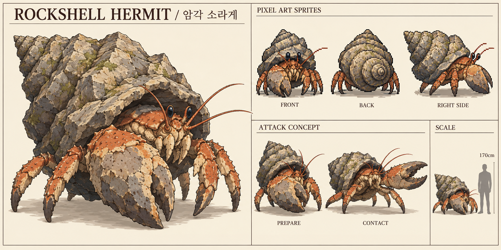

## 공명에 물든 늑대

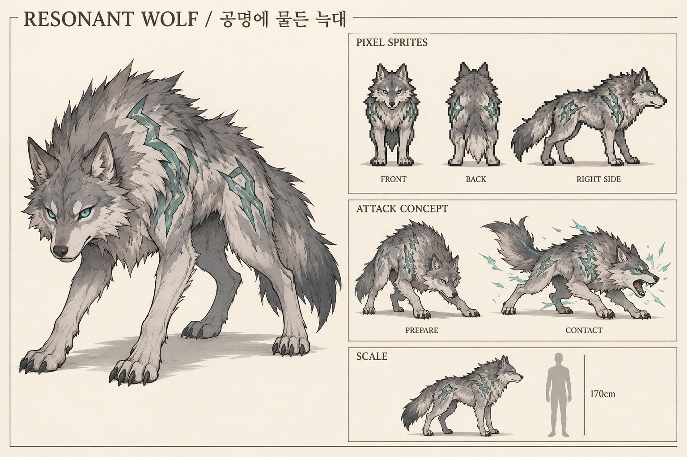

## 균사 포식체

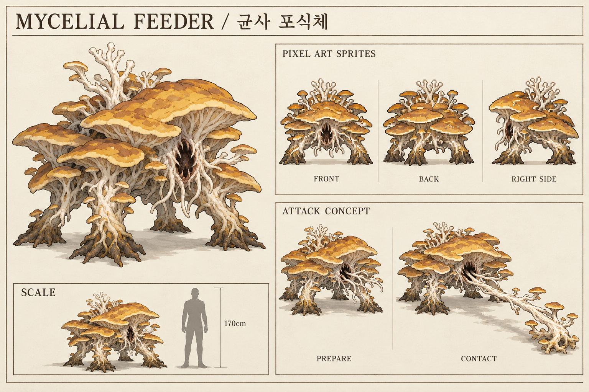

## 유적 감시구

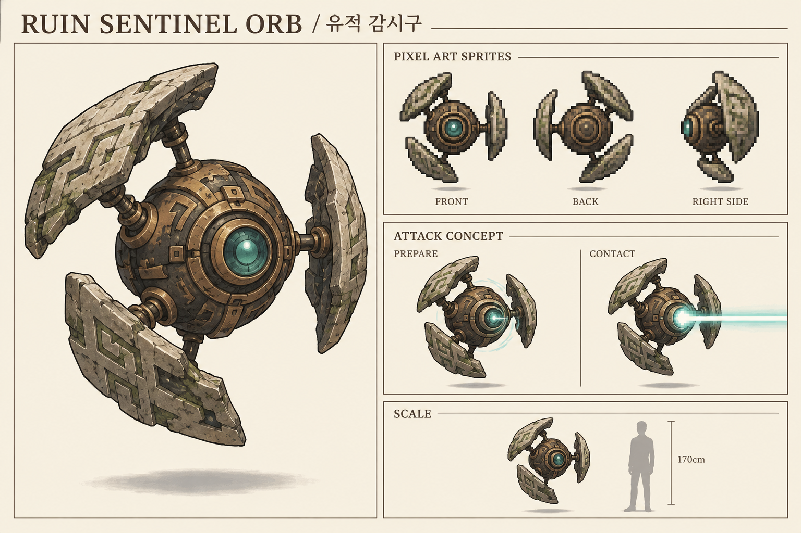

## 석갑 수호체

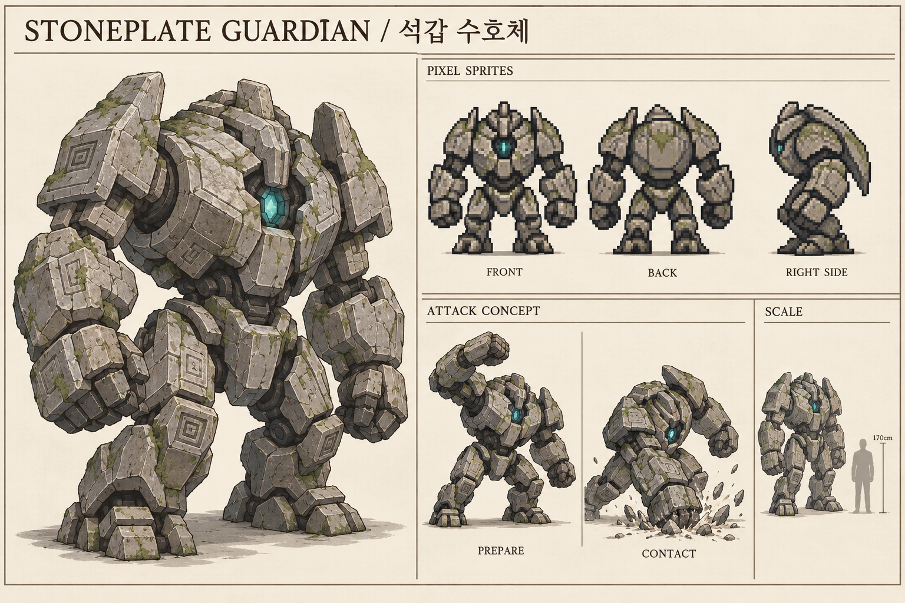

## 공명 융합체

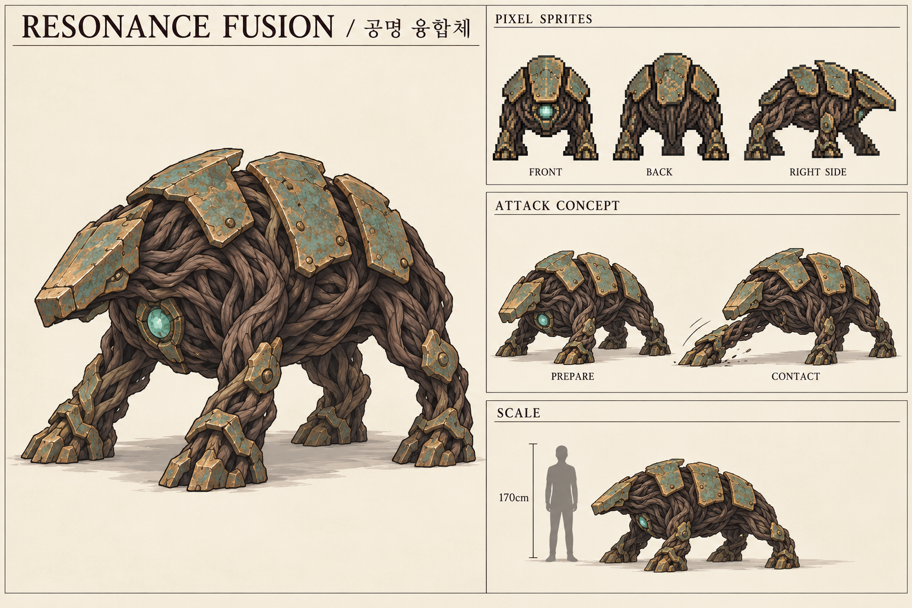

## 흉터 난 무리 우두머리

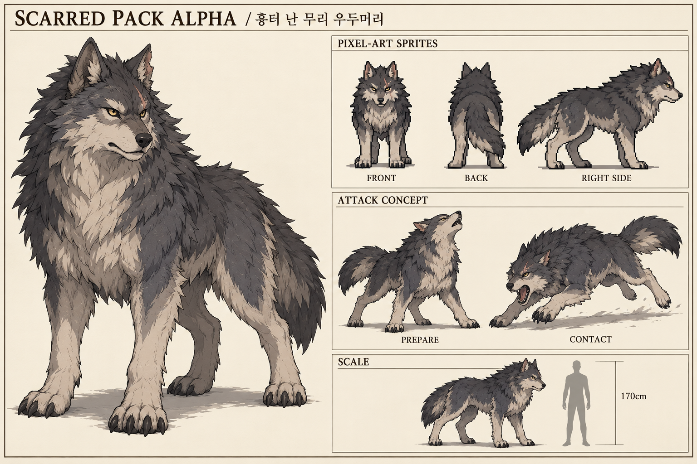

## 협곡의 돌등왕

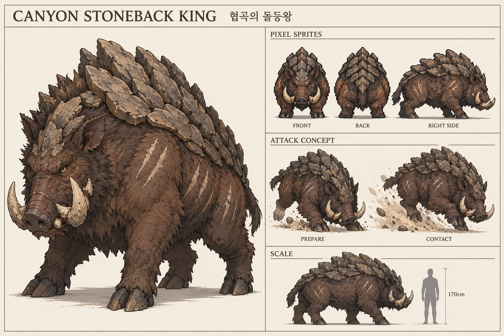

## 문지기 수호체

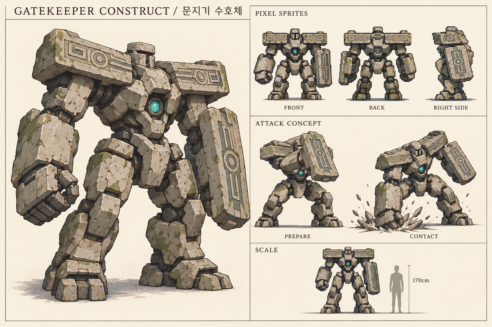

## 뿌리 깊은 공명체

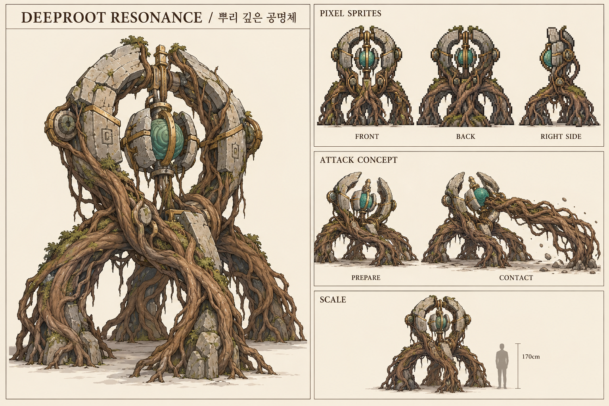
