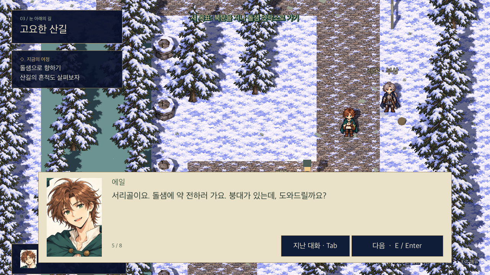

# 프롤로그 게임 이벤트 대본

2026-10-30 · 소설 원고를 폐기하고 플레이 순서·상태에 맞춘 대사로 교체했습니다.

## 플레이 흐름

| 단계 | 시작 조건 / 플레이어 조작 | 대화에서 전달할 내용 | 대화 종료 후 |
|---|---|---|---|
| 아침 | 새 게임 | 수건 전달·물 긷기 부탁, 마르타의 기침 | 조작 복귀, 두 심부름 목표 표시 |
| 우물 / 여관 | 각 대상 조사, 순서 자유 | 수행한 일 확인, 주민의 짧은 반응 | 해당 심부름만 완료·알림 |
| 배달 부탁 | 두 심부름 후 마르타와 대화 | 마르타 대신 약 배달, 받는 사람은 돌샘 연락소의 에다 | 약 꾸러미 목표 표시 |
| 준비 / 배웅 | 꾸러미 조사 후 마르타와 대화 | 배달 약과 개인 붕대 구분, 출발 인사 | 북문 통과 가능 |
| 레온 발견 | 산길의 레온과 대화 | 부상·이름·도움 요청 | 조작 복귀, 응급처치 상호작용 표시 |
| 첫 전투 | 레온에게 다시 말 걸기 | 마물 접근·검 대여·조작 안내 | 같은 맵에서 명령 정지 상태로 전투 시작 |
| 처치 마무리 | 직접 승리 후 레온에게 돌아가 대화 | 안도·붕대 마무리·검 임시 대여 | 돌샘 이동 가능 |
| 전달 | 돌샘 연락소 조사 | 약 인수·레온 치료 인계·도착 기록 | 배달 완료·알림 |
| 마무리 | 전달 후 레온과 대화 | 감사와 휴식, 돌아가기 전 인사 약속 | 조작 복귀 |

우물에서 물을 길었는데 또 물을 길라고 하거나, 준비 전 니아가 큰 가방을 언급하거나, 전달 뒤에도 치료가 남았다고 말하지 않게 상태별로 분기합니다. `PrologueStory.scene_for()`가 장면을 선택하고, 대화가 끝나야 완료 상태가 바뀝니다.

## 대사와 화면의 역할

- 대화창에는 인물이 실제로 말하는 문장과 조사한 게시판·표지 내용만 표시합니다.
- 심부름 완료·물품 획득은 대화 종료 후 짧은 알림, 다음 행동은 목표창에 표시합니다.
- 긴 동작 묘사·감정 설명·소설식 서술 페이지는 넣지 않습니다.
- 같은 인물도 진행 전/중/후에 맞는 말을 하며, 재대화는 짧은 확인·안내로 끝냅니다.
- 선택 NPC와 배경 조사는 필수 심부름·배달 진행을 막지 않습니다.

## 첫 전투 연결

응급처치 시작 → 마물 접근 → 검 대여 → 플레이어가 직접 첫 전투 → 승리 확인 후 붕대 마무리 → 동행을 실제로 연결했습니다. `planned_scenes`는 비어 있으며 첫 전투 4개 장면이 전투 이벤트에서 재생됩니다. `leon_bridge`는 승리 후에만 처치·동행을 확정합니다. [첫 전투 조작·저장·검증](first-battle.md)을 참고하세요.

## 저장과 검증

저장 v3에 체력·마나·남은 회복약·검 대여·승리·전투 체크포인트를 기록합니다. 기존 v1/v2 진행은 유지합니다. 발견 뒤 조작 복귀, 명령 정지/재개, 패배 재도전, 아이템 비환급, 승리 후 처치와 약 전달까지 자동 검증했습니다. 일반 저장과 전투 테스트/검사 저장은 분리합니다.

## 실제 화면

## 실제 플레이 대사

### 아침 심부름 (`opening`)

**마르타**: 에일, 일어났니? 밥 먹고 여관에 수건 좀 갖다주렴.

**에일**: 네. 우물 물통도 비었던데, 같이 채워 둘게요.

**마르타**: 물은 받아 놓기만 해. 도렌이 수레로 가져다준대.

**에일**: 알겠어요. 그런데 기침은 좀 괜찮으세요?

**마르타**: 약 먹었어. 오늘은 나도 좀 쉬어야겠다.

**에일**: 그럼 제가 다녀올 동안 누워 계세요. 선반 정리는 내일 하고요.

**마르타**: 알았어. 수건은 문 옆 바구니에 넣어 뒀으니까 챙겨 가.

종료 알림: 새 목표: 우물 물통 채우기 · 여관에 수건 전달하기

### 남은 심부름 (`marta_wait`)

**마르타**: 우물 물통하고 여관 수건만 챙겨 주면 돼.

**에일**: 네. 둘 다 끝내고 올게요.

### 물통 채우기 (`well_first`)

**에일**: 줄이 얼었네. 조금씩 당기면… 됐다.

**에일**: 이 정도면 가득 찼어. 뚜껑 덮고 여기 두면 되겠지.

종료 알림: 물통을 채웠다.

### 채워 둔 물통 (`well_again`)

**에일**: 물은 받아 뒀어. 도렌 아저씨가 가져가실 거야.

### 수건 전달 (`inn_first`)

**오르만**: 에일이구나. 수건 가져왔어?

**에일**: 네. 마르타가 다 마른 것만 골라서 보내셨어요.

**오르만**: 고맙다. 저 의자에 놓아 줘. 마르타는 좀 어떠셔?

**에일**: 기침이 안 멎어서요. 오늘은 집에 계시라고 했어요.

**오르만**: 그래야지. 빈 바구니에 빵 넣어 줄 테니까 같이 드셔.

**에일**: 정말요? 잘 먹겠습니다.

**오르만**: 그리고 산길 갈 일 있으면 큰길로 돌아가. 계류 쪽은 아직 얼어 있더라.

**에일**: 네. 마르타한테도 전할게요.

종료 알림: 수건을 전달했다.

### 여관 재방문 (`inn_again`)

**오르만**: 수건은 잘 받았다. 마르타께 고맙다고 전해 줘.

**에일**: 네. 빵도 맛있었다고 말씀드릴게요.

### 돌샘 배달 부탁 (`request`)

**마르타**: 다녀왔니? 도렌이 물통은 가져다줬어. 수건도 전했고?

**에일**: 네. 오르만 아저씨가 빵도 주셨어요. 그 약은 어디 보낼 거예요?

**마르타**: 돌샘 의무실에서 기다리는 약이야. 오늘 내가 가져가려고 했는데…

**에일**: 제가 갈게요. 오늘은 쉬셔야 해요.

**마르타**: 혼자 갈 수 있겠니? 길에 눈이 많이 남았을 텐데.

**에일**: 큰길로 가면 되죠? 오르만 아저씨가 계류 쪽은 피하라고 하셨어요.

**마르타**: 그래. 약은 돌샘 연락소로 가져가서 에다에게 주면 돼. 의무실 맡는 분이야.

**에일**: 연락소에서 에다를 찾으면 되는 거죠. 맡겨 주세요.

**마르타**: 늦으면 거기서 자고 와. 문 옆 꾸러미부터 챙기렴.

종료 알림: 새 목표: 집 문 옆의 약 꾸러미 챙기기

### 약 챙기기 (`medicine`)

**에일**: 파란 끈은 해열제, 흰 끈은 약초… 쪽지도 있어요.

**마르타**: 그건 에다에게 통째로 줘. 네가 쓸 붕대는 가방 바깥 주머니에 넣어 놨어.

**마르타**: 회복약 두 개도 바깥 주머니에 넣었어. 네가 다치면 쓸 거니까 배달 약이랑 헷갈리지 마.

**에일**: 네. 배달 약은 안 뜯을게요. 빵이랑 물통도 챙겼어요.

**마르타**: 다 챙겼으면 이리 와 봐. 어깨끈 좀 맞춰 줄게.

종료 알림: 약 꾸러미를 챙겼다.

### 출발 인사 (`farewell`)

**마르타**: 어때? 가방이 한쪽으로 쏠리진 않니?

**에일**: 네. 딱 맞아요. 다녀올게요.

**마르타**: 약 전하면 연락소에 도착했다고 남겨 줘. 그래야 여기서도 알 수 있으니까.

**에일**: 알겠어요. 마르타도 약 챙겨 드시고요.

**마르타**: 베라가 점심때 와서 봐준댔어. 걱정 말고 다녀와.

종료 알림: 새 목표: 북문을 지나 돌샘 연락소로 가기

### 출발 전 재대화 (`marta_departed`)

**마르타**: 뭐 빠뜨렸니?

**에일**: 아니요. 진짜 갈게요. 다녀오겠습니다!

### 귀가 인사 (`marta_return`)

**마르타**: 에일, 왔구나. 약은 잘 전했고?

**에일**: 네. 에다가 받았어요. 연락소에도 이름 남겼고요.

**마르타**: 수고했다. 가방 내려놓고 좀 쉬어. 차 끓여 줄게.

**에일**: 네. 길에서 만난 사람 얘기도 해 드릴게요.

### 방의 지도 조사 (`map`)

**에일**: 돌샘 다음이 이 도시구나. 항구는 여기서도 한참 멀고… 언젠가 가 보고 싶네.

### 창가 조사 (`window`)

**에일**: 새잎 났네. 흙은 아직 젖어 있으니까 물은 나중에 주자.

### 게시판 조사 (`notice`)

**서리골 게시판**: 산길 결빙 주의. 돌샘 방면 여행자는 큰길을 이용하고, 해가 진 뒤에는 출발하지 마십시오.

**서리골 게시판**: 약재·구호 물품 접수처: 돌샘 연락소. 수신인 이름을 함께 적어 주십시오.

### 눈사람 이야기 (`nia`)

**니아**: 에일! 얘 누구 닮았게?

**에일**: 눈사람? 오르만 아저씨인가? 배가 좀 비슷한데.

**니아**: 마르타야! 목도리도 해 줬잖아.

**에일**: 아, 그러네. 마르타한테는 처음부터 맞혔다고 해 줘.

**니아**: 그럼 사탕 줘.

**에일**: 다음에 장 보러 갈 때 하나 사 올게. 손 시려 보이는데 장갑은?

**니아**: 젖어서 집에 두고 왔어. 이것만 붙이고 들어갈 거야.

### 귀환 후 니아 (`nia_return`)

**니아**: 돌샘 갔다 왔어? 거기도 눈 많이 와?

**에일**: 응. 우물 지붕에도 잔뜩 쌓였더라.

**니아**: 우리 눈사람보다 높아?

**에일**: 지붕까지 세면 훨씬 높지.

**니아**: 그건 반칙이잖아!

### 도렌과 대화 (`doren`)

**도렌**: 물통 채워 놓으면 우물 옆에 둬. 내가 장작이랑 같이 가져다줄게.

**에일**: 네. 마르타가 오늘 기침이 심해서요. 부탁드릴게요.

**도렌**: 알았다. 집 앞에 내려놓고 인사도 하고 올게.

### 베라와 대화 (`vera`)

**베라**: 에일, 마르타는 집에 계시지?

**에일**: 네. 기침 때문에 쉬고 계세요.

**베라**: 점심때 수프 가져갈게. 나도 같이 먹을 거니까 혼자 두고 간다고 걱정하지 마.

**에일**: 고마워요. 식사 뒤에 약 드시는 것도 좀 봐주세요.

**베라**: 응. 마르타한테도 들었어. 내가 챙길게.

### 돌샘 출발 확인 (`roke`)

**로크**: 돌샘에 약 전하러 간다며? 장부에 적어 둘게. 오늘 돌아올 거야?

**에일**: 늦으면 거기서 자려고요. 도착하면 연락소에 이름 남길게요.

**로크**: 그래. 돌아올 때 문 닫혀 있으면 종을 쳐. 혼자 담 넘지 말고.

**에일**: 그 얘기는 이제 그만하셔도 되는데요.

### 산길 표지 조사 (`trail_sign`)

**산길 표지**: 돌샘 연락소 → 큰길을 따라 북쪽으로.

### 발자국 조사 (`tracks`)

**에일**: 한쪽 발을 끈 자국인데… 누가 다쳤나? 저 굽이까지 이어져.

### 부상자 발견 (`leon_first`)

**에일**: 저기요! 다치셨어요?

**레온**: 잠깐. 네 앞에 있는 돌 밟지 마. 그쪽은 흔들려.

**에일**: 아… 고맙습니다. 옆으로 돌아갈게요.

**레온**: 어디서 왔지?

**에일**: 서리골이요. 돌샘에 약 전하러 가요. 붕대가 있는데, 도와드릴까요?

**레온**: 부탁하지. 다친 건 왼쪽 다리야. 천이 풀리지 않게 잡아 줘.

**에일**: 네. 아프면 말씀해 주세요. 저는 에일이에요.

**레온**: 레온이다. 도와줘서 고맙다.

### 처치 마무리와 동행 (`leon_bridge`)

**에일**: 붕대 마저 묶었어요. 그래도 돌샘 의무실에서 꼭 다시 보셔야 해요.

**레온**: 그래. 검은 돌샘까지 갖고 있어. 아직 길이 남았으니까.

**에일**: 알겠어요. 일어나실 때는 제 어깨 잡으세요. 천천히 같이 가요.

**레온**: 고맙다. 다음 굽이는 왼쪽이야. 힘들면 중간에 쉬고.

종료 알림: 붕대 처치 완료 · 레온과 돌샘으로 향하자.

### 산길의 레온 (`leon_again`)

**에일**: 잠깐 쉬었다 갈까요?

**레온**: 그래. 왼쪽 큰길로 가면 돌샘이 나온다. 계류 쪽은 피하고.

**에일**: 네. 길은 제가 살필게요.

### 돌샘 도착 (`leon_arrival`)

**에일**: 저기 우물 오른쪽 건물이 연락소죠?

**레온**: 맞아. 에다를 불러 주겠나? 다리를 좀 봐 달라고 해 줘.

**에일**: 네. 약도 거기로 가져가면 되니까 같이 말씀드릴게요.

### 약과 환자 인계 (`delivery`)

**할벤**: 서리골에서 왔나요? …레온 경, 다리 다치셨습니까?

**레온**: 그래. 에다 좀 불러 주게.

**에다**: 여기서 볼게요. 에일, 마르타가 보낸 약도 가져왔니?

**에일**: 네. 이 꾸러미예요. 안쪽에 쪽지도 있어요.

**에다**: 맞아, 기다리던 약이야. 잘 받았어. 가져오느라 고생했네.

**에일**: 마르타가 기침이 심해서 제가 대신 왔어요.

**할벤**: 도착 기록도 남겨 둘게요. 약은 받았고, 에일도 무사히 왔다고 전하면 되죠?

**에일**: 네. 부탁드려요. 레온 씨 다리는 제가 붕대로 고정했어요. 에다가 다시 봐주세요.

**에다**: 그래. 이제 내가 맡을게. 둘 다 여기서 좀 쉬어.

**에일**: 레온 씨, 빌린 검은 이제 돌려드릴게요. 덕분에 무사히 왔어요.

**레온**: 그래. 잘 썼어. 이제 우리 둘 다 좀 쉬자.

종료 알림: 약 전달 완료 · 빌린 검을 돌려주었다.

### 배달 후 재대화 (`delivery_again`)

**에다**: 약은 잘 받았어. 마르타께 고맙다고 전해 줘.

**에일**: 네. 돌아가면 말씀드릴게요.

### 배달 후 레온 (`closing`)

**레온**: 고맙다, 에일. 약 배달하러 왔다가 나까지 신경 쓰게 됐군.

**에일**: 그냥 지나칠 수는 없잖아요. 다리는 좀 어떠세요?

**레온**: 에다가 쉬라고 하더군. 오늘은 여기 있을 생각이야.

**에일**: 저도 좀 쉬어야겠어요. 가방 내려놓으니까 어깨가 뻐근하네요.

**레온**: 그래. 고생했어. 돌아가기 전에 나한테도 말해 줘.

종료 알림: 돌샘 배달 구간을 마쳤다.

### 돌샘에서 재대화 (`rest_again`)

**레온**: 좀 쉬었어?

**에일**: 네. 돌아갈지는 조금 있다 정하려고요.

### 연락소 기록 확인 (`halven`)

**할벤**: 서리골로 가는 연락 편에 도착 소식도 넣어 둘게요.

**에일**: 고맙습니다. 마르타가 기다리실 거예요.

### 레온 치료 문의 (`eda`)

**에일**: 레온 씨는 많이 다치셨어요?

**에다**: 당분간은 쉬어야 해. 오늘 더 걷지는 못하게 할 거야.

**에일**: 다행이네요. 저도 무리하실까 봐 걱정했어요.

### 니아 재대화 (`nia_again`)

**니아**: 이번엔 목도리 보고 맞혀 봐.

**에일**: 마르타. 이제 안 틀려.

### 귀환 후 첫 인사 (`nia_late`)

**니아**: 어디 갔다 와? 아까 집에 없던데.

**에일**: 돌샘에 약 전하고 왔어. 넌 눈사람 만들었네?

**니아**: 마르타야. 목도리 똑같지?

**에일**: 응. 집에 가면 한 번 나와 보시라고 할게.

### 도렌 재대화 (`doren_again`)

**도렌**: 오늘은 쌓아 둔 장작만 옮길 거야. 나무 위에 눈이 너무 많이 쌓여서.

**에일**: 네. 가지 떨어질 수 있으니까 조심하세요.

### 베라 재대화 (`vera_again`)

**베라**: 점심때 마르타한테 갈게. 약도 챙겨 드릴 테니 걱정 마.

**에일**: 네. 고마워요.

### 북문 재대화 (`roke_again`)

**로크**: 돌샘까지 간다고 적어 뒀어. 해 지면 거기서 자고 와.

**에일**: 네. 무리해서 돌아오진 않을게요.

### 연락소 안내 재확인 (`leon_arrival_again`)

**레온**: 우물 오른쪽 연락소에서 에다를 찾으면 돼.

**에일**: 네. 바로 말씀드릴게요.

### 연락소 재대화 (`halven_again`)

**할벤**: 도착 소식은 적어 뒀어요. 서리골로 보낼 때 같이 전할게요.

**에일**: 감사합니다.

### 에다 재대화 (`eda_again`)

**에다**: 치료는 내가 할 테니까 너도 쉬어. 더 필요한 게 있으면 부를게.

**에일**: 네. 근처에 있을게요.

### 귀환 후 지도 조사 (`map_after`)

**에일**: 오늘 간 길이 여기구나. 돌샘 가기 전 굽이에서 레온 씨를 만났지.

### 레온을 만난 뒤 발자국 (`tracks_after`)

**에일**: 레온 씨 발자국이었구나. 돌샘에 가면 에다한테 꼭 봐 달라고 해야겠어.

### 준비 후 니아 재대화 (`nia_departure`)

**니아**: 아까는 바구니 들고 다니더니, 이번엔 가방이네. 어디 가?

**에일**: 돌샘에 약 전하러. 다녀와서 또 보자.

**니아**: 응. 마르타 눈사람 녹기 전에 와!

### 배달 전 북문 (`roke_before_trip`)

**로크**: 산길은 아직 미끄러워. 밖에 나갈 거면 집에 말하고 가.

**에일**: 네. 지금은 마을 심부름 중이에요.

### 물 긷기 후 도렌 (`doren_water_done`)

**도렌**: 물 다 받았어? 그럼 내가 가져갈게.

**에일**: 네. 뚜껑도 덮어 놨어요. 고마워요.

### 배달 후 산길 재대화 (`leon_return`)

**에일**: 서리골로 가는 길도 아직 얼어 있겠죠?

**레온**: 그늘진 곳은 조심해. 늦었으면 내일 출발하고.

### 배달 후 발자국 (`tracks_return`)

**에일**: 이 자국은 그대로네. 돌아갈 때도 발밑 잘 보고 가야겠다.

### 배달 준비 전 연락소 (`office_wait`)

**할벤**: 약재는 이 연락소에서 받아요. 가져온 꾸러미가 있으면 에다를 찾아 주세요.

### 배달 준비 전 의무실 (`office_wait_eda`)

**에다**: 진료가 필요하면 여기로 와. 약재 전달도 내가 맡고 있어.

### 마물 접근 (`leon_danger`)

**레온**: 에일, 뒤로 물러나. 길 아래에서 뭔가 올라온다.

**에일**: 저거… 여기까지 오는 거예요?

**레온**: 그래. 내 검을 가져가. 칼집은 옆에 있어.

### 검 대여 (`sword_loan`)

**에일**: 저, 검은 제대로 써 본 적 없어요.

**레온**: 알아. 내가 옆에서 알려 줄게. 우선 검끝을 저쪽으로 향해.

**에일**: 손이 자꾸 떨려요.

**레온**: 서두르지 마. 다가오면 피할 자리부터 봐 둬.

### 첫 전투 조작 안내 (`firstbattle_help`)

**조작 안내**: 지금은 시간이 멈춰 있습니다. 공격을 누르고 마물을 클릭한 뒤 Space로 재개하세요.

**조작 안내**: 이동을 누르고 길 위의 지점을 고르면 한 칸씩 이동합니다. 우클릭으로도 지정할 수 있습니다.

**조작 안내**: 회복약은 재개할 때 에일에게 즉시 적용됩니다. 사용 뒤에는 잠시 다시 공격하거나 약을 쓸 수 없습니다.

**레온**: 마물이 몸을 낮추면 물려고 하는 거야. 위험하면 거리를 벌려. 난 싸울 수 없으니 부탁한다.

### 첫 전투 승리 (`leon_after_battle`)

**레온**: 이제 됐어. 검 내려도 돼.

**에일**: …끝난 거죠? 더 오는 건 없죠?

**레온**: 없어. 이쪽은 내가 보고 있을게. 잠깐 숨 좀 돌려.

**에일**: 네. 조금만요. 그다음에 붕대 마저 묶어 드릴게요.

### 꾸러미 위치 안내 (`parcel_reminder`)

**마르타**: 문 옆 받침대의 약을 챙겨. 끈 색하고 쪽지가 있는지도 확인하렴.

### 약 확인 (`parcel_packed`)

**에일**: 약은 가방 안에 잘 넣어 뒀어. 마르타한테 인사하고 출발하자.

### 배달 전 약 조사 (`parcel_wait`)

**에일**: 마르타가 묶어 둔 약이네. 어디에 쓸 건지 먼저 여쭤보자.

### 아침 대화 안내 (`morning_reminder`)

**에일**: 마르타가 부탁할 게 있다고 하셨지. 먼저 이야기하고 오자.

### 남은 물 심부름 (`marta_water_left`)

**마르타**: 수건은 전했구나. 우물 물통만 채워 주면 돼.

**에일**: 네. 물 받아 놓고 올게요.

### 남은 여관 심부름 (`marta_towels_left`)

**마르타**: 물은 도렌이 가져다준대. 여관 수건도 부탁한다.

**에일**: 네. 오르만 아저씨께 직접 드릴게요.

### 출발 준비 완료 (`parcel_ready`)

**에일**: 약도 챙겼고 인사도 드렸어. 북문으로 가자.

### 배달 후 꾸러미 자리 조사 (`parcel_delivered`)

**에일**: 약은 에다에게 잘 전했어. 다음에 배달할 때도 여기서 챙기면 되겠지.
