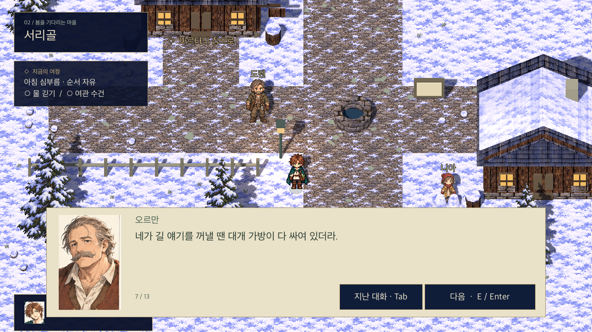
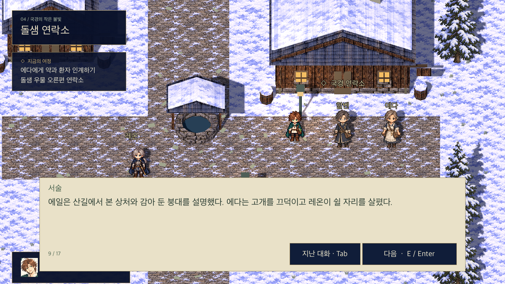

# 프롤로그 대화와 생활 진행

2026-10-30 · 41개 장면 / 304개 대사·서술 페이지

마르타와의 아침 → 물 긷기·여관 수건 전달(순서 자유) → 마르타와 배달 상의 → 약 챙기기 → 출발 인사 → 산길의 레온 응급처치·동행 → 돌샘의 에다에게 약과 환자 인계 → 레온과 차 한 잔으로 이어집니다.

[소설 형식의 프롤로그 전체 본문](prologue-novel.md)을 먼저 읽을 수 있습니다. 2026-10-30 구어체 개정: 추상적인 교훈을 줄이고 심부름의 이유, 배달 대상, 부상과 처치 과정을 구체적으로 썼습니다. 대사는 인물끼리 실제로 주고받는 말로, 서술은 눈에 보이는 행동과 상황으로 나눴습니다. 재대화는 짧게 바뀝니다. 니아를 만나지 않았는데 과거 약속을 언급하는 등 순서에 맞지 않는 대화는 별도 장면으로 분기합니다.

## 플레이

- `프롤로그 플레이.command` 실행 후 새로운 여정을 선택하면 아침 대화부터 시작합니다.
- WASD 한 칸 이동, E 조사·대화, E/Enter/Space 또는 다음 버튼으로 한 페이지씩 진행합니다. 대사를 자동으로 넘기지 않습니다.
- 대화창의 페이지 수로 현재 장면의 길이를 확인합니다. Tab 또는 지난 대화 버튼으로 이번 세션의 대화를 다시 읽습니다. Tab/Esc로 닫습니다.
- 우물은 마을 중앙, 오르만은 북서쪽 여관 앞입니다. 두 심부름 뒤 집의 마르타에게 돌아갑니다. 현재 목표는 왼쪽 HUD에 표시됩니다.
- 주민 대화, 집의 지도·창가, 산길 표지·발자국은 선택 조사입니다. 하지 않아도 배달을 마칠 수 있습니다.
- 약 전달 뒤 돌샘의 레온과 대화해 마무리합니다. 귀가하면 마르타·지도·니아의 대화도 달라집니다.

## 구현과 저장

대사는 `game/story/prologue_dialogue.json`, 진행 검증은 `game/scripts/prologue_story.gd`에 분리했습니다. 마지막 페이지를 닫을 때만 심부름·배달·마무리를 완료하고 자동 저장합니다. 대화 중에는 저장/불러오기를 하지 않습니다.

저장 형식은 v2입니다. 기존 v1 기록은 약을 챙겼거나 레온·배달까지 진행했다면 아침 심부름을 다시 강제하지 않습니다. 약을 챙기지 않은 기록은 집에서 아침 진행을 시작합니다. v2에는 심부름·출발 인사·선택 대화 완료 여부가 기록됩니다. 잘못된 자료는 현재 진행을 바꾸지 않고 거부합니다. 대화 기록창은 세션 한정이며 저장 파일에는 포함하지 않습니다.

NPC 7명의 기존 보드를 게임 리소스로 복사해 정면·초상화 영역을 사용합니다. 정면의 연결된 종이 배경을 런타임에서 분리해 발을 맞췄으며, 별도 보행 애니메이션이나 최종 도트 재제작은 아닙니다. 아이는 성인보다 작게 배치했습니다. 돌샘의 차 탁자는 환경 팩 장면을 사용하고 GridWalker 장애물 메타데이터를 등록합니다.

## 현재 범위와 남은 작업

이번 변경은 **대화·생활 진행·NPC 배치 개선**입니다. 첫 마물 전투·검 대여·전투 후 처치는 아직 구현되지 않았습니다. 기존 임시 응급처치→돌샘 동행 흐름을 유지하며 전투 승리 대사를 넣지 않았습니다. `leon_first`와 `leon_bridge` 사이가 전투 사건을 연결할 위치입니다. 원래 확정한 첫 전투 서사를 대체하거나 취소하지 않습니다.

레온의 화면상 따라걷기, 표정별 초상화 전환, BGM·효과음, Windows 검증도 남아 있습니다. 30~45분 완성 프롤로그로 보고하지 않습니다.

## 검증

- `godot --headless --path game --script res://tests/prologue_story_test.gd`: 심부름 순서, 저장 상태·손상 거부·v1 이관, 대사 구조와 페이지 길이.
- `godot --headless --path game -- --qa`: 아침부터 마무리까지 대화 완료, 준비 전 약 획득 차단, 재대화, 조사 지점 접근, 이동·충돌·지도 연결, 대화 기록과 저장/불러오기.
- `godot --headless --path game --script res://tests/grid_walker_test.gd`: 격자 이동 회귀.
- `godot --headless --path game --script res://tests/environment_pack_test.gd`: 환경 43종 로드 회귀.
- `godot --path game -- --story-capture`: Mac Compatibility 렌더링으로 집·마을·여관 대화·레온·전달·기록창 촬영. QA/캡처 모드의 대화는 사용자 저장을 자동 덮어쓰지 않습니다.

## UI 구성 참고

아래 화면은 구어체 개정 전 UI 검수 자료입니다. 최신 문장은 위 소설과 아래 원고를 따릅니다.

## 전체 대사 원고

소설의 흐름을 게임의 조사·재대화 순서에 맞게 나눈 원고입니다. 아래 모든 장면이 순서대로 한 번에 재생되는 것은 아닙니다.

### 서리골의 아침 (`opening`)

**서술**: 부엌에서 그릇 부딪히는 소리가 났다. 에일이 눈을 비비며 나오자, 마르타가 빈 의자를 턱으로 가리켰다.

**마르타**: 일어났으면 앉아. 수프 식겠다.

**에일**: 벌써 다 하셨어요? 깨우시지.

**마르타**: 세 번 불렀어. 네가 세 번 다 대답했고.

**에일**: …그건 제가 아닌데요. 자고 있었는데.

**마르타**: 그럼 네 방에 누가 하나 더 사나 보구나. 그 애한테 수건 걷으라고도 전해 줘.

**서술**: 에일이 웃으며 의자를 당겼다. 창가에는 어제 널어 둔 여관 수건이 그대로 걸려 있었다.

**에일**: 먹고 바로 가져다줄게요. 우물에도 다녀오고요.

**마르타**: 물통은 채워서 우물 옆에 둬. 도렌이 장작 가져오는 길에 실어 주기로 했으니까.

**에일**: 네. 수건은 문 옆 바구니에 담으면 되죠?

**마르타**: 그래. 오르만에게 직접 줘. 지난번처럼 주방에 두고 오면 못 찾더라.

**서술**: 마르타가 말을 마치고 입을 가렸다. 기침이 잠깐 이어졌다. 에일은 의자에서 반쯤 일어났다.

**에일**: 어제보다 심한 거 아니에요? 오늘은 그냥 누워 계세요.

**마르타**: 아침 약은 먹었어. 뜨거운 차 좀 마시면 괜찮아질 거야. 너부터 수프 먹어.

**에일**: 제가 안 본다고 또 일어나서 선반 정리하시면 안 돼요.

**마르타**: 알았으니까 앉아. 그러다 네 수프 다 식는다.

**에일**: 아, 죄송해요.

**서술**: 에일은 자리에 앉기 전에 마르타의 컵에 따뜻한 물을 조금 더 부었다.

### 아침 심부름 중 (`marta_wait`)

**마르타**: 수건은 문 옆 바구니에 있어. 여관에 갖다주고, 우물 물통도 채워 두렴.

**에일**: 물은 여기까지 안 가져와도 되는 거죠?

**마르타**: 응. 도렌이 수레에 실어 온대. 넌 물통 옆 뚜껑만 잘 덮어 놔.

**에일**: 알겠어요. 다녀올게요.

### 우물가의 아침 (`well_first`)

**서술**: 우물 손잡이에 얇게 얼음이 붙어 있었다. 에일은 장갑 낀 손으로 얼음을 털고 천천히 줄을 당겼다.

**에일**: 으… 오늘은 왜 이렇게 안 올라와.

**도렌**: 옆으로 당겨 봐. 줄이 홈에 걸렸어.

**에일**: 아, 그래서. …됐다. 고마워요!

**서술**: 에일이 물통을 내려놓자 도렌이 손잡이를 잡고 수레 쪽으로 옮겼다.

**도렌**: 마르타네 거지? 거기 두고 가. 이 장작하고 같이 가져다줄게.

**에일**: 많이 무겁진 않아요? 저도 좀 들까요?

**도렌**: 이 정도는 괜찮아. 물통 놓을 자리도 비워 뒀고.

**에일**: 그럼 부탁드릴게요. 저는 수건부터 가져다주고요.

**도렌**: 그래. 마르타는 좀 어떠셔?

**에일**: 기침은 아직 해요. 아침 약은 드셨고요. 오늘은 집에 계시라고 했어요.

**도렌**: 그래. 문 옆에 내려놓고 올 테니, 물통 찾으러 다시 나오진 마라.

**에일**: 네. 뚜껑 덮어 둘게요. 고마워요, 아저씨.

### 물을 길은 뒤 (`well_again`)

**에일**: 물은 다 받았고, 뚜껑도 덮었어. 도렌 아저씨가 가져다주신댔으니까 이제 가도 되겠다.

### 오르만의 여관 (`inn_first`)

**오르만**: 에일이냐? 잘 왔다. 수건 다 떨어져서 식탁보를 찢어야 하나 했어.

**에일**: 그 정도예요? 어제 가져왔으면 좋았을 텐데. 아직 덜 말라서요.

**오르만**: 농담이다. 이쪽 의자에 놔라. 거긴 바닥이 젖었어.

**서술**: 에일이 바구니를 내려놓자 오르만이 젖은 앞치마에 손을 닦았다.

**에일**: 손님이 많았나 봐요. 아까부터 주방이 엄청 바쁘네요.

**오르만**: 돌샘 가던 상인들이 하룻밤 더 묵었어. 짐수레 바퀴가 얼어서 안 굴러간다더라.

**에일**: 산길도 얼었대요?

**오르만**: 그늘진 데는 아직. 정오쯤엔 좀 낫겠지. 왜, 너도 갈 일 있냐?

**에일**: 아니요. 그냥 물어본 거예요.

**오르만**: 그냥 물어보는 얼굴은 아닌데. 가게 되면 계류 쪽으로 내려가지 마. 길이 짧아 보여도 거기가 더 미끄러워.

**에일**: 네. 마르타한테도 말씀드릴게요.

**서술**: 오르만은 갓 구운 빵 하나를 종이로 싸서 건넸다.

**에일**: 저 아침 먹었어요.

**오르만**: 그럼 점심에 먹어. 수건 갖다준 값이다.

**에일**: 수건은 마르타가 빠셨는데요.

**오르만**: 그럼 반 나눠 먹든가. 받기 싫으면 다시 주고.

**에일**: 싫다는 말은 안 했는데요. 잘 먹겠습니다.

### 수건을 전한 뒤 (`inn_again`)

**오르만**: 수건은 아까 잘 넣어 뒀어. 마르타께 고맙다고 전해 줘.

**에일**: 네. 빵도 주셨다고 말씀드릴게요.

**오르만**: 그 얘긴 하지 마라. 다음엔 돈 안 받겠다고 하실 테니까.

### 마르타의 부탁 (`request`)

**서술**: 집으로 돌아오니 문 옆에 물통과 장작이 놓여 있었다. 마르타는 난로 앞에서 작은 천 주머니에 끈을 묶고 있었다.

**에일**: 다녀왔어요. 물통도 왔네요. 도렌 아저씨 만나셨어요?

**마르타**: 응. 인사만 하고 갔어. 수건도 잘 전했니?

**에일**: 네. 오르만 아저씨가 빵 주셨어요. …아, 말하지 말랬는데.

**마르타**: 또 줬구나. 다음에 빈 바구니 보낼 때 잼도 넣어야겠네.

**서술**: 에일은 마르타 무릎 위의 주머니를 보았다. 돌샘 의무실로 보낼 약이었다.

**에일**: 그거 오늘 가져가시려고요?

**마르타**: 그래야 하는데, 아침부터 이러니 길에서 기침만 하다 오겠어. 다른 사람에게 부탁할까 생각 중이야.

**에일**: 제가 다녀올게요.

**마르타**: 돌샘까지? 마지막으로 갔을 때도 나랑 같이 갔잖니.

**에일**: 길 기억해요. 북문 나가서 산길 따라가면 되죠. 오르만 아저씨도 계류 쪽으로만 안 내려가면 된댔어요.

**마르타**: 길이 미끄럽다던데.

**에일**: 천천히 갈게요. 해 지기 전에 못 돌아오겠으면 돌샘에서 자고요.

**서술**: 마르타가 끈을 쥔 채 에일을 올려다보았다. 에일은 말을 덧붙였다.

**에일**: 저도 한 번 혼자 가 보고 싶었어요. 맨날 장작이랑 수건만 옮기잖아요.

**마르타**: 그게 싫었니?

**에일**: 싫진 않은데요. …가끔은 다른 데도 보고 싶어서요.

**마르타**: 그럼 다녀오렴. 대신 무리해서 오늘 안에 돌아오려고 하진 마.

**에일**: 진짜요? 저 보내 주시는 거예요?

**마르타**: 네가 가겠다고 했잖니. 마음 바뀌기 전에 가방 가져와.

**에일**: 안 바뀌어요. 아, 그런데 점심은요? 마르타 혼자 계시면 또 거르실 것 같은데.

**마르타**: 베라가 수프 가져온대. 약 먹는 시간도 알려 놨어. 내 걱정은 그만하고 네 점심이나 챙겨.

**에일**: 네. 빵 두 개 다 넣으면 되겠네요.

**마르타**: 오르만이 준 건 반 놓고 가. 나도 맛은 봐야지.

### 출발 준비 (`medicine`)

**에일**: 이 꾸러미 통째로 드리면 되죠? 파란 끈이 해열제고요.

**마르타**: 응. 돌샘 연락소에 가서 에다를 찾아. 의무실 맡는 분이야. 쪽지도 같이 넣었으니 보여 드리면 돼.

**에일**: 전에 저한테 뜨거운 물 쏟지 말라고 하셨던 분이죠?

**마르타**: 기억하네. 그땐 네가 주전자보다 작았지.

**에일**: 그렇게 옛날은 아니잖아요.

**서술**: 에일은 약을 가방 안쪽에 넣고, 꾸러미가 기울지 않게 옷가지로 받쳤다.

**마르타**: 바깥 주머니엔 붕대하고 깨끗한 천을 넣었어. 필요하면 그걸 써. 배달 약은 뜯지 말고.

**에일**: 알겠어요. 빵, 물통, 여분 양말… 다 넣었어요.

**마르타**: 어깨끈 한쪽이 길다. 이리 와 봐. 조금만 줄여 줄게.

### 문을 나서기 전 (`farewell`)

**서술**: 마르타가 어깨끈을 잡아당기자 가방이 등에 바짝 붙었다. 에일은 두어 번 어깨를 움직여 보았다.

**마르타**: 어때? 불편한 데 없니?

**에일**: 네. 아까보다 훨씬 나아요.

**마르타**: 약 전하면 에다한테 어디서 잘 수 있는지도 물어봐. 늦으면 거기서 자고, 내일 아침에 와.

**에일**: 알겠어요. 도착했다고 연락소에도 이름 남길게요.

**마르타**: 그래. 배고프면 쉬면서 먹고. 길에서 넘어지면 약부터 붙잡지 말고 네 몸부터 챙겨.

**에일**: 저 그렇게 덜렁거리진 않아요.

**서술**: 에일이 문고리를 잡았다가 돌아섰다.

**에일**: 그래도 기침 심해지면 베라 아주머니한테 바로 말씀하세요. 저 없다고 참지 마시고요.

**마르타**: 알았어. 너도 어디 아프면 말하고. 괜찮다고만 하지 말고.

**에일**: …네. 다녀올게요.

**마르타**: 잘 다녀와. 문은 끝까지 닫아 주고.

**서술**: 에일은 문을 닫기 전에 한 번 더 손을 흔들었다. 마르타도 무릎 위에 올려 두었던 손을 들었다.

### 준비를 마친 뒤 (`marta_departed`)

**마르타**: 뭐 빠뜨렸니?

**에일**: 아니요. 그냥 한 번 더 보고 가려고요.

**마르타**: 그럼 얼굴 잘 봤으니 다녀와. 여기서 더 늦으면 점심 먹고 출발하겠다.

**에일**: 네, 진짜 갈게요.

### 배달 뒤 귀가 (`marta_return`)

**마르타**: 에일? 왔니? 가방은 거기 내려놓고 들어와.

**에일**: 다녀왔어요. 약 잘 전했어요. 에다가 쪽지도 확인했고요.

**마르타**: 수고했다. 다친 데는 없어?

**에일**: 손 좀 쓸렸는데 에다가 약 발라 줬어요. …마르타, 저 오늘 길에서 사람을 한 명 만났어요.

**마르타**: 그래? 앉아서 얘기해 봐. 물부터 끓일 테니.

**에일**: 저도 도와드릴게요. 아니, 가방만 먼저 벗고요.

### 침대 옆의 지도 (`map`)

**서술**: 침대 옆 지도는 접힌 선이 닳아 하얗게 일어나 있었다. 서리골 아래에 돌샘이, 그보다 한참 아래에 항구 이름이 적혀 있었다.

**에일**: 돌샘까지만 가 봤는데, 여긴 얼마나 더 걸릴까.

**서술**: 에일은 항구 옆의 작은 배 그림을 손끝으로 짚었다. 배 위에서 자면 계속 흔들릴까. 그건 조금 걱정됐다.

### 아침의 창가 (`window`)

**서술**: 창가의 화분에 작은 잎이 나 있었다. 에일이 손가락으로 흙을 눌러 보았다. 아직 촉촉했다.

**에일**: 물은 안 줘도 되겠다. 마르타가 아침에 주셨나 보네.

### 서리골 게시판 (`notice`)

**게시판**: 돌샘 방면 여행자는 해가 지기 전에 이동을 마쳐 주십시오. 산길 그늘과 계류 주변이 얼어 있습니다.

**에일**: 다들 같은 데를 조심하라고 하네. 계류 쪽으로는 안 가야겠다.

**게시판**: 구호 물품과 약재는 돌샘 연락소에서 접수합니다. 보낼 마을과 받는 사람의 이름을 적어 주십시오.

**에일**: 약은 연락소로 가져가면 되고. 에다를 찾으라고 했지.

### 니아의 눈사람 (`nia`)

**니아**: 에일! 여기 좀 봐!

**에일**: 눈사람 만들었어? 손 시렵겠다. 장갑은 어디 갔어?

**니아**: 젖어서 벗었어. 그것보다 얘 누구 닮았게?

**에일**: 오르만 아저씨? 배가 좀 비슷한데.

**니아**: 마르타야! 목도리도 해 줬잖아!

**에일**: 아, 미안. 지금 보니까 닮았네. 마르타한테는 처음부터 맞혔다고 해 줘.

**니아**: 그러면 사탕 줘.

**에일**: 다음에 장 보러 갈 때 하나 사 올게. 대신 장갑은 지금 끼고.

**서술**: 니아가 주머니에서 젖은 장갑을 꺼내 들었다.

**니아**: 너 어디 가? 가방 엄청 큰데.

**에일**: 돌샘. 약 갖다주러 가.

**니아**: 거기도 눈사람 있어? 있으면 우리 것보다 큰지 봐 줘.

**에일**: 알았어. 하나라도 보면 크기까지 보고 올게.

**니아**: 꼭 말해 줘야 해!

**에일**: 응. 너도 집에 가서 장갑부터 말려.

### 니아와의 약속 (`nia_return`)

**니아**: 에일! 돌샘 눈사람 봤어?

**에일**: 미안. 못 봤어. 약 가져다주고 사람 찾느라 정신이 없었거든.

**니아**: 하나도?

**에일**: 응. 다음에 가면 찾아볼게.

**니아**: 그럼 얘 데려가지 그랬어. 거기에도 하나 있게.

**에일**: 가방에 넣으면 물이 됐을걸. 마르타 닮은 물은 좀 그렇잖아.

**서술**: 니아가 소리 내어 웃었다. 에일도 웃으며 눈사람의 기울어진 목도리를 고쳐 주었다.

### 도렌의 길 이야기 (`doren`)

**도렌**: 돌샘 간다며? 장갑 좀 봐라. 아까 우물에서 젖은 것 같던데.

**에일**: 안쪽은 괜찮아요. 아저씨는 오늘도 숲에 가세요?

**도렌**: 아니. 저 위에서 가지 부러지는 소리가 나. 눈 무게를 못 버티는 거야. 오늘은 쌓아 둔 것만 가져오려고.

**에일**: 산길에도 나무가 쓰러졌을까요?

**도렌**: 큰길은 아침에 보고 왔어. 지나갈 만하다. 숲 안으로만 들어가지 마.

**에일**: 네. 다녀와서 물통 돌려드릴게요.

**도렌**: 급할 거 없다. 뚜껑만 잃어버리지 마. 그거 새로 깎기 귀찮아.

### 베라의 잡화점 앞 (`vera`)

**베라**: 에일, 잠깐. 네 옷에 실밥 붙었다.

**서술**: 베라가 에일의 어깨에서 하얀 실을 떼어 냈다.

**에일**: 아까 수건 담을 때 묻었나 봐요. 마르타한테 점심 가져다주신다면서요?

**베라**: 응. 수프 끓여 놨어. 조금 있다 갈 거야. 너도 한 그릇 먹고 갈래?

**에일**: 아침 먹었어요. 빵도 챙겼고요. 마르타 약은 식사 뒤에 드시게 해 주세요.

**베라**: 들었어. 얼마나 설명을 해 주던지, 내 약 먹는 시간까지 헷갈리겠더라.

**에일**: 제가 말이 많았죠. 죄송해요.

**베라**: 걱정돼서 그러는 거 알아. 내가 가서 볼 테니까 다녀와. 길에서 빵 흘리지 말고.

**에일**: 네. 다녀올게요. 고마워요!

### 북문 경비 (`roke`)

**로크**: 에일, 잠깐만. 어디까지 가?

**에일**: 돌샘이요. 마르타 대신 약 가져가요.

**로크**: 그럼 장부에 적어 둘게. 오늘 돌아올 거야?

**에일**: 늦으면 거기서 자려고요. 연락소에 도착했다고 남길게요.

**로크**: 좋아. 해 지고 길 나서지 말고. 돌아오는 날엔 문 앞 종을 쳐. 안에서 못 볼 수도 있으니까.

**에일**: 알겠어요. 문 닫혀 있으면 괜히 밀고 있지 않을게요.

**로크**: 지난번처럼 담 넘을 생각도 하지 마라. 바지 찢어지면 또 내가 혼나.

**에일**: 그건 비밀로 해 주신다면서요.

### 산길의 표지 (`trail_sign`)

**서술**: 돌샘을 가리키는 표지판 아래에 누군가 작은 나무토막을 받쳐 놓았다. 에일이 손으로 눌러 보았지만 흔들리지 않았다.

**에일**: 이거 지난번엔 덜렁거렸는데. 고쳐 놨네.

### 길가의 흔적 (`tracks`)

**서술**: 눈 위로 사람의 발자국이 이어졌다. 처음엔 가지런하던 자국이 굽이 가까이에서 흐트러졌다. 한쪽 발을 질질 끈 흔적도 있었다.

**에일**: 누가 넘어졌나? …저쪽까지 이어지는데.

**서술**: 에일은 가방 끈을 고쳐 잡고 굽이 너머를 살폈다.

### 산길에서 만난 사람 (`leon_first`)

**서술**: 바위 옆에 남자가 앉아 있었다. 남색 망토 아래로 한쪽 다리를 뻗은 채였다. 에일이 다가가자 남자가 고개를 들었다.

**에일**: 저기요. 괜찮으세요?

**레온**: …잠깐. 거기서 멈춰. 네 발 앞에 돌, 밟지 마. 흔들린다.

**서술**: 에일이 발을 거두자 돌이 비탈 아래로 굴러갔다. 에일은 숨을 삼켰다.

**에일**: 고맙습니다. 저쪽으로 돌아갈게요. 다리 다치신 거예요?

**레온**: 왼쪽. 발을 잘못 디뎠어. 너는 어디서 왔지?

**에일**: 서리골이요. 돌샘에 약 전하러 가던 길이에요. 가방에 붕대도 좀 있는데… 봐 드려도 될까요?

**레온**: 약초사인가?

**에일**: 아직 배우는 중이에요. 마르타한테요. 상처가 심하면 제가 손대는 것보다 사람을 부르는 게 낫고요.

**레온**: 피는 멎었어. 천이 풀리지 않게 묶어 줄 수 있겠나? 혼자 하려니 잘 안 되는군.

**에일**: 그 정도는 할 수 있어요. 잠깐만요. 깨끗한 천부터 꺼낼게요.

**서술**: 에일이 남자 곁에 무릎을 꿇었다. 장갑을 벗고 망토 끝을 걷자 바짓단에 번진 핏자국이 보였다.

**에일**: …조금 아플 수 있어요. 움직이실 때는 먼저 말씀해 주세요.

**레온**: 알았어. 이름이 뭐지?

**에일**: 에일이에요. 그쪽은요?

**레온**: 레온. 돌샘 연락소로 가던 중이었어.

**에일**: 잘됐네요. 저도 거기로 가요. 에다라는 분 찾으면 된다던데, 아세요?

**레온**: 알아. 그분께 가면 돼. …천은 그쪽 끝부터 잡아 줘.

**서술**: 에일이 천을 잡았지만 손가락이 자꾸 미끄러졌다. 레온이 에일의 손을 보고 말을 멈췄다.

**레온**: 놀랐지? 잠깐 쉬었다 해도 돼.

**에일**: 아니에요. 저는 괜찮… 아, 죄송해요. 손이 좀 떨리네요.

**레온**: 미안할 건 없어. 천천히 해. 나도 가만히 있을 테니.

**에일**: 네. 잠깐만요. …이제 다시 잡을게요.

### 산길의 동행 (`leon_bridge`)

**서술**: 에일은 붕대가 풀리지 않는지 확인하고 한 발 물러났다. 레온은 바위에 손을 짚고 몸을 조금 일으켰다가 얼굴을 찡그렸다.

**에일**: 아, 바로 서지 마세요. 제가 옆으로 갈게요. 여기 어깨 잡으세요.

**레온**: 가방까지 메고 괜찮겠어?

**에일**: 서 있을 수는 있어요. 그런데 저도 힘이 세진 않아서… 다 기대시면 안 돼요.

**레온**: 알았어. 바위 쪽을 더 짚을게. …됐어.

**서술**: 레온이 천천히 두 발로 섰다. 왼발에 힘이 실릴 때마다 입술이 굳어졌다.

**에일**: 돌샘까지 갈 수 있겠어요? 힘들면 여기 계세요. 제가 먼저 가서 사람을 데려올게요.

**레온**: 천천히라면 갈 수 있을 것 같아. 다음 굽이만 지나면 길도 좀 나아지고.

**에일**: 그럼 같이 가요. 아프면 바로 말씀하시고요. 잠깐씩 쉬면서 가면 되니까.

**레온**: 그래. 도와줘서 고맙다, 에일.

**에일**: 아직 다 간 것도 아닌데요. 인사는 도착해서 받을게요.

### 산길에서 잠시 멈춰 (`leon_again`)

**에일**: 여기서 잠깐 쉬실래요? 저도 가방 끈 좀 고치려고요.

**레온**: 그래. …왼쪽 굽이로 가면 된다. 물소리가 들리는 쪽은 내려가지 말고.

**에일**: 계류죠? 오늘 그 말만 벌써 네 번 들었어요.

**레온**: 그 정도면 누군가는 말 안 듣고 내려갔다는 뜻이겠군.

**에일**: …레온 씨는 아니죠?

**레온**: 난 저 위 돌계단에서 미끄러졌어. 아쉽게도 남한테 할 말은 없군.

### 돌샘의 불빛 (`leon_arrival`)

**서술**: 나무 사이로 지붕들이 보였다. 에일은 굴뚝에서 연기가 나는 건물을 가리켰다.

**에일**: 저기가 연락소예요? 우물 오른쪽에 있는 거요.

**레온**: 맞아. 문 앞에 사람이 있군. 불러 줄래?

**에일**: 네. 그런데 여기서 잠깐 쉬어요. 아까부터 왼발 거의 못 딛고 계시잖아요.

**레온**: …티가 났나?

**에일**: 어깨가 점점 무거워져서요.

**레온**: 미안하다. 의자 있는 데까지만 부탁할게.

**에일**: 네. 다 왔으니까요. 이번엔 혼자 일어나지 마세요.

### 연락소에 약을 전하다 (`delivery`)

**할벤**: 어서 오세요. 물품 전달하러… 레온 경? 다리 다치셨습니까?

**레온**: 산길에서 넘어졌어. 에다 좀 불러 주게.

**할벤**: 잠깐만요. 에다! 이쪽으로 좀 와 주세요!

**에다**: 무슨 일이에요? …아이고, 다리부터 봐야겠네. 여기 앉으세요. 할벤, 의자 잡아 줘요.

**서술**: 에일은 할벤과 함께 레온을 의자에 앉혔다. 가방을 내려놓고 나니 어깨가 저릿했다.

**에다**: 붕대는 누가 감았어? 네가 했니?

**에일**: 네. 피가 묻은 천 위에 깨끗한 걸 덧대서 고정했어요. 돌샘까지 걸어오는 동안은 안 풀렸고요.

**에다**: 잘했어. 이제 내가 볼게. 마르타가 보낸 약도 네가 가져왔니?

**에일**: 아, 맞다. 여기 있어요. 파란 끈하고 흰 끈으로 묶은 거요. 안쪽에 쪽지도 있어요.

**서술**: 에다가 꾸러미를 열고 쪽지를 확인했다. 에일은 옆에서 가방 바닥까지 한 번 더 들여다보았다.

**에다**: 빠진 거 없어. 다 왔어. 비에 젖지도 않았고. 가져오느라 고생했네.

**에일**: 다행이다. 혹시 약이 눌렸을까 봐 걱정했어요.

**할벤**: 마르타 선생님이 직접 오시려던 거 아니었나요?

**에일**: 기침이 심해서요. 제가 대신 왔어요. 마르타께 약 잘 받았다고 전해 주실 수 있어요?

**할벤**: 그럼요. 다음 연락 편에 적어 보내죠. 이름이 에일 맞나요?

**에일**: 네. 서리골의 에일이요. 오늘 돌아가는 건 좀 늦을 것 같다고도 부탁드려요.

**레온**: 나 때문에 늦었다고 해 주게. 길에서 부축을 받았어.

**에일**: 혼자 왔어도 좀 걸렸을 거예요. 길을 자꾸 확인해서.

**레온**: 그래도 내가 없었으면 벌써 차를 마시고 있었겠지.

**에다**: 차 얘기가 나왔으니 둘 다 마시고 쉬어요. 에일, 너도 손 줘 봐. 장갑 벗을 때 보니까 빨갛던데.

**에일**: 우물 줄에 좀 쓸렸어요. 씻고 약 바르면 될까요?

**에다**: 응. 안에 따뜻한 물 있으니까 씻고 와. 잔은 내가 가져다줄게.

### 약을 전한 뒤 (`delivery_again`)

**에다**: 약은 다 정리했어. 마르타한테 잘 받았다고 전해 드려. 네 손도 약 한 번 더 바르고.

**에일**: 네. 돌아가기 전에 잠깐 들를게요.

### 따뜻한 차 한 잔 (`closing`)

**서술**: 연락소 앞 탁자에 차 두 잔이 놓였다. 에일이 컵을 들어 올렸다가 도로 내려놓았다. 아직 너무 뜨거웠다.

**레온**: 입천장 데겠다. 조금 식혀서 마셔.

**에일**: 네. 손이 차니까 그만… 어휴, 이제 좀 살 것 같네요.

**레온**: 어깨는 괜찮아? 내가 꽤 기대서 걸었는데.

**에일**: 좀 뻐근해요. 그래도 가방 벗으니까 낫네요. 레온 씨 다리는요?

**레온**: 에다가 오늘은 걷지 말라더군. 나도 그럴 생각이고.

**에일**: 잘됐어요. 저 혼자 말렸으면 안 들으셨을 것 같은데.

**레온**: 그렇게 고집스러워 보였나?

**에일**: 아까 혼자 일어나려다 다시 주저앉으셨잖아요.

**레온**: …그건 할 말이 없군. 오늘은 얌전히 있지.

**서술**: 에일이 웃었다. 레온도 컵을 들며 입가를 조금 풀었다.

**레온**: 에일. 아까 길에서 못 한 인사, 지금 해도 되겠나?

**에일**: 벌써 하셨는데요.

**레온**: 도착하면 받겠다고 했잖아. 고마웠다. 네가 안 왔으면 해 질 때까지 거기 있었을 거야.

**에일**: …저도 혼자였으면 무서웠을 거예요. 길 잘 가고 있는 건지 계속 걱정했거든요.

**레온**: 길은 잘 찾았어. 내 쪽에서 늦게 만든 거지.

**에일**: 그럼 다음에는 안 다친 상태로 길 좀 알려 주세요. 전 계류 말고 다른 길도 보고 싶어요.

**레온**: 그래. 다리 나으면 그 정도는 얼마든지.

**서술**: 차가 조금 식었다. 에일은 조심스럽게 한 모금을 마시고 가방에서 남은 빵을 꺼냈다.

**에일**: 빵 드실래요? 오르만 아저씨가 주신 건데, 반 남았어요.

**레온**: 네 점심 아니었어?

**에일**: 맞아요. 그래서 반은 제가 먹을 거예요.

**레온**: 그럼 잘 먹을게.

**서술**: 에일은 빵을 나눠 건넸다. 집에 돌아가면 마르타가 오늘 어땠냐고 물을 것이다. 레온을 처음 봤을 때부터 얘기해야겠다고 생각했다.

### 돌샘에서 쉬어 가기 (`rest_again`)

**레온**: 차 좀 더 마실래? 아직 남았어.

**에일**: 네. 이번엔 조금 식혀서요. 혀까지 데면 마르타한테 설명할 게 하나 더 늘어요.

### 연락소의 기록 (`halven`)

**할벤**: 도착했다는 얘기는 적어 뒀어요. 서리골로 가는 사람이 오면 편지 맡길게요.

**에일**: 고맙습니다. 혹시 저보다 먼저 가는 분 계시면 마르타한테 잘 있다고 좀 전해 주세요.

**할벤**: 네. 다만 언제 출발할지는 아직 몰라요. 길이 미끄러워서 다들 시간을 보고 있거든요.

**에일**: 네. 저도 여기서 좀 쉬다가 정하려고요.

### 의무실 앞 (`eda`)

**에다**: 손은 이제 덜 따가워?

**에일**: 네. 아까보다 나아요. 레온 씨는 많이 다치셨어요?

**에다**: 당분간은 쉬어야 해. 오늘 데려온 건 잘했어. 혼자 계속 걸었으면 더 부었을 거야.

**에일**: 제가 좀 더 일찍 봤으면 좋았을 텐데요.

**에다**: 그래도 데려왔잖아. 지금 치료하고 있으니 너무 걱정하지 마.

### 니아의 눈사람 곁에서 (`nia_again`)

**니아**: 오르만 아저씨한테도 물어봤는데 마르타인 줄 바로 알던데.

**에일**: 정말? 그럼 내가 아직 눈사람 보는 눈이 없나 봐.

**니아**: 배만 보지 말고 목도리를 보라니까.

### 돌아온 에일을 만난 니아 (`nia_late`)

**니아**: 어디 갔다 와? 아까 없었지?

**에일**: 돌샘에 약 전하고 왔어. 넌 눈사람 만들었네?

**니아**: 마르타야. 닮았지?

**에일**: 응. 목도리가 똑같네. 마르타도 보셨으면 좋아하시겠다.

**니아**: 그럼 데려와. 녹기 전에!

**에일**: 알았어. 집에 가면 말씀드릴게.

### 도렌과 짧은 인사 (`doren_again`)

**도렌**: 오늘은 쌓아 둔 장작만 옮길 거야. 숲에 눈 좀 떨어지고 나면 그때 들어가야지.

**에일**: 네. 나무 밑에 계시지 말고요. 아까 소리가 엄청 크던데요.

### 베라와 짧은 인사 (`vera_again`)

**베라**: 마르타 점심은 걱정 말고 다녀와. 가는 길에 오르만네 들러서 잼 병도 받아다 주려고.

**에일**: 잼이요? 아, 빵 때문에 그러시는구나.

### 북문에서 다시 (`roke_again`)

**로크**: 돌샘까지만 간다고 적어 뒀어. 더 멀리 갈 거면 연락소에 꼭 말해.

**에일**: 네. 오늘은 거기까지만 갈 거예요.

### 연락소 앞에서 (`leon_arrival_again`)

**레온**: 에다가 나올 거야. 연락소 앞에 있는 사람한테 불러 달라고 하면 돼.

**에일**: 네. 여기 앉아 계세요. 제가 다녀올게요.

### 기록을 마친 할벤 (`halven_again`)

**할벤**: 편지 내용은 적어 뒀어요. 마르타 선생님께 잘 전할게요.

**에일**: 고맙습니다. 돌아가기 전에 저도 인사드릴게요.

### 에다의 당부 (`eda_again`)

**에다**: 약 정리는 다 했어. 너도 이제 쉬어. 필요한 거 있으면 부르고.

**에일**: 네. 차 마시고 있을게요.

### 돌아와 펼친 지도 (`map_after`)

**에일**: 여기서 왼쪽으로 꺾었고… 레온 씨 만난 데가 이쯤이네.

**서술**: 에일은 지도 위에 손가락을 올린 채 잠깐 멈췄다. 아까까지만 해도 길 이름만 보였는데, 이제는 걸어온 풍경이 떠올랐다.

### 알게 된 발자국 (`tracks_after`)

**에일**: 레온 씨 발자국이었구나. 여기서부터 제대로 못 걸으셨네.

**서술**: 에일은 눈 위의 자국을 피해 걸었다. 발밑의 돌이 흔들리는지 먼저 확인했다.
