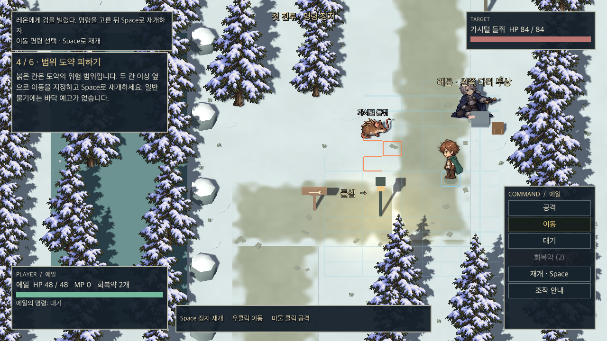
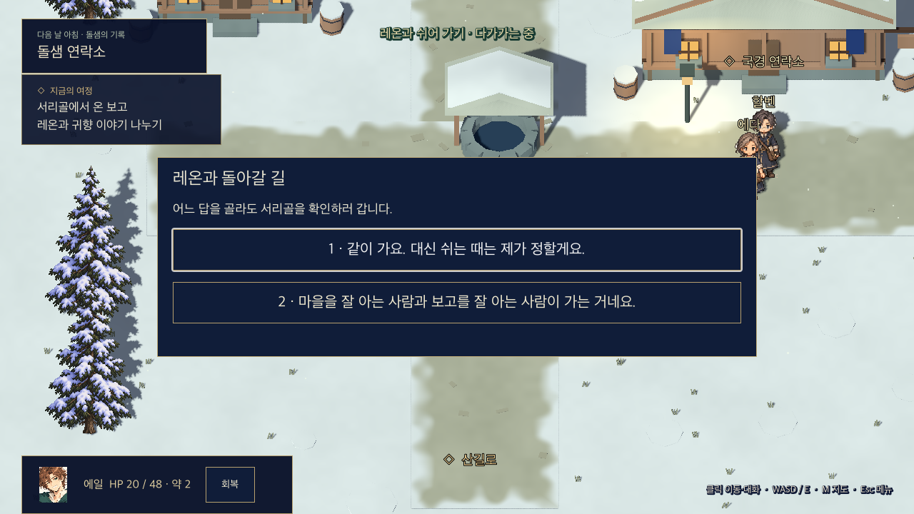
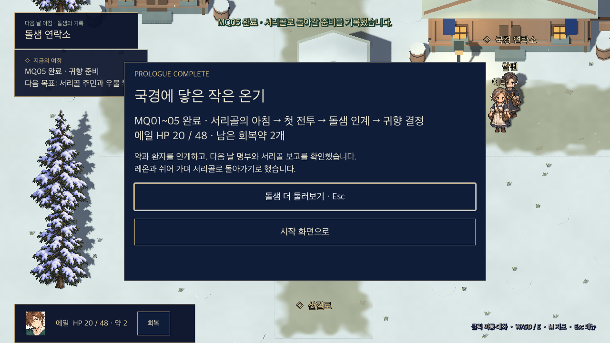

# 프롤로그 MQ01~05 게임 적용·E2E 검수

2026-11-06. 기준 main `d89ea2755b677416da3910c65224505457260f50`(PR13~20 병합). 실행 환경은 macOS 26.6.2 arm64 / Godot 4.6.3 Compatibility. 기존 로컬의 환경·동행·입력·음량/글자 설정 작업을 보존해 인수하고, 병합된 프롤로그 명세에 맞춰 확장했다.

## 실제 플레이 범위

새 게임 → 우물/여관 순서 자유 → 약 준비·출발 인사 → 산길·레온 발견 → 검 대여 → 정지/재개·이동·대기·범위 회피·실제 타격·선택적 회복 안내 → 승리·붕대 마무리 → 부상 레온 비전투 동행 → 돌샘의 약/환자/명부 인수 → 차·밤 경과 → 다음 날 명부·가동/결빙 기록 → 귀향 선택 A/B → 출발 확인·검 보관 기간 갱신 → MQ05 완료·MQ06 준비.

MQ06 이후 맵/사건은 이 변경에 구현하지 않았다. 완료 후 돌샘의 안전 지점에 머물고 다음 목표를 표시한다. 차를 마신 것과 프롤로그 완료를 별개 상태로 저장한다. 선택하기 전에 선택 결과나 완료를 저장하지 않는다. 기존 서술 원고는 게임 대사로 그대로 출력하지 않고 대사·안내와 실제 동작/장면 전환으로 나눈다.

## 전투·애셋 연결

- 입력 학습 중에는 적 공격을 보류한다. 목적지 선택만으로 이동을 완료하지 않고 실제 도착을 확인한다. 도착 시 자동 대기와 플레이어가 고른 대기 명령을 구분한다.
- 일반 물기에는 바닥 예고를 붙이지 않는다. 별도 범위 도약은 고정된 착지 영역을 예고하고 실제로 피해/회피를 판정한다. 실패하면 피해를 유지하고 다시 안내한다.
- 첫 유효 타격 직후 안내를 멈추며, 회복약 사용은 필수가 아니다. 배달 약은 전투 아이템이 아니다.
- PR14의 활성 SpriteFrames/rect/발 앵커를 사용한다. 에일 4방향 탐험·검 동작, 들쥐 동작, 레온 부상/검 건네기·느린 동행과 첫 승리 떨림을 연결했다. `prologue_motion.gd`가 클립을 소비한다.
- 기존 3D 환경43종과 해당 구간 소품을 사용하며, PR14의 마을/산길/국경/전투 BGM과 발·획득·UI·무기·피격·회복 음원을 연결한다. 카탈로그의 루프 지점을 사용하고 음악/효과음 음량을 분리한다.
- 동작 원본의 미술 승인과 인간형48×64 최종 픽셀 작업을 완료했다고 표시하지 않는다. 활성 클립 연결과 최종 미술 승인은 별개다. 최종 전편 음원 실청취·Windows 검수도 별도다.

## 저장과 회귀

저장 v4는 차/기록/선택/출발 상태를 분리한다. v1~v3를 읽을 때 원본 `.vN.bak`를 먼저 보존한다. 이미 동행/배달한 옛 기록은 첫 전투로 되돌리지 않으며, 실제 승리와 `legacy_skipped`를 구분한다. 잘못된 형식/위치는 현재 진행과 원본을 덮어쓰지 않는다. 저장 실패는 성공으로 안내하지 않는다.

재도전은 전투 전 HP/MP/위치/진행을 복원하고 소비품은 복구하지 않는다. 승리 후 처치·약 인계·차·밤 경과도 HP/MP를 자동 회복시키지 않는다. 대화·선택 중 수동 저장/불러오기를 막고, 창 포커스가 빠지면 실제 플레이를 정지한다.

## 재현

`프롤로그 플레이.command`로 플레이한다. Godot가 저장소 `.local`, 기존 작업 폴더의 형제 저장소 `.local`, `/Applications`, PATH 중 한 곳에 있으면 찾는다.

```sh
python3 tools/verify_prologue.py --engine /path/to/Godot --native
```

또는 `프롤로그 E2E 점검.command`. 각 실행은 별도의 QA 저장·설정·로그 폴더를 사용한다. 기본10검사(격자·이야기·환경·전투코어·표현·25계약·월드·전투통합·A/B 전체경로)와 `--native`의 실제 입력/렌더링 완주를 실행한다. 결과 경로를 마지막에 출력한다.

## 결과와 증거

[기계 판독 결과](verification/prologue-mq01-05/verification.json): 기본10검사 전부 통과. E2E는 진행 플래그/HP/아이템/좌표를 대입해 완료하지 않는다. 실제 맵 경로를 걷고 상호작용·명령 핸들러를 실행한다. 계약/회귀 검사는 별도로 경계 상태를 구성한다.

- 심부름 양 순서와 귀향 A/B를 각각 완주. 선택 조사 생략 경로도 완료.
- 실제 Godot 창의 완주 A, 실제 마우스로 귀향 B를 클릭한 완주 및 저장 복귀 통과. [네이티브 A](verification/prologue-mq01-05/native-a.json), [클릭 B](verification/prologue-mq01-05/native-click-b.json).
- 키보드 대상 확정·공격 버튼·마물 클릭·Space·우클릭 이동·Esc 취소·회복약·Enter 재도전의 실제 InputEvent/GUI 경로 통과.
- 패배·안내를 다시 보는 재도전·소비1회·소비품 미복구·약0개 전술 승리·승리 저장 후 재전투 차단 통과.
- 대화/선택 중 저장 차단, v1/v2/v3 백업·이관, 손상/미지원 저장과 쓰기 실패, 실제 범위 피격·재안내 등25계약 통과.
- 음소거와 큰 글자 설정의 실제 창에서 B 경로 완주·선택지/목표 줄바꿈 확인. [확대·음소거 결과](verification/prologue-mq01-05/native-large-muted-b.json).
- 각 경계 저장/불러오기 뒤 진행·HP·남은 약·지역·선택 결과 일치. 차 후 자동 회복 없음.

검수표 [A01~A35](scenario/prologue/acceptance.md)는 원래 인계 당시 상태를 보존한다. 이번 자동/네이티브 검수 증거는 위 결과에 연결한다. A18의 EXP/골드 보상 ledger는 이 구간에 아직 지급 기능이 없으므로 적용 대상이 아니다. A35의 독립 초견 플레이어 관찰, 전편 품질 승인과 Windows 실기는 수행하지 않았다. 자동 완주 시간은 사람이 대사를 읽는 플레이 시간으로 사용하지 않는다.




