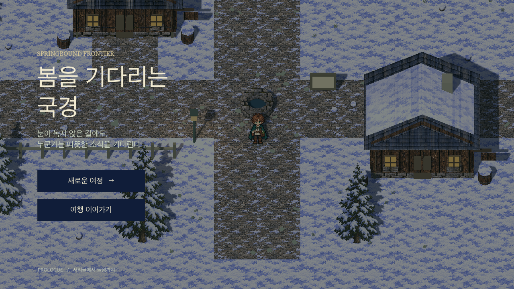
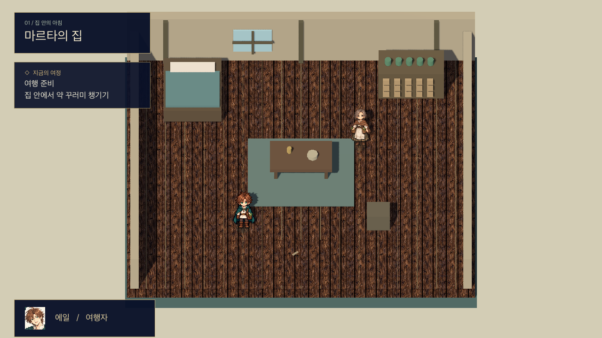
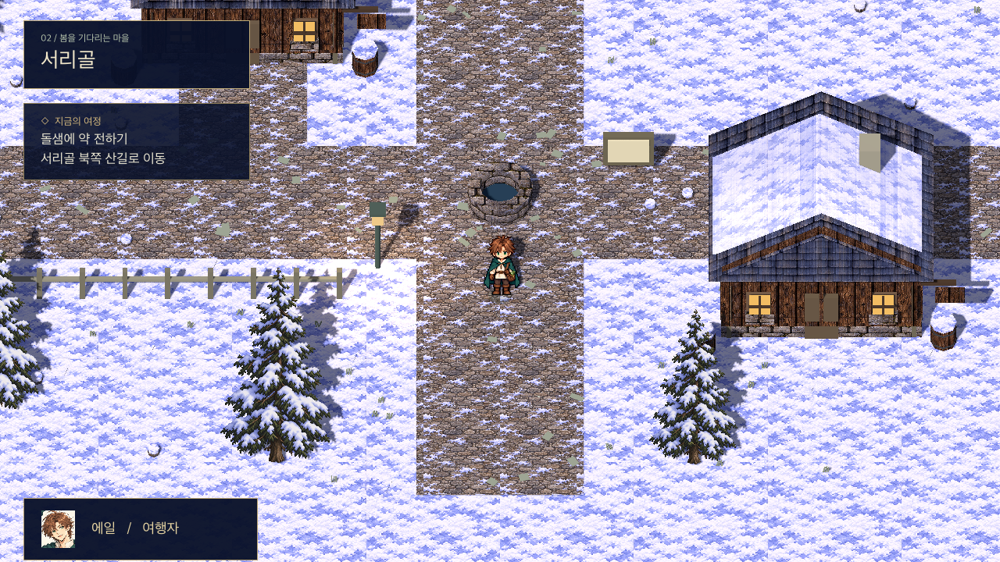
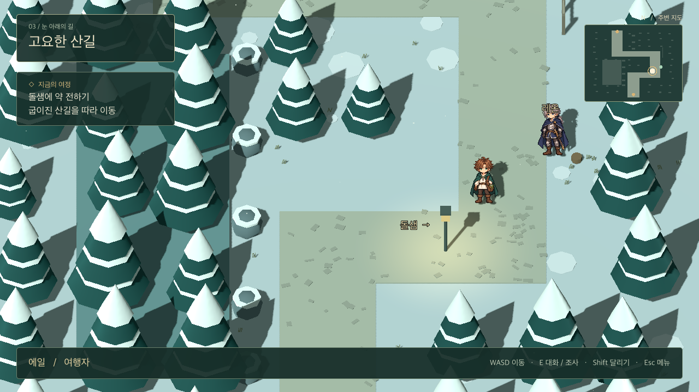
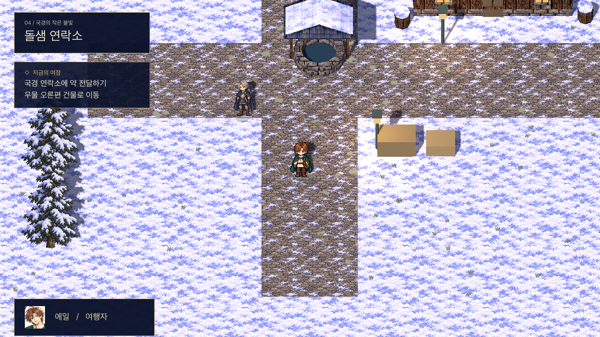
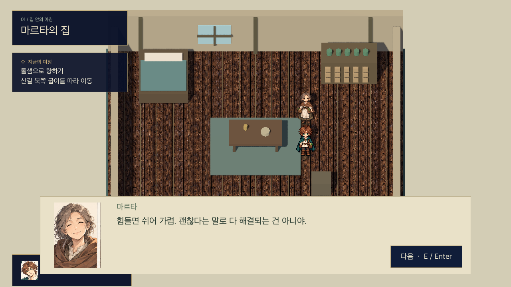
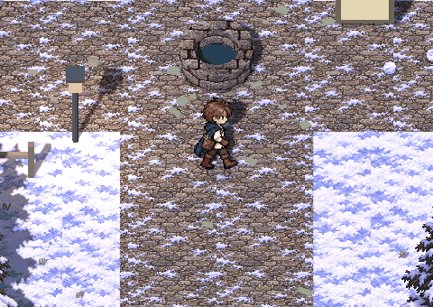
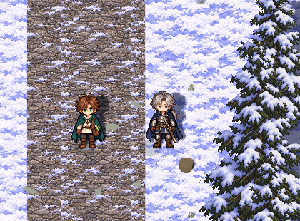

# 프롤로그 공간 · 실행 가능한 첫 이동 빌드

> 2026-10-30 업데이트: 아침 심부름·배달 준비·진행별 대화·NPC 7명·Tab 대화 기록을 연결했습니다. 최신 진행과 저장 v2 이관, 전체 대사는 [프롤로그 대화](prologue-dialogue.md)를 참고하세요. 아래 초기 빌드의 약을 바로 챙기는 순서는 새 게임에서 아침 심부름 뒤 준비하는 흐름으로 바뀌었습니다.

2026-10-27 · Godot 4.6.3 · Windows 출시 목표 / macOS 개발 테스트

## 실행

현재 Mac에서는 저장소 최상단의 `프롤로그 플레이.command`를 실행합니다. 로컬 도구 `.local/Godot.app`을 우선 사용하며, 해당 도구는 Git에 올리지 않습니다. 다른 컴퓨터에서는 Godot 4.6.3으로 `game/project.godot`를 열고 F6/F5로 실행할 수 있습니다. 공식 다운로드: https://godotengine.org/download/archive/4.6.3-stable/

## 화면과 이동 동선

| 화면 | 공간 구성 | 실제 이동·상호작용 |
|---|---|---|
| 시작 화면 | 서리골을 배경으로 제목과 새 여정·이어하기 | 새 여정은 집에서 시작. 저장 기록이 있을 때 이어하기 |
| 마르타의 집 | 침대·작업대·약 선반·중앙 탁자·남쪽 출입구 | 탁자를 돌아 약 꾸러미 조사 → 마르타 대화 → 남쪽 출구. 약 없이 출발하면 안내 |
| 서리골 | 집 출입구·중앙 우물·동서 길·북쪽 산길·게시판 | 집↔마을 왕복, 우물·집·울타리 충돌, 게시판 조사, 북쪽 산길로 이동 |
| 산길 | 남쪽 진입→동쪽 굽이→북쪽 길→서쪽 굽이→북쪽 출구 | 눈 덮인 나무와 계류 주변 통행 제한. 레온과 대화 후 돌샘 이동 가능 |
| 돌샘 | 남쪽 입구·중앙 우물·오른편 연락소·보급 상자 | 레온 대화, 연락소에서 약 전달, 산길로 돌아가기 |
| 대화·메뉴 | 캐릭터 초상화·대사·이어서 보기, 휴식 메뉴 | 대화 중 이동 정지, 수동 저장/불러오기, 글자 확대, 이동·상호작용 키 변경 |

## 조작

- WASD: 화면 기준 상하좌우 한 걸음 이동. 한 번 누르면 1.0 단위 한 칸을 완료합니다. 누르고 있으면 칸 끝에서 짧게 발을 딛고 다음 칸을 걷습니다. 동시 방향키를 눌러도 대각선으로 움직이지 않습니다.
- Shift: 달리기. E: 주변 대상 대화·조사·출입구 사용.
- 우클릭: 목적지 이동. 화면 축에 맞춘 한 칸 격자 A* 길찾기로 상하좌우만 사용해 장애물을 우회하며, WASD를 누르면 취소합니다.
- 마우스 휠: 고정 방향 카메라 확대·축소. 카메라는 가로 회전 없이 높이에서 내려다보며 에일을 따라가고 지도 경계에서 멈춥니다. 세로길은 화면 위아래로, 가로길은 좌우로 정렬합니다.
- Esc / Space: 메뉴·시간 정지. F5 저장, F9 불러오기, M 주변 지도 표시 전환.
- 대화는 E/Enter/Space 또는 다음 버튼으로 진행합니다. 상호작용 키를 변경하면 변경된 키도 적용됩니다.
- 휴식 메뉴에서 이동·상호작용 키를 변경할 수 있습니다. 중복 키와 메뉴·저장 등의 예약 키는 거절합니다. 키 설정은 `user://controls.cfg`에 저장합니다.

## 검증

Godot 4.6.3을 Apple M2 Mac의 OpenGL Compatibility 렌더러로 실행했습니다. 실시간 3D 화면 6장을 캡처하고 확인했습니다. 이번 초기 공간 빌드는 이 조합을 기준으로 하며, 출시용 렌더러·Windows 성능은 이후 검증합니다.

자동 검증 실행:

```sh
godot --headless --path game --quit-after 600 -- --qa
```

검증 내용: 네 맵의 시작 위치·모든 상호작용 지점의 연결성, 출입구 충돌, 탁자 충돌, 실제 이동 입력, 클릭 경로의 장애물 회피, 약 챙기기·레온 대화·전달 상태 변경, 저장/불러오기 왕복. 결과 `PROLOGUE_QA: PASS []`.

저장은 Godot의 플랫폼별 `user://prologue_save.json`에 기록합니다. 지도 전환과 약 전달 완료 시 자동 저장하며 수동 저장을 지원합니다. 현재는 단일 저장 기록으로, 정식 다중 슬롯 UI는 미구현입니다. 자동 검증은 기존 저장을 복원합니다.

## 이번 구현의 범위

이동 가능한 프롤로그 공간과 임시 대사 흐름입니다. 기존 프롤로그 이야기의 첫 마물 전투를 구현 완료한 것은 아닙니다. 공간 검증을 위해 레온 응급처치 대화에서 돌샘 이동으로 연결했으며, 최종 프롤로그에서는 그 사이에 확정된 첫 전투와 처치 마무리를 넣어야 합니다.

배경은 서리골 인게임 시안을 참고한 눈·돌길·목재·석재 재질, 눈 덮인 나무, 청색 UI를 적용한 초기 아트 패스입니다. 최종 배경 아트는 아닙니다. 캐릭터는 승인된 보드를 참고한 투명 도트 시안이며, 에일은 앞·뒤·옆의 정지·걷기 포즈를 사용하며, 좌우는 같은 걷기를 반전해 리듬과 발 위치를 통일했습니다. 이동 시 정지 이미지를 흔들지 않고 다리 자세가 다른 프레임을 재생하며 발 기준점은 고정합니다. 공격 프레임 애니메이션, 전투·아이템 소비, 동료 편성, BGM·효과음, 완성 시나리오 연출은 후속 작업입니다. 레온도 이 공간 빌드에서는 서 있는 임시 포즈입니다.

Windows·macOS 내보내기 프리셋을 추가했습니다. Windows 실행 파일 export 및 실제 Windows·Steam 실행 검증은 아직 수행하지 않았습니다. 내보내기에는 동일 버전의 공식 export templates가 필요합니다. macOS 내부 테스트 지원은 macOS 정식 출시 확정이 아닙니다.

## 실제 실행 화면








## 이동 수정 회귀 검증

```sh
godot --headless --path game --script res://tests/grid_walker_test.gd
```

단일 입력의 정확한 한 걸음, 이동 도중 방향 전환 방지, 대각선 거절, 충돌 통과 방지, 고정된 발 높이, 다리 프레임 전환·정지 포즈 복귀를 확인합니다. 전체 `--qa`는 배경 길의 화면 축 정렬, 두 방향 동시 입력과 목적지 이동의 대각선 차단도 확인합니다.

## 실제 걷기 미리보기

아래 GIF는 새 에셋을 별도로 합성한 콘셉트가 아니라 Godot에서 렌더링한 실제 걷기 프레임 64장을 이어 붙인 것입니다. 배경 길과 캐릭터가 화면 상하좌우에 정렬되어 있습니다.



레온 인게임 도트는 에일과 같은 머리·몸통·팔다리 비율로 재제작했으며, 키만 약 5% 크게 배치합니다.


