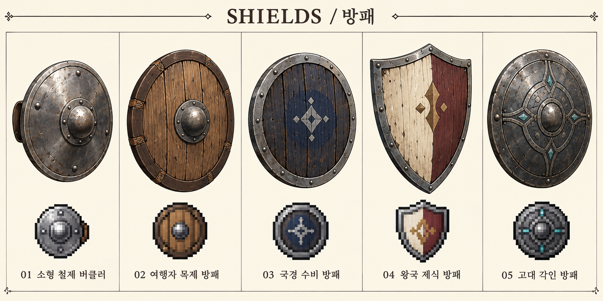

# 방패 조합과 에일 모션 추가

2026-10-29 · 기존 전투 모션 PR #7의 후속

## 적용 범위

사용자 요청에 따라 에일의 **한손검 + 방패**, **단검 + 소형 방패(버클러)** 조합을 추가합니다. 방패 없이 사용하는 기존 두 계열 자세를 삭제하지 않고 별도 장착 조합으로 관리합니다. 한손검·단검을 들었다는 이유만으로 방패를 자동 생성하지 않습니다.

한손검은 방패와 함께 쓰기 좋은 조합이며 단검도 작은 방패를 함께 사용할 수 있습니다. 모든 단검 사용자가 반드시 방패를 든다는 역사·원작 규칙으로 설명하지 않고 본작에서 지원할 장착 선택으로 다룹니다.

## 장착 분류와 기획 경계

- 방패는 무기와 별도인 **보조 방어 장비**로 분류합니다. 기존 ‘방어구·장신구 공용’ 원칙을 유지해 직업·성별만으로 방패를 제한하지 않습니다.
- 다만 두 손이 필요한 무기와의 동시 사용은 캐릭터 제한과 다른 **조합 호환성**입니다. 첫 제작안은 한손검·단검과 방패를 지원하고 활·양손으로 쓰는 창·지팡이와의 동시 사용은 보류합니다. 한손 창·지팡이 변형까지 영구 금지하는 확정 규칙은 아닙니다.
- 다른 캐릭터의 주무기는 기존 직업 범위를 따릅니다. 방패 공용이라는 이유로 레온이 모든 무기를 장착하지는 않습니다.
- 보조 슬롯 UI, 방패 장착/해제 가능 시점, 방어 수치·피해 감소·명중·속도·중량·스태미나·패링·반격은 아직 미정입니다.
- 방패 들어올리기와 충격 키포즈를 만들었다고 완벽 방어·수동 방어 버튼·무적 프레임을 도입한 것은 아닙니다. 기존 명령 중심 전투에 맞는 판정은 별도 검토합니다.
- 보유와 장착을 구분하고, 실제 아이템 ID와 장착 조합이 없는 상태에서 시각용 방패가 전투 중 나타나지 않도록 합니다.

## 에일의 시각 규칙

| 조합 | 오른손 | 왼손 | 공격 | 승리 |
|---|---|---|---|---|
| 한손검 + 방패 | 한손검 | 전완에 고정한 작은 원형 방패 | 방패를 전방에 두고 검으로 짧은 대각선 베기 | 칼끝·방패를 안전하게 내리고 숨을 고른 뒤 동료 확인 |
| 단검 + 버클러 | 전방 그립 단검 | 중앙 손잡이를 쥔 작은 철제 버클러 | 짧은 찌르기/베기, 버클러로 빈틈 보호 | 두 손 장비를 내리고 안심한 시선으로 동료 확인 |

기본 손 방향은 에일 기존 설정에 맞춰 오른손 주무기·왼손 방패입니다. 뒤/옆 방향과 좌우 반전에서도 이를 유지하도록 수정해야 합니다. 방패가 얼굴과 상대 행동을 과도하게 가리지 않게 하고, 가방·망토·무기와의 겹침을 검수합니다. 두 손이 장비를 들고 있으므로 승리 동작에서 빈손처럼 가슴을 만지거나 무기를 던지는 표현을 피합니다.

## 추가 시안

- 조합별 키포즈 시트 2장, 각 16포즈.
- 방패 외형·아이콘 비교 보드 1장, 5종: 소형 철제 버클러 / 여행자 목제 방패 / 국경 수비 방패 / 왕국 제식 방패 / 고대 각인 방패.
- 키포즈 읽는 순서: 앞 대기 / 오른쪽 대기 / 뒤 대기 / 공격 준비 / 타격 / 공격 회수 / 방패 들어올리기 / 방어 충격 / 방어 회수 / 피격 / 전투 불능 / 승리 시작 / 승리 숨고르기 / 승리 동료 확인 / 오른쪽 걷기 A / 오른쪽 걷기 B.

이미지들은 **조합·동작 방향의 참고**입니다. 16개 포즈가 그대로 연결되는 매끄러운 애니메이션이 아니며, 방어 판정·장비 코드·4방향 중간 프레임·투명 개별 프레임은 아직 없습니다. 방패 5종도 기존 아이템 PR #6의 80종에 추가되는 외형안이며 성능 순위가 아닙니다.

## 프롤로그 예외

레온이 빌려주는 것은 기존대로 검입니다. 방패 획득 사건·인벤토리가 없는 프롤로그에서 방패를 추가 지급하지 않고 **기존 검 단독 자세**로 첫 전투를 진행합니다. 방패 조합은 이후 실제 입수·장착 시 사용합니다. 첫 승리의 손 떨림·레온 확인·붕대 마무리도 유지합니다.

## 실제 제작·연결 전 확인

- [ ] 오른손 무기·왼손 방패가 모든 방향에서 유지되는가.
- [ ] 보조 장비가 바뀌어도 몸 크기·발 기준점·이동 간격이 유지되는가.
- [ ] 방패를 든 손으로 동시에 무기를 잡거나 물건을 사용하지 않는가.
- [ ] 공격·방어·피격 포즈가 분명히 구분되는가.
- [ ] 방패와 무기가 칸이나 화면에서 잘리지 않는가.
- [ ] 방패 없는 조합과 있는 조합을 실제 장비 데이터로 전환하는가.
- [ ] 장착 불가 조합의 처리와 저장/로드를 검증하는가.
- [ ] 방어 연출과 피해 계산, 아이템 사용, 승리 종료 이벤트가 중복되지 않는가.
- [ ] 첫 전투에 미획득 방패가 나타나지 않는가.

실제 프레임 분리와 재생 검증 후 모션 제작 기획의 완료 기준을 적용합니다. 런타임 구현 전에는 방어 효과의 크기나 발동 조건을 임의로 채우지 않습니다.

## 파일 보기

[통합 HTML 갤러리](../assets/combat-motion-boards/ael/index.html) · [모션 메타데이터](../assets/combat-motion-boards/ael/manifest.json) · [방패 메타데이터](../assets/shield-boards/manifest.json)

