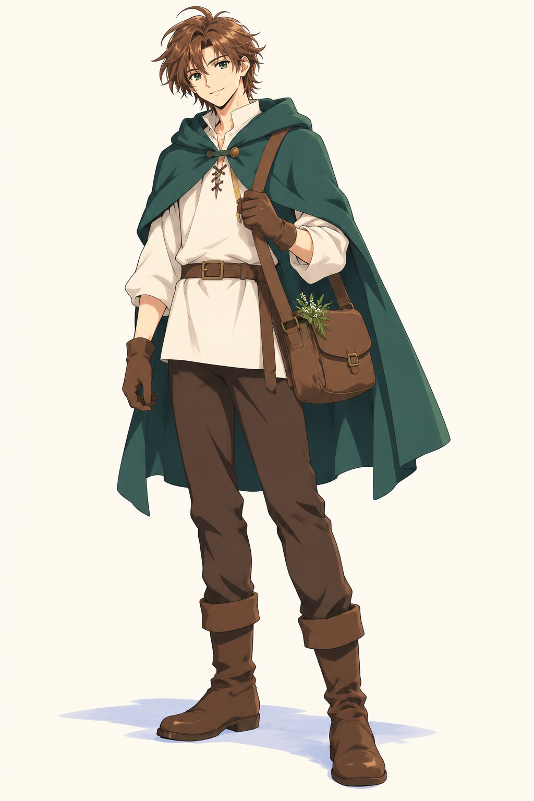
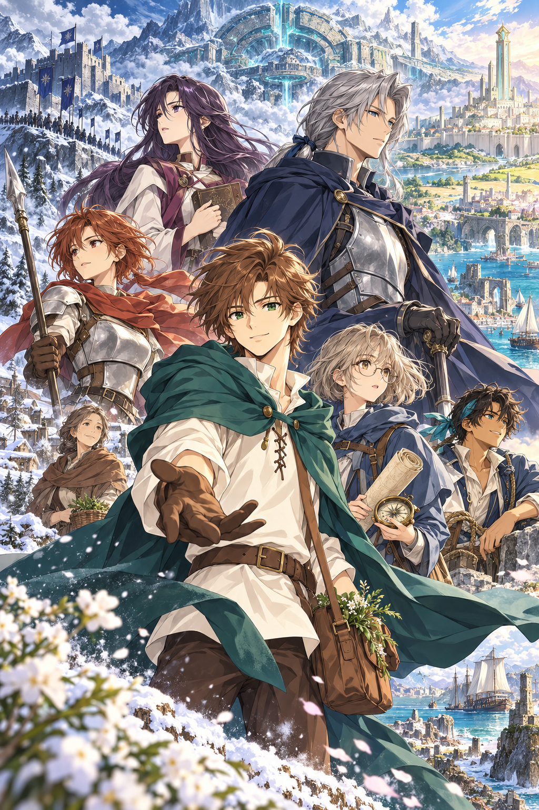
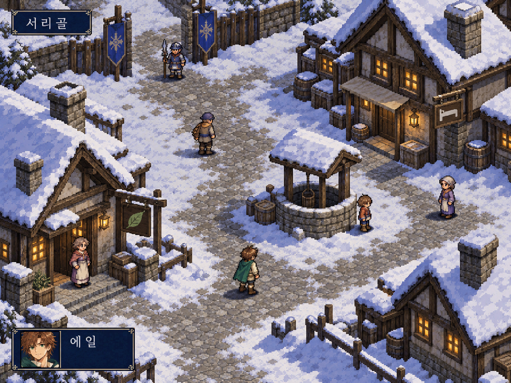
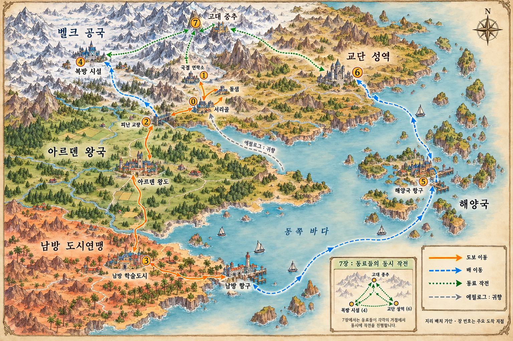

# 최신 이미지 시안

각 유형의 최신 버전만 수록합니다. 모두 AI 생성 콘셉트 이미지이며 완성 게임 에셋이나 확정 지리 명세가 아닙니다. 이전 버전은 업로드하지 않았습니다.

## 주인공 에일

장식을 줄인 최신 단독 시안. 캐릭터의 기본 의상과 장식 밀도 참고.

## 세계관과 등장인물

에일, 레온, 리아, 세나, 카이, 이리스, 마르타가 등장하는 표지 구도. 세부 의상과 지리는 가안.

## 서리골 인게임 화면

고정 사선 시점과 작은 2D 캐릭터의 미술 참고. 실제 동작하는 게임 화면이 아님.

## 월드맵과 이동 경로

최신 지도 시안이나 경로 오류가 남아 있음. 아래 정정 내용을 우선 적용.

## 월드맵 경로 정정

그림의 연결선 일부는 누락되었거나 잘못 연결되어 있습니다. 이미지를 그대로 이동 그래프로 구현하지 마세요.

본편의 의도한 순서:

서리골 → 돌샘·국경 연락소 → 서리골 귀환 → 피난 교량 → 아르덴 왕도 → 남방 학술도시·항구 → 북방 시설 → 해양국 → 교단 성역 → 고대 중추.

에필로그: **7번 고대 중추에서 출발하여 서리골로 귀향**한 뒤 레온의 고향을 방문합니다. 그림의 회색 귀향선이 중간 해안에서 시작하는 것처럼 보이는 부분은 오류입니다.

초록색 점선은 에일의 이동 경로가 아니라 마지막 동료 공동 작전의 연결입니다. 플레이어는 다른 팀으로 조작을 전환하지 않습니다. 지리 배치와 이동 수단의 상세는 후속 설계에서 검증합니다.
